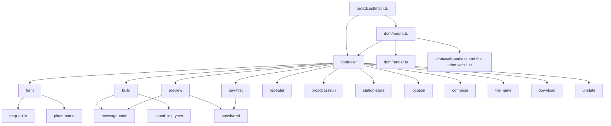
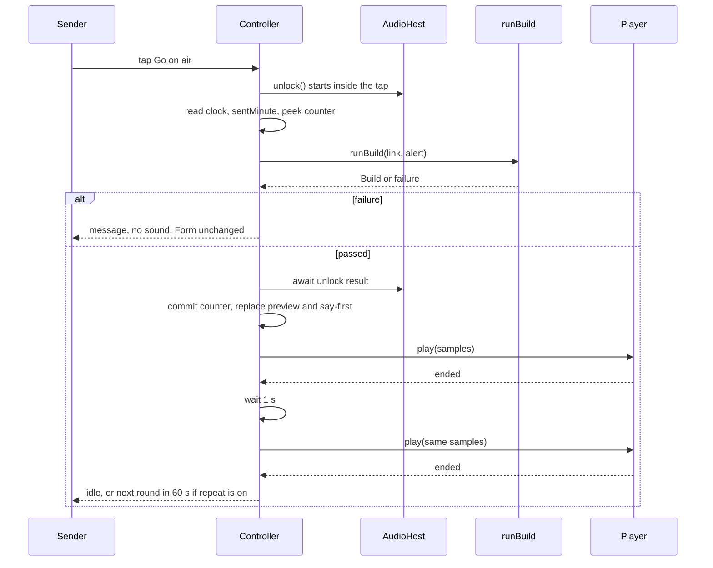

# Design Document

## Overview

The Broadcast page is the sender's page at `<base>broadcast/`. A sender fills in a short form. The page turns the form into an alert, makes the sound, checks the sound by decoding it in memory, shows what a listener will see, and plays the sound twice. It can repeat every minute and save the sound as a WAV file.

All decisions are made in plain TypeScript modules that use no browser API, so they run in Node under Vitest. A thin layer of DOM code reads the form, draws the state and starts the real audio, location and wake lock. There is no UI framework and no new dependency.

The page uses `src/message-code/` and `src/sound-link/` only through their `index.ts` files. It does not edit them.

This document follows the approved `requirements.md`. Each decision below was checked against the existing code, the steering files and a real Vite build (see "Settings the build needs").

### Design decisions

| Decision | Choice | Reason |
|---|---|---|
| Logic and DOM are split by folder | Logic in `src/broadcast/` and `src/shared/`, compiled with no DOM library. DOM code only in `src/broadcast/dom/` and `broadcast/main.ts` | Logic is tested in plain Node (Requirement 15.1). The type checker stops logic from using `document` or `window` by accident. |
| One controller holds all page state | `createBroadcastController(deps)` owns a `ViewState` and has one method per user action. The DOM layer calls the methods and draws the state | The glue then has no decisions in it. Everything in Requirements 1 to 12 is testable with fakes. |
| Everything outside the controller is injected | Sound link, clock, timers, storage, audio host and player, geolocation, wake lock and downloader are passed in as small interfaces | Tests use fakes that count calls, throw, or fail. |
| The state holds keys, not English | Messages are `{ key, params }`. The DOM layer fills them from the strings file | Requirement 14.6 and 14.7. A language file with the same keys replaces `strings.en.ts` and no logic changes. |
| Build is synchronous | `runBuild` calls `encodeAlert`, `bytesToAudio`, a listener and `decodeMessage` in one call with no `await` | The sound link calls are synchronous. This removes any chance of two builds overlapping, so at most one listener is open (Requirement 6.9). A timer and a generation number only decide which draft is current. |
| Counter is peeked, then committed | A Build reads the saved counter without saving it. The counter is saved as counter plus 1 only after the Build passed and, for Go on air, the audio context is ready | A draft or a failed Build never uses up a counter (Requirement 4.6, 7.3). |
| Same bytes everywhere | A passed Build is kept as a `Build` object. Replays, repeat rounds and Save reuse its `samples` and `bytes` | Requirement 7.5, 11.2. |
| Map point text is parsed as text | Latitude and longitude are parsed from decimal digits into integer units of 0.0001 degree by string arithmetic, not by `Number(text) * 10000` | `12.34565 * 10000` gives 123456.49999999999 in floating point. The string rule gives 123457 as Requirement 3.2 says. |
| Preview is built from the decoded alert | `buildPreview(decoded, nowMs, offsetMinutes, draft)` takes no form value | Requirement 8.1. What the sender sees is what a listener would decode (promise 1). |
| Status is recomputed every second | The controller runs a one second timer that rebuilds the preview status from `checkExpiry` and the clock | A preview left open must not keep saying `current` after the alert expires (promise 2). The same timer drives the repeat countdown. |
| Audio context made inside the tap | `audio.unlock()` is the first call in `goOnAir()`, before the Build, and it starts synchronously | Phone browsers only allow it inside a tap (sound rules, Requirement 10.1). |
| Two plays use a timer gap | Play 1 resolves when the sound ends. A timer waits 1000 ms. Then play 2 starts | Simple and testable with an injected player. The tolerance in Requirement 10.4 is 0.25 s. |
| TEST confirmation is a `<dialog>` | Opened with `showModal()`. The Esc key counts as cancel | `<dialog>` is in all current browsers and needs no framework. The text comes from the strings file. |
| ggwave needs no Vite setting | Verified in a real build (see below) | Requirement 13.6. |
| Browser check is a script, not a test | `npm run check:browser` runs headless Chrome. It is not in `npm test` or CI | Playwright would be a new dependency, which needs approval. |

### Research notes

- **ggwave in a Vite page.** A page that imports `loadSoundLink` builds with no special setting. Vite prints two warnings that `path` and `fs` were externalized for browser compatibility. They come from a Node-only branch in `ggwave.js` that never runs in a browser. The output is one JS file of about 138 kB (60 kB gzip) with the engine embedded as base64. There is no `.wasm` request, no `http(s)` URL and no `require("fs")` in the output. It loaded and returned `ok` in headless Google Chrome served from a local static server.
- **Why a Self_Check needs trailing silence.** ggwave reports a payload after the end marker and a few silent frames. The Self_Check appends 2 seconds of zeros after the sound, as the sound link report advises. The played audio does not include this silence.
- **Zero payloads.** 21 bytes of 0x00 come back from ggwave as 16 bytes. This cannot happen for a real alert, because the version and check bytes are not zero. The Self_Check compares byte for byte, so it would fail if it did.
- **Wake lock.** `navigator.wakeLock.request('screen')` can be refused, and the browser releases the lock when the tab is hidden. The page must ask again when the tab is visible. Source: [Screen Wake Lock API on MDN](https://developer.mozilla.org/en-US/docs/Web/API/Screen_Wake_Lock_API). Content was rephrased for compliance with licensing restrictions.
- **AudioContext sample rate.** The `sampleRate` option of `new AudioContext` is not honoured by every browser. When `ctx.sampleRate` differs, the page creates the `AudioBuffer` at the link rate and the browser resamples while playing (Requirement 10.12). Source: [AudioContext constructor on MDN](https://developer.mozilla.org/en-US/docs/Web/API/AudioContext/AudioContext).

## Architecture

### Files

```
broadcast/
  index.html          markup with ids and data-text keys, no visible English text (Requirement 14.6)
  main.ts             entry point, about 15 lines: load the sound link once, build the controller, call mountPage
src/shared/                     helpers the Listen page will reuse
  fill.ts             fillTemplate(template, params): string | null
  time.ts             formatUtc(ms), formatLocal(ms, offsetMinutes), formatClock(ms, offsetMinutes)
  labels.ts           labelFor(map, code)
  strings-shape.ts    type helpers: SameKeys<A, B>, Placeholders
src/broadcast/                  logic: no DOM library, no browser API
  index.ts            public entry for tests
  strings.types.ts    the Strings type, TextKey, the allowed placeholders per key
  strings.en.ts       every user-facing string (English)
  valid-for.ts        the nine valid-for choices
  map-point.ts        parseCoordinate, unitsToDegreesText, formatDegrees
  place-name.ts       bytesLeft(placeName)
  form.ts             RawForm, FormModel, FieldErrors, initialForm, validateForm
  snapshot.ts         formSnapshot(model): string
  station-store.ts    createStationStore(storage)
  build.ts            toAlert, sentMinuteFrom, runBuild, selfCheck
  compose.ts          composeBroadcastAudio(samples, rate)
  file-name.ts        wavFileName(alert)
  preview.ts          buildPreview
  say-first.ts        buildSayFirst
  ui-state.ts         deriveControls(state): which control is enabled
  broadcast-run.ts    runBroadcast: play, gap, play
  repeater.ts         createRepeater
  providers.ts        Player, AudioHost, GeolocationProvider, WakeLockProvider, Clock, Timers, Downloader types
  location.ts         requestLocation
  download.ts         createDownloader
  controller.ts       createBroadcastController, ViewState
  dom/                DOM glue, compiled with the DOM library
    ids.ts            ELEMENT_IDS, the ids that index.html must contain
    mount.ts          mountPage(controller, strings, win)
    render.ts         draws ViewState, fills data-text, fills selects
    web-audio.ts      createWebAudioHost
    web-location.ts   createGeolocationProvider
    web-wake-lock.ts  createWakeLockProvider
    web-download.ts   Blob, object URL and anchor click
    web-platform.ts   clock, timers, storage lookup in try/catch
tsconfig.broadcast-logic.json   no DOM library, types: [], includes the logic and the two modules it uses
tsconfig.broadcast-page.json    DOM library, includes everything the page compiles
scripts/check-broadcast-browser.mjs   headless Chrome check (not part of npm test)
scripts/browser-harness.html          page the check serves next to the built site
tests/broadcast/
  fakes.ts            fake clock, timers, storage, player, audio host, geolocation, wake lock, link
  generators.ts       fast-check arbitraries
  fixtures.ts         sample alerts and forms, all with test: true
  node-extra.d.ts     declares the parts of node:child_process, node:fs and process the tests use
  *.test.ts           see the test plan
.kiro/specs/broadcast-page/report.md   written near the end of this spec
```

`src/shared/` has no import from `src/broadcast/`. `src/broadcast/` (except `dom/`) imports from `src/shared/`, `src/message-code/index.ts` and, for types and in tests the loader, `src/sound-link/index.ts`. Only `broadcast/main.ts` calls `loadSoundLink`.

### Module dependencies



### Go on air



## Components and Interfaces

### Strings

```ts
// strings.types.ts
export type FieldName = keyof Alert;
export type ValidForKey = 'm15' | 'm30' | 'h1' | 'h2' | 'h3' | 'h6' | 'h12' | 'h24' | 'h48';

export interface Strings {
  labels: {
    event: Record<EventType, string>;
    urgency: Record<Urgency, string>;
    severity: Record<Severity, string>;
    action: Record<Action, string>;
    status: Record<ExpiryStatus, string>;          // current, expired, sent-in-future, clock-unknown
    validFor: Record<ValidForKey, string>;
    field: Record<FieldName, string>;              // names used in error messages
    decodeReason: Record<DecodeRejectionReason, string>;
    audioReason: Record<'not-bytes' | 'too-short' | 'too-long' | 'engine-error' | 'disposed', string>;
    wavReason: Record<'not-float32' | 'empty' | 'not-finite' | 'bad-sample-rate', string>;
  };
  text: Record<TextKey, string>;
}
```

`TextKey` is a string union listed in `strings.types.ts`. It covers: page title and headings, every form label, the "Choose" option, the nine button and switch texts, each validation message (`err.map.need-both`, `err.map.not-a-number`, `err.map.out-of-range`, `err.station`, `err.placeName.too-long`, `err.placeName.bad-char`), the encode failure messages, `check.failed`, `bytesLeft`, `loading`, `engine.failed`, `on-air`, `stopped`, `repeat.keep-open`, `repeat.round`, `repeat.countdown`, `repeat.missed`, `repeat.expired`, `wake.on`, `wake.off`, `wake.unsupported`, `wake.refused`, `location.*` (five outcomes and two reasons the button is off), `storage.unavailable`, `clock.bad`, `audio.unavailable`, `test.banner`, `test.dialog`, `test.dialog.confirm`, `test.dialog.cancel`, `real.notice`, `draft.label`, `preview.*`, `no-map-point`, and the Say_First templates.

Rules:
- `test.dialog` is exactly `This will send a real alert. Are you sure?` (Requirement 5.4 and 5.11).
- Templates use `{name}` placeholders. `fillTemplate` returns `null` when the template is missing or empty, or when a placeholder has no parameter. The caller then shows `err.sayfirst`. `PLACEHOLDERS` in `strings.types.ts` lists the allowed placeholders for each key, and a test checks every English template against it.
- A second language file is typed `Strings`, so a missing key is a compile error (Requirement 14.7).
- No emoji. A test scans for `\p{Extended_Pictographic}`.

```ts
export type Msg = { key: TextKey; params?: Record<string, string | number> };
```

### Form and validation (`form.ts`, `map-point.ts`, `place-name.ts`, `valid-for.ts`)

```ts
export interface RawForm {            // exactly what the boxes hold, as text
  event: string; urgency: string; severity: string; action: string;   // '' means not chosen
  placeName: string; latitude: string; longitude: string;
  validFor: ValidForKey;               // starts at 'h1'
  stationId: string;
  test: boolean;                       // starts true
  repeat: boolean;                     // starts false
}

export interface FormModel {
  event: EventType; urgency: Urgency; severity: Severity; action: Action;
  placeName: string;
  latitude: number | null; longitude: number | null;   // units of 0.0001 degree, both null or both numbers
  validSteps: number; stationId: number; test: boolean;
}

export type FieldError =
  | { field: 'event' | 'urgency' | 'severity' | 'action'; code: 'not-chosen' }
  | { field: 'placeName'; code: 'too-long' | 'bad-char' }
  | { field: 'latitude' | 'longitude'; code: 'not-a-number' | 'out-of-range' | 'need-both' }
  | { field: 'stationId'; code: 'invalid' };

export type FormCheck =
  | { ok: true; model: FormModel }
  | { ok: false; errors: FieldError[] };

export function validateForm(raw: RawForm): FormCheck;
export function parseCoordinate(text: string, limitUnits: number):
  | { ok: true; units: number | null }                       // null when the text is empty
  | { ok: false; code: 'not-a-number' | 'out-of-range' };
export function formatDegrees(units: number): string;       // 4 decimals, "-0.0000" never appears
export function bytesLeft(placeName: string):
  | { ok: true; left: number }
  | { ok: false; code: 'too-long' | 'bad-char' };
```

`validateForm` never throws and never changes the raw form. The sender's text stays in the boxes (Requirements 1.8 and 3.8).

**Coordinate grammar.** After trimming outer spaces: an optional `+` or `-`, then digits, optionally one `.` or `,` and more digits, or a decimal mark followed by digits. Anything else is `not-a-number` (letters, inner spaces, two marks, thousands separators, exponent). Empty text means no value.

**Units from text, no floating point.** Split into sign, integer digits and fraction digits. Strip leading zeros from the integer part. If the integer part has more than 3 digits, return `out-of-range` right away. Otherwise `units = integer * 10000 + first four fraction digits (padded with zeros)`. If the fifth fraction digit is 5 or more, add 1 (half away from zero, applied to the absolute value). Apply the sign. `-0` becomes `0`. Then check against the limit: 900000 for latitude, 1800000 for longitude.

**Map point.** Both parse to `null` gives `latitude: null, longitude: null`. Exactly one `null` gives `need-both` on the empty box. 0 and 0 is never used for no point (Requirement 3.5).

**Place name.** `bytesLeft` builds a probe alert with fixed valid values for every other field (event `flood`, urgency `unknown`, and so on) and calls `encodeAlert`. On success the answer is `40 - bytes.length`. A rejection with `place-name-too-long` gives `too-long`. A rejection with `invalid-field` for `placeName` gives `bad-char`. Any other rejection cannot happen with the fixed probe values. The file never imports `encodePlaceName` (Requirement 2.6).

**Valid-for choices.** `VALID_FOR = [{ key: 'm15', steps: 1 }, { key: 'm30', steps: 2 }, { key: 'h1', steps: 4 }, { key: 'h2', steps: 8 }, { key: 'h3', steps: 12 }, { key: 'h6', steps: 24 }, { key: 'h12', steps: 48 }, { key: 'h24', steps: 96 }, { key: 'h48', steps: 192 }]`.

**Station ID.** `/^\d{1,5}$/` and a value of at most 65535. Anything else is `invalid`.

**Snapshot.** `formSnapshot(model)` returns `JSON.stringify` of an array of the model fields in a fixed order, including `test`. Two raw forms that validate to equal models give equal snapshots. Repeat is not part of it. The snapshot decides whether Save can reuse the last Build (Requirement 12.3).

### Station store (`station-store.ts`)

```ts
export interface KeyValueStore { getItem(key: string): string | null; setItem(key: string, value: string): void; }
export const STATION_ID_KEY = 'dead-air.broadcast.stationId';
export const COUNTER_KEY = 'dead-air.broadcast.counter';

export interface StationStore {
  readonly persistent: boolean;             // false after any read or write threw, or when storage is null
  readStationId(): number | null;
  writeStationId(id: number): void;
  peekCounter(): number;                    // 0 to 255, does not save
  commitCounter(used: number): void;        // saves (used + 1) % 256
}
export function createStationStore(storage: KeyValueStore | null): StationStore;
```

It keeps an in-memory copy of both values. A read or write that throws sets `persistent` to false and the page shows `storage.unavailable`. A stored value that is not a whole number in range (`/^\d{1,5}$/` and in range for the station ID, `/^\d{1,3}$/` and at most 255 for the counter) is ignored. These two keys are the only things the page writes anywhere (Requirement 4.8). The keys are names, not paths.

### Build and Self_Check (`build.ts`)

```ts
export type LinkLike = Pick<SoundLink, 'bytesToAudio' | 'createListener' | 'sampleRate'>;

export interface Build {
  readonly alert: Alert;            // the source alert
  readonly decoded: Alert;          // what decodeMessage returned
  readonly bytes: Uint8Array;       // Alert_Bytes
  readonly samples: Float32Array;   // one Play, without the check silence
  readonly sampleRate: number;
  readonly draft: boolean;
}

export type BuildFailure =
  | { kind: 'encode'; reason: 'invalid-field' | 'place-name-too-long'; field: FieldName }
  | { kind: 'audio'; reason: AudioFailReason }
  | { kind: 'check'; why: 'listener-unavailable' | 'no-payload' | 'many-payloads' | 'payload-differs' | 'feed-failed' }
  | { kind: 'check'; why: 'decode-rejected'; reason: DecodeRejectionReason }
  | { kind: 'check'; why: 'field-differs'; field: FieldName };

export type BuildResult = { ok: true; build: Build } | { ok: false; failure: BuildFailure };

export function sentMinuteFrom(nowMs: number): number | null;   // null for NaN, infinite, negative, or above 4294967295 minutes
export function toAlert(model: FormModel, sentMinute: number, counter: number): Alert;  // passedOn is false
export function runBuild(link: LinkLike, alert: Alert, draft: boolean): BuildResult;
```

`sentMinuteFrom(nowMs)` is `Math.floor(nowMs / 60000)` after the checks.

`runBuild` steps:
1. `encodeAlert(alert)`. On rejection return `kind: 'encode'` and call nothing else.
2. `link.bytesToAudio(bytes)`. On `ok: false` return `kind: 'audio'`.
3. Copy the samples into a new array that has 2 seconds of zeros added (`2 * sampleRate` samples). This copy is only for the check.
4. `link.createListener()`. On `ok: false` return `check / listener-unavailable`.
5. In `try`, feed the copy to the listener in chunks of 1024. If any `feed` returns `ok: false`, return `feed-failed`. Collect payloads.
6. In `finally`, call `listener.dispose()`. This runs on every path, including a throw (Requirement 6.9). A throw from the listener becomes `feed-failed`.
7. Exactly one payload is required: none is `no-payload`, two or more is `many-payloads`, one that differs from `bytes` byte for byte is `payload-differs`.
8. `decodeMessage(payload)`. A rejection is `decode-rejected`.
9. Compare all 13 fields of the decoded alert with the source alert using `===`. The first difference is `field-differs`. This is null-safe for latitude and longitude, because `null === null`.
10. Return the `Build` with the original `samples`, not the padded copy.

A failure result has no `samples` field, so nothing can play or be saved from it (Requirement 6.8). No audio is written to storage, logs or any request.

### Preview and Say_First (`preview.ts`, `say-first.ts`)

```ts
export interface PreviewModel {
  draft: boolean;
  test: boolean;                    // true shows the TEST banner
  event: EventType; urgency: Urgency; severity: Severity; action: Action;
  placeName: string | null;         // null when empty
  stationId: number; counter: number;
  map: { kind: 'none' } | { kind: 'point'; latitude: string; longitude: string };   // "12.3456", from units
  sent:  { utc: string; local: string };         // minute precision, always present
  until: { utc: string; local: string };
  status: ExpiryStatus;             // from checkExpiry
}
export function buildPreview(decoded: Alert, nowMs: number, offsetMinutes: number, draft: boolean): PreviewModel;

export type SayFirst = { ok: true; text: string } | { ok: false };
export function buildSayFirst(decoded: Alert, strings: Strings, offsetMinutes: number): SayFirst;
```

The preview model holds codes and formatted values only. `render.ts` turns codes into words with the strings file. A point at 0, 0 gives `kind: 'point'` with `"0.0000"` and `"0.0000"`. `null, null` gives `kind: 'none'` and the page shows `no-map-point`.

Say_First sentence order: the test sentence when `test` is true, then `{event}. {action}.`, then the place sentence when the name is not empty, then `Sent at {time}. Valid for {duration}.` Each part is a separate template. The parts are joined with one space. The place part is left out whole when the name is empty, so no empty placeholder, doubled space or stray punctuation appears (Requirement 9.4). If any template, event label, action label or the duration label is missing, the result is `{ ok: false }` and the page shows `err.sayfirst` instead of part of a line. The line is text only. The page never calls speech output (Requirement 9.8).

Time helpers in `src/shared/time.ts` take an offset in minutes and use no clock and no time zone database:
- `formatUtc(ms)` gives `YYYY-MM-DD HH:MM UTC`.
- `formatLocal(ms, offsetMinutes)` gives the same fields shifted by the offset, ending in `UTC+05:30` style text.
- `formatClock(ms, offsetMinutes)` gives `HH:MM` for the Say_First line.

The DOM layer supplies `-new Date(ms).getTimezoneOffset()`.

### Composing the sound (`compose.ts`)

```ts
export function composeBroadcastAudio(samples: Float32Array, sampleRate: number): Float32Array;
```

Returns a new array of length `2 * samples.length + Math.round(1.0 * sampleRate)`: the samples, then zeros, then the samples. The WAV file uses `audioToWav(composeBroadcastAudio(...), sampleRate)`. A Broadcast does not use this array. It plays `samples` twice with a timed gap (Requirement 10.5).

### Playing and the double play (`providers.ts`, `broadcast-run.ts`)

```ts
export interface Clock { now(): number }                               // epoch milliseconds
export interface Timers {
  setTimeout(fn: () => void, ms: number): unknown;
  clearTimeout(handle: unknown): void;
}
export interface Player {
  play(samples: Float32Array, sampleRate: number): Promise<void>;     // resolves at the end of the sound, or when stop() is called; rejects on a playback error
  stop(): void;                                                         // silences within 0.25 s and makes the pending play() resolve
}
export interface AudioHost {
  unlock(): Promise<boolean>;     // creates or resumes the context; called inside the tap; false when it cannot
  readonly player: Player;
}

export const PLAY_GAP_MS = 1000;
export interface BroadcastRun { done: Promise<'finished' | 'stopped'>; stop(): void }
export function runBroadcast(player: Player, timers: Timers, build: Build): BroadcastRun;
```

`runBroadcast` plays `build.samples`, waits `PLAY_GAP_MS` on a timer after the first play resolves, plays the same array again, then resolves `finished`. `stop()` sets a flag, clears the gap timer, calls `player.stop()` and resolves `stopped`. After `stop()` no second play can start.

### Repeat (`repeater.ts`)

```ts
export const REPEAT_INTERVAL_MS = 60000;
export interface RepeaterEvents {
  startRound(round: number, info: { skipped: number; late: boolean }): Promise<void>;   // plays one Broadcast; resolves when it ends or is stopped
  onTick(info: { round: number; secondsToNext: number | null }): void;
  onEnd(reason: 'stopped' | 'expired'): void;
}
export interface Repeater {
  start(): void;                 // first round now
  visibilityChanged(visible: boolean): void;
  stop(): void;
  readonly roundsStarted: number;
}
export function createRepeater(opts: { clock: Clock; timers: Timers; expiresAtMs: number; events: RepeaterEvents }): Repeater;
```

Round times come from the clock and one anchor, never from counting ticks (Requirement 11.7):
- `anchorMs` is the start time of the first round. `anchorRound` is 1.
- Round `k` is due at `anchorMs + (k - anchorRound) * 60000`.
- A timer is set for the next due time minus `clock.now()`. When it fires, `checkRounds('timer')` runs.
- `checkRounds(source)`: let `now = clock.now()`. If `now >= expiresAtMs`, end with `expired` (after the playing round finishes, if one is playing). Otherwise let `dueCount` be the highest round number due at `now`. If `dueCount > roundsStarted` and no round is playing, start exactly one round. `skipped = dueCount - roundsStarted - 1`. The new round becomes the anchor, so the next one is 60 s after it (Requirement 11.8). `late` is true when `source` is `visible`, or when `skipped > 0`.
- `visibilityChanged(true)` calls `checkRounds('visible')`.
- An expiry timer is set for `expiresAtMs`. When it fires and a round is playing, the end is held until that round finishes. No round starts at or after `expiresAtMs`.
- `stop()` clears all timers, ends with `stopped`, and the controller stops the player.
- A one second tick timer calls `onTick` with `secondsToNext = ceil((nextDue - now) / 1000)`, or `null` when the next round would start at or after the expiry.

### Location (`location.ts`)

```ts
export type Position = { latitude: number; longitude: number };
export type LocationFailure = 'refused' | 'unavailable' | 'timeout' | 'no-api';
export interface GeolocationProvider {
  availability(): { ok: true } | { ok: false; reason: 'no-api' | 'insecure' };
  getPosition(timeoutMs: number): Promise<{ ok: true; position: Position } | { ok: false; reason: LocationFailure }>;
}
export const LOCATION_TIMEOUT_MS = 15000;
```

`availability()` is read once when the page starts. It does not ask for permission. `getPosition` is called only from the Location_Button handler, once per tap, with 15000. On success the controller writes `formatDegrees` text to both boxes (4 decimals, a dot) and runs the normal validation. On failure it sets a message by reason and leaves both boxes as they were. Nothing is saved.

The browser may use device location services to answer. That is not a request made by the page, so promise 4 still holds (Requirement 3.15).

### Wake lock

```ts
export interface WakeLockHandle { release(): Promise<void>; onRelease(cb: () => void): void }
export interface WakeLockProvider {
  readonly supported: boolean;
  request(): Promise<WakeLockHandle | null>;   // null when refused
}
```

The controller requests it when repeat starts (inside the tap flow), requests again on `visibilityChanged(true)` if the handle was released, and releases it on Stop and when repeat ends. The state `wake` is one of `on`, `off`, `unsupported`, `refused` and has a message for each. A missing or failing provider never stops the repeat (Requirement 11.14).

### Download (`download.ts`, `file-name.ts`)

```ts
export interface DownloadPlatform {
  makeUrl(bytes: Uint8Array, mime: string): string;     // Blob and URL.createObjectURL in the browser
  revoke(url: string): void;
  clickAnchor(url: string, fileName: string): void;
  timers: Timers;
}
export const REVOKE_AFTER_MS = 5000;
export function createDownloader(p: DownloadPlatform): { save(bytes: Uint8Array, fileName: string): void };
export function wavFileName(alert: Alert): string;
```

`save` makes the URL, clicks the anchor, and revokes the URL after 5000 ms, which is inside the 10 second limit (Requirement 12.6). `wavFileName` gives `dead-air-<test|alert>-<event>-<YYYYMMDDTHHMM>Z-s<stationId>-n<counter>.wav`, using the alert's `sentMinute` in UTC and decimal numbers with no leading zeros.

### Controller (`controller.ts`)

```ts
export type Phase = 'loading' | 'engine-failed' | 'idle' | 'building' | 'on-air' | 'repeating';

export interface ViewState {
  phase: Phase;
  form: RawForm;
  errors: FieldError[];
  bytesLeft: { kind: 'number'; left: number } | { kind: 'error'; code: 'too-long' | 'bad-char' };
  controls: Controls;                       // from deriveControls: which control is enabled or hidden
  dialogOpen: boolean;                      // the TEST confirmation
  preview: PreviewModel | null;
  sayFirst: SayFirst | null;
  sayFirstError: boolean;
  notices: Msg[];                           // status line, in order
  banner: Msg | null;                       // build failure, clock, audio
  repeat: { round: number; secondsToNext: number | null; sentUtc: string; wake: 'on' | 'off' | 'unsupported' | 'refused' } | null;
  location: { available: boolean; whyNot: Msg | null; message: Msg | null };
  stationIdRemembered: boolean;
}

export interface Controller {
  readonly state: ViewState;
  subscribe(fn: (s: ViewState) => void): () => void;
  engineLoaded(link: LinkLike | null): void;     // null when loadSoundLink returned ok: false
  setField<K extends keyof RawForm>(key: K, value: RawForm[K]): void;   // test: false goes through requestTest
  requestTest(on: boolean): void;                // off opens the dialog, on applies at once
  confirmReal(): void;
  cancelReal(): void;
  goOnAir(): Promise<void>;
  stop(): void;
  save(): Promise<void>;
  useLocation(): Promise<void>;
  visibilityChanged(visible: boolean): void;
}

export interface ControllerDeps {
  clock: Clock; timers: Timers; storage: KeyValueStore | null;
  audio: AudioHost; geolocation: GeolocationProvider; wakeLock: WakeLockProvider;
  downloader: { save(bytes: Uint8Array, fileName: string): void };
  strings: Strings; offsetMinutes(ms: number): number;
}
```

**Per action.**
- `setField`: update the raw form, run `validateForm` and `bytesLeft`, and update the encode-and-decode preview synchronously. If the field is the station ID and it is valid, save it. Then restart the 150 ms draft timer. The preview update is synchronous, so it is far inside 500 ms (Requirement 8.11).
- Draft timer fires: if the form is valid and phase is `idle`, `runBuild(link, toAlert(model, sentMinuteFrom(now), store.peekCounter()), true)`. The result sets `preview` (labelled draft) and `sayFirst`, or shows the check failure. A generation number discards a result if the form changed during the wait. A draft never saves the counter and never plays.
- Why the preview shows earlier than the Self_Check: until the first Build the draft preview is produced by encode followed by decode, which already runs the check value. It is marked as a draft and as "sound check pending" until the draft Self_Check ends. See Notes for review.
- `goOnAir`: described in the sequence diagram. Details: ignore the call unless `controls.goOnAir` is enabled. Start `audio.unlock()` first, with no `await` before it. Read the clock once. If `sentMinuteFrom` is `null`, show `clock.bad`, start no Play and change nothing in the form. Run `runBuild(..., false)`. On failure show the message, discard everything, and stay `idle`. On success `await` the unlock result. If it is `false`, show `audio.unavailable`, play nothing, and stay `idle` with Go on air enabled (Requirement 10.10). Otherwise commit the counter, store the Build as `lastBuild` with its snapshot, replace the preview and Say_First with the ones from the Build, set the phase to `on-air` (or `repeating` when the repeat box is checked), and run the Broadcast. When the box is checked, create the repeater with `expiresAtMs` from `checkExpiry(decoded, now).expiresAtMs`, request the wake lock and start round 1 through the repeater.
- `stop`: stop the repeater and the current run, call `player.stop()`, release the wake lock, clear the countdown, enable the form, phase `idle`.
- `save`: needs a ready link and a valid form, and does not call `audio.unlock()` (Requirement 12.7). If `lastBuild` exists, its snapshot equals the current form snapshot, and `checkExpiry(lastBuild.decoded, now).status` is `current`, reuse its samples and counter. Otherwise run a new Build with a new `sentMinute`, peek and commit a new counter, and make it the new `lastBuild`. Then `audioToWav(composeBroadcastAudio(samples, rate), rate)`. If the Build fails, download nothing and show `check.failed`. If `audioToWav` fails, download nothing, show the reason, and keep the form and the previous preview.
- `useLocation`: described in the Location section.
- `requestTest(false)` sets `dialogOpen`. The switch stays on until `confirmReal`. `cancelReal` closes the dialog. `requestTest(true)` applies at once with no dialog. The starting value of `test` is always `true`, with no stored value read (Requirement 5.1).
- `visibilityChanged`: passes to the repeater and, when repeating, re-requests a released wake lock.
- The one second tick timer rebuilds `preview.status` from the clock and updates the countdown.

**Two kinds of state.** `lastBuild` is the Build of the latest Go on air or Save. While a Broadcast or repeat runs, the form is disabled and the running Build is never replaced (Requirements 7.5 and 7.7).

### Control states (`ui-state.ts`)

| State | Form inputs | Repeat box | Go on air | Stop | Save | Location button |
|---|---|---|---|---|---|---|
| `loading` | enabled | enabled | disabled, loading text shown | disabled | disabled | enabled if available |
| `engine-failed` | enabled | enabled | disabled, failure text shown | disabled | disabled | enabled if available |
| `idle`, form invalid | enabled | enabled | disabled | disabled | disabled | enabled if available |
| `idle`, form valid | enabled | enabled | enabled | disabled | enabled | enabled if available |
| `building` | disabled | disabled | disabled | disabled | disabled | disabled |
| `on-air` | disabled | disabled | disabled | enabled | disabled | disabled |
| `repeating` | disabled | disabled | disabled | enabled | disabled | disabled |
| TEST dialog open | the dialog is modal, the page behind it is inert | | | | | |

The Location button is hidden, or shown disabled with the reason, when `availability()` is not ok. Save is disabled while a Broadcast or repeat plays, to keep the running alert and the preview the same (a choice, see Notes for review).

### Markup and DOM layer (`broadcast/index.html`, `src/broadcast/dom/`)

The HTML holds plain semantic structure with no visible text. Each text element carries `data-text="<TextKey>"`, and `render.ts` fills it from the strings. The page title is set from the strings too. The static `<title>` is the brand name only.

```
<main>
  <nav> two links: href="../" and href="../listen/" (relative, so they work under any base)
  <form id="alert-form" autocomplete="off"> labels, selects, inputs
  #alert-form fields:    f-event f-urgency f-severity f-action (select, first option is "Choose")
                         f-place (text, with #place-left for bytes left) f-lat f-lon (type text, inputmode decimal)
                         f-valid (select, nine options) f-station (inputmode numeric)
                         f-test (checkbox, role switch) f-repeat (checkbox)
  #btn-location  #btn-go  #btn-stop  #btn-save
  #dialog-test (dialog) with #dialog-confirm and #dialog-cancel
  #status (aria-live polite)  #banner (role alert, for failures)
  #preview  #say-first  #countdown  #repeat-info
  <script type="module" src="./main.ts">
```

- The script path is relative. Vite rewrites it under `base`, so it works under a sub-path and at the root (Requirement 14.9).
- `autocomplete="off"` on the form and an explicit assignment on start stop the browser from restoring an old TEST or repeat state after a reload. `mount.ts` sets `f-test.checked = true` and `f-repeat.checked = false` before anything else.
- `ELEMENT_IDS` in `dom/ids.ts` lists every id above. A test reads `index.html` and checks that each id exists once and that each `data-text` key is a `TextKey`. The glue gets elements with a helper that throws at start when an id is missing.
- The glue never writes to `localStorage` directly. It gives `web-platform.ts` storage to the controller, in a `try/catch`, and passes `null` when access throws.
- `web-audio.ts`: `unlock()` runs `new AudioContext({ sampleRate: 48000 })` with a `webkitAudioContext` fallback, then `resume()` when suspended. If the constructor throws on the option, it tries without the option. The player makes an `AudioBuffer` with `ctx.createBuffer(1, n, linkRate)`, copies the samples, plays it with an `AudioBufferSourceNode` and resolves on `ended`. `stop()` calls `source.stop()`. When `ctx.sampleRate` differs from the link rate this is the same code path, so the browser resamples (Requirement 10.12).
- `web-location.ts`: `navigator.geolocation.getCurrentPosition` with `{ timeout, maximumAge: 0, enableHighAccuracy: false }`. Error code 1 is `refused`, 2 is `unavailable`, 3 is `timeout`. The call is reached only from the button handler.
- `web-wake-lock.ts`: wraps `navigator.wakeLock.request('screen')`, with `supported` false when the API is missing.
- `mount.ts` registers `visibilitychange` and passes it to the controller. It registers no service worker (Requirement 14.10).

## Data Models

| Type | Where | Notes |
|---|---|---|
| `RawForm` | `form.ts` | Text as typed. Initial: nothing chosen, `validFor: 'h1'`, `test: true`, `repeat: false`. |
| `FormModel` | `form.ts` | Valid values. Map point is integer units or null and null. |
| `Alert` | message code | Built by `toAlert`: `passedOn: false`, `counter` from the store, `sentMinute` from the clock. |
| `Build` | `build.ts` | `alert`, `decoded`, `bytes`, `samples`, `sampleRate`, `draft`. Never holds the check silence. |
| `lastBuild` | controller | `{ build, snapshot }` of the last Go on air or Save. |
| `Msg` | `strings.types.ts` | `{ key, params }`. No English in state. |
| Station_Store | `localStorage` | Two keys only. Station ID and counter as decimal text. |

### Sample sizes

At 48000 Hz a 40-byte payload is a few seconds of sound. The exact figure is in the sound link report. A WAV with two plays and the gap is `44 + 2 * (2 * n + 48000)` bytes for `n` samples per play.

## Settings the build needs

Answer to Requirement 13.6 to 13.8.

- **`vite.config.ts`: no change.** ggwave builds with the existing settings. The three-page `rollupOptions.input` and the `base` handling stay as they are.
- **Expected warnings.** Vite prints two warnings that `path` and `fs` were externalized for browser compatibility. They come from a Node-only branch of `ggwave.js` that the browser never runs. They are not errors. The build test accepts them and fails on any other warning that is not about those two modules.
- **No `.wasm` request.** The engine is embedded as base64 in the JS file.
- **`tsconfig.broadcast-logic.json`:** `target ES2022`, `module ESNext`, `moduleResolution Bundler`, `lib ["ES2022"]`, `types []`, `strict`, `noEmit`, `skipLibCheck`, `isolatedModules`. `include`: `src/broadcast`, `src/shared`, `src/message-code`, `src/sound-link`. `exclude`: `src/broadcast/dom`.
- **`tsconfig.broadcast-page.json`:** the same, with `lib ["ES2022", "DOM", "DOM.Iterable"]` and `types ["vite/client"]`. `include`: `broadcast/main.ts`, `src/broadcast`, `src/shared`, `src/message-code`, `src/sound-link`.
- **`tsconfig.json` (existing):** add `"exclude": ["src/broadcast/dom"]`. It has no DOM library and checks `src` and `tests`, so it would reject the glue. The glue is checked by the page config instead.
- **`package.json`:**
  - `typecheck` becomes `tsc -p tsconfig.message-code.json --noEmit && tsc -p tsconfig.sound-link.json --noEmit && tsc -p tsconfig.broadcast-logic.json --noEmit && tsc -p tsconfig.broadcast-page.json --noEmit && tsc -p tsconfig.json --noEmit`.
  - New script `check:browser`: `node scripts/check-broadcast-browser.mjs`. It is not called by `test`, `build` or the deploy workflow.
  - No new dependency. No `@types/node`.
- The `.github/workflows/deploy.yml` file is not changed. It already runs `typecheck` and `test`, and the build test runs inside `test`.

The files outside this spec's folders that the tasks will touch are `package.json`, `tsconfig.json`, and the new files listed above. They are listed here so they can be approved with this design.

## Correctness Properties

*A property is a characteristic or behavior that should hold true across all valid executions of a system-essentially, a formal statement about what the system should do. Properties serve as the bridge between human-readable specifications and machine-verifiable correctness guarantees.*

### Property 1: A Build passes the Self_Check and decodes to its source

*For any* valid form (with a map point or with both boxes empty, TEST on or off), a Build at a clock time and counter yields an alert with `passedOn` false, `test` equal to the switch, the given `sentMinute` and `counter`, `latitude` and `longitude` both null when both boxes were empty, and the Self_Check passes with a decoded alert equal to the source alert in all 13 fields. This runs on the real sound link.

**Validates: Requirements 1.9, 3.5, 5.2, 5.3, 6.1, 6.3, 7.1, 15.2**

### Property 2: Any changed heard byte is caught

*For any* Alert_Bytes value, any position, and any different byte value from 0 to 255, a listener that returns the changed bytes makes the Self_Check fail and returns no audio.

**Validates: Requirements 6.7, 15.3**

### Property 3: Bad listener results fail, return no audio, and the listener is closed

*For any* injected listener result that is not exactly one payload equal to the Alert_Bytes (no payload, two or more payloads, one payload with different bytes, a failed feed, a thrown error), the Self_Check fails, the result carries no samples, and the number of open listeners is 0 afterwards.

**Validates: Requirements 6.6, 6.8, 6.9, 15.4**

### Property 4: The test sentence appears if and only if the alert is a test

*For any* decoded alert built from a valid form, the Say_First line contains the test sentence from the strings file if and only if `test` is true, and when it does, the test sentence comes first.

**Validates: Requirements 9.5, 9.6, 15.5**

### Property 5: The Say_First line is well formed with and without a place name

*For any* decoded alert, the Say_First line contains the event label, the action label, the local sent time as hours and minutes and the valid-for label. It contains the place name when the name is not empty. When the name is empty it has no doubled space, no leading or trailing space and no empty placeholder.

**Validates: Requirements 9.1, 9.2, 9.3, 9.4**

### Property 6: Bytes left equals 40 minus the encoded length

*For any* place name (including Devanagari, Bengali, Gurmukhi, Gujarati, Odia, Tamil, Telugu, Kannada and Malayalam text), `bytesLeft` is `ok` with `left = 40 - encodeAlert(...).bytes.length` when `encodeAlert` accepts the name, is `too-long` or `bad-char` when it rejects it, and in the rejected case the form is invalid and Go on air is disabled.

**Validates: Requirements 2.1, 2.2, 2.3, 2.4, 2.5, 15.6**

### Property 7: An expired alert is never shown as current

*For any* decoded alert and any clock time, the preview status equals `checkExpiry(...).status`, and when that status is not `current` the preview status is not `current` and the sent time is present.

**Validates: Requirements 8.5, 8.6, 15.7**

### Property 8: Map point text converts to units within half a unit

*For any* latitude in -90 to 90 and longitude in -180 to 180 written as decimal text with up to six decimals, the units differ from the written value by at most 0.00005 degree, and the value on a tie is rounded away from zero.

**Validates: Requirements 3.2, 15.9**

### Property 9: Comma and dot are the same, and non-numbers are rejected

*For any* valid coordinate text, replacing its dot with a comma gives the same units. *For any* text with letters, inner spaces, two decimal marks, a thousands separator or exponent notation, the result is `not-a-number`.

**Validates: Requirements 3.6, 3.7**

### Property 10: Validation accepts a form exactly when every rule holds

*For any* raw form built from structured generators (chosen or empty selects, place names, coordinate text, station ID text), `validateForm` is `ok` if and only if all four selects are chosen, the place name is accepted by `encodeAlert`, the map point is both empty or both valid and in range, and the station ID is 1 to 5 digits and at most 65535. Every failing rule has an error naming its field, and the raw form is left unchanged.

**Validates: Requirements 1.7, 1.8, 3.3, 3.4, 3.5, 4.1, 4.2**

### Property 11: The station store accepts only valid stored values and round trips

*For any* stored string, `readStationId` and `peekCounter` return the number only when the string is canonical decimal in range, and fall back to null and 0 otherwise. *For any* station ID from 0 to 65535, writing then reading returns the same value. The fake storage holds only the two keys.

**Validates: Requirements 4.3, 4.4, 4.8, 4.10**

### Property 12: Repeat rounds are 60 s apart, identical, and stop at the valid-until time

*For any* start time, `validSteps` from 1 to 255 and any sequence of clock advances, the repeater starts rounds at `start + 60000 * k`, always with the same bytes, never starts a round at or after `expiresAtMs`, ends with `expired` at that time, and after `stop` starts no round. Form edits and clock minute changes during the run do not change the bytes.

**Validates: Requirements 7.5, 7.7, 11.2, 11.5, 11.6, 11.7**

### Property 13: A hidden tab gets exactly one catch-up round

*For any* hidden time longer than one interval and shorter than the time to expiry, when the page becomes visible the repeater starts exactly one round, reports `skipped` equal to the due rounds minus one, and schedules the next round 60 s after that round started. If the valid-until time has passed it starts none.

**Validates: Requirements 11.8**

### Property 14: Two plays use the same samples with a 1 s gap, and the file has the same audio

*For any* sample array and sample rate, a Broadcast calls the player twice with the same array, starts the second play 1000 ms after the first resolved, and `composeBroadcastAudio` has length `2 * n + round(rate)` with the samples, then zeros, then the samples.

**Validates: Requirements 10.3, 10.4, 10.5, 12.1, 12.2**

### Property 15: The form snapshot is equal exactly when the models are equal

*For any* two valid form models, `formSnapshot` is equal if and only if every field, including `test`, is equal.

**Validates: Requirements 12.3, 12.4**

### Property 16: The file name follows the pattern and reads back

*For any* alert, `wavFileName` matches `dead-air-(test|alert)-<event>-<YYYYMMDDTHHMM>Z-s<id>-n<counter>.wav`, and parsing it gives back `test`, `event`, the UTC sent minute, `stationId` and `counter`.

**Validates: Requirements 12.5**

### Property 17: The preview map and banner follow the decoded alert

*For any* decoded alert, `map.kind` is `none` if and only if `latitude` is null, a point shows both numbers as `units / 10000` with 4 decimals (including 0, 0), and the TEST banner is present if and only if `test` is true.

**Validates: Requirements 5.8, 5.9, 8.3, 8.7, 8.8, 8.13, 15.22**

### Property 18: Sent minute comes from the clock, and a bad clock is refused

*For any* finite clock value from 0 to 4294967295 minutes, `sentMinuteFrom` returns `floor(ms / 60000)`. *For any* NaN, infinite, negative or too large value it returns null, and Go on air starts no play and leaves the form unchanged.

**Validates: Requirements 7.1, 7.2**

### Property 19: A found location fills both boxes with four decimals

*For any* position inside the valid range, the two boxes hold the four-decimal text, parse to units within 0.00005 of the position, and the saved storage keys are unchanged.

**Validates: Requirements 3.12, 3.15**

### Reflection on overlap

- Requirements 1.9, 5.2, 5.3 and 7.1 are checked inside Property 1, which already builds with real values, so they have no property of their own.
- Properties 2 and 3 stay separate. Property 2 changes one byte and needs the decode check. Property 3 checks listener counts and shapes.
- Property 9 and Property 10 are separate because Property 9 is about text grammar and Property 10 is the whole-form rule.
- The counter wrap (Requirement 15.8) is a finite set of 256 values, so it is an exhaustive test and not a property.

## Error Handling

| Situation | What happens |
|---|---|
| `loadSoundLink` returns `ok: false` | Phase `engine-failed`. Go on air and Save are disabled. The rest of the form works (Requirement 13.4). |
| Link still loading | Phase `loading`. Go on air and Save are disabled with the loading text. |
| `encodeAlert` rejects | No audio call. The reason and field are shown in words. The form is unchanged. |
| `bytesToAudio` fails | Reason shown. No play. |
| Self_Check fails | The failure message and detail (reason or field name) are shown. No play, no WAV, no preview and no Say_First for that Build. Samples are dropped. |
| Listener throws | Counted as `feed-failed`. The listener is disposed in `finally`. |
| Clock not usable | `clock.bad` is shown. No play. Form unchanged. |
| Audio context cannot be made | `audio.unavailable`. No play. Go on air stays enabled. |
| Player rejects while playing | Stop the run and repeat, release the wake lock, show `audio.unavailable`, return to `idle`. |
| Storage missing or throws | Memory copy used. `storage.unavailable` is shown. |
| Geolocation fails | The four reasons each have a message. Boxes unchanged. |
| Wake lock missing or refused | Repeat goes on. `wake.unsupported` or `wake.refused` is shown with the keep-open notice. |
| `audioToWav` fails | Reason shown. Nothing downloaded. Form and previous preview unchanged. |
| Missing string or template | Say_First shows `err.sayfirst`. A test makes sure the shipped file has every key. |

The logic never throws to the page for bad input. The DOM layer wraps each handler in one `try/catch` that shows `err.unexpected` and returns to `idle`.

## Testing Strategy

The message code, form, build, preview, Say_First, repeat and store are pure or injected, so property tests apply. The DOM glue, the audio hardware and the page look are not suited to property tests. They get build checks, source scans and the headless Chrome script.

Property tests use fast-check 4.10.3 with a fixed seed and at least 100 runs each. Each property test has a comment `Feature: broadcast-page, Property N: <title>`. Each property is one test. Tests that use the real sound link load it once in `beforeAll`. Every fixture and generated alert has `test: true`, except where a property needs both values (Properties 1, 4 and 17), where the test flag is the generated input and a separate check makes sure no fixture file has `test: false`.

| File | What it covers | Requirements |
|---|---|---|
| `build.property.test.ts` | Properties 1, 2, 3, 18 (real link for 1, fake link for 2 and 3). A 40-byte timing example under 15 s | 1.9, 3.5, 5.2, 5.3, 6.1 to 6.9, 7.1, 7.2, 15.2 to 15.4 |
| `build-examples.test.ts` | Encode rejection means no `bytesToAudio` call, audio failure, listener unavailable, decode rejection, field difference with a null-safe comparison | 6.4, 6.5, 6.7 |
| `form.property.test.ts` | Properties 8, 9, 10 | 1.7, 1.8, 3.2 to 3.7, 4.1, 4.2, 15.9 |
| `place-name.property.test.ts` | Property 6 with an Indic-script generator, the empty name example (19 left) | 2, 15.6 |
| `station-store.test.ts` | Property 11, counter wrap for all 256 values, throwing storage, null storage, only two keys written | 4, 15.8, 15.14 |
| `say-first.property.test.ts` | Properties 4 and 5, a deleted template gives `ok: false` | 9, 15.5 |
| `preview.property.test.ts` | Properties 7 and 17, local and UTC format with several offsets | 5.8, 5.9, 7.6, 8, 15.7, 15.22 |
| `repeat.property.test.ts` | Properties 12 and 13 with a fake clock and fake timers. Example: Stop within a playing round, wake lock requested at start, again after visible, released on Stop and on end, missing provider | 11, 15.11, 15.21 |
| `broadcast-run.test.ts` | Property 14, no player call before the tap, none after a failed Self_Check, Stop cancels the second play | 10, 12.1, 12.2, 15.12 |
| `controller.test.ts` | TEST dialog (cancel, confirm, on without dialog, exact text), initial state (TEST on, repeat off, nothing chosen, `h1`), phases and control table, Go on air flow with fakes, save reuse and rebuild, Property 15 and 19, draft does not use the counter, draft labelled, one listener open at a time, Location button (zero calls before tap, success, four failures), no storage write of a position | 1, 3.8 to 3.15, 4.7, 5, 6.10, 6.11, 7.3 to 7.5, 10, 12.3, 12.4, 12.7 to 12.9, 13.4, 13.5, 15.10, 15.20 |
| `file-name.property.test.ts` | Property 16 | 12.5 |
| `download.test.ts` | URL revoked at 5000 ms, anchor clicked once, Save makes no audio unlock | 12.6, 12.7 |
| `strings.test.ts` | Non-empty label for every event, urgency, severity, action, status, valid-for choice and field; every `TextKey` has a value; placeholders match the table; no emoji; the dialog text matches exactly; `index.html` ids and `data-text` keys | 1.3, 1.4, 5.11, 14.5 to 14.8, 15.13 |
| `fixtures.test.ts` | Every fixture alert and form has `test: true` | 15.18 |
| `boundary.test.ts` | Source scan of `src/broadcast` (outside `dom/`) and `src/shared`: no `document`, `window`, `navigator`, `localStorage`, `fetch`, `XMLHttpRequest`, `getUserMedia`, `serviceWorker`, `speechSynthesis`, no import of `encodePlaceName`. Scan of `dom/` and `broadcast/main.ts`: no `fetch`, `XMLHttpRequest`, `sendBeacon`, `WebSocket`, `getUserMedia`, `serviceWorker`. `loadSoundLink` is called once | 2.6, 6.2, 6.12, 9.8, 13.1, 14.1, 14.4, 14.10 |
| `build-site.test.ts` | Runs `vite build` twice in a child process (`BASE_PATH=dead-air`, and `BASE_PATH` empty) into folders under `node_modules/.cache/dead-air-broadcast-build/`, with a long timeout. See below | 1.1, 1.10, 13.2, 13.6, 13.8, 14.1 to 14.3, 14.9, 15.15 |

**Build test.** It runs `process.execPath` with `node_modules/vite/bin/vite.js build --outDir <dir> --emptyOutDir`. It fails on a non-zero exit. It reads the output and checks that every line that mentions "externalized" names only `path` or `fs`. For both builds it checks:
- `broadcast/index.html` exists in the output.
- Every `src` and `href` in it resolves to a file: absolute paths start with the base (`/dead-air/` or `/`) and exist after the base is removed, and relative paths like `../listen/` resolve against `broadcast/` to a folder that has an `index.html`.
- The linked JS file contains the engine marker (the base64 text `AGFzbQ`, which is the start of a WebAssembly file) and is larger than 100 kB.
- None of the broadcast page's files (html, js, css) contain `http://` or `https://`, a `.wasm` reference, or an image file name from the front page.
- The `input` keys of the build output still include the front page, `listen` and `broadcast`.

The test needs `process` and `node:child_process`. `tests/broadcast/node-extra.d.ts` declares only the parts used (the same way `tests/sound-link/node-fs.d.ts` does for `node:fs`). No `@types/node` is added.

**DOM glue tests.** The glue is small enough that the logic tests cover its decisions. DOM-level behavior is checked by the headless Chrome script.

### Headless Chrome check (Requirement 15.16)

`npm run check:browser` runs `scripts/check-broadcast-browser.mjs`, a plain Node script with no new dependency. It:
1. Finds Chrome from the `CHROME_PATH` environment variable, or `/Applications/Google Chrome.app/Contents/MacOS/Google Chrome`. If none exists it prints "not run" and exits with code 2.
2. Builds the site with `BASE_PATH` unset into `node_modules/.cache/dead-air-browser-check/`.
3. Starts a static server with `node:http` on port 0 (a free port). It serves the built site and, at `/__harness/`, the file `scripts/browser-harness.html`. It records every request path.
4. Starts Chrome with `--headless=new --disable-gpu --autoplay-policy=no-user-gesture-required --virtual-time-budget=20000 --dump-dom http://127.0.0.1:<port>/__harness/`.
5. The harness page opens `/broadcast/` in a same-origin iframe, waits for the sound engine, picks a value in each select, types a station ID, sets a map point, clicks Go on air, and then reads the iframe. It writes `PASS` or `FAIL <reason>` into `<pre id="result">`. PASS needs: a TEST banner in the preview, a Say_First line, the on-air message shown, and Stop enabled. It does not wait for the sound to end, because virtual time does not drive real audio.
6. The script reads the dumped DOM, prints the result, and checks that the recorded requests are only the site's own files with no `.wasm` file.
7. Exit code 0 on PASS, 1 on FAIL, 2 when not run.

This check is not in `npm test` and not in CI. The report lists it as "not run in CI: needs an installed Chrome and a free local port" and records the result of the owner's run if there was one (Requirement 15.17). A change in any element id breaks the harness, and the check says so in its output.

### Manual checks (Requirement 15.19)

Real phone sample rate (`ctx.sampleRate` and whether the resample path was used), real phone Build timing, real speaker and phone test including whether the second play is heard after the 1 s gap, geolocation on a real phone, wake lock on a real phone, and a hidden-tab test with repeat on a real phone. The report lists each as not done by code tests.

### Report file

`.kiro/specs/broadcast-page/report.md` is written by the last task. It states that promise 6 is not met on this page for icons until spec 8, because the page shows text labels only. It lists the manual checks above and the headless Chrome result or "not run".

## Promise checks

| Promise | How this design keeps it |
|---|---|
| 1. Never show a damaged alert | The preview is built from bytes that went through `decodeMessage`, which checks the CRC-32 first. The Self_Check compares the heard payload byte for byte. A failure shows no alert content. |
| 2. Never show an expired alert as current | The preview status comes from `checkExpiry` and is recomputed every second. The sent time is always shown. Repeat ends at the valid-until time. |
| 3. Test alerts are marked | TEST starts on at every load, ignoring any stored value. The TEST banner and the Say_First test sentence follow `test` of the decoded alert. The switch off needs a confirmation. All fixtures have `test: true`. |
| 4. No network after first load | No `fetch`, request API, font, CDN or script from a URL. Source scans and the build test check this. The wake lock and geolocation add no page request. |
| 5. Microphone audio | The page never opens the microphone. A scan checks that `getUserMedia` does not appear. Generated audio is never stored or sent. |
| 6. Icon and text in every language | Text: the `Strings` type needs every key in each language and a test checks it. Icons: not met on this page. Text labels only, recorded in the report and fixed in spec 8. |

## Traceability

| Requirement | Design section and files |
|---|---|
| 1 Page and Form | Form and validation (`form.ts`, `valid-for.ts`), Markup and DOM layer (`index.html`), Control states |
| 2 Place name | Form and validation (`place-name.ts`), Property 6 |
| 3 Map point | Form and validation (`map-point.ts`), Location (`location.ts`, `dom/web-location.ts`), Properties 8, 9, 19 |
| 4 Station ID and counter | Station store (`station-store.ts`), Property 11 |
| 5 TEST switch | Controller (`requestTest`), Markup (`<dialog>`), Strings, Properties 4, 17 |
| 6 Build and Self_Check | Build and Self_Check (`build.ts`), Properties 1, 2, 3 |
| 7 Sent time and identical bytes | Build (`sentMinuteFrom`), Controller (draft, `lastBuild`), `src/shared/time.ts`, Properties 12, 18 |
| 8 Preview | Preview and Say_First (`preview.ts`), Properties 7, 17 |
| 9 Say this first | Preview and Say_First (`say-first.ts`), Properties 4, 5 |
| 10 Go on air | Playing (`broadcast-run.ts`, `dom/web-audio.ts`), Go on air diagram, Property 14 |
| 11 Repeat | Repeat (`repeater.ts`), Wake lock, Properties 12, 13 |
| 12 Save as sound file | Composing the sound (`compose.ts`), Download (`download.ts`, `file-name.ts`), Controller (`save`), Properties 14, 15, 16 |
| 13 Loading ggwave | Settings the build needs, `broadcast/main.ts`, Error Handling |
| 14 No network, no mic, bundled text | Strings, Promise checks, `boundary.test.ts`, `build-site.test.ts` |
| 15 Tests | Testing Strategy, Headless Chrome check, Report file |

## Notes for review

These are choices where the requirements leave room or pull in two directions.

1. **Draft preview and the Self_Check.** Requirement 6.10 says the Preview is shown only for a Build whose Self_Check passed. Requirement 8.11 says the Preview updates within 500 ms of any form change. A Self_Check takes up to about a second. This design shows, within 500 ms, a draft preview made by encode and decode (which already checks the CRC-32), labelled as a draft with "sound check pending". The draft Self_Check runs 150 ms after the last change. Say_First, Go on air and Save wait for it. The Preview after Go on air is only ever from a passed Build. If the owner wants the strict reading, the draft preview would appear only after the draft Self_Check passes and Requirement 8.11 would change to a longer limit.
2. **Save while playing.** Save is disabled during a Broadcast and during repeat, so the running alert and `lastBuild` stay the same. The requirements do not say.
3. **Counter after an audio failure.** When the Build passes but the audio context cannot start, the counter is not saved. The sender taps again and gets the same counter.
4. **Catch-up count.** `skipped` is the number of due rounds that did not play, not counting the one catch-up round. Zero is shown as such.
5. **Edits to shared config.** `tsconfig.json` (an `exclude` line) and `package.json` (two script lines) change. Both are outside this spec's folders and need approval.

## Limits

- The Build runs on the main thread. It takes under 1 second for 40 bytes in Node. On a slow phone the page may freeze for that time after the tap. Page timing on a phone is a manual check.
- The gap between plays uses a timer. A background tab can delay a timer by more than the 0.25 s tolerance. The page asks to keep the screen awake and tells the sender to keep the page in front.
- Sound is not tested on a real speaker or phone by code tests. White noise and Node tests are not a room.
- The headless Chrome check does not wait for the sound to finish, and does not hear it.
- Icons are not part of this spec (promise 6 gap, recorded in the report).
- The page shows English only. Other languages come in spec 7 through a file with the same keys.
- There is no service worker. Offline use comes in spec 6.
- Local time is the device time zone offset at the sent time. A device with a wrong clock shows wrong times. The preview status then shows `clock-unknown` or `sent-in-future` where `checkExpiry` says so.
