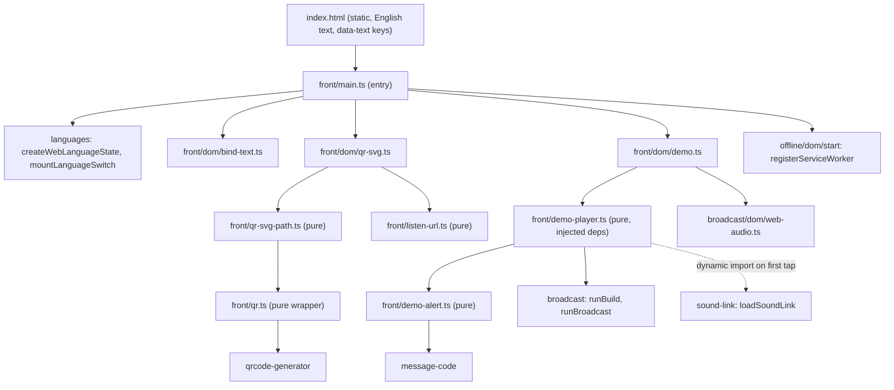

# Design Document

## Overview

The front page replaces the placeholder `index.html` at `/` with the real page: eight sections of `docs/front-page-content.md`, in English and Hindi, under the shared header, in the existing radio look.

The design reuses what exists and adds four small things:

1. A static `index.html` with the English text and one `data-text` key per string. A small page script applies the Chosen_Language, mounts the language switch, draws the QR code and wires the demo.
2. A pure QR wrapper around `qrcode-generator`, and a pure builder that turns its matrix into an SVG path. The DOM code only creates SVG nodes.
3. A Demo_Player that builds a TEST flood alert, checks it with the existing `runBuild`, and plays it with the existing `runBroadcast` and `createWebAudioHost`. The sound code is loaded on the first tap.
4. A one-line change to the offline File_List rule, so the four pictures are saved.

No new tool, test runner, script or build step is added. The new `front.*` text keys go in the existing language files, so the existing Hindi_Check lists them without change.

### Research and decisions

| Question | Finding | Decision |
|---|---|---|
| How do pictures reach `dist/` with the right base? | Vite processes `` in an HTML input, hashes the file, emits it under `assets/` and prefixes `base`. The existing offline reachability walk already follows `` (`refs.ts`). | Reference `./docs/design/front/*.webp` from `index.html`. No copy step, one source of truth with `credits.md`. |
| How are the pictures saved offline? | `buildFileList` in `src/offline/file-list.ts` computes `frontImages` (images reached only from the front page) and removes them from `files`. | Stop removing them (one filter line). Keep the `frontImages` field as information so the offline tests change the least. |
| QR library? | `qrcode-generator` 2.0.4, MIT, no dependencies, ESM `dist/qrcode.mjs`, with types. About 20.6 KB minified, 7.2 KB gzipped (owner's measurement, requirements decision 3). | Use it. Import only from `src/front/qr.ts`. |
| How is the QR drawn without a data URL or an image request? | `createElementNS` for an `svg` and one `path`. | One path for all dark modules, on a paper rectangle with a 4-module quiet zone. |
| How does the demo play sound? | `runBuild(link, alert, false)` encodes, makes audio and checks it by decoding in memory. `runBroadcast(player, timers, build)` plays twice with a 1 second gap. `createWebAudioHost()` creates the audio context only inside `unlock()`. | Reuse all three by import. Nothing in `src/broadcast/` is edited. |
| Where do the new texts live? | `TEXT_KEYS`, `PLACEHOLDERS`, `stringsEn` and `stringsHi` hold every text. `buildStringEntries` lists every key for the Hindi_Check. | Add `front.*` keys there. |
| Tested distances from the diary? | The diary table holds free text. A build step that parses it would be new tooling. | Static page text, guarded by a test that parses `docs/kiro-diary.md` and fails when the page and the diary disagree (see Diary facts). No build plugin. |
| Can the Listen sentence builder take an empty place name? | Yes. `buildAlertSentence` in `src/languages/sentence.ts` builds the place part only when `alert.placeName.trim().length > 0`, otherwise `place` is `null` and the sentence is the test part plus the main part. `fillTemplate` in `src/shared/fill.ts` is called only for the templates actually used, and returns `null` only for a missing template or placeholder. An empty place name never reaches it. The message code also accepts an empty name (`isValidPlaceNameText('')` is true). | The Demo_Alert carries `placeName: ''`. The fallback "Test" is not needed and is dropped. |

### Decisions confirmed by the owner

- **Header.** The front page reuses the header markup of the Listen and Broadcast pages: the same `site-header` element, the same home link (`homeLinkHtml` output: `a.app-name` with the inline logo and the `sr-only` words "Dead Air"), so the logo has the same position and size, set by the same `look.css` rules. The Listen and Broadcast pages get their header from `headerHtml` through the `<!--look:header-->` marker. The front page cannot use `headerHtml` as is, because that draws the slide switch with a knob and marks one page as current. So `index.html` keeps the `<!--look:logo-->` marker (the plugin fills it with `logoHtml`, the same function `homeLinkHtml` uses), adds `id="link-home"` to match, keeps the two plain pills, and replaces the empty `.language-slot` with `<div id="language-switch" role="group">`, the element `mountLanguageSwitch` and the existing CSS use. No knob is drawn. `tests/look/front-header.test.ts` asserts "no language switch" today and is updated to assert the switch, the pills, no knob, and that the logo link markup equals `homeLinkHtml` output apart from the `href` and `id`.
- **Language keys.** About 90 `front.*` keys go in the existing `src/broadcast/strings.types.ts`, `strings.en.ts` and `src/languages/strings.hi.ts`, so the existing Hindi_Check lists them with no new wiring. The Listen and Broadcast bundles carry them too (a few KB of text).
- **Cross-page imports.** `src/front/` imports `runBuild`, `runBroadcast`, `Player`, `Timers` and `createWebAudioHost` from `src/broadcast/`, under the exception recorded in `.kiro/steering/structure.md`. Nothing is copied and no Broadcast file is edited.
- **Diary facts.** The distances, device names and the two "not tested yet" lines are static page text. They are not typed freehand: each comes from the diary, and a test parses `docs/kiro-diary.md` and fails when any of them differs (Requirement 8.5). There is no build plugin.
- **QR colours and margin.** Always the light-theme colours, with a quiet zone of 4 modules on every side (Requirements 3.3, 3.3a).

## Architecture



### Files

New files (owned by this spec):

```
index.html                         replaced: sections, header, markers for nothing (static)
src/front/
  main.ts                          page entry: look.css, language, text, QR, demo, service worker
  listen-url.ts                    pure: listenUrl(origin, base)
  qr.ts                            pure wrapper: qrMatrix(text) -> boolean[][] | null
  qr-svg-path.ts                   pure: qrSvgShape(matrix) -> { size, d }
  demo-alert.ts                    pure: buildDemoAlert(nowMs) -> Alert | null
  demo-player.ts                   pure, injected deps: the Demo_Player state machine
  diary-tests.ts                   pure: parseDiaryTests(markdown), feetToMetres (used by the drift test)
  dom/
    bind-text.ts                   data-text, data-alt, document title
    qr-svg.ts                      creates the svg and path, or the plain-text fallback
    demo.ts                        button, stop button, volume line, failure line
    web-demo.ts                    real deps: dynamic import of the sound link, clock, timers
tests/front/                       see Testing Strategy
tsconfig.front-page.json           same shape as tsconfig.listen-page.json
```

Edited files:

| File | Owner | Change |
|---|---|---|
| `src/offline/file-list.ts` | offline | `files` no longer drops `frontImages`. Smallest change below. |
| `tests/offline/front-image.property.test.ts`, `file-list.test.ts`, `file-list-complete.property.test.ts`, `file-list-sound.property.test.ts`, `generators-build.ts` | offline | Expect front-only images to be in `files`. |
| `tests/look/offline-look.test.ts` | radio-look | The "reaches no front page image" test becomes "lists the four front pictures". |
| `.kiro/specs/offline/design.md`, `report.md`, `requirements.md` | offline | One note each: decision 5 is reversed by the front-page spec. |
| `docs/kiro-diary.md` | project | The line "Front page images are left out" gets a dated update. |
| `src/broadcast/strings.types.ts`, `strings.en.ts`, `src/languages/strings.hi.ts` | broadcast, languages | New `front.*` keys. |
| `tests/look/front-header.test.ts` | radio-look | Expect the language switch. |
| `src/shared/ui/look.css` | radio-look | A small `.front-*` block (Big_Number, Tuning_Line, section layout, captions). Uses existing custom properties, plus two new tokens `--qr-paper` and `--qr-ink` set once for both themes. |
| `package.json`, `package-lock.json` | project | Add `qrcode-generator` 2.0.4 to `dependencies`. Add `tsc -p tsconfig.front-page.json --noEmit` to `typecheck`. |
| `vite.config.ts` | project | No change. `index.html` is already an input. |
| `tsconfig.json` | project | Add `src/front/dom` to `exclude`, as for the other `dom` folders. |
| `docs/design/front/credits.md`, `README.md` | project | Name `qrcode-generator` (MIT). |

`src/offline/dom/front-entry.ts` is no longer loaded by `index.html`. `src/front/main.ts` calls `registerServiceWorker()` itself (Requirement 7.9). The old entry file is left in place until tasks decide to delete it.

## Components and Interfaces

### Page build: `/` as a static page

`index.html` is a real HTML file with all eight sections and the English text, so it opens without a script. Vite already builds it as the `main` input. Rules:

- Links use `%BASE_URL%` (Vite replaces it with `base`), as the placeholder already does. `Open Listen` is `<a class="pill" href="%BASE_URL%listen/">`.
- The stylesheet is `./src/shared/ui/look.css` and the script is `<script type="module" src="./src/front/main.ts">`. Vite rewrites both with `base`.
- Pictures: ``. Sizes read from the files: fani 1200x1215, acoustic-coupler 1200x1269, illustration-phone 1200x675. CSS gives `width: 100%; height: auto; border-radius: var(--radius)`, max the Text_Column width. `loading="lazy"` is a native attribute, not a request to another site.
- The `lookHeaderPlugin` still adds the licence `<link>` and fills `<!--look:logo-->`. It is not changed.
- `<main>` holds one `<section>` per content section, each with `id="s1"` to `id="s8"` and a heading (`h1` in section 1, `h2` in 2 to 7, a plain label in 8).
- English text is the default content of every `data-text` element. `bindText` replaces it with the Chosen_Language, so English visitors see no change and a no-script visitor still reads English.

Section order and content follow the Content_File. Lines starting "Kiro:" are not drawn.

### Text and language (`src/front/dom/bind-text.ts`)

```ts
export function bindText(doc: Document, strings: Strings): void;
```

For each `[data-text]` it sets `textContent` to `strings.text[key]`. For each `[data-alt]` it sets `alt`. It sets `document.title` from `front.page.title`. Elements that hold a link inside a sentence use separate `<span data-text>` elements around the `<a>`, so the link text (Source_Link names, numbers, place names, quoted names) is never translated (Requirement 1.8).

`main.ts` does what the Listen page does: `createWebLanguageState()`, `applyDocumentLanguage`, `mountLanguageSwitch(#language-switch, state, () => strings.text['lang.switch.label'])`, `bindText` now and on every `state.subscribe`. `bindText` changes text nodes and `alt` only, so the Demo state, the focus and the scroll position stay (Requirement 1.6). The Demo's own lines use `data-text` too, and the demo module re-reads the current strings when it shows a line.

### Tuning_Line

A `div.front-tuning` with `aria-hidden="true"`, placed between sections. Each one is an inline `<svg>` with a `<line>` for the rule and one `<path>` of short tick strokes, stroked in `currentColor` on the page colour, with no fill, gradient, shadow or filter. The section number is a `<span class="front-tuning-no">02</span>` beside the svg, inside the same `aria-hidden` element. The following heading carries `data-section="2"`, so the number is also present in an attribute that does not change the accessible name (Requirement 5.8). The same markup is repeated for the seven lines, a few hundred bytes in all.

### Big_Numbers

`<p class="front-big">95.2%</p>` in the mono font at `font-size: clamp(3rem, 12vw, 5rem)`, then the words at body size, then `<a class="front-source" href="...">FCC, 2018</a>`. `clamp` keeps the minimum at 3rem and uses `rem` (Requirements 5.2, 5.11).

### Case_Card

An `<article class="card card-live front-case">` that reuses `.card`, `.card-head`, `.icon-tile`, `.event-name` and `.card-rows` from `look.css`. It differs from a Listen card only by omission: no `.test-banner`, no `.card-sent`, no voice button (Requirement 5.5). The cyclone drawing is placed by `iconNode('cyclone')` from `src/shared/ui/dom/icon-node.ts`, called by `main.ts` into an empty `<span class="icon-tile" data-icon="cyclone">`. The tile is empty in the static HTML and filled by the script, which is acceptable because the icon is decorative (`aria-hidden`). The four rows are `<div><strong data-text="front.s3.failed.label">What failed</strong>: <span data-text="front.s3.failed.text">…</span> <a>…</a></div>`. `card-live` is used for the colour only; the card does not claim to be a received alert and its heading is the plain text "Cyclone Fani". The pictures sit below the rows in a `.front-pair` (`display: grid; grid-template-columns: repeat(auto-fit, minmax(min(100%, 14rem), 1fr))`), side by side when there is room and stacked on a phone.

### Sections 6 and 7 layout

```css
.front-twin { display: grid; gap: calc(var(--gap) * 3); }
@media (min-width: 60em) {
  .front-twin { grid-template-columns: minmax(0, 1fr) minmax(0, 1fr); }
}
```

Section 6 comes first in the source, so it is first when stacked. At 60em the page `--measure` is widened for `.front-twin` only (a `max-width: 72rem` wrapper), the same width the app pages use at that breakpoint. All other sections stay in the 40rem Text_Column.

### Dies_Element

The headline is `<h1>When the internet <span id="dies">dies</span>, the radio still speaks.</h1>`. The span has no class, style or script. `data-text` cannot be on the `h1` because the span would be replaced. Instead the h1 holds three translatable parts: `<span data-text="front.s1.h.a">When the internet </span><span id="dies" data-text="front.s1.h.dies">dies</span><span data-text="front.s1.h.b">, the radio still speaks.</span>`. In Hindi the word that translates "dies" stays in the `#dies` span. The `h1` accessible name is the three parts joined, which reads as the sentence.

### QR code

`src/front/listen-url.ts` (pure):

```ts
export function listenUrl(origin: string, base: string): string; // origin + base + 'listen/'
```

`base` is `import.meta.env.BASE_URL`, always ending in `/`. `origin` is `location.origin`. Under a sub-path the result is `https://user.github.io/repo/listen/` (Requirements 3.1, 3.8).

`src/front/qr.ts` (pure, no browser API):

```ts
import qrcode from 'qrcode-generator';
export type QrMatrix = readonly (readonly boolean[])[];
/** Error level 'M', type number 0 (auto). Returns null when the library throws. */
export function qrMatrix(text: string): QrMatrix | null;
```

`qrcode(0, 'M')`, `addData(text)`, `make()`, then `isDark(r, c)` for every cell. The try/catch returns `null` (Requirement 3.7). Level M is a balance of size and scan reliability at 8 to 10 cm on a phone screen; the Listen URL is under 80 characters, which is a version 4 to 6 code.

`src/front/qr-svg-path.ts` (pure):

```ts
export const QUIET_MODULES = 4;
export function qrSvgShape(m: QrMatrix): { size: number; d: string };
```

`QUIET_MODULES` is 4, the minimum quiet zone of the QR standard, and is the margin on every side. `size = m.length + 2 * QUIET_MODULES`. `d` is one path: for each dark module `M{x} {y}h1v1h-1z`, with x and y offset by `QUIET_MODULES`, so the first dark module of the matrix starts at 4 and the last ends at `size - 4`. `src/front/dom/qr-svg.ts` builds `<svg viewBox="0 0 {size} {size}" role="img" aria-label="{url}" shape-rendering="crispEdges">`, a `<rect width="{size}" height="{size}">` (the paper, which draws the quiet zone) and a `<path d>` (the ink). The viewBox is the whole square including the margin, so the light border is part of the picture and the code does not depend on the page colour around it.

Colours are the light-theme paper and ink in both themes, because some scanners read light-on-dark codes badly and the night page is dark. `look.css` gets two tokens set once, outside the dark media query: `--qr-paper: #eae4d9` and `--qr-ink: #111111`, the same values as the light-theme `--page` and `--text`. A `.front-qr rect` and `.front-qr path` rule sets `fill` from them. The markup carries no colour. The theme test that checks `look.css` colour values is extended to list the two tokens (tasks check how `css-colour-rules` treats hex values in token blocks). The svg is created with `createElementNS`; no `innerHTML`, no data URL. The scan line sits beside it. If `qrMatrix` returns `null` the module writes the URL as plain text in a `<code>` element instead.

The text alternative is the `aria-label` carrying the Listen_URL, plus a visible `<a>` is not added (the URL is the thing being scanned, and showing it as text is the fallback only).

### Demo alert (`src/front/demo-alert.ts`, pure)

```ts
export const DEMO_VALID_STEPS = 4; // 4 x 15 minutes = 1 hour
export function buildDemoAlert(nowMs: number): Alert | null; // null when the clock reading is unusable
```

Uses `sentMinuteFrom(nowMs)` from `src/broadcast/build.ts` for the minute (floor of `nowMs / 60000`, `null` for NaN, negative or too large). The alert:

| Field | Value |
|---|---|
| `test` | `true` |
| `passedOn` | `false`, `hopCount` 0 |
| `event` | `flood` |
| `urgency`, `severity`, `action` | `immediate`, `severe`, `evacuate` |
| `sentMinute` | from `nowMs` |
| `validSteps` | 4 |
| `latitude`, `longitude` | `null`, `null` |
| `stationId`, `counter` | 0, 0 |
| `placeName` | `''` |

The place name is empty, so the demo states no fact about any real place. This is settled: `buildAlertSentence` (`src/languages/sentence.ts`) builds a place sentence only when the name is not blank, so an empty name gives the TEST sentence plus the main sentence and no failure, and the message code accepts an empty name. The fallback "Test" of Requirement 4.2a is not used. A unit test builds the sentence for the Demo_Alert in English and Hindi and expects `ok: true` with `parts.place === null`.

### Demo_Player (`src/front/demo-player.ts`, pure, injected deps)

```ts
export type DemoState =
  | { kind: 'idle' }
  | { kind: 'loading' }
  | { kind: 'playing' }
  | { kind: 'failed'; reason: 'load' | 'build' | 'audio' | 'clock' };

export interface DemoDeps {
  clock: Clock;                                   // from broadcast/providers
  timers: Timers;
  audio: AudioHost;                               // unlock() and player
  loadLink: () => Promise<LinkLike | null>;       // dynamic import of the sound link, null on failure
  onState: (s: DemoState) => void;
}
export interface Demo { tap(): void; stop(): void; state(): DemoState; }
export function createDemo(deps: DemoDeps): Demo;
```

`tap()` runs synchronously up to the first `await`, so `audio.unlock()` is called inside the tap (Requirement 4.1). Flow:

1. If `playing` or `loading`, ignore.
2. `onState(loading)`, `const unlocked = audio.unlock()` (called first, awaited later).
3. `link = await loadLink()` (cached after the first success). `null` gives `failed('load')` and the button stays pressable (Requirement 4.9).
4. `alert = buildDemoAlert(clock.now())`, `null` gives `failed('clock')`.
5. `r = runBuild(link, alert, false)`. A failure gives `failed('build')`. So a damaged or unreadable demo is never played (Promise 1).
6. `await unlocked`. `false` gives `failed('audio')`.
7. `onState(playing)`, `run = runBroadcast(audio.player, timers, r.build)`, `await run.done`, then `idle`. `stop()` calls `run.stop()`; the result `stopped` also gives `idle` (Requirement 4.7).

`createDemo` never touches `navigator.mediaDevices`, `fetch` or any storage, and the module imports none of them (Requirements 4.10, 4.11). A grep test checks the source of `src/front/` for `getUserMedia`, `fetch(`, `XMLHttpRequest`, `sendBeacon`, `WebSocket`.

`src/front/dom/web-demo.ts` builds the real deps. `loadLink` is:

```ts
async () => {
  const { loadSoundLink } = await import('../../sound-link/index');
  const r = await loadSoundLink();
  return r.ok ? r.link : null;
}
```

The dynamic `import()` makes Vite put the sound link and ggwave in a separate chunk that is fetched on the first tap, from this site only, and is already in the Saved_Copy because the Listen and Broadcast pages use it (Requirement 4.5). `loadSoundLink()` takes the default options, the same ones Broadcast uses.

`src/front/dom/demo.ts` wires the buttons:

- Play_Button `#btn-demo`: idle is the solid ink pill "Play test alert". While `loading` it keeps that text, is disabled and has `aria-busy="true"`. While `playing` it is hollow (the existing outline pill class), shows "Playing" and is disabled. `#btn-demo-stop` ("Stop", the existing `btn.stop` key) is shown as a solid pill only while `playing` (Requirement 4.6).
- `#demo-line` (`role="status"`) shows "Turn your volume all the way up." while `playing` and the failure line while `failed`. A failed state leaves the Play_Button pressable.
- Re-renders on every `onState` and on language change, from the current strings.

The Play_Button and the link pill are at least 48 by 48 px (`--target`), 8 px apart (`--gap`) (Requirement 2.7).

## Data Models

### Language keys

All keys are added to `TEXT_KEYS`, `PLACEHOLDERS`, `stringsEn` and `stringsHi`. Reused as they are: `lang.switch.label`, `btn.stop`, `nav.switch.listen`, `nav.switch.broadcast`. Naming: `front.<section>.<part>`.

| Group | Keys (examples) | Placeholders |
|---|---|---|
| Page | `front.page.title` | none |
| Section 1 | `front.s1.h.a`, `front.s1.h.dies`, `front.s1.h.b`, `front.s1.under`, `front.s1.btn.play`, `front.s1.btn.playing`, `front.s1.btn.listen`, `front.s1.qr.line`, `front.s1.small` | none |
| Demo | `front.demo.volume`, `front.demo.err.load`, `front.demo.err.build`, `front.demo.err.audio`, `front.demo.err.clock` | none |
| Section 2 | `front.s2.title`, `front.s2.n1.words`, `front.s2.n2.words`, `front.s2.n3.words`, `front.s2.line` | none. The numbers "95.2%", "29,000" and "24" stay in the HTML. The word "hours" beside "24" is `front.s2.n3.unit`. |
| Section 3 | `front.s3.title`, `front.s3.place`, `front.s3.failed.label` and `.text`, same for `worked`, `happened`, `gap`, `front.s3.caption`, `front.s3.after` | none |
| Section 4 | `front.s4.title`, `front.s4.step1.name`, `.text`, same for 2 and 3, `front.s4.caption` ("Illustration") | none |
| Section 5 | `front.s5.title`, `front.s5.text`, `front.s5.p1970`, `front.s5.p1997`, `front.s5.p2026`, `front.s5.quote`, `front.s5.quote.by` | none |
| Section 6 | `front.s6.title`, `front.s6.p1` to `front.s6.p6` | none |
| Section 7 | `front.s7.title`, `front.s7.i1` to `front.s7.i8`, `front.s7.tested.near`, `front.s7.tested.far`, `front.s7.tested.how`, `front.s7.radio`, `front.s7.loud` | `tested.near`: `{m}`, `{ft}`. `tested.far`: `{m}`, `{ft}`, `{n}`, `{of}`. `tested.how`: `{device}`, `{phone}`. |
| Section 8 | `front.s8.credits`, `front.s8.pictures`, `front.s8.last` | none |
| Alt text | `front.alt.fani-before`, `front.alt.fani-after`, `front.alt.coupler`, `front.alt.illustration` | none |

Where a sentence holds a Source_Link in the middle, the sentence is split into separate keys (before and after the link). Every key has a Hindi value. New Hindi values are not in the Reviewed_List, so `npm run translations` lists them as `needs human check` with no further work (Requirements 1.9, 1.11). `docs/translation-check.md` is regenerated by the existing command as a task step.

The `tested.*` strings use placeholders so the numbers and device names stay as the diary writes them. The page JS formats them with the existing `fill` helper (`src/shared/fill.ts`). The static English HTML already holds the filled English text.

### Diary facts (`src/front/diary-tests.ts`)

```ts
export interface DiaryRow { device: string; phone: string; feet: number; metres: number; result: string; heard: string | null }
export function parseDiaryTests(markdown: string): DiaryRow[];
export function feetToMetres(ft: number): number; // Math.round(ft * 0.3048 * 10) / 10
```

Used by the drift test only; it is not bundled into the page. `feetToMetres(8) = 2.4` and `feetToMetres(21) = 6.4`.

### Credits

Section 8 is static HTML. The licence strings "OFL-1.1", "MIT", "MIT" are compared by test to the `license` field of `@fontsource/ibm-plex-mono`, `ggwave` and `qrcode-generator` in `node_modules`. The picture credits are compared to `credits.md` line by line.

## Offline and size

### Smallest change to the offline spec's files

In `src/offline/file-list.ts`, the end of `buildFileList` changes from:

```ts
const dropped = new Set(frontImages);
const files: string[] = [];
for (const p of new Set([...app, ...front])) {
  if (!dropped.has(p)) files.push(p);
}
```

to:

```ts
const files: string[] = [...new Set([...app, ...front])];
```

`frontImages` is still computed and returned, now as information (images only the front page reaches). Nothing else in `src/offline/`, `build/offline-postbuild.mjs`, `build/offline-check.mjs` or the worker changes. `DEFAULT_PLAN_RULES`, the excluded paths (`sw.js`, `offline-files.json`, `sound-test/`, `.map`) and the size check are untouched. The result:

- The four hashed `assets/*.webp` files join the File_List, so they are cached on install and served offline (Requirement 7.1, 7.2).
- `planOffline` already fails with `Saved copy is N bytes, over the limit of 2097152 bytes` when over. Requirement 7.4 asks the message to name the largest file. `planOffline` adds the largest file to that error: in `src/offline/plan.ts`, the over-limit error line gets `, largest file ${name} (${size} bytes)`, computed from `sized` with one `reduce`. This is a second, one-line change to an offline file, listed in tasks.
- Size: last build 244,377 bytes (11 files). The four pictures add 362,160 bytes. The front script adds the QR library (about 20.6 KB) and the page code. The total stays near 0.65 MB, well under 2 MiB.
- Structure rules: the app pages still do not load the pictures (only `index.html` references them). The offline copy is bigger by the owner's decision (requirements decision 2).

### Offline_Check

The check keeps allowing `<a href>` to other sites on the front page and flags any other external reference. `index.html` adds `<a href>` Source_Links and nothing else external. The QR library has no network call, and the check's Loader_Call_List scan of the bundled JS finds none (Requirement 7.12). The new `` values are same-origin hashed paths.

### Base path

Every path comes from Vite: `%BASE_URL%` in links, Vite's rewrite of `./src/...` and `./docs/...`, and `import.meta.env.BASE_URL` in `listenUrl`. Nothing is hard-coded (Requirement 7.8). The existing `site-build.test.ts` builds with an empty and a non-empty `BASE_PATH`; it gains front-page assertions.

## Correctness Properties

*A property is a characteristic or behavior that should hold true across all valid executions of a system-essentially, a formal statement about what the system should do. Properties serve as the bridge between human-readable specifications and machine-verifiable correctness guarantees.*

Only the promise-related behaviour of the Demo alert is covered by properties (Requirement 9.1 to 9.3). The QR wrapper, layout, sections, text keys, pictures, credits and offline lists have one fixed shape and are covered by example tests (Requirement 9.9). The generator for the first two properties draws `nowMs` from the whole usable clock range, `0` to `4294967295 * 60000 + 59999`, with a bias to the edges (0, minute boundaries, the maximum).

### Property 1: Demo alert survives encode and decode, marked TEST

*For any* usable clock reading `nowMs`, `buildDemoAlert(nowMs)` encodes to bytes that `decodeMessage` accepts, and the decoded alert has `test` equal to `true`, `event` equal to `flood`, `sentMinute` equal to `floor(nowMs / 60000)` and `validSteps` equal to 4 (one hour).

**Validates: Requirements 4.2, 4.3, 9.1, 9.2**

### Property 2: Demo alert is current only inside its hour

*For any* usable tap time `t` and any check time `c`, `checkExpiry` on the decoded Demo alert returns the same status as `checkExpiry` applied to a reference interval: sent at `floor(t / 60000)` minutes, expiring 60 minutes later. In particular it never returns `current` when `c` is at or after that expiry.

**Validates: Requirements 9.2**

### Property 3: Any single changed byte of the Demo alert is rejected

*For any* usable clock reading `nowMs`, any byte position in the encoded Demo alert, and any different byte value at that position, `decodeMessage` returns a rejection and no alert.

**Validates: Requirements 9.3**

## Error Handling

| Situation | Behaviour |
|---|---|
| Clock reading unusable (NaN, negative, beyond the 32-bit minute) | `buildDemoAlert` returns `null`, state `failed('clock')`, line shown, button pressable. |
| Sound link does not load (`loadSoundLink` not ok, or the chunk fetch fails offline before it was saved) | State `failed('load')`, plain failure line, next tap retries. The link is cached only after success. |
| `runBuild` fails (encode, audio or self-check) | State `failed('build')`. Nothing is played (Promise 1). |
| `audio.unlock()` returns `false` | State `failed('audio')`. |
| `player.play` rejects | `runBroadcast` returns `failed`; the demo shows `failed('audio')`. |
| Stop tapped | `run.stop()`, state `idle`. |
| Language changes while playing | Text updates, playback and state continue. |
| QR library throws | The Listen_URL is written as plain text instead of the code (Requirement 3.7). |
| A picture fails to load | The browser shows `alt` and the caption stays in the layout (Requirement 6.9). |
| Over the size limit at build | `planOffline` fails the build with the total, the limit and the largest file. |
| Missing Hindi key | The existing `SameKeys` compile check and `strings.test.ts` fail. |

Failure lines are plain sentences in both languages (`front.demo.err.*`). No error shows a technical code.

## Testing Strategy

### Property-based tests (Vitest, fast-check)

`tests/front/demo-alert.property.test.ts` holds the three properties above, one test each, at least 100 runs each. Each carries the tag comment:

```
// Feature: front-page, Property 1: Demo alert survives encode and decode, marked TEST
// Feature: front-page, Property 2: Demo alert is current only inside its hour
// Feature: front-page, Property 3: Any single changed byte of the Demo alert is rejected
```

No property test is written from scratch; fast-check 4.10.3 is already a dev dependency.

### Example tests

| File | What it checks | Requirements |
|---|---|---|
| `tests/front/qr.test.ts` | `qrMatrix` equals stored matrices for three texts, one a sub-path Listen_URL. `qrSvgShape` size is matrix size plus 8 (4 modules each side, `QUIET_MODULES` is 4), the path has one `M` per dark module, and no dark module lies within 4 units of any edge of the viewBox (smallest x and y are at least 4, largest x and y plus 1 are at most `size - 4`). The built svg has `viewBox="0 0 size size"` and its fills come from the `--qr-paper` and `--qr-ink` tokens, with no inline colour. A forced library failure returns `null`. | 3.3, 3.3a, 3.5, 3.6, 3.7, 9.9 |
| `tests/front/listen-url.test.ts` | Root base and sub-path base. | 3.1, 3.8 |
| `tests/front/demo-player.test.ts` | With fakes: unlock is called before the first await, sound link is not loaded before the first tap, state sequence idle, loading, playing, idle, two plays and a 1 second gap, stop returns to idle, load failure leaves the button pressable and the next tap retries, `runBuild` failure plays nothing, no microphone or fetch call. | 4.1, 4.4 to 4.11 |
| `tests/front/no-network-source.test.ts` | `src/front/**` source has no `getUserMedia`, `fetch(`, `XMLHttpRequest`, `sendBeacon`, `WebSocket`, `EventSource`, `indexedDB`. | 4.10, 4.11 |
| `tests/front/page.test.ts` | Reads `index.html`: one `h1`, six `h2`, sections in order, no "Kiro:" text, no emoji, `#dies` holds only `dies` and has no `style` or `class`, every `img` has width, height and non-empty `alt` and `data-alt`, no `src`, `href` on `<link>`, `srcset`, `url()` or `@import` to another origin, every `<a href>` that leaves the site is `https`. | 1.1, 1.4, 1.5, 1.10, 2.3, 2.4, 6.4, 6.8, 9.5, 9.7, 9.8 |
| `tests/front/strings.test.ts` | Every `data-text` and `data-alt` key in `index.html` exists in `stringsEn` and `stringsHi`, no Hindi value is empty, placeholders match. The English default text in the HTML equals `stringsEn` for each key. | 1.7, 9.4 |
| `tests/front/facts.test.ts` | Parses `docs/kiro-diary.md` with `parseDiaryTests`; the page's 2.4 m (8 ft) and 6.4 m (21 ft) lines, device and phone match; the page says "not tested yet" for radio and loudspeaker only while the diary has no such row. Licences in `index.html` equal the installed packages' `license` fields. Picture credit lines equal `credits.md`. | 8.3 to 8.5, 8.7 |
| `tests/offline/*` (updated) | The front-only image is now in `files`; the old "not listed" assertions are reversed; the oversize error names the largest file. | 7.2, 7.4, 7.11 |
| `tests/offline/site-build.test.ts` (extended) | In both base modes: the four pictures are in `offline-files.json`, total at most 2097152, the Offline_Check passes, the QR library code is in a listed JS file, `index.html` has no `offline-line`. | 7.1, 7.3, 7.7, 7.8, 7.10, 7.12, 9.6 |
| `tests/look/front-header.test.ts` (updated) | The header has the two pills and `#language-switch`, no knob, and the logo link equals `homeLinkHtml` output apart from `href` and `id`, so the logo sits where it does on the other pages. | 1.3, 3a |
| `tests/front/demo-sentence.test.ts` | `buildAlertSentence` on the Demo_Alert returns `ok: true` with a TEST part and no place part, in English and Hindi. | 4.2a |

### Owner checks

The owner opens the built site in a real browser at 360 px and at 60em, in both languages and both colour themes, and scans the QR with a second phone and plays the demo. No headless-browser script is added (Requirement 9.10).

### Test commands

`npm test` (`vitest run`) runs everything under `tests/`. `npm run typecheck` gains `tsc -p tsconfig.front-page.json --noEmit`. `npm run translations` regenerates `docs/translation-check.md`; the check variant (`npm run translations:check`) must pass.
