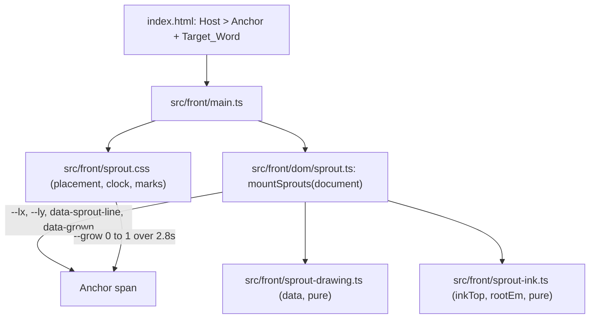
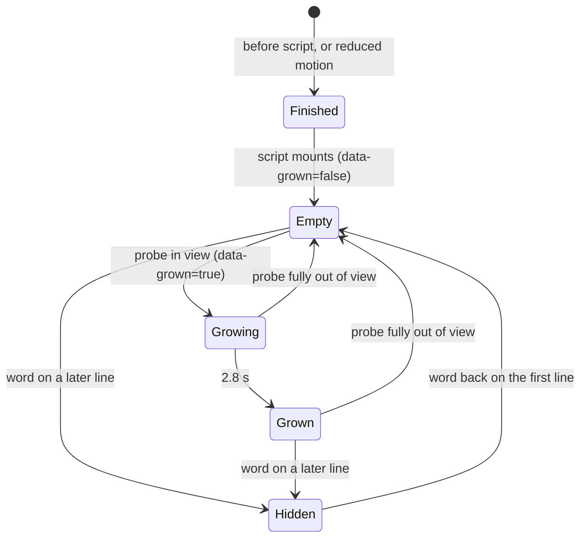

# Design Document

## Overview

One hand-drawn flower grows out of one word on the front page. The work is mostly copying: the Kit in `docs/design/sprout/kit/` is finished, tested code, and `docs/design/sprout/guide.md` says how to place it on any word. This design records why the Kit is built the way it is, so that nothing in it is "simplified" away.

Four files are copied into `src/front/`, four test files into `tests/front/`, one anchor goes into `index.html`, and three lines go into `src/front/main.ts`.

### Target

Filled in by task 1.1.

| | |
|---|---|
| Target_Word | "dies" (named by the owner) |
| Chosen_Letter | First letter, "d" (no `data-sprout-letter` attribute) |
| Element in `index.html` | `<span id="dies" data-text="front.s1.h.dies">dies</span>`. It is alone in its `data-text` element, so the Anchor goes outside it. |
| Block and its class | `h1.hero-title` |
| `--sprout-height` | 3.5em (set in task 5.1) |
| First line at 360, 390, 768, 1280 px | English: yes at 360 (font 23.04px), yes at 390 (24.96px), yes at 768 (42.11px), yes at 1280 (48px). This depends on the approved narrow-width rule in `front.css` (`@media (max-width: 32em)`, see `.kiro/specs/front-page/design.md`, "Headline size on narrow screens"); before it, the word was on line 2 at 360 and 390. Hindi (no change made): line 1 at all four widths. Open point for the owner: in Hindi at 360 and 390 px the plant would cover the photo credit text. At 200% text size the word wraps at narrow widths and the flower is hidden by the Guide's fallback. |

### Research and decisions

| Question | Finding | Decision |
|---|---|---|
| Does the radio look allow a glow and a growing drawing? | `style-rules.md` forbids glows and blur and allows motion only where it shows something real. | A written, narrow exception in `style-rules.md` ("Exception: the front page sprout"), limited to `sprout.css` and `dom/sprout.ts`. |
| Can the sprout rules go in `front.css`? | `tests/front/front-css.test.ts` fails on `filter`, `blur` or any colour value in `front.css`. | A separate `src/front/sprout.css`, imported by `main.ts`, with its own lint test. The blur is an SVG `feGaussianBlur` created by the script, and the glow colour lives in the Drawing, so `sprout.css` names no colour and no filter either. |
| Can the anchor go inside the word's element? | `bindText` sets `textContent` on every `[data-text]` element on a language switch, which deletes its children. | The Anchor goes straight before the word's element, and a Host wraps both. A test checks that no ancestor of the Anchor has `data-text`. |
| How is the stem put on the letter, for any word and any font? | Letter shapes differ: the "d" ascender is on its right, the "i" has a dot, Devanagari has a head line. Font metrics alone do not say where the ink is. | Draw the Chosen_Letter on a canvas at 200 px in its computed font, find the topmost ink row and the middle of the ink in the next few rows, and turn that into em from the Anchor. The pure part (`sprout-ink.ts`) has property tests. |
| How does it follow text size, language and fonts? | The front page headline size uses `clamp()` with `vw`, and the Hindi headline uses the system font. | Root and size in em. Measure again on any text change in the Block (MutationObserver), on a Block size change (ResizeObserver) and when `document.fonts.ready` resolves. Letter results are cached per font and cleared when the fonts load. |
| When is it "on screen"? | The drawing's box is 180 by 190 with the Root at x 84, so for a word at the start of a line on a phone part of the box is off the left edge. The blog's rule, 98 percent of the box in view, never passed there (seen in a 390 px test: the box at x -17). | An invisible 1 px strip from the Root to the top of the drawing (`.sprout-probe`) is observed instead. It grows at 98 percent of the strip above the bottom 12 percent of the window, or when the strip fills that space, and resets when none of it is in view. |
| What if the word wraps to a later line? | At 390 px the headline puts "dies" on line 2. The plant then grew over "When the internet" and its left leaf was cut off. | The script compares the Chosen_Letter's line with the Block's first character. On a later line the Anchor gets `data-sprout-line="later"` and its drawing is hidden. It comes back by itself when a wider screen or another language puts the word on the first line. |
| How big? | The blog's default is 9.5em of 20 px body text. On the front page headline that is 456 px. | `--sprout-height` knob, default 9.5em. A headline sets about 3.5em (168 px measured at 1280 px wide) in the "Placement on this site" part of `sprout.css`. |
| The clock without per-frame script? | The blog uses a registered CSS number transitioned by CSS. | Same: `@property --grow`, default 1, so the finished flower shows before the script runs and under reduced motion. The script only flips `data-grown`. |
| Where does the drawing come from? | The blog builds it from the owner's drawing (`flowers.ts`, `SPROUT_MARKS`, no random wobble). | The exact numbers are exported to `sprout-drawing.ts` by `docs/design/sprout/export-from-blog.mjs`. Never edited by hand. Running the export again gives the same file. |

## Architecture



### Files

| File | New or changed | Owner spec | Copied from |
|---|---|---|---|
| `src/front/sprout-drawing.ts` | new | front-sprout | `docs/design/sprout/kit/sprout-drawing.ts` |
| `src/front/sprout-ink.ts` | new | front-sprout | `docs/design/sprout/kit/sprout-ink.ts` |
| `src/front/dom/sprout.ts` | new | front-sprout | `docs/design/sprout/kit/dom/sprout.ts` |
| `src/front/sprout.css` | new, plus one placement rule if the word is in a headline | front-sprout | `docs/design/sprout/kit/sprout.css` |
| `tests/front/sprout-*.test.ts` (4) | new | front-sprout | `docs/design/sprout/kit/tests/` |
| `index.html` | one Host and Anchor around the Target_Word | front-page (approved) | |
| `src/front/main.ts` | three lines | front-page (approved) | |

No tsconfig change is needed: `tsconfig.front-page.json` already includes `src/front`, and the root `tsconfig.json` already excludes `src/front/dom`. `sprout-drawing.ts` and `sprout-ink.ts` use no browser API, so the root check compiles them as they are.

## Components and Interfaces

### Anchor markup

```html
<span class="sprout-host"><span class="sprout" data-sprout aria-hidden="true"></span>WORD</span>
```

Optional: `data-sprout-letter="N"` straight after `data-sprout`. WORD is the word's own element or plain text.

### `mountSprouts(root?: ParentNode): void` (`dom/sprout.ts`)

For each `[data-sprout]` under `root`, once:

1. Writes the box (`--bw`, `--bh`, `--rx`, `--ry`, `--em`) on the Anchor and puts the SVG drawing and the probe inside it.
2. Measures the Root (`--lx`, `--ly`) and the line (`data-sprout-line`), and again on Block text change, Block resize and font load.
3. Unless reduced motion: sets `data-grown="false"`, then `"true"` when the probe is in view, and `"false"` again when it is out.

### `inkTop(pixels, band, inset)` and `rootEm(ink, frame, offsetEm)` (`sprout-ink.ts`, pure)

`inkTop` takes RGBA pixels and returns the topmost inked row (alpha 128 or more), moved `inset` rows down but never below the band's last inked row, and the mean x of the ink in `band` rows from that row, or `null` when nothing is inked. `rootEm` turns that point into em from the Anchor.

### `sprout.css`

| Selector | Job |
|---|---|
| `@property --grow` | The Clock, a number, default 1 |
| `.sprout-host` | `white-space: nowrap`, so the Anchor and the word never part |
| `.sprout` | Zero-size inline box on the baseline. Holds `--grow`, `--p`, fallback `--lx`/`--ly`, and `--u` (one drawing unit as a length, from `--sprout-height`) |
| `.sprout[data-grown='false']` | Clock to 0 |
| `.sprout[data-grown='true']` | The 2.8 s transition, only under `prefers-reduced-motion: no-preference` |
| `.sprout[data-sprout-line='later'] > *` | Hidden |
| `.sprout-svg`, `.sprout-probe` | Placed so the Root lands on (`--lx`, `--ly`). No pointer events |
| `.sprout-stem`, `.sprout-part`, `.sprout-glow` | Each mark's own progress from the Clock |
| "Placement on this site" | The only part edited per word: `--sprout-height` for a headline |

## Data Models

```ts
type SproutMark =
  | { kind: 'stem'; s: number; dur: number; w: number; d: string }
  | { kind: 'part'; s: number; dur: number; ox: number; oy: number; transform: string;
      paths: ReadonlyArray<{ i: number; sw?: number; d: string }> }
  | { kind: 'glow'; s: number; dur: number; cx: number; cy: number; r: number; fill: string; transform: string };
```

`s` and `dur` are on the Clock (0 to 1). Stem 0 to 0.68, leaves at 0.19 and 0.44, head at 0.65, glow at 0.76.

## State



## Correctness Properties

### Property 1: The ink point is on the ink

For any image with one inked rectangle, `inkTop` returns the rectangle's top row, moved down by the inset but never past the band's last inked row, and its middle across. The point is never outside the rectangle.

**Validates: Requirements 2.1, 2.5**

### Property 2: Nothing inked, no point

For any blank image, `inkTop` returns `null`.

**Validates: Requirement 2.5**

### Property 3: The em conversion is exact

For any point and offset, `rootEm` gives `offset + (x - originX) / size` and `(baselineY - y) / size`, to 3 decimals.

**Validates: Requirement 2.2**

## Error Handling

| Case | Behaviour |
|---|---|
| No script | No flower. The text is unchanged. |
| Reduced motion | The finished flower, no movement. |
| Canvas unavailable, or the letter has no ink | The fallback Root (0.3em across, 0.7em up). The flower still grows. |
| Word wraps to a later line | No flower on that line. It returns when the word is back on the first line. |
| `mountSprouts` called twice | The second call does nothing (`data-sprout-mounted`). |

## Testing Strategy

All four test files come from the Kit and are copied as they are.

| File | What it checks |
|---|---|
| `tests/front/sprout-ink.property.test.ts` | Properties 1 to 3, with fast-check, 200 runs each |
| `tests/front/sprout-drawing.test.ts` | The Drawing: parts, Root, every mark inside the Clock, growth order |
| `tests/front/sprout-css.test.ts` | `--grow` defaults to 1, only `data-grown='false'` empties it, motion only under no-preference, no colour, no font size, no pointer events, nothing about the sprout in `front.css` |
| `tests/front/sprout-markup.test.ts` | Each Anchor written as the Guide says, the word straight after it, no `data-text` ancestor, the three lines in `main.ts` |

The existing tests must keep passing unchanged, in particular `front-css.test.ts`, `page.test.ts` (`#dies` untouched) and `no-network-source.test.ts`.

The owner checks the look in a real browser, with the list in the Guide, Step 7. No headless-browser tooling is added (front-page decision 9).
