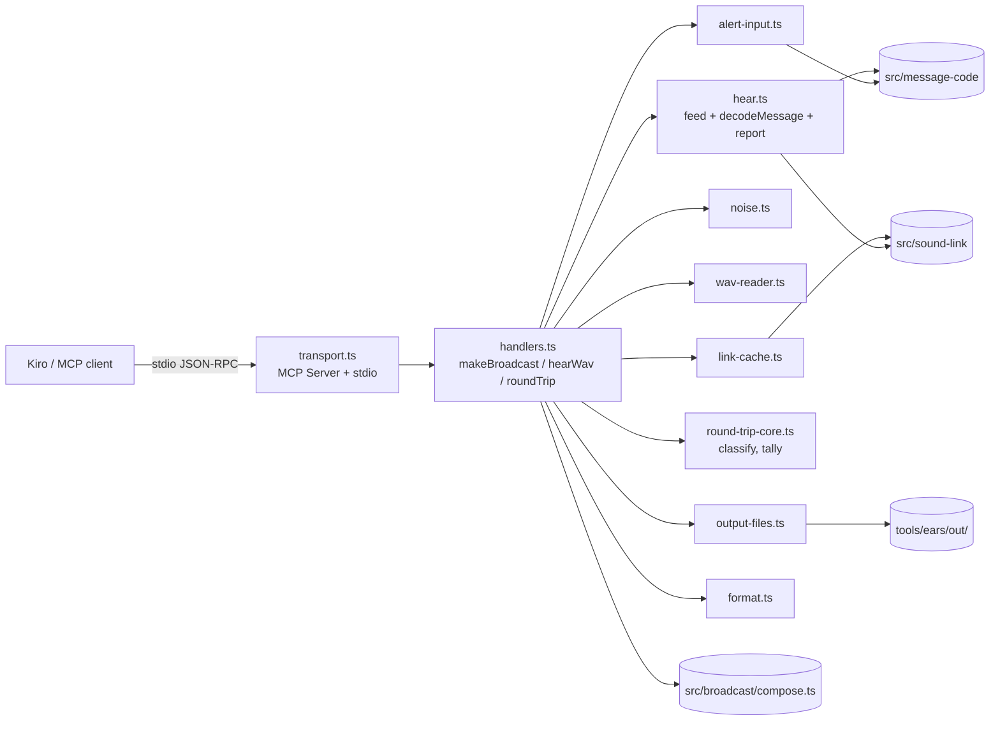

# Design Document

## Overview

Kiro's ears is a local MCP server in `tools/ears/`. It gives Kiro three tools that exercise the same sound path as the live pages, without a speaker or a phone:

- `make_broadcast`: alert JSON in, WAV file out.
- `hear_wav`: WAV file in (optionally with added noise), decoded report out.
- `round_trip`: make, add noise, decode and compare, N times, with counts out.

The design has one rule that shapes everything else: **protocol code and logic are separate.** The MCP server (transport) is a thin file. All behaviour lives in plain TypeScript functions that take plain values and return plain values, so Vitest calls them directly in Node, and fast-check can run properties on them.

The server reuses, and does not change, three existing pieces: the Message Code (`encodeAlert`, `decodeMessage`, `checkExpiry`), the Sound Link (`loadSoundLink`, `audioToWav`) and `composeBroadcastAudio` from `src/broadcast/compose.ts`. It is a developer aid. It is not part of the Vite site build, `dist/` or the offline copy.

### Decisions this design rests on

These come from the Decisions section of `requirements.md`.

- **SDK as devDependency.** `@modelcontextprotocol/sdk` and `zod` are `devDependencies`. The bundle reads them at build time. No page imports from `tools/`, so neither reaches `dist/`.
- **One bundle, built by the Vite already installed.** `npm run build:ears` writes `tools/ears/build/ears.mjs` (git-ignored). The MCP settings point to that relative path. No `tsx`.
- **`test: false` is rejected.** Promise 3.
- **Noise is white noise at a stated SNR in dB.** 0, -10 and -15 dB for the diary run.

### Research notes

- The SDK's current 1.x line (1.32.2 when this was written) lists `zod` as a peer dependency, so `zod` is added explicitly. The SDK's `Server` class and `StdioServerTransport` are the pieces used. Versions are pinned exactly, as the other devDependencies are (`npm install -D -E`).
- This design uses the SDK's low-level `Server` with hand-written JSON Schema for each tool, not `McpServer` with zod schemas. Reason: Requirements 3, 4 and 5 name specific error reasons (`bad-sample-rate`, `bad-tries`, `bad-noise-level`, `not-a-test-alert`). If the SDK validated input first, a bad value would come back as a generic protocol error. With hand-written schemas the SDK only checks that arguments are an object, and the handlers own all other validation. Our own code then never imports `zod`.
- The Sound Link needs a sample rate fixed when it is loaded. `hear_wav` must use the sample rate stored in the file, and `make_broadcast` accepts 16000 to 96000. So the server keeps **one loaded Sound Link per sample rate**. This is how Requirement 1.6 ("load once and reuse") is read: once per sample rate. A normal run uses one or two rates.
- ggwave only reports a payload after a few silent frames. The Broadcast page's Self_Check handles this with 2 seconds of trailing zeros. The same fix is the Tail_Silence in `hear_wav` and `round_trip`.
- Bundling for Node: `ggwave` is an Emscripten build with an embedded engine and a Node branch that uses `require`, `__dirname` and `__filename`. In an ES module bundle those names do not exist. The Vite config adds a banner that defines them (`createRequire(import.meta.url)`, and `__filename` and `__dirname` from `fileURLToPath`). The first implementation task is a spike that proves the bundle decodes a clip. If it cannot be made to work, the fallback is to leave `ggwave` as an external import (it is already in `node_modules`) and say so in the README. That fallback is a change to Decision 2 and needs the user's approval before it is used.
- No `@types/node` is installed. The project already declares the few Node names it uses in `tests/*/node-extra.d.ts`. The tools follow that convention (see Build and typecheck).

## Architecture



Dependency direction: `transport.ts` depends on `handlers.ts`. Nothing else imports MCP code. `handlers.ts` receives its outside world through a `Deps` object (clock, link loader, output directory, file operations), so tests replace each one.

### Files

All files are in `tools/ears/` unless stated. Tests are in `tests/ears/`.

| File | Contains | MCP code? |
|---|---|---|
| `main.ts` | Entry point. Redirects `console.log` to stderr, builds real `Deps`, starts the transport, or runs one handler when called with `--call` | no (calls transport) |
| `transport.ts` | MCP `Server`, stdio transport, tool list with JSON Schemas, request routing, error mapping | **yes, only here** |
| `handlers.ts` | `createHandlers(deps)` returning `makeBroadcast`, `hearWav`, `roundTrip` | no |
| `alert-input.ts` | `prepareAlert(input, nowMs)`: object check, TEST rule, default `sentMinute`, `encodeAlert` | no |
| `link-cache.ts` | `createLinkCache(load)`: one `SoundLink` per sample rate, retry after a failed load | no |
| `noise.ts` | Seeded PRNG, `addWhiteNoise`, `deriveTrySeed`, `appendTailSilence` | no |
| `wav-reader.ts` | `readWav(bytes)`: strict WAV parser | no |
| `hear.ts` | `hearSamples(link, samples, nowMs)` and `reportPayload(bytes, nowMs)` | no |
| `round-trip-core.ts` | `classifyTry`, `tally`, `diffFields` (pure) | no |
| `output-files.ts` | Content-hash name, atomic write into the Output_Directory | no |
| `format.ts` | `formatRoundTrip`, `formatHear`, `formatMake`: result to text, warning line first | no |
| `errors.ts` | `ToolError` type, reason codes, `truncateMessage` | no |
| `vite.config.ts` | Bundle build config | no |
| `README.md` | Build, turn on, one example per tool | no |
| `tests/ears/node-extra.d.ts` | Node names not already declared (`node:crypto`, `renameSync`, `unlinkSync`, `tmpdir`) | no |

Outside `tools/` and `tests/ears/`, this spec adds or edits only the approved files: `.kiro/settings/mcp.json` (new), `package.json`, `.gitignore`, `tsconfig.tools.json` (new, at the repo root, next to the other `tsconfig.*.json`), and appends to `docs/kiro-diary.md` in the last task.

### Build and typecheck

`package.json` gets two devDependencies, one script and one typecheck addition:

```json
"build:ears": "vite build --config tools/ears/vite.config.ts",
"typecheck": "... && tsc -p tsconfig.tools.json --noEmit"
```

`tools/ears/vite.config.ts` builds one SSR bundle. It is a separate config file, so the root `vite.config.ts` (the `base` setting and the three page inputs) is not read and not changed.

```ts
export default defineConfig({
  root: '<repo root>',
  publicDir: false,
  build: {
    ssr: 'tools/ears/main.ts',
    outDir: 'tools/ears/build',
    emptyOutDir: true,
    target: 'node20',
    minify: false,
    sourcemap: false,
    rollupOptions: {
      output: {
        format: 'es',
        entryFileNames: 'ears.mjs',
        inlineDynamicImports: true,
        banner: NODE_BANNER, // defines require, __filename, __dirname
      },
    },
  },
  ssr: { noExternal: true, target: 'node' },
});
```

`noExternal: true` pulls the SDK, `zod`, `ggwave` and the `src/` modules into the one file. Node's own modules (`node:fs`, `node:path`, and so on) stay as imports. `outDir` is `tools/ears/build/`, which is outside `dist/`.

`tsconfig.tools.json` copies the settings of `tsconfig.sound-link.json` (strict, `Bundler` resolution, `types: []`, `skipLibCheck`) and includes `tools`, `tests/ears/node-extra.d.ts`, and the two existing declaration files `tests/broadcast/node-extra.d.ts` and `tests/sound-link/node-fs.d.ts` (read only, not edited). The main `tsconfig.json` already includes `tests/`, so `tests/ears/` is type-checked there as well. `tests/ears/node-extra.d.ts` declares only names the existing files do not, so the declarations merge without a clash. The implementation task checks this by running `npm run typecheck`.

### Registration

`.kiro/settings/mcp.json`:

```json
{
  "mcpServers": {
    "dead-air-ears": {
      "command": "node",
      "args": ["tools/ears/build/ears.mjs"],
      "disabled": true,
      "autoApprove": []
    }
  }
}
```

No `env`, no absolute path, no secret. The path is relative to the workspace root, which is where Kiro starts workspace-level servers. The README states this and tells the user to run `npm run build:ears` before turning the server on.

### Process model

One Node process per Kiro session. Requests are handled one at a time by the SDK. `round_trip` is CPU-bound and blocks the event loop for its duration, at most a few seconds for 20 tries, and the server has no other duty during that time. N is capped at 200.

## Components and Interfaces

### Shared types (`errors.ts`)

```ts
export type ErrorReason =
  | 'invalid-input-type' | 'not-a-test-alert' | 'invalid-field' | 'place-name-too-long'
  | 'bad-sample-rate' | 'bad-noise-level' | 'bad-tries' | 'bad-seed'
  | 'write-failed'
  | 'file-not-found' | 'file-unreadable' | 'file-too-large' | 'not-wav' | 'unsupported-wav'
  | 'silent-signal'
  | 'sound-link-unavailable' | 'engine-error'
  | 'internal-error';

export interface ToolError {
  readonly ok: false;
  readonly reason: ErrorReason;
  readonly message: string;      // 200 characters or fewer, one line, no stack
  readonly field?: string;       // set for invalid-field and place-name-too-long
}
export type Outcome<T> = ({ readonly ok: true } & T) | ToolError;

export function toolError(reason: ErrorReason, message: string, field?: string): ToolError;
/** Collapses whitespace and cuts to 200 characters. */
export function truncateMessage(text: string): string;
```

`bad-seed` and `sound-link-unavailable` are additions to the reasons the requirements name. A Seed must be an integer from 0 to 4294967295. A failed Sound Link load maps to `sound-link-unavailable` (Requirement 1.10).

### Dependencies (`handlers.ts`)

```ts
export interface Deps {
  /** Milliseconds since the Unix epoch. */
  readonly now: () => number;
  /** Returns the loaded link for a sample rate, or a ToolError. Tests pass fakes. */
  readonly getLink: (sampleRate: number) => Promise<Outcome<{ link: SoundLink }>>;
  /** Absolute path of the Output_Directory. */
  readonly outDir: string;
  /** File operations. Tests pass failing versions. */
  readonly files: FileOps;
}
export interface FileOps {
  readFile(path: string): Uint8Array;
  fileSize(path: string): number | 'missing' | 'not-a-file';
  ensureDir(path: string): void;
  writeAtomic(dir: string, name: string, data: Uint8Array): void; // temp file then rename
}
export interface Handlers {
  makeBroadcast(args: unknown): Promise<Outcome<MakeBroadcastResult>>;
  hearWav(args: unknown): Promise<Outcome<HearWavResult>>;
  roundTrip(args: unknown): Promise<Outcome<RoundTripResult>>;
}
export function createHandlers(deps: Deps): Handlers;
```

Every handler takes `unknown` and checks the type itself. No handler throws on bad input.

### Alert preparation (`alert-input.ts`)

```ts
export function prepareAlert(
  input: unknown,
  nowMs: number,
): Outcome<{ alert: Alert; bytes: Uint8Array }>;
```

Steps, in order:

1. If `input` is not a plain JSON object (null, array, string, number, boolean) return `invalid-input-type`. No encoding happens.
2. If `input.test !== true` return `not-a-test-alert`. Absent, `false`, `"true"` and `1` all fail here.
3. Copy the object. If `sentMinute` is absent, set it to `Math.floor(nowMs / 60000)`.
4. Call `encodeAlert`. On rejection return its `reason` and `field`.

Order matters: the TEST rule is checked before `encodeAlert`, so a non-test alert is never encoded and never produces audio.

### Sound Link cache (`link-cache.ts`)

```ts
export function createLinkCache(
  load: (options: { sampleRate: number }) => Promise<LoadResult>,
): (sampleRate: number) => Promise<Outcome<{ link: SoundLink }>>;
```

It stores one promise per sample rate. If a load fails, the entry is deleted so the next call retries (Requirement 1.10). Concurrent calls for the same rate share one load. `main.ts` passes `loadSoundLink`. Tests pass a counting fake.

### Noise (`noise.ts`)

```ts
export const TAIL_SILENCE_SECONDS = 2;
export const MAX_SEED = 4294967295;

/** Returns a new array: the samples followed by 2 s of zeros. */
export function appendTailSilence(samples: Float32Array, sampleRate: number): Float32Array;

/** Seed of Try `index`. A bijection of `index` for a fixed seed, so no two tries in one call share a seed. */
export function deriveTrySeed(seed: number, index: number): number;
//   (seed + Math.imul(index, 0x9E3779B1)) >>> 0

export type NoiseResult =
  | { ok: true; samples: Float32Array; appliedNoiseRms: number; targetNoiseRms: number }
  | { ok: false; reason: 'silent-signal' };

/**
 * Adds white noise to `clip`. The first `signalLength` samples are the signal; the rest is
 * tail silence. Noise is added over the whole clip.
 * snrDb is signal RMS / noise RMS in dB, measured over the first signalLength samples.
 */
export function addWhiteNoise(
  clip: Float32Array,
  signalLength: number,
  snrDb: number,
  seed: number,
): NoiseResult;
```

Algorithm:

1. `signalRms = sqrt(mean(clip[i]^2))` over `i < signalLength`, in float64. If `signalLength` is 0 or `signalRms` is 0, return `silent-signal`.
2. `targetNoiseRms = signalRms * 10^(-snrDb/20)`.
3. Seeded generator `mulberry32(seed)` feeds a Box-Muller transform to make Gaussian samples `g[i]` for the whole clip. `Math.random` is never called.
4. `rawRms` is the RMS of `g` over `i < signalLength`. The scale is `targetNoiseRms / rawRms`. So the noise over the signal positions has the exact requested RMS, and `appliedNoiseRms` equals `targetNoiseRms` up to float64 rounding. This is how the 1 percent bound (Requirement 6.2) is met by construction, not by luck.
5. `out[i] = clamp(clip[i] + g[i] * scale, -1, 1)`, stored as `Float32`.

The result has the same length as `clip` (Requirement 6.4). `appliedNoiseRms` is measured before clipping, which is what Requirement 6.2 asks for. At very low SNR most output samples clip, so the test of the noise level reads `appliedNoiseRms`, and a separate check confirms the unclipped output at high SNR.

### WAV reader (`wav-reader.ts`)

```ts
export type WavReadResult =
  | { ok: true; sampleRate: number; samples: Float32Array }
  | { ok: false; reason: 'not-wav' | 'unsupported-wav' };

/** Never throws. Reads no byte outside `bytes`. */
export function readWav(bytes: Uint8Array): WavReadResult;
```

Behaviour:

- Needs at least 12 bytes with `RIFF` at 0 and `WAVE` at 8. Otherwise `not-wav`.
- Walks chunks from byte 12: 4-byte id, 4-byte little-endian size, body, then one pad byte if the size is odd. Unknown chunks (`LIST`, `fact`, odd-sized, between `fmt ` and `data`) are skipped.
- If a chunk's size runs past the end of the file, return `not-wav` (Requirement 7.3). The `data` chunk is not clamped.
- If `fmt ` or `data` is missing, return `not-wav`.
- `fmt ` must have format 1 (PCM), 1 or 2 channels, 16 bits per sample, and a sample rate from 16000 to 96000. Otherwise `unsupported-wav`. (A `fmt ` chunk shorter than 16 bytes is `not-wav`.)
- Samples convert to float: `s < 0 ? s / 32768 : s / 32767`. This is the exact inverse of `audioToWav`'s rounding, so writing the result back gives identical bytes (Property 1).
- For two channels, each output sample is `(left + right) / 2` of the float values, one per frame. A `data` chunk whose length is not a whole number of frames drops the partial frame.
- The reader is wrapped in a `try` that maps any unexpected exception to `not-wav`, so it never throws.

A WAV with zero samples reads successfully with an empty array. `hear_wav` then reports `nothing heard`.

### Hearing (`hear.ts`)

```ts
export interface PayloadReport {
  readonly bytes: number;                     // payload length
  readonly check: 'passed' | 'failed';
  readonly reason?: DecodeRejectionReason;    // only when failed
  readonly alert?: Alert;                     // only when passed
  readonly sentUtc?: string;                  // ISO 8601, only when passed
  readonly status?: ExpiryStatus;             // only when passed
  readonly statusText?: string;               // only when passed
}

/** The two calls the Listen page makes: decodeMessage, then checkExpiry. */
export function reportPayload(payload: Uint8Array, nowMs: number): PayloadReport;

export type HearResult =
  | { ok: true; payloads: PayloadReport[]; decoded: Alert[] }
  | { ok: false; reason: 'engine-error' };

/** Creates a listener, feeds all samples at once, reports every payload, disposes the listener. */
export function hearSamples(link: SoundLink, samples: Float32Array, nowMs: number): HearResult;
```

`reportPayload` is the only place payload bytes meet `decodeMessage`. When the check fails, the object it returns has no `alert`, `sentUtc`, `status` or `statusText` key at all (promise 1). `statusText` comes from an exhaustive map over `ExpiryStatus`:

| status | statusText |
|---|---|
| `current` | `current` |
| `expired` | `EXPIRED, not current` |
| `sent-in-future` | `sent time is in the future, not current` |
| `clock-unknown` | `device clock unknown, not current` |

A TypeScript `Record<ExpiryStatus, string>` makes a missing status a type error. `sentUtc` is always present with a passed alert (promise 2). An alert with `test: false` is reported like any other (Requirement 4.14). `decoded` is the list of Check-passed alerts, used by `round_trip` and not printed by `hear_wav`.

### Round trip core (`round-trip-core.ts`)

```ts
export type TryOutcome = 'ok' | 'wrong-alert' | 'check-failed' | 'nothing-heard';

export interface TryResult {
  readonly outcome: TryOutcome;
  readonly differingFields: readonly string[]; // only for wrong-alert, else []
  readonly bothPlaysHeard: boolean;
}

export const ALERT_FIELDS: readonly (keyof Alert)[]; // all 13 fields of Alert

/** Names of fields whose values differ. Compares null and numbers with Object.is. */
export function diffFields(sent: Alert, got: Alert): string[];

/** payloads: every PayloadReport of one try. */
export function classifyTry(sent: Alert, payloads: readonly PayloadReport[]): TryResult;

export interface Tally {
  readonly counts: Record<TryOutcome, number>;
  readonly successes: number;
  readonly failures: number;
  readonly bothPlaysHeardTries: number;
}
export function tally(results: readonly TryResult[]): Tally;
```

`classifyTry` rules:

1. No payload at all: `nothing-heard`.
2. Let `passed` be the payloads with `check: 'passed'`. If `passed` is empty: `check-failed`.
3. If any passed alert differs from `sent` in any field: `wrong-alert`, with the names from `diffFields` of the first differing alert.
4. Otherwise (at least one passed, all equal): `ok`.

`bothPlaysHeard` is true when two or more passed alerts equal the sent alert.

`tally` gives each of the four outcomes a count (zero when absent). `successes = counts.ok`. `failures = N - successes`, which equals the sum of the other three counts.

### Output files (`output-files.ts`)

```ts
/** `dead-air-<first 16 hex chars of SHA-256 of the WAV bytes>.wav`. Depends only on the content. */
export function fileNameFor(wav: Uint8Array): string;
export function createFileOps(): FileOps; // real node:fs implementation
```

`writeAtomic` writes `<name>.tmp-<pid>` in the directory, then renames it to `<name>`. If either step throws, it removes the temp file and rethrows, and the handler returns `write-failed` with no path. The rename means the target path never holds a partial file (Requirement 3.9). The handler passes only a file name built by `fileNameFor`, never a caller string, so the path is always inside `outDir` (Requirement 3.5). The file name contains only `dead-air-`, hex digits and `.wav`.

Same alert and same sample rate give the same WAV bytes (the encoder is deterministic), so the same hash and the same file. Writing the same file twice overwrites it with identical bytes.

### Handlers (`handlers.ts`)

**makeBroadcast(args)**

```ts
export interface MakeBroadcastResult {
  readonly path: string;          // absolute, inside outDir
  readonly seconds: number;       // two decimals
  readonly sampleRate: number;
  readonly messageBytes: number;  // 21 to 40
}
```

1. `args` must be an object, else `invalid-input-type`. Read `args.alert` and `args.sampleRate`. Any other field (including `path`, `fileName`, `outDir`) is ignored.
2. Sample rate: absent gives 48000. Present must satisfy the Sound Link's `isValidSampleRate` rule (integer, 16000 to 96000), else `bad-sample-rate`. (The check is repeated in the tools folder as a small pure function, because `isValidSampleRate` is not exported from the Sound Link's `index.ts`.)
3. `prepareAlert(args.alert, deps.now())`.
4. `getLink(sampleRate)`, `link.bytesToAudio(bytes)`, `composeBroadcastAudio(samples, sampleRate)`, `audioToWav(audio, sampleRate)`.
5. `ensureDir(outDir)`, `writeAtomic(outDir, fileNameFor(wav), wav)`.
6. Return `path = join(outDir, name)`, `seconds = round2(audio.length / sampleRate)`, `sampleRate`, `messageBytes = bytes.length`.

All validation happens before any file operation, so every rejected call leaves the Output_Directory untouched. A handler that fails after validation (for example, the encoder reports an engine error) writes nothing, because the write is the last step.

**hearWav(args)**

```ts
export interface HearWavResult {
  readonly heard: number;                 // payloads heard
  readonly summary: string;               // "nothing heard" when heard is 0
  readonly sampleRate: number;
  readonly noise?: { db: number; seed: number };
  readonly payloads: PayloadReport[];
}
```

1. `args.path` must be a non-empty string, else `file-not-found`.
2. Validate `noiseDb` (when present): finite number from -60 to 60, else `bad-noise-level`. Validate `seed` (when present): integer from 0 to 4294967295, else `bad-seed`. Both are checked before the file is touched, so a bad noise level never decodes.
3. `files.fileSize(path)`: `missing` gives `file-not-found`, `not-a-file` gives `file-unreadable`, more than 20,971,520 gives `file-too-large`. A read that throws gives `file-unreadable`. Nothing is fed to the Sound Link on any of these.
4. `readWav(bytes)`: its failures pass through as `not-wav` or `unsupported-wav`.
5. `getLink(wav.sampleRate)`.
6. `clip = appendTailSilence(samples, rate)`. If `noiseDb` is present, `addWhiteNoise(clip, samples.length, noiseDb, seed ?? 1)`. A silent file with noise gives `silent-signal`.
7. `hearSamples(link, clip, deps.now())`. The clock is read once per call.
8. Return `heard`, `payloads`, and `summary` (`"nothing heard"` for zero payloads, with `ok: true`).

**roundTrip(args)**

```ts
export interface RoundTripResult {
  readonly noiseDb: number;
  readonly tries: number;
  readonly seed: number;
  readonly sampleRate: number;
  readonly counts: Record<TryOutcome, number>;
  readonly successes: number;
  readonly failures: number;
  readonly bothPlaysHeardTries: number;
  readonly wrongAlertFields: string[];   // union of differing field names, [] when none
}
```

1. Read `alert`, `noiseDb` (required), `tries` (default 20), `seed` (default 1), `sampleRate` (default 48000). Validate in this order: sample rate, `noiseDb` (`bad-noise-level`), `tries` as an integer 1 to 200 (`bad-tries`), seed (`bad-seed`), alert. Any failure returns before any audio is made.
2. `prepareAlert`, then `getLink`, then `bytesToAudio` and `composeBroadcastAudio` **once**. This is the clean audio (Requirement 5.5). `clip = appendTailSilence(clean, rate)` is also made once.
3. For `i` in `0..N-1`: `addWhiteNoise(clip, clean.length, noiseDb, deriveTrySeed(seed, i))`, then `hearSamples`, then `classifyTry`.
4. `tally` the results. Return the result.

`hearSamples` makes and disposes one listener per try, so each try starts with a clean ggwave state and no instance leaks over 200 tries. Nothing is written to disk. The `now` used for `checkExpiry` in `hearSamples` does not affect the outcome, because `classifyTry` reads only the check result and the alert fields.

**Expired alerts in round_trip.** An expired TEST alert still encodes and decodes. `round_trip` compares fields only, so it counts it as `ok`. The result carries `expiryOfSent: ExpiryStatus` from `checkExpiry(alert, now)` and the text form prints `status: EXPIRED, not current` for anything other than `current`. This is the "reports the alert as not current" check of Requirement 9.7. This field is added to `RoundTripResult`:

```ts
readonly sentStatus: ExpiryStatus;
readonly sentStatusText: string;   // same map as the hear report
```

### Formatting (`format.ts`)

```ts
export function formatMake(r: MakeBroadcastResult): string;
export function formatHear(r: HearWavResult): string;
export function formatRoundTrip(r: RoundTripResult): string;
```

Each returns a plain-text block: one summary line per fact, then the JSON of the result. `formatRoundTrip` starts with the warning line `WARNING: a Check-passed alert did not match the sent alert (N tries, fields: ...)` if and only if `counts['wrong-alert'] > 0` (Requirement 5.11). The line is the first line of the text. The numbers in the text are the numbers from the result, not recomputed, so the diary can copy them (Requirement 10.5).

`formatHear` prints no alert field for a failed payload, because `PayloadReport` has none to print.

### Transport (`transport.ts`)

```ts
export function startServer(handlers: Handlers, log: (line: string) => void): Promise<void>;
```

- Creates `new Server({ name: 'dead-air-ears', version }, { capabilities: { tools: {} } })` and a `StdioServerTransport`.
- `ListToolsRequest` returns exactly three tools. Each has a non-empty description and a JSON Schema `inputSchema` of type `object` with named properties. The `make_broadcast` and `round_trip` descriptions embed the sample alert (`SAMPLE_ALERT`, exported from `handlers.ts` so a test can encode it).
- `CallToolRequest` routes by name. An unknown name throws `McpError(InvalidParams, "Unknown tool: <name>")`, which the SDK returns as an error response. The server keeps running (Requirement 1.8).
- A handler result with `ok: true` becomes `{ content: [{ type: 'text', text }] }`. A `ToolError` becomes `{ isError: true, content: [{ type: 'text', text: "<reason>: <message>" }] }`.
- Every handler call is in a `try/catch`. An exception becomes `internal-error` with `truncateMessage(error.message)`. The stack goes to `log` (stderr) only if an environment flag is set, and never to stdout (Requirement 1.9).
- `log` writes to `process.stderr`. `main.ts` also sets `console.log = console.error` before loading anything, so a stray `console.log` from a library cannot corrupt stdout (Requirement 1.2).

Tool input schemas:

| Tool | Properties |
|---|---|
| `make_broadcast` | `alert` (object, required), `sampleRate` (integer, 16000 to 96000, default 48000) |
| `hear_wav` | `path` (string, required), `noiseDb` (number, -60 to 60), `seed` (integer) |
| `round_trip` | `alert` (object, required), `noiseDb` (number, required), `tries` (integer 1 to 200, default 20), `seed` (integer, default 1), `sampleRate` (integer, default 48000) |

The schemas describe the inputs for the client. They carry no `additionalProperties: false`, and they do not carry `minimum` or `maximum` keywords that the SDK might enforce first. Range text goes in the `description`, and the handlers enforce the ranges and return the named reasons. (The SDK's low-level `Server` does not validate tool arguments against `inputSchema`; this is confirmed in the first spike task.)

### Entry point (`main.ts`)

- Default mode: build real `Deps` (`now: Date.now`, `getLink: createLinkCache(loadSoundLink)`, `outDir` = `../out` relative to the bundle's own folder, `files: createFileOps()`), then `startServer`. Because the bundle is at `tools/ears/build/ears.mjs`, `outDir` is `tools/ears/out/` whatever the working directory is. From source (in tests), the tests pass their own `outDir`.
- `--call <tool> <json>` mode: builds the same `Deps`, runs one handler, prints `formatXxx` text to stdout and exits. It starts no transport and speaks no MCP. It exists for Requirement 10.3 (the diary fallback when the server cannot be turned on from the agent session) and for the README's quick check.

## Data Models

### Alert_Input

The JSON object has the 13 fields of `Alert` (`src/message-code/types.ts`). `sentMinute` is optional. Example, also used as `SAMPLE_ALERT` (a TEST alert, promise 3):

```json
{
  "test": true, "passedOn": false,
  "event": "flood", "urgency": "immediate", "severity": "severe", "action": "evacuate",
  "validSteps": 24,
  "latitude": 129716, "longitude": 775946,
  "stationId": 1234, "counter": 1,
  "placeName": "Riverside ward 4"
}
```

`validSteps: 24` is 6 hours. The latitude and longitude are in units of 0.0001 degree. A unit test encodes this sample with `encodeAlert` (Requirement 2.6).

### Tool results

Defined in the Components section: `MakeBroadcastResult`, `HearWavResult` with `PayloadReport`, `RoundTripResult`. An example `round_trip` text result:

```text
round_trip: 20 tries at -10 dB (seed 1, 48000 Hz)
successes: 14, failures: 6
ok: 14, wrong-alert: 0, check-failed: 1, nothing-heard: 5
both plays heard in 9 tries
sent alert status: current
{ ...the JSON of RoundTripResult... }
```

(The numbers above are illustration only, not a measured result.)

### Clip layout

```text
|<------------- Broadcast_Audio (clean) ------------->|<- Tail_Silence (2 s) ->|
|  play 1  |  1 s gap  |  play 2                      |  zeros                 |
|<- signalLength = clean.length ---------------------->|
 noise is added over the whole clip; its RMS is set from the first signalLength samples
```

### Seeds

`seed` is an integer from 0 to 4294967295. Try `i` uses `deriveTrySeed(seed, i)`. `hear_wav` with noise uses `seed ?? 1` directly.

## Correctness Properties

*A property is a characteristic or behavior that should hold true across all valid executions of a system-essentially, a formal statement about what the system should do. Properties serve as the bridge between human-readable specifications and machine-verifiable correctness guarantees.*

Reflection: the prework found about 20 testable criteria. These were merged where one property implies another: 7.1 and 7.2 become one WAV round trip; 7.3, 7.4 and 7.8 become one "never throws, bad input is rejected" property; 7.6 and 7.7 become one "layout does not change samples" property; 6.5 and 6.6 become one seed property; 3.3 and 3.10 become one "make_broadcast is deterministic and equals the page's audio" property; 3.6, 3.7, 3.8, 4.8 and 5.3 become one "out-of-range parameters are rejected with their own reason" property; 4.10 and 4.12 become one expiry-reporting property; 5.9 and 5.12 are covered by the tally property; 5.7 and 5.8 become one classification property. Criteria that are not properties (protocol, files, process rules, timing) are in the Testing Strategy as example, edge-case, integration or smoke tests.

### Property 1: WAV round trip

*For any* non-empty `Float32Array` of finite samples and any sample rate from 16000 to 96000, writing it with `audioToWav`, reading it with `readWav`, and writing the result with `audioToWav` again SHALL give bytes identical to the first file, the same sample rate, the same number of samples, and each read sample within 1/32768 of the written sample after clamping to -1 to 1.

**Validates: Requirements 7.1, 7.2**

### Property 2: The WAV reader never throws and rejects malformed input

*For any* byte array (random bytes, empty, or a valid WAV cut at any length, or with any chunk size field set past the end of the file), `readWav` SHALL return a result without throwing, and SHALL return a failure with reason `not-wav` or `unsupported-wav` and no samples whenever the input is shorter than a header, lacks `RIFF`, `WAVE`, `fmt ` or `data`, or has a chunk size that runs past the end. A valid file cut anywhere before the end of its data chunk SHALL give `not-wav`.

**Validates: Requirements 7.3, 7.4, 7.8**

### Property 3: Chunk layout and channels do not change the samples

*For any* sample array, any list of extra chunks (any id other than `fmt ` and `data`, any size including odd sizes with their pad byte) inserted before `fmt `, between `fmt ` and `data`, or after `data`, `readWav` SHALL return the same samples as for the file without them. *For any* stereo file, `readWav` SHALL return one sample per frame equal to the average of the left and right values of that frame.

**Validates: Requirements 7.6, 7.7**

### Property 4: Noise has the requested level

*For any* signal with at least one non-zero sample, any tail length, and any Noise_Level from -60 to 60 dB, `addWhiteNoise` SHALL return `appliedNoiseRms` within 1 percent of `signalRms * 10^(-snrDb/20)`, where `signalRms` is computed independently over the signal positions.

**Validates: Requirements 6.2**

### Property 5: Noise is repeatable and depends on the seed

*For any* non-silent signal of at least 100 samples, any Noise_Level and any seed, two calls with the same inputs SHALL return identical samples, and two calls with different seeds SHALL return outputs that differ in at least one sample.

**Validates: Requirements 6.5, 6.6**

### Property 6: Noise output keeps length and range

*For any* clip, signal length and Noise_Level, the output of `addWhiteNoise` SHALL have the same number of samples as the input and every sample SHALL be a finite number from -1 to 1 inclusive.

**Validates: Requirements 6.4**

### Property 7: Try seeds are distinct

*For any* seed from 0 to 4294967295, the values `deriveTrySeed(seed, i)` for `i` from 0 to 199 SHALL all be different, and each SHALL be an integer from 0 to 4294967295.

**Validates: Requirements 5.4**

### Property 8: Only TEST alerts, only objects

*For any* value that is not a JSON object, and *for any* alert object whose `test` field is absent or is any value other than the boolean `true`, `make_broadcast` and `round_trip` SHALL return an error (`invalid-input-type` for non-objects, `not-a-test-alert` for the rest), SHALL NOT call `encodeAlert` or the Sound Link, and SHALL leave the Output_Directory with the same files it had before the call.

**Validates: Requirements 2.2, 2.3, 9.6**

### Property 9: Alert rejections name the field

*For any* alert object with `test: true` in which one field is replaced by a value that `encodeAlert` rejects, `prepareAlert` SHALL return the reason and field name from `encodeAlert`, and `make_broadcast` SHALL write no file.

**Validates: Requirements 2.5**

### Property 10: Default sent time

*For any* valid TEST alert without `sentMinute` and any clock value, the alert that `prepareAlert` encodes SHALL have `sentMinute` equal to `floor(now / 60000)`, and every other field SHALL be unchanged. *For any* valid TEST alert with `sentMinute`, every field SHALL be unchanged.

**Validates: Requirements 2.1, 2.4**

### Property 11: make_broadcast output decodes to the alert

*For any* valid TEST alert and any sample rate from 16000 to 96000, `make_broadcast` SHALL return a path inside the Output_Directory, a `messageBytes` value from 21 to 40, and a `seconds` value equal to the file's sample count divided by the sample rate rounded to two decimals; and `hear_wav` on that path SHALL report only passed payloads whose alert equals the sent alert, with at least one payload heard.

**Validates: Requirements 3.1, 3.2, 4.1, 4.2**

### Property 12: make_broadcast is deterministic and matches the page

*For any* valid TEST alert and sample rate, two `make_broadcast` calls SHALL return the same path and write byte-identical files, and the samples read from the file SHALL equal, sample for sample (within the 16-bit step), the result of `composeBroadcastAudio` on `bytesToAudio` of the same bytes, as the Broadcast page builds its saved file.

**Validates: Requirements 3.3, 3.10**

### Property 13: The caller cannot choose where a file goes

*For any* extra fields in the `make_broadcast` arguments (including `path`, `fileName`, `outDir` and strings containing `..` or path separators), the returned path SHALL be a direct child of the Output_Directory whose name matches `dead-air-<hex>.wav`, and no file SHALL be created anywhere else.

**Validates: Requirements 3.5**

### Property 14: Out-of-range parameters are rejected with their own reason

*For any* sample rate that is not an integer from 16000 to 96000, any Noise_Level that is not a finite number from -60 to 60, and any tries value that is not an integer from 1 to 200, the matching handler SHALL return `bad-sample-rate`, `bad-noise-level` or `bad-tries` respectively, SHALL write no file, and SHALL make no audio and decode no file. *For any* value inside the range, the handler SHALL NOT return that reason.

**Validates: Requirements 3.6, 3.7, 3.8, 4.8, 5.2, 5.3**

### Property 15: A failed check shows nothing

*For any* valid alert, and *for any* single changed byte of its encoded message (any position, any non-zero XOR value), `reportPayload` SHALL return `check: 'failed'` with a rejection reason, and the returned object SHALL have no `alert`, `sentUtc`, `status` or `statusText` key.

**Validates: Requirements 4.9, 4.11**

### Property 16: Expiry is reported from the clock and never as current when it is not

*For any* valid alert and any clock value, a passed `PayloadReport` SHALL carry `status` equal to `checkExpiry(alert, now).status`, a `sentUtc` string that names the sent minute, and a `statusText` that contains the word `current` as a stand-alone positive only when the status is `current`; for every other status the text SHALL contain `not current`.

**Validates: Requirements 4.10, 4.12**

### Property 17: Try classification

*For any* sent alert and any list of payload reports, `classifyTry` SHALL return `nothing-heard` when the list is empty; `check-failed` when it is not empty and no report passed; `wrong-alert` when any passed report holds an alert that differs from the sent alert in at least one field, with `differingFields` listing exactly the names that differ; and `ok` otherwise. It SHALL return `ok` only if at least one passed alert equals the sent alert in every field.

**Validates: Requirements 5.7, 5.8**

### Property 18: Tally adds up

*For any* list of N try results, `tally` SHALL give four counts that sum to N, `successes` equal to the `ok` count, and `failures` equal to N minus `successes`.

**Validates: Requirements 5.6, 5.9**

### Property 19: The wrong-alert warning comes first

*For any* round-trip result, `formatRoundTrip` SHALL start with a line beginning `WARNING` if and only if the `wrong-alert` count is above zero, and SHALL contain the noise level and the seed.

**Validates: Requirements 5.11, 5.12**

### Property 20: round_trip is repeatable

*For any* valid TEST alert, Noise_Level, seed, sample rate and a small N (1 to 3), two `round_trip` calls SHALL return results that are deeply equal.

**Validates: Requirements 5.10**

### Property 21: Handler failures become short error results

*For any* thrown value (an Error with a long multi-line message and stack, a string, a number, an object), the transport's error mapping SHALL return an error result whose message is 200 characters or fewer, has no line break, and contains no stack text.

**Validates: Requirements 1.9**

## Error Handling

| Situation | Reason | Behaviour |
|---|---|---|
| Alert is not an object | `invalid-input-type` | No encode, no audio, no file |
| `test` not exactly `true` | `not-a-test-alert` | Checked before `encodeAlert`; no encode, no file |
| `encodeAlert` rejects | `invalid-field` or `place-name-too-long`, with `field` | No file |
| Sample rate outside 16000 to 96000 or not an integer | `bad-sample-rate` | No file, no path |
| `noiseDb` missing (round_trip), not finite, or outside -60 to 60 | `bad-noise-level` | No decode |
| `tries` not an integer from 1 to 200 | `bad-tries` | No audio, no try |
| `seed` not an integer from 0 to 4294967295 | `bad-seed` | No audio, no try |
| Output file cannot be written | `write-failed` | Temp file removed, no path, no partial file |
| WAV path missing / is a directory or unreadable / over 20 MB | `file-not-found` / `file-unreadable` / `file-too-large` | Nothing fed to the Sound Link |
| Not RIFF WAVE, truncated, bad chunk size | `not-wav` | Nothing fed |
| Not 16-bit PCM, 1 or 2 channels, 16000 to 96000 Hz | `unsupported-wav` | Nothing fed |
| Silent signal with noise requested | `silent-signal` | No noise added |
| Sound Link fails to load | `sound-link-unavailable` | The cache entry is removed so the next call retries |
| Listener or encoder reports an engine error | `engine-error` | Error result, server keeps running |
| Unknown tool name | MCP error response naming the tool | Server keeps running |
| Unexpected exception in a handler | `internal-error` | Message truncated to 200 characters, one line, no stack on stdout |

Rules that apply everywhere:

- A tool error is a tool result with `isError: true`, not a crash and not a protocol failure. The process stays up and answers the next request.
- Nothing from a failed-check payload is shown (promise 1). Nothing expired is described as current (promise 2). Every alert in this tool is a TEST alert, and `test: false` is rejected on input (promise 3).
- Audio stays in memory. It is written only as a WAV inside the Output_Directory by `make_broadcast`. It is never written to stdout, stderr, a log or a network connection (promise 5). The tools import no network module (`net`, `http`, `https`, `dgram`, `fetch` use).
- A user-supplied `hear_wav` path is read only as a WAV, only up to 20 MB, and file contents never appear in an error message.
- A file name is built only from a content hash, so a caller cannot write outside the Output_Directory or overwrite an arbitrary file.

## Testing Strategy

The tool is mostly pure functions with clear input and output (a WAV parser, a noise generator, a classifier, an alert preparer). Property-based testing fits. The MCP transport, file system, process and build parts are covered by example, edge-case, integration and smoke tests.

**Library and settings.** Vitest and fast-check, both already installed. No property test is written from scratch. Each of the 21 properties above is one `fc.assert(fc.property(...))` test with at least 100 runs (`numRuns: 100`). Properties that use the real ggwave engine (11, 12, 20) set a longer test timeout and share one loaded Sound Link per sample rate. Each test carries a comment in this form:

`// Feature: kiro-ears, Property 4: Noise has the requested level`

**Files.** `tests/ears/` holds:

| File | Covers |
|---|---|
| `wav-reader.property.test.ts` | Properties 1, 2, 3, plus examples for unsupported formats and odd chunks |
| `noise.property.test.ts` | Properties 4, 5, 6, 7, plus silent-signal edge cases |
| `alert-input.property.test.ts` | Properties 8, 9, 10 |
| `handlers.property.test.ts` | Properties 11, 12, 13, 14, 20 (real Sound Link, temp Output_Directory) |
| `hear.property.test.ts` | Properties 15, 16 |
| `round-trip-core.property.test.ts` | Properties 17, 18, 19 |
| `transport.test.ts` | Property 21 on the error mapping, unknown tool, child-process protocol test |
| `examples.test.ts` | The example tests listed below |
| `settings-and-build.test.ts` | Registration, README, bundle and `dist/` checks |
| `generators.ts` | fast-check arbitraries: valid TEST alerts, invalid alerts, byte arrays, WAV builders (including stereo and extra-chunk builders) |
| `node-extra.d.ts` | Node declarations for the tools (see Build and typecheck) |

**Generators.** Every generated or stored alert has `test: true` (promise 3). The one exception is the Property 8 generator, which builds the `test` value from a generated non-`true` value at run time, as the Broadcast tests do. Alert generators use the field ranges and code lists exported by `src/message-code` (`EVENT_TYPES`, `URGENCIES`, `SEVERITIES`, `ACTIONS`, `PLACE_NAME_MAX_BYTES`).

**Example tests (`examples.test.ts`).**

- The three tool results on the sample alert, with noise at 60 dB (Requirement 9.7, 6.7).
- `hear_wav` on a WAV whose message has one changed byte (built from the encoded bytes with one byte flipped, then `bytesToAudio`, `audioToWav` and a write to a temp file): result is `check: failed` with reason `bad-check` and no alert fields (promise 1).
- `round_trip` on an expired TEST alert (sent 3 days ago, valid for 15 minutes) at 60 dB, N = 3: all tries `ok`, `sentStatus` is `expired` and the text says `EXPIRED, not current` (promise 2).
- `hear_wav` on pure silence: `heard: 0`, summary `nothing heard`, not an error (4.13).
- `hear_wav` on a `test: false` alert's bytes: reported like any other (4.14).
- One example per file error: missing file, a directory, a file over 20 MB (the size check is injected through `FileOps`, no 20 MB file is made), a text file, an 8-bit WAV, a 3-channel WAV (4.5, 7.5).
- Stereo and mono files at 44100 and 16000 Hz decode with the file's rate (4.3).
- Link cache: two calls at one rate load once; a failing load is retried on the next call (1.6, 1.10).
- `bytesToAudio` is called once per `round_trip` call (5.5).
- `make_broadcast` creates a missing Output_Directory (3.4) and returns `write-failed` with no path and no leftover temp file when the file operations throw (3.9).
- `round_trip` writes no file (5.13): the Output_Directory listing is the same before and after.
- `round_trip` with N = 20 at 0 dB finishes in under 60 seconds (5.14). It runs in the Vitest run, with a 60 second timeout assertion on elapsed time.
- The sample alert in the tool descriptions encodes without error (2.6).

**Child-process protocol test (`transport.test.ts`, Requirement 9.8).** A `beforeAll` builds the bundle with `node node_modules/vite/bin/vite.js build --config tools/ears/vite.config.ts --outDir node_modules/.cache/dead-air-ears-bundle`, the same way `tests/broadcast/build-site.test.ts` runs the root build (clean env, no `NODE_ENV` or `VITEST*`). The test spawns `node <bundle>`, writes `initialize`, the `initialized` notification, `tools/list`, one `tools/call` for `make_broadcast` (with `outDir` redirected through an environment variable that only the test sets, `EARS_OUT_DIR`), and one call for an unknown tool name. It then checks that every stdout line parses as JSON-RPC 2.0 and that stdout holds nothing else, that exactly three tools are listed, that the unknown-tool call returns an error naming the tool, and that the process is still alive and answers a further `tools/list`. `main.ts` honours `EARS_OUT_DIR` only when it is set; the README does not mention it.

**Settings, README and build tests (`settings-and-build.test.ts`).**

- `.kiro/settings/mcp.json` has one server `dead-air-ears`, `disabled: true`, `autoApprove: []`, a relative `args` path that equals the bundle path, and no absolute path or home folder text (8.1 to 8.4).
- The README mentions `npm run build:ears`, the three tool names, and the steps to turn the server on (8.5). The `build:ears` script named there exists in `package.json`.
- `.gitignore` lists `tools/ears/build/` and `tools/ears/out/`.
- Static scans of `tools/ears/*.ts`: no `Math.random` in `noise.ts` (6.1); no import of `node:net`, `node:http`, `node:https`, `node:dgram` or `node:tls` (1.3); no import from `@modelcontextprotocol` outside `transport.ts` (1.7, 9.1); imports from `src/message-code` and `src/sound-link` go only through `index.ts` (1.4).
- Root build check (9.4, 8.8): run the root `vite build` into a cache folder as `build-site.test.ts` does. No output file name or content contains `modelcontextprotocol`, `zod` or a `tools/` path.
- A check that `git status` shows no change under `src/` is a task-level check, not a test.

**What is not covered.** White noise is not a room (sound rules). The diary run says so, and a test on real speakers and phones is still needed. Timing on the developer's machine is not a guarantee on another one.

**Existing tests.** `npm test` runs all earlier tests unchanged. The new tests add the MaxListeners warning risk that earlier tests also have (each `loadSoundLink` call loads an engine); the link cache keeps the number of loads low.

## Open points for review

These are small choices the design made that the requirements did not state. Say if any should change.

1. **One Sound Link per sample rate**, not one in total (Requirement 1.6 read as "once per sample rate").
2. **Two new error reasons**, `bad-seed` and `sound-link-unavailable`, for cases the requirements left open.
3. **A `--call <tool> <json>` mode** in `main.ts`, to meet Requirement 10.3 without a second bundle.
4. **An `EARS_OUT_DIR` environment variable**, read only if set, so the child-process test can write to a temp folder.
5. **`round_trip` result carries `sentStatus`**, so an expired sample is never described as current (promise 2).
6. **The ggwave bundling spike.** If the single-file bundle cannot run ggwave, the fallback (leave ggwave external) needs your approval because it changes Decision 2.
7. **The shared declaration files** `tests/broadcast/node-extra.d.ts` and `tests/sound-link/node-fs.d.ts` are listed in `tsconfig.tools.json` (read only). Nothing in them is edited.
