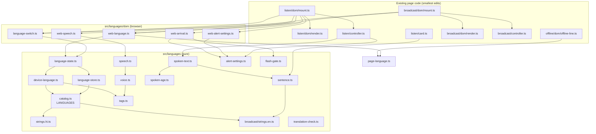
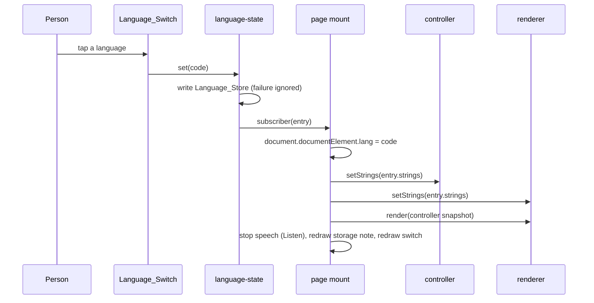

# Design Document

## Overview

Spec 7, "Languages and read aloud". It adds Hindi next to English on `/listen` and `/broadcast`. The air carries only codes, so each Language builds words and sentences from the codes with its own `Strings` object. The message code and the sound link are not touched.

The design has five parts, matching the requirements:

1. **Language files.** `src/languages/strings.hi.ts` exports a full `Strings` object. `src/languages/catalog.ts` lists every Language. Everything else (switch, device choice, store check, voice match, `lang` attribute, tests, review file generator) reads the catalog, so a third language needs one file and one catalog entry (Requirement 15).
2. **Language state.** A small pure object chooses the Chosen_Language (stored value, then device language, then English), changes it on request, writes the Language_Store, and tells subscribers. Both pages create one at mount and redraw on every change.
3. **Sentences and speech.** One pure builder makes the Alert_Sentence from codes. The Listen card, the Spoken_Text and the review sample sentences all use it. A pure function turns the Sent_Age into the Spoken_Age phrase. A speech controller over an injected `SpeechHost` handles Read aloud and decides which one voice block a card shows (button with help line, Voice_Missing_Line, or nothing). The browser adapter is the only code that touches `speechSynthesis`.
4. **Arrival alert.** The Listen controller reports each New_Alert. A pure function decides flash and vibrate from the two settings, the expiry result, reduced-motion and vibration support. A second pure function (the flash gate) limits flashes to 3 in any second, also when alerts arrive quickly. A small DOM module does the flash and the buzz. The two on/off switches sit below the alert cards, and the Language_Switch stays at the top.
5. **Checks.** A language test over the catalog, property tests for the pure parts, and a generator that writes `docs/translation-check.md` from the two language files and the Reviewed_List.

### Design decisions

| Decision | Choice | Reason |
|---|---|---|
| Where the page keeps "current strings" | Each controller and renderer gets a `setStrings(next)` method. The page calls them from one subscriber. | Explicit and testable. A getter-based "live" `Strings` would hide the change and would not rebuild cached text (the Say_First line). |
| Hindi bundling | `catalog.ts` imports `stringsHi` statically. | The Hindi text lands in the page's own JS, so the offline File_List and the offline check already cover it (Requirement 1.9, 11.3). No dynamic import, no extra request. |
| Reviewed_List file | `docs/translation-reviewed.json`, shipped as `{ "version": 1, "reviewed": { "hi": {} } }`. | It sits next to the file it feeds, a reviewer edits one small JSON file, and it is outside `src/` so it is never bundled. It starts empty because no native speaker has checked anything yet. |
| Translation_Check_File generator | Pure functions in `src/languages/translation-check.ts` (tested in vitest). A runner in `tools/languages/main.ts` is built to Node with the same pattern as `tools/ears`. | The language files import each other without `.ts` extensions, so Node cannot load them directly. A vite SSR build can. |
| Text of the Alert_Sentence | New key `sentence.main`, plus the existing `sayfirst.test` and `sayfirst.place` templates. | `buildSayFirst` already uses `sayfirst.test` and `sayfirst.place`. Using the same keys makes the shared parts agree word for word by construction, and `say-first.ts` (not in the approved edit list) stays unchanged. |
| New sentence line on the card | The card gets one new line, the Alert_Sentence, above the label and value rows (English too). The rows keep their text. | The card had no single sentence. The line is new English text on the card, and it uses only the new key `sentence.main`, so no English text of an existing key changes (Requirement 14.1). |
| Spoken_Age | A pure `spokenAge(sentAgeMs, strings)` in `src/languages/spoken-age.ts` with four keys (`spoken.age.now`, `.minutes`, `.hours`, `.days`). The Spoken_Text uses it and no longer says the sent time. | A listener hears "Sent 12 minutes ago", which is easier to take in by ear than a date and a UTC offset. The card keeps the exact sent time (Requirement 8.16). The limits (2 minutes, 120 minutes, 48 hours) make n at least 2 in every plural Template, so no singular form is needed (8.15). |
| Sample sentences | Each sample has the key `sample.<eventType>` and goes through the same Reviewed_List rule as every other entry (key plus exact text). | A reviewer can mark a whole sentence as checked, and a changed sentence returns to review (Requirement 13.9 to 13.15). The sample entries count in the two counts and in the sync test. |
| Voice block on a card | One pure function `voiceBlockFor` returns `'button'`, `'missing'` or `'none'`. The renderer shows the block it names and hides the other parts. | The Voice_Help_Line and the Voice_Missing_Line can never appear together because there is one value, not two flags (Requirement 7.22). |
| Messages that carry label text | `setStrings` in the Broadcast controller re-labels stored `Msg.params` by looking up the old label in the old language and writing the matching label of the new language. | `Msg.params` holds already-translated label text (for example `{ field: 'Place name' }`), and existing tests assert that shape. A reverse lookup keeps the shape and fixes the language. It is sound only if labels are unique within one label group, so the language test checks that (Requirement 12 test list, extra check). |
| Flash shape | A frame about 24 px wide along the screen edge (an inset `box-shadow`, centre transparent). 2 pulses of 150 ms on with a 100 ms gap: 400 ms in total, 2 pulses. | The frame leaves the card text uncovered (Requirement 9.6, 9.7). 400 ms is under the 600 ms limit and 2 pulses are under the limit of 2. The radio look (spec 8) may restyle it. |
| Rapid arrivals | A pure flash gate (`planFlash`) keeps the start times of every pulse already shown or scheduled. A flash starts only when no 1 second window would then hold more than 3 pulses. A flash that is refused is dropped, not queued. | Requirement 9.12 counts each pulse as one flash and counts repeated New_Alerts. With 2 pulses per flash, a second flash that starts while the first runs, or within 1 second of the first pulse, would break the limit. The gate also covers the case of 3 or more alerts in one block. |
| Vibration pattern | `[400, 150, 400]` (950 ms in total). | Meets 9.9 (between 900 and 1100 ms). `navigator.vibrate` replaces a running pattern, so quick repeats do not stack. Vibration is not a flash, so the flash gate does not apply to it. |
| Settings placement | The settings `fieldset` sits after the `#cards` element in `listen/index.html`. The Language_Switch stays in the top block. | Requirement 10.11 to 10.13: the newest card is the first thing seen after the switch and the state lines. The settings stay visible when the History is empty because they do not depend on the cards. |

### Research notes

- Chrome and Android browsers fill `speechSynthesis.getVoices()` late and announce it with the `voiceschanged` event, so voices are looked up at load and again on every `voiceschanged` (Requirement 7.2, 7.16). Voice `lang` tags come as `hi-IN` or `hi_IN` on Android, so matching uses the primary subtag only (7.17). A `SpeechSynthesisUtterance` can be garbage collected while it speaks in Chrome, so the adapter keeps a reference until it ends. `speechSynthesis.cancel()` makes the engine fire an `error` event with `canceled` or `interrupted`, so each `speak` call carries a token and a stale callback is ignored. Sources: [MDN SpeechSynthesis](https://developer.mozilla.org/en-US/docs/Web/API/SpeechSynthesis), [MDN SpeechSynthesisVoice.localService](https://developer.mozilla.org/en-US/docs/Web/API/SpeechSynthesisVoice/localService), [MDN SpeechSynthesisErrorEvent.error](https://developer.mozilla.org/en-US/docs/Web/API/SpeechSynthesisErrorEvent/error). Content was rephrased for compliance with licensing restrictions.
- `navigator.vibrate` is missing on iOS Safari, so the Vibrate_Setting switch is hidden when `typeof navigator.vibrate !== 'function'` (Requirement 10.7). Source: [MDN Navigator.vibrate](https://developer.mozilla.org/en-US/docs/Web/API/Navigator/vibrate).
- WCAG 2.3.1 limits flashing to 3 per second. One flash has 2 pulses in 400 ms. The flash gate refuses a flash that would put more than 3 pulses into any 1 second window, so quick repeats stay inside the limit.  Source: [WCAG 2.3.1](https://www.w3.org/WAI/WCAG21/Understanding/three-flashes-or-below-threshold.html).
- A page with `lang="hi"` and no web font uses the phone's own Devanagari system font. No font is added to the offline File_List (Requirement 6.8).

## Architecture



### Language change flow



Startup order on each page (Requirement 4.7): create the language state, set `lang`, then create the controller and renderer with the Chosen_Language strings. `bindStaticText` runs inside the renderer constructor, so the first draw is already in the right language. The HTML files ship empty `data-text` elements, so no English text appears first.

### Pages and files

New files (owned by this spec):

| File | Role |
|---|---|
| `src/languages/catalog.ts` | `LanguageEntry`, `LANGUAGES`, `DEFAULT_LANGUAGE_CODE`, `findLanguage` |
| `src/languages/strings.hi.ts` | Hindi `Strings` |
| `src/languages/tags.ts` | `primarySubtag`, `sameLanguage` |
| `src/languages/device-language.ts` | `pickDeviceLanguage` |
| `src/languages/language-store.ts` | `LANGUAGE_STORAGE_KEY`, `parseStoredLanguage`, `LanguageStorage` |
| `src/languages/language-state.ts` | `createLanguageState` |
| `src/languages/page-language.ts` | `setPageLanguage`, `getPageLanguage` (shares the state with the Offline_Line) |
| `src/languages/sentence.ts` | `buildAlertSentence` |
| `src/languages/spoken-text.ts` | `buildSpokenText` |
| `src/languages/spoken-age.ts` | `spokenAge`, `AGE_LIMITS` (the Spoken_Age phrase for a Sent_Age) |
| `src/languages/relabel.ts` | `relabelMsg` for the Broadcast controller |
| `src/languages/voice.ts` | `VoiceInfo`, `pickLocalVoice` |
| `src/languages/speech.ts` | `SpeechHost`, `voiceBlockFor`, `createSpeechController` |
| `src/languages/alert-settings.ts` | `AlertSettings`, parse and serialize, `decideArrival`, `FLASH_PLAN`, `FLASH_FRAME_PX`, `VIBRATE_PATTERN_MS` |
| `src/languages/flash-gate.ts` | `planFlash` (pulse start times, the 3 flashes in 1 second rule) |
| `src/languages/translation-check.ts` | entries, render, parse, `parseReviewedList` |
| `src/languages/dom/web-language.ts` | `localStorage` and `navigator.languages` wrappers, `lang` attribute |
| `src/languages/dom/language-switch.ts` | draws the Language_Switch |
| `src/languages/dom/web-speech.ts` | `speechSynthesis` adapter |
| `src/languages/dom/web-arrival.ts` | flash layer and `navigator.vibrate` |
| `src/languages/dom/web-alert-settings.ts` | Settings_Store wrapper |
| `tools/languages/main.ts`, `tools/languages/vite.config.mjs` | generator runner (the config is `.mjs` so that `tsconfig.tools.json`, which includes `tools`, does not check it and needs no edit) |
| `docs/translation-reviewed.json` | Reviewed_List |
| `docs/translation-check.md` | Translation_Check_File (generated) |
| `tests/languages/*` | tests (see Testing Strategy) |
| `.kiro/specs/languages/report.md` | Report_File (written at the end of the tasks) |

Edits to files of other specs (approved by the owner; each is the smallest edit that works). "No edit planned" means the file is on the approved list but the design does not need it.

| File (spec) | Edit |
|---|---|
| `src/broadcast/strings.types.ts` (3) | Add the new keys to `TEXT_KEYS` and `PLACEHOLDERS` (list under Data Models). |
| `src/broadcast/strings.en.ts` (3) | Add English text for the new keys. No existing value changes. |
| `src/broadcast/controller.ts` (3) | Replace `const { ..., strings } = deps` by `let strings = deps.strings`. Add `setStrings(next)` to `Controller`: re-label the stored `Msg` values (banner, banner detail, notices) with `relabelMsg(msg, old, next)`, rebuild `sayFirst` when it is set and `previewAlert` is not null, then `publish()`. Nothing else changes. |
| `src/broadcast/dom/render.ts` (3) | `strings` becomes a variable. Add `setStrings(next)` to `Renderer`: set the variable, call `bindStaticText` (it re-fills the selects and `data-text` nodes), remove `data-sig` from the preview, banner and status nodes so they redraw. The caller then renders the current state. Set the Language_Switch group `aria-label`. |
| `src/broadcast/dom/mount.ts` (3) | Create the language state first. `strings` becomes a variable. Mount the Language_Switch. One subscriber: set `lang`, `controller.setStrings`, `renderer.setStrings`, `renderer.render(controller.getState())`, rewrite the storage note. `fail()` reads the current strings. `createPersistence` receives a `Strings` view that reads the current value (see Components). |
| `src/broadcast/dom/ids.ts` (3) | Add `languageSwitch: 'language-switch'`. (Needed by the markup test and by mount.) |
| `broadcast/index.html` (3) | Add `<div id="language-switch" role="group"></div>` after the `<nav>`. Change `<title>Dead Air</title>` to `<title data-text="page.title"></title>`. |
| `src/listen/controller.ts` (4) | `let strings = deps.strings`. Add `setStrings(next)` (then `emit()`). Add `spokenText(key)`, which builds the Spoken_Text from the stored `Alert`, `deps.now()` and the current strings (the Spoken_Age needs the device time at the tap). Add optional dep `onNewAlert`. In `makeOnBlock`, compare history keys before and after the payloads and call `onNewAlert({ expiry })` once for each key that is new. |
| `src/listen/card.ts` (4) | `CardView` gets `sentence: string \| null`. `CardRow` gets `dirAuto?: true`, set on the place row. `buildCardView` calls `buildAlertSentence`. Existing fields and values stay. |
| `src/listen/dom/render.ts` (4) | `strings` becomes a variable. `setStrings(next)` rebuilds all cards (`shown = []`), resets the cached meter label, rebinds static text. `buildCardElement` draws the sentence line, sets `dir="auto"` on rows with `dirAuto`, and adds one voice block with `data-read="<alert key>"` that holds the button, the help line, the Voice_Missing_Line and the error line. New `renderSpeech(ui)` shows exactly the parts that `ui.block` names (see Components) and hides the rest, and relabels the button. |
| `src/listen/dom/mount.ts` (4) | Same language wiring as the Broadcast mount. Create the speech controller, the arrival module and the settings switches. Delegate clicks on `#cards` for `[data-read]`. Stop speech when the page is hidden and on `pagehide`. |
| `src/listen/dom/ids.ts` (4) | Add `languageSwitch`, `alertSettings`, `setFlash`, `setVibrate`, `setVibrateRow`. |
| `listen/index.html` (4) | Add the Language_Switch `div` in the top block (under the `<nav>`). Add the settings block (two checkbox switches in a `fieldset`, all text from `data-text`) directly after the `#cards` element, so that it sits below the alert cards (Requirement 10.11). |
| `src/listen/ui-state.ts` (4) | No edit planned. |
| `src/offline/dom/offline-line.ts` (6) | `createOfflineLine` returns `{ apply, setStrings }`. `connectOfflineLine(doc, strings?)` uses `strings` when it is given. Otherwise it uses `getPageLanguage()` (falls back to `stringsEn` when none is set) and subscribes, so the line follows the Chosen_Language. `listen/main.ts` and `broadcast/main.ts` are not edited. |
| `tsconfig.json` (shared) | Add `src/languages/dom` to `exclude`. `src/languages` is already inside the `include` entry `src`, and the tests are inside `tests`. |
| `tsconfig.broadcast-logic.json` (shared) | Add `src/languages` to `include` and `src/languages/dom` to `exclude`. |
| `tsconfig.broadcast-page.json` (shared) | Add `src/languages` to `include`. |
| `tsconfig.listen-logic.json` (shared) | Add `src/languages` to `include` and `src/languages/dom` to `exclude`. |
| `tsconfig.listen-page.json` (shared) | Add `src/languages` to `include`. |
| `package.json` (shared) | Add two scripts: `translations` (`vite build --config tools/languages/vite.config.mjs && node tools/languages/build/languages.mjs`) and `translations:check` (the same with `--check`). The `typecheck` script is not changed. |
| `.gitignore` (shared) | Add `tools/languages/build/`. |

Not edited: `tsconfig.tools.json` (the runner `tools/languages/main.ts` uses only the Node declarations that the included `tests/broadcast/node-extra.d.ts` and `tests/ears/node-extra.d.ts` already give, and decodes bytes with `utf8Decode` from `src/message-code/utf8.ts`), `tsconfig.message-code.json`, `tsconfig.sound-link.json`, the three `tsconfig.offline-*.json` files (they follow imports of `src/languages/page-language.ts` without an edit), `src/message-code/`, `src/sound-link/`, `tools/ears/`, `src/broadcast/say-first.ts`, `src/offline/persist.ts`, `src/offline/dom/persist.ts`, the three `main.ts` entry files, and every existing test.

## Components and Interfaces

### `catalog.ts`

```ts
export interface LanguageEntry {
  readonly code: string;       // 'en', 'hi'
  readonly name: string;       // its own name: 'English', 'हिन्दी'
  readonly speechTag: string;  // 'en', 'hi'
  readonly strings: Strings;
}
export const LANGUAGES: readonly LanguageEntry[]; // [en, hi]
export const DEFAULT_LANGUAGE_CODE = 'en';
export function findLanguage(code: string, catalog?: readonly LanguageEntry[]): LanguageEntry | null; // exact match
```

Every consumer takes `catalog` as an argument with `LANGUAGES` as the default, so tests can pass a catalog with a third fake language (Requirement 15.3).

### `tags.ts`

```ts
export function primarySubtag(tag: string): string; // split on '-' or '_', first part, lower case, trimmed
export function sameLanguage(a: string, b: string): boolean; // true when both primary subtags are non-empty and equal
```

### `device-language.ts`

```ts
export function pickDeviceLanguage(
  tags: readonly unknown[],
  catalog?: readonly LanguageEntry[],
): LanguageEntry | null;
```

Walks `tags` in order, ignores non-string entries, returns the first catalog entry whose `code` has the same primary subtag as the tag. Returns null when none match.

### `language-store.ts`

```ts
export const LANGUAGE_STORAGE_KEY = 'dead-air.language.v1';
export interface LanguageStorage {
  read(): string | null;          // never throws
  write(code: string): boolean;   // false on failure, never throws
}
export function parseStoredLanguage(raw: unknown, catalog?: readonly LanguageEntry[]): LanguageEntry | null;
```

The stored value is the plain code, for example `hi`. `parseStoredLanguage` returns an entry only for a string that equals a catalog `code` exactly (no trimming, no case folding). Anything else, including `null`, gives `null`.

### `language-state.ts`

```ts
export interface LanguageState {
  current(): LanguageEntry;
  set(code: string): boolean;                       // false when code is not in the catalog; nothing changes
  subscribe(fn: (entry: LanguageEntry) => void): () => void;
}
export function createLanguageState(deps: {
  catalog?: readonly LanguageEntry[];
  storage: LanguageStorage;
  deviceTags: () => readonly unknown[];
}): LanguageState;
```

Initial choice: `parseStoredLanguage(storage.read())`, else `pickDeviceLanguage(deviceTags())`, else the entry with `DEFAULT_LANGUAGE_CODE`, else the first catalog entry. The initial choice writes nothing (4.4). `set` updates the current entry, calls `storage.write(code)` and ignores a `false` result (5.8), then calls the subscribers. `deviceTags` and `storage.read` are wrapped in `try` so a throw counts as empty (4.5).

### `page-language.ts`

Holds one module-level `LanguageState | null`. `setPageLanguage(state)` is called by both mounts. `getPageLanguage()` returns it or null. It imports types only, so the front page bundle does not pull in the Hindi file.

### `sentence.ts`

```ts
export type AlertSentence =
  | { ok: true; text: string; parts: { test: string | null; main: string; place: string | null } }
  | { ok: false };

export function buildAlertSentence(alert: Alert, strings: Strings): AlertSentence;
```

Parts, joined by one space:
1. `test`: `fillTemplate(text['sayfirst.test'])`, only when `alert.test`.
2. `main`: `fillTemplate(text['sentence.main'], { event, urgency, severity, action })` with labels from `labelFor`.
3. `place`: `fillTemplate(text['sayfirst.place'], { place: alert.placeName })`, only when `alert.placeName.trim().length > 0`. The place value is passed as `alert.placeName` unchanged (no trim, no case change; Requirement 3).

Any `null` from `labelFor` or `fillTemplate` returns `{ ok: false }` with no partial text (2.7). The function is pure, so two calls with the same input give the same text (2.8).

Note on `placeName`: `buildSayFirst` tests emptiness with `trim()` and passes the trimmed name. The sentence passes the name as sent. The message code does not allow leading or trailing spaces to matter for display, and the card shows the name as sent. If the two ever differ, the card and the Spoken_Text agree with each other, and the Say_First line is unchanged because spec 3 owns it.

### `spoken-age.ts`

```ts
export const AGE_LIMITS = { justNowBelowMs: 120_000, minutesBelowMs: 7_200_000, hoursBelowMs: 172_800_000 } as const;
export function spokenAge(sentAgeMs: number, strings: Strings): string | null;
```

`sentAgeMs` is the Sent_Age. The function picks one case and fills the Template of the Chosen_Language:

| Sent_Age | Key | `{n}` |
|---|---|---|
| below 2 minutes (`< 120_000` ms, including a small negative value inside the clock tolerance) | `spoken.age.now` | none |
| 2 minutes up to, not including, 120 minutes | `spoken.age.minutes` | `floor(ms / 60_000)` |
| 120 minutes up to, not including, 48 hours | `spoken.age.hours` | `floor(ms / 3_600_000)` |
| 48 hours or more | `spoken.age.days` | `floor(ms / 86_400_000)` |

`n` is written with Latin digits. Because every plural case starts at a whole 2 of its unit, n is at least 2 in minutes, hours and days, and no singular Template exists (Requirement 8.15). The boundaries are exact: 119 999 ms gives "just now", 120 000 ms gives 2 minutes, 7 199 999 ms gives 119 minutes, 7 200 000 ms gives 2 hours, 172 799 999 ms gives 47 hours, 172 800 000 ms gives 2 days. A non-finite `sentAgeMs`, or a missing Template, returns null.

### `spoken-text.ts`

```ts
export function buildSpokenText(
  alert: Alert,
  nowMs: number,
  strings: Strings,
): string | null;
```

The sent time text and the UTC offset are no longer inputs: the Spoken_Text carries the Spoken_Age, not the card's time text (Requirement 8.4). The card keeps the exact time (8.16).

Parts in order, joined by one space, each only when it applies. `expiry = checkExpiry(alert, nowMs)`:
1. Test sentence (`sayfirst.test`) when `alert.test`.
2. `spoken.expired` filled with `status` = `labels.status.expired`, when `expiry.status === 'expired'`.
3. `listen.clock.line` when the status is `sent-in-future` or `clock-unknown`. No Spoken_Age is added in these two cases (8.3).
4. The Alert_Sentence without its `parts.test` (part 1 already has it, so the test sentence is said once).
5. `spokenAge(nowMs - expiry.sentAtMs, strings)`, only when the status is `current` or `expired` (8.4). A negative age is clamped to 0 first, so a sent time a little ahead of the device clock (inside the clock tolerance) reads "just now".

Returns null when any needed part cannot be built. It runs at the moment of the tap with the current device time (8.6). It takes an `Alert` from the History only, and the History holds only alerts that passed the check (8.7).

### `relabel.ts`

```ts
export function relabelMsg(msg: Msg, from: Strings, to: Strings): Msg;
```

Group by key and param name: `err.encode` and `check.failed.field` use `field` with `labels.field`. `err.audio` uses `reason` with `labels.audioReason`. `err.wav` uses `reason` with `labels.wavReason`. `check.failed.reason` uses `reason` with `labels.decodeReason`. For each of those, find the code whose label in `from` equals the param, and put the label of that code in `to`. When no code matches (the param is a raw code that fell back, see `?? f.field` in the controller), the param is kept. Other messages come back unchanged.

### `voice.ts`

```ts
export interface VoiceInfo { id: string; name: string; lang: string; localService: boolean; isDefault: boolean }
export function pickLocalVoice(voices: readonly VoiceInfo[], speechTag: string): VoiceInfo | null;
```

Candidates are voices with `localService === true` and `sameLanguage(v.lang, speechTag)`. Among them prefer `isDefault`, otherwise the first in list order. Returns null when there are none.

### `speech.ts`

```ts
export interface SpeechHost {
  readonly supported: boolean;
  voices(): readonly VoiceInfo[];
  onVoicesChanged(fn: () => void): () => void;
  speak(req: { text: string; voiceId: string; lang: string }, cb: { onEnd(): void; onError(): void }): void;
  cancel(): void;
}
export type VoiceBlock = 'button' | 'missing' | 'none';
export function voiceBlockFor(i: { supported: boolean; hasLocalVoice: boolean; languageCode: string }): VoiceBlock;
export interface SpeechUi {
  block: VoiceBlock;             // which one voice block every card shows
  available: boolean;            // a Local_Voice exists for the Chosen_Language
  showHelp: boolean;             // block === 'button' and the Chosen_Language is not English
  speakingKey: string | null;    // Alert_Key of the card being read
  errorKey: string | null;       // Alert_Key whose last speech failed
}
export interface SpeechController {
  refresh(): void;               // look for voices again
  languageChanged(): void;       // stop speech, clear error, refresh
  tap(alertKey: string): void;
  stop(): void;
  snapshot(): SpeechUi;
  subscribe(fn: (ui: SpeechUi) => void): () => void;
  dispose(): void;
}
export function createSpeechController(deps: {
  host: SpeechHost;
  language: () => LanguageEntry;
  buildText: (alertKey: string) => string | null;   // listen controller's spokenText
}): SpeechController;
```

`voiceBlockFor` (Requirement 7.3 to 7.5, 7.19, 7.21 to 7.23):

| `supported` | `hasLocalVoice` | `languageCode` | Result |
|---|---|---|---|
| false | any | any | `'none'` (no button, no help line, no missing line) |
| true | true | any | `'button'` |
| true | false | not English | `'missing'` |
| true | false | English | `'none'` |

`showHelp` is `block === 'button' && languageCode !== DEFAULT_LANGUAGE_CODE`. The renderer shows, for each card, only what `block` names:

| `block` | Card shows | Card hides |
|---|---|---|
| `'button'` | Read_Aloud_Button, plus the Voice_Help_Line when `showHelp` | Voice_Missing_Line |
| `'missing'` | Voice_Missing_Line, in the place where the button would be | Read_Aloud_Button, Voice_Help_Line |
| `'none'` | nothing | all three |

So the card shows exactly one of the three outcomes, and the two lines never appear together (7.22). The error line `listen.read.error` is separate: it shows near the button only when `errorKey` is that card's key and `block === 'button'`. When the voice list fills later, `refresh()` recomputes `block`, so the Voice_Missing_Line disappears and the button appears on every card at once (7.16).

Behaviour:
- `tap(key)`: if `speakingKey === key`, call `stop()`. Otherwise `stop()` first (this cancels any other card, 7.10), then build the text now, pick the voice now, call `host.speak` with `voiceId` and `lang` of that voice (7.7), set `speakingKey = key`, clear `errorKey`. A `null` text, a missing voice or a throw from `host.speak` sets `errorKey = key` and starts nothing.
- Each `speak` call takes a token. `onEnd` and `onError` act only when their token is still current, so the `canceled` event that follows our own `cancel()` does nothing. `onEnd` clears `speakingKey`. `onError` sets `errorKey` and clears `speakingKey`. Neither starts a new speech (7.13).
- `stop()` calls `host.cancel()` only when something is speaking, clears `speakingKey`.
- `refresh()` recomputes `available` as `host.supported && pickLocalVoice(...) !== null`, then `block` with `voiceBlockFor`. When `available` turns false while speaking, it calls `stop()`.
- `speak` is only ever called from `tap`. Nothing calls it on arrival (7.8).
- No `fetch`, `XMLHttpRequest` or other call is made with the text (7.14). The `SpeechHost` interface has no such method.

### `alert-settings.ts`

```ts
export const ALERT_SETTINGS_KEY = 'dead-air.listen.alertSettings.v1';
export interface AlertSettings { flash: boolean; vibrate: boolean }
export const DEFAULT_ALERT_SETTINGS: AlertSettings; // both true
export function parseAlertSettings(raw: unknown): AlertSettings;   // invalid value per field -> true
export function serializeAlertSettings(s: AlertSettings): string;   // JSON: {"flash":true,"vibrate":false}
export interface ArrivalInput { settings: AlertSettings; expiry: ExpiryStatus; reducedMotion: boolean; canVibrate: boolean }
export function decideArrival(i: ArrivalInput): { flash: boolean; vibrate: boolean };
export const FLASH_PLAN: readonly { onMs: number; offMs: number }[]; // [{150,100},{150,0}]: 2 pulses, 400 ms in total
export const FLASH_FRAME_PX = 24;                                     // width of the coloured frame
export const VIBRATE_PATTERN_MS: readonly number[];                   // [400,150,400]: 950 ms in total
```

`FLASH_PLAN` reconciles the pulse count and the duration (Requirement 9.6): 2 pulses (at most 2), each 150 ms on, one 100 ms gap, 400 ms from start to end (at most 600). Pulse starts are 0 ms and 250 ms after the flash starts. `VIBRATE_PATTERN_MS` is `[400, 150, 400]`: 950 ms in total, inside the 900 to 1100 ms range (9.9).

`decideArrival`: `flash = settings.flash && expiry === 'current' && !reducedMotion`; `vibrate = settings.vibrate && expiry === 'current' && canVibrate`. `parseAlertSettings` reads JSON, and for each of the two fields uses the value only when it is a boolean, otherwise `true` (10.2, 10.5). The stored text holds only the two booleans (10.10). Test and real alerts take the same path (9.10).

### `flash-gate.ts`

```ts
export const MAX_FLASHES_PER_SECOND = 3;
export const PULSE_STARTS_MS: readonly number[]; // derived from FLASH_PLAN: [0, 250]
/** `earlierStarts` holds the start time (ms) of every pulse already shown or scheduled. */
export function planFlash(earlierStarts: readonly number[], nowMs: number): number[] | null;
```

`planFlash` returns the absolute start times of the pulses of a new flash (`nowMs + 0`, `nowMs + 250`), or null when the new flash must not start. It returns null when, with the new pulse starts added to `earlierStarts`, some window of 1000 ms (from any pulse start, the end not included) would hold more than `MAX_FLASHES_PER_SECOND` pulse starts. The web module keeps the list of accepted starts, drops starts older than 1000 ms before it asks, and starts a flash only when the result is not null. A refused flash is dropped, not queued (Requirement 9.12).

Worked cases with a first flash at 0 ms (pulses at 0 and 250, ending at 400): a second New_Alert at 100 ms is refused (4 pulses in 1 s); at 500 ms it is refused (pulses 0, 250, 500, 750); at 800 ms it is allowed (pulses 0, 250, 800, 1050: no 1 s window holds more than 3). The result is pure, so a property test can run it over any arrival sequence.

### `translation-check.ts`

```ts
export interface CheckEntry { key: string; english: string; hindi: string; status: 'checked' | 'needs human check' }
export interface ReviewedList { version: 1; reviewed: Record<string, Record<string, string>> } // language code -> key -> checked text
export function parseReviewedList(text: string): { ok: true; list: ReviewedList } | { ok: false; reason: string };
export function statusFor(reviewed: Record<string, string>, key: string, text: string): CheckEntry['status'];
export function buildStringEntries(en: Strings, other: Strings, reviewed: Record<string, string>): CheckEntry[];
export function buildSampleEntries(en: Strings, other: Strings, reviewed: Record<string, string>): CheckEntry[]; // 9 entries, one per event type
export function renderTranslationCheck(strings: CheckEntry[], samples: CheckEntry[]): string;
export function parseTranslationCheck(md: string): { checked: number; needsCheck: number; strings: CheckEntry[]; samples: CheckEntry[] };
```

Keys: `labels.<group>.<code>` for every label and `text.<textKey>` for every text key. Sample keys are `sample.<eventType>`, for example `sample.flood`. Each sample is a test alert (`test: true`, place "Rampur", urgency `immediate`, severity `severe`, action `shelter`), built with `buildAlertSentence`, so the sample sentences begin with the test sentence (promise 3).

Strings and samples follow one rule. `statusFor(reviewed, key, text)` is `checked` only when `reviewed[key]` equals `text` exactly. `buildSampleEntries` calls `statusFor` for each sample with the sample's own key and the current sample sentence in the target Language, so no sample has a fixed status (Requirement 13.15). The same Reviewed_List map (one per Language code) holds string keys and `sample.` keys. When the Reviewed_List holds every entry key with its exact current text, the `needs human check` count is 0 (13.14).

The `hindi` field of `CheckEntry` holds the text of the target Language (the field name is kept for the Hindi file). The runner takes its Language list from the catalog: for every entry except English it writes one file, `docs/translation-check.md` for `hi` and `docs/translation-check.<code>.md` for any later Language (Requirement 15.2).

`renderTranslationCheck` writes: a heading, the note paragraph (Requirement 13.7), two count lines, the strings table, the sample table. Cell text has `|` written as `\|` and line breaks as a space. Placeholders such as `{minutes}` are written unchanged (13.3). `parseTranslationCheck` reverses that.

### Browser adapters (`src/languages/dom/`)

- `web-language.ts`: `createWebLanguageState()` builds the `LanguageStorage` over `localStorage` (every call in `try`, returns null or false on failure) and `deviceTags` over `navigator.languages` (falling back to `[navigator.language]`). It also exports `applyDocumentLanguage(doc, entry)` which sets `doc.documentElement.lang`. It calls `setPageLanguage`.
- `language-switch.ts`: `mountLanguageSwitch(doc, state, getLabel)` fills `#language-switch` with one `<button type="button" lang="<code>" aria-pressed="true|false">` per catalog entry, text = `entry.name`. It sets the group `aria-label` from `lang.switch.label` of the current strings. A click calls `state.set(code)`. It redraws the pressed states on every change. It returns a dispose function.
- `web-speech.ts`: implements `SpeechHost` with `window.speechSynthesis`. `supported` is true only when `speechSynthesis` and `SpeechSynthesisUtterance` exist. `voices()` maps `getVoices()` to `VoiceInfo` and keeps an id-to-voice map. `onVoicesChanged` uses `addEventListener('voiceschanged', ...)`. `speak` builds an utterance, sets `voice` and `lang`, keeps a reference to it until `end` or `error`, and calls `speechSynthesis.speak`. `cancel` calls `speechSynthesis.cancel()`.
- `web-arrival.ts`: `createWebArrival(getSettings)` returns `{ signal(expiry), dispose() }`. `signal` calls `decideArrival` with `matchMedia('(prefers-reduced-motion: reduce)').matches` and `typeof navigator.vibrate === 'function'`. For flash it keeps the list of accepted pulse starts, drops starts older than 1000 ms, and calls `planFlash(starts, Date.now())`. A null result means no flash (9.12). Otherwise it adds the returned starts to the list and makes one `div` with `aria-hidden="true"`, `pointer-events: none`, fixed position over the screen, no text, a transparent centre and an inset `box-shadow` frame of `FLASH_FRAME_PX` (24 px), and runs `FLASH_PLAN` with `setTimeout`. For vibrate it calls `navigator.vibrate(VIBRATE_PATTERN_MS)` inside `try`, and ignores a throw or a `false` result (9.11).
- `web-alert-settings.ts`: reads and writes `localStorage[ALERT_SETTINGS_KEY]` in `try`. A write failure keeps the in-memory values (10.6).

### Live strings for `createPersistence`

`src/offline/dom/persist.ts` takes a `Strings` value and reads `strings.text['offline.storageNote']` when it shows the note. The mounts pass an object whose `text` and `labels` are getters over the current language state. This avoids an edit to `persist.ts`. On a language change the mount also rewrites the note text when `#storage-note` is visible.

### Listen controller additions

```ts
interface ListenDeps { /* existing */ onNewAlert?: (e: { expiry: ExpiryStatus }) => void }
interface ListenController { /* existing */ setStrings(next: Strings): void; spokenText(alertKey: string): string | null }
```

In `makeOnBlock`, before applying payloads take `const keysBefore = new Set(model.history.map(e => alertKey(e.alert)))`. After the loop, for each history entry whose key is not in `keysBefore`, call `deps.onNewAlert?.({ expiry: checkExpiry(entry.alert, now).status })` inside `try`. A repeat of a stored key is not in the new set (9.3). The History loaded at start never goes through `makeOnBlock` (9.4). `onNewAlert` is called only while a Session runs, because `makeOnBlock` returns early otherwise.

### Markup changes

`listen/index.html` adds, under the `<nav>` (the top of the page):

```html
<div id="language-switch" role="group"></div>
```

and, directly after the `#cards` element (below the alert cards, Requirement 10.11):

```html
<fieldset id="alert-settings">
  <legend data-text="listen.settings.heading"></legend>
  <div><input id="set-flash" type="checkbox" role="switch" /><label for="set-flash" data-text="listen.setting.flash"></label></div>
  <div id="set-vibrate-row"><input id="set-vibrate" type="checkbox" role="switch" /><label for="set-vibrate" data-text="listen.setting.vibrate"></label></div>
</fieldset>
```

The fieldset does not depend on the History, so it is visible when there are no cards (10.12). The Language_Switch is not inside it (10.13).

`broadcast/index.html` adds the same `#language-switch` div and the `<title data-text>` change. The level meter `aria-label=""` stays: the renderer fills it from `listen.level.label`. The Language_Switch sits in the first screen without a menu (5.1). The settings are below the cards and may need a scroll when the History is long.

## Data Models

### New text keys

| Key | Placeholders | English text | Hindi (illustrative, final wording in the task) |
|---|---|---|---|
| `lang.switch.label` | none | `Language` | `भाषा` |
| `sentence.main` | `event`, `urgency`, `severity`, `action` | `{event}. Urgency: {urgency}. Severity: {severity}. {action}.` | `{event}। कितनी जल्दी: {urgency}। कितना गंभीर: {severity}। {action}।` |
| `spoken.expired` | `status` | `{status}.` | `{status}।` |
| `spoken.age.now` | none | `Sent just now.` | `अभी भेजा गया।` |
| `spoken.age.minutes` | `n` | `Sent {n} minutes ago.` | `{n} मिनट पहले भेजा गया।` |
| `spoken.age.hours` | `n` | `Sent {n} hours ago.` | `{n} घंटे पहले भेजा गया।` |
| `spoken.age.days` | `n` | `Sent {n} days ago.` | `{n} दिन पहले भेजा गया।` |
| `listen.read` | none | `Read aloud` | `पढ़कर सुनाएँ` |
| `listen.read.stop` | none | `Stop reading` | `पढ़ना बंद करें` |
| `listen.read.error` | none | `This alert could not be read aloud.` | `यह अलर्ट पढ़कर नहीं सुनाया जा सका।` |
| `listen.read.help` | none | `If you hear nothing or the voice sounds wrong, install this language's voice in your phone's text-to-speech settings.` (exact text from Requirement 7.19) | Hindi version of the same line |
| `listen.read.missing` | none | `To hear alerts read aloud, install this language's voice in your phone's text-to-speech settings.` (exact text from Requirement 7.21) | Hindi version of the same line |
| `listen.settings.heading` | none | `Alert signals` | `अलर्ट के संकेत` |
| `listen.setting.flash` | none | `Flash the screen when a new alert arrives` | `नया अलर्ट आने पर स्क्रीन चमके` |
| `listen.setting.vibrate` | none | `Vibrate when a new alert arrives` | `नया अलर्ट आने पर फ़ोन काँपे` |

`spoken.age.minutes`, `.hours` and `.days` declare `n` in `PLACEHOLDERS`. The three plural Templates need no singular form because `n` is at least 2 (Requirement 8.15).

The existing keys are all kept with their current English text (Requirement 14.1). The sentence also uses `sayfirst.test` and `sayfirst.place`, and the spoken text uses `listen.clock.line`, `labels.status.expired` and the four `spoken.age.*` keys.

The Hindi file has a value for every key of `TEXT_KEYS` and every code in the ten label groups. Wording rules (Requirement 1.10): short everyday words, polite commands (जाएँ, रहें), no Sanskrit-heavy words, Devanagari digits never used, Latin digits and the Latin word `TEST` only where the requirements say so. Illustrative labels (final text is a task, and every entry starts as `needs human check`):

| Group | Examples |
|---|---|
| `event` | flood `बाढ़`, cyclone `चक्रवात`, fire `आग`, earthquake `भूकंप`, heatwave `लू`, missing-person `लापता व्यक्ति`, all-clear `खतरा टल गया` |
| `action` | shelter `सुरक्षित जगह पर रहें`, evacuate `इलाका खाली करें`, prepare `तैयार रहें`, avoid `इस इलाके में न जाएँ`, monitor `ख़बरों पर नज़र रखें` |
| `status` | expired `समय समाप्त` |
| `test.banner` | `परीक्षण TEST` (Devanagari word plus the Latin word) |
| `sayfirst.test` | `यह परीक्षण TEST है।` (contains `TEST`, Requirement 12.7) |

### Types

```ts
// strings.types.ts after the edit: TEXT_KEYS gains the 15 keys above; PLACEHOLDERS gains their entries.
// The existing compile-time check PLACEHOLDER_KEYS_MATCH keeps TEXT_KEYS and PLACEHOLDERS in step.
// Language files are typed `Strings`, so a missing key in any Language_File fails `tsc` (Requirement 12.11).
```

```ts
interface CardRow { label: string; value: string; dirAuto?: true }   // dirAuto only on the place row
interface CardView { /* existing fields */ sentence: string | null }   // the new English sentence line on the card
```

### Stores

| Store | Key | Value | Written when |
|---|---|---|---|
| Language_Store | `dead-air.language.v1` | the plain code, `en` or `hi` | only when the person picks a Language |
| Settings_Store | `dead-air.listen.alertSettings.v1` | `{"flash":true,"vibrate":true}` | when a settings switch changes |

Neither holds audio, alert text or a place name (Requirement 11.5, 10.10).

### Reviewed_List

`docs/translation-reviewed.json`:

```json
{ "version": 1, "reviewed": { "hi": { "labels.event.flood": "बाढ़", "text.btn.go": "…", "sample.flood": "…" } } }
```

The first level is the Language_Code, the second level maps an entry key to the exact text that was checked. An entry is `checked` when its key is in `reviewed[code]` and the value equals the current text of that Language exactly. This is the one rule for every entry, the `sample.<eventType>` sentences included (Requirement 13.10, 13.11, 13.15). A changed text, or a missing key, gives `needs human check`. The file ships with `"reviewed": { "hi": {} }`. The generator reads this file on every run, so a review survives regeneration (13.13). A key in `reviewed[code]` that is neither a string key nor a `sample.` key makes the sync test fail, so stale reviews are noticed.

### Translation_Check_File layout

```
# Hindi translation check

<note: machine-written, only `checked` entries were checked by a native speaker, review all others before real use>

Checked: <N>
Needs human check: <M>

## Strings
| Key | English | Hindi | Status |
|---|---|---|---|
| labels.event.flood | Flood | … | needs human check |

## Sample sentences (test alerts)
| Key | English | Hindi | Status |
|---|---|---|---|
| sample.flood | … | … | checked or needs human check, by the Reviewed_List |
```

The two counts cover both tables. The note and the file hold no emoji (13.8). The runner has two modes: write (default) and `--check` (compare only, exit 1 on a difference).

## Correctness Properties

*A property is a characteristic or behavior that should hold true across all valid executions of a system-essentially, a formal statement about what the system should do. Properties serve as the bridge between human-readable specifications and machine-verifiable correctness guarantees.*

Reflection on the prework: several criteria were merged so that each statement below checks one distinct behavior. Place name and label checks (2.3, 3.2, 3.4, 3.6, 12.12) are merged into the first statement. The spoken-text criteria 8.1 to 8.5, 8.8 and 8.9 are merged into one. The Spoken_Age boundary criteria 8.10 to 8.15 and 8.17 are one property of their own, because they are about a number and not about the text around it. The flash limit (9.6, 9.12) is one property over the flash gate. The voice block criteria 7.3 to 7.5, 7.19 and 7.21 to 7.23 are one property over `voiceBlockFor`. The settings criteria 10.2 to 10.5 and 10.10 are merged into one round trip. Voice criteria 7.3 to 7.6 are split between a pure voice pick and the speech controller. Every statement ranges over every entry of `LANGUAGES`, and alerts come from `alertArb` in `tests/message-code/generators.ts` (so place names are ones the message code accepts), with the TEST flag chosen by the statement.

### Property 1: The sentence holds the four labels and the place name

*For any* valid `Alert` and *for any* Language in the catalog, `buildAlertSentence` returns `ok: true`, and its text contains the event label, the urgency label, the severity label and the action label of that Language. When the place name is not blank, the text also contains the place name as a substring, exactly as sent.

**Validates: Requirements 2.1, 2.2, 2.3, 3.2, 3.4, 3.6, 12.12, 14.7**

### Property 2: Sentence structure and determinism

*For any* valid `Alert` and Language: the sentence begins with the test sentence of that Language exactly when `alert.test` is true; `parts.place` is null exactly when the place name is blank, and then the text contains no filled place sentence; and building the sentence twice from the same input gives the same text.

**Validates: Requirements 2.4, 2.5, 2.8**

### Property 3: A missing template or label gives no sentence

*For any* valid `Alert`, Language, and any one of the keys the sentence needs (`sentence.main`, `sayfirst.test` when the alert is a test, `sayfirst.place` when the place is not blank, and the four label entries used), when that value is removed or set to the empty string, `buildAlertSentence` returns `{ ok: false }` and no text.

**Validates: Requirements 2.7**

### Property 4: Shared parts agree word for word

*For any* valid `Alert` and Language, when both builders succeed: the Say_First text contains `parts.test` and `parts.place` of the Alert_Sentence verbatim (when they exist), and the Spoken_Text contains the Alert_Sentence `parts.main` and `parts.place` verbatim.

**Validates: Requirements 2.9**

### Property 5: The Spoken_Text carries the promises

*For any* valid `Alert`, Language and device time, the Spoken_Text (when built) contains the Alert_Sentence main part and, when the place name is not blank, the place name. It begins with the test sentence when `test` is true. When `checkExpiry` reports `expired`, it contains the `expired` status label, placed after the test sentence when there is one. When `checkExpiry` reports `sent-in-future` or `clock-unknown`, it contains `listen.clock.line` and contains no Spoken_Age phrase and no sent time text. When the status is `current` or `expired`, it contains the Spoken_Age phrase for the Sent_Age, placed after the `expired` label when there is one, and does not contain the card's sent time text (`formatLocal` of the sent time). When the status is `current`, it contains neither the expired label nor the clock line.

**Validates: Requirements 8.1, 8.2, 8.3, 8.4, 8.5, 8.8, 8.9, 14.7**

### Property 6: The Spoken_Age follows the boundaries

*For any* Language and *for any* Sent_Age in milliseconds (generated across the whole range, with extra weight on and around each boundary), `spokenAge` gives: "just now" when the age is below 120 000 ms; the minutes Template with n equal to the age in whole minutes, rounded down, from 120 000 ms up to but not including 7 200 000 ms; the hours Template with n in whole hours from 7 200 000 ms up to but not including 172 800 000 ms; and the days Template with n in whole days from 172 800 000 ms. The text equals the Template of that Language with `{n}` replaced by the decimal number, n is at least 2 in every plural case, and the worked boundaries hold: 1 minute 59 seconds is "just now", 2 minutes is 2 minutes, 119 minutes is 119 minutes, 120 minutes is 2 hours, 47 hours 59 minutes is 47 hours, 48 hours is 2 days.

**Validates: Requirements 8.10, 8.11, 8.12, 8.13, 8.14, 8.15, 8.17, 14.7**

### Property 7: The card keeps place, test banner and time format in every Language

*For any* valid `Alert` in a History entry and each Language: the place row value equals the place name exactly and carries `dirAuto`; `testBanner` is not null exactly when `test` is true and then equals the `test.banner` text of that Language; `sentText` and the valid-until row are the same string in every Language; and `sentText` matches `^\d{4}-\d{2}-\d{2} \d{2}:\d{2} UTC[+-]\d{2}:\d{2}$` (Latin digits, no month or day name), whatever the Spoken_Age says.

**Validates: Requirements 3.1, 3.5, 6.6, 6.9, 8.16, 12.12**

### Property 8: Stored messages keep their meaning when the Language changes

*For any* message of the kinds that carry label text (`err.encode`, `check.failed.field`, `err.audio`, `err.wav`, `check.failed.reason`) built with a code from its label group in Language A, `relabelMsg(msg, A, B)` carries the label of the same code in Language B, and `relabelMsg(relabelMsg(msg, A, B), B, A)` equals `msg`, for each pair of Languages in the catalog.

**Validates: Requirements 6.4**

### Property 9: Device language follows the primary subtag

*For any* list of language tags (any case, `-` or `_` separators, extra subtags, entries that match no Language, and non-string entries), `pickDeviceLanguage` returns the catalog entry for the first tag whose primary subtag equals a catalog code, and returns null when no tag matches.

**Validates: Requirements 4.1, 4.2, 4.3, 14.7**

### Property 10: The Language_Store round trip

*For any* `code` of the catalog, writing it through the Language_Store and reading it back with `parseStoredLanguage` returns that entry. *For any* string that is not exactly a catalog code (including other case, padding spaces, and an empty string), and for `null`, `parseStoredLanguage` returns null. A state created over a store that holds a valid code uses that code whatever the device tags are.

**Validates: Requirements 4.5, 5.5, 5.6, 5.7, 14.8**

### Property 11: Language tags match by primary subtag

*For any* two language tags with a non-empty primary subtag, `sameLanguage(a, b)` is true exactly when their primary subtags are equal after lower-casing, with `-` and `_` both treated as the separator.

**Validates: Requirements 7.17, 14.10**

### Property 12: Only a local voice of the right language is chosen

*For any* list of voices and any speech tag, `pickLocalVoice` returns null when no voice has both `localService === true` and the same primary subtag as the tag, and otherwise returns a voice with both properties.

**Validates: Requirements 7.3, 7.4, 7.6**

### Property 13: A card shows exactly one voice outcome

*For any* `supported` flag, any voice list and any Language in the catalog, `voiceBlockFor` returns `'none'` when `supported` is false; `'button'` when `supported` is true and a Local_Voice exists; `'missing'` when `supported` is true, no Local_Voice exists and the Language is not English; and `'none'` when `supported` is true, no Local_Voice exists and the Language is English. The Voice_Help_Line is shown exactly when the result is `'button'` and the Language is not English, and the Voice_Missing_Line exactly when the result is `'missing'`, so the two lines are never shown together, and neither is shown when `supported` is false.

**Validates: Requirements 7.3, 7.4, 7.5, 7.19, 7.21, 7.22, 7.23**

### Property 14: One speech at a time, and speech follows the rules

*For any* voice list, language and sequence of actions (tap on a card, stop, language change, page hidden, speech ended, speech error, voices changed) run against a fake `SpeechHost`: at most one card is speaking; `snapshot().available` is true exactly when the host is supported and a Local_Voice exists for the Chosen_Language; `snapshot().block` equals `voiceBlockFor` of the same inputs after every action, including when the voice list fills later (the Voice_Missing_Line gives way to the button); every `speak` request uses the picked voice's id and `lang`; `speak` is called only as the result of a tap; a tap on the card that is speaking stops it; a tap on another card cancels the first speech before the second starts; a language change or page hidden leaves nothing speaking; and an error leaves the card ready with `errorKey` set and causes no new `speak` call.

**Validates: Requirements 7.2, 7.7, 7.8, 7.9, 7.10, 7.11, 7.12, 7.13, 7.16, 7.18**

### Property 15: Alert settings round trip and defaults

*For any* `AlertSettings` value, `parseAlertSettings(serializeAlertSettings(s))` equals `s`, and the serialized text has exactly the two keys `flash` and `vibrate`. *For any* raw value (any string, `null`, malformed JSON, JSON with wrong types), `parseAlertSettings` returns two booleans, and each field that is not a boolean in the input is `true`.

**Validates: Requirements 10.2, 10.3, 10.4, 10.5, 10.10**

### Property 16: The arrival decision follows the settings and the expiry result

*For any* settings, expiry status, reduced-motion flag and vibration support, `decideArrival` returns `flash` true exactly when the Flash_Setting is on, the status is `current` and reduced motion is off, and `vibrate` true exactly when the Vibrate_Setting is on, the status is `current` and vibration is supported.

**Validates: Requirements 9.1, 9.2, 9.5, 9.8, 10.8, 10.9**

### Property 17: Flashes never exceed 3 in any second

*For any* non-decreasing sequence of arrival times (including many arrivals within the same millisecond, 10 ms apart, and around 750 ms and 1000 ms apart), a model that calls `planFlash` for each arrival and keeps the returned pulse starts yields a list of pulse start times in which no window of 1000 ms holds more than 3 starts. Every accepted flash has exactly the pulse starts of `FLASH_PLAN` (at most 2 pulses, ending within 600 ms of its start), a flash is never accepted while an earlier flash is still running, and the first arrival of any sequence is accepted.

**Validates: Requirements 9.6, 9.12**

### Property 18: Only a new, running-session alert signals

*For any* starting History and *for any* sequence of heard alerts delivered while a Session runs (using the Listen controller with fakes), `onNewAlert` is called once for each alert whose Alert_Key was not in the History at that moment, with that alert's expiry status, and is not called for a repeated key. Creating the controller with a stored History makes no call.

**Validates: Requirements 9.3, 9.4**

### Property 19: Review status comes only from the Reviewed_List

*For any* Reviewed_List, entry key (a string key or a `sample.<eventType>` key) and target-language text, `statusFor` is `checked` exactly when the list holds the key and the stored text equals the text exactly. In particular, *for any* entry that is `checked`, including a Sample_Sentence entry, changing its text by any edit (adding, removing or replacing any character) makes it `needs human check`, and generating again from the same inputs gives the same entries. *For any* Reviewed_List, `buildSampleEntries` gives each sample the status that `statusFor` gives, with no fixed status.

**Validates: Requirements 13.10, 13.11, 13.13, 13.15, 14.10**

### Property 20: The Translation_Check_File counts and round trip

*For any* list of string entries and sample entries (any text without line breaks, including `|` and placeholders such as `{minutes}`), `parseTranslationCheck(renderTranslationCheck(strings, samples))` returns the same entries, the `Checked` count equals the number of `checked` entries, the `Needs human check` count equals the number of the others, and the two counts add up to the number of entries in both tables. Placeholders appear unchanged in the Hindi column. *For any* Reviewed_List that holds every entry key and every sample key with its exact current text, the `Needs human check` count is 0.

**Validates: Requirements 13.2, 13.3, 13.6, 13.12, 13.14**

## Error Handling

| Situation | Handling |
|---|---|
| `localStorage` blocked or throwing (Language_Store) | Treated as empty on read. A write failure keeps the new language for the life of the page and shows nothing (4.5, 5.8, 11.7). |
| Language_Store holds a string that is not a catalog code | `parseStoredLanguage` returns null, the device language or English is used (4.5). |
| `navigator.languages` missing or holds non-strings | Falls back to `navigator.language`, then to English. Non-string entries are skipped. |
| Template or label missing at runtime | `buildAlertSentence` and `buildSpokenText` return no text. The card omits the sentence line and keeps its rows. Read aloud shows `listen.read.error` instead of speaking a partial line (2.7). The type check and the language test make this a build-time failure. |
| `speechSynthesis` missing | `host.supported` is false, so `voiceBlockFor` gives `'none'`: no Read_Aloud_Button, no Voice_Help_Line and no Voice_Missing_Line (7.5). |
| No local voice for the language | Button hidden (7.4). When the Chosen_Language is not English, the Voice_Missing_Line shows where the button would be (7.21). In English nothing shows (7.23). The line gives way to the button when voices arrive later (7.16). Chrome on Android can list a voice whose language is not installed and then speak with an English voice. The page cannot see this. The Voice_Help_Line is the mitigation, and the Report_File records the gap (7.19, 7.20). The Voice_Missing_Line is a different case (no listed voice) and never shows together with the help line (7.22). |
| Speech error event | The card returns to ready, `listen.read.error` shows near the button, nothing restarts (7.13, 7.18). The `canceled` and `interrupted` events that follow our own `cancel()` are ignored by the token check. |
| `speak` throws | Handled like a speech error. |
| `navigator.vibrate` throws or returns false | Ignored, no message (9.11). |
| A second New_Alert while a flash runs, or when a third pulse would fall inside 1 second | `planFlash` returns null and no flash starts. The alert is still added to the History and still vibrates (if on). The flash is dropped, not queued (9.12). |
| Sent time a little ahead of the device clock (inside the tolerance) | `buildSpokenText` clamps the Sent_Age to 0, so the Spoken_Age reads "just now". |
| Sent_Age not a finite number | `spokenAge` returns null, so `buildSpokenText` returns null and Read aloud shows `listen.read.error`. |
| Reduced motion on | No flash. Vibration still follows its setting (9.8). |
| Settings_Store unreadable or invalid | Per field default `true` (10.5). Write failure keeps the in-memory values (10.6). |
| Language changes during a Listen Session or a Broadcast | Only `setStrings` and a redraw happen. The session, History, form, repeater and sound are not touched (5.9, 5.10). Speech stops (7.11). |
| Reviewed_List missing or not valid JSON when generating | The runner exits with an error and writes nothing, so a review is never dropped silently. |
| Reviewed key that is not an entry key | The sync test fails (stale review). |
| Translation_Check_File differs from a fresh generation | The sync test fails until `npm run translations` is run (13.5). |
| Alert with a damaged check | Unchanged: never reaches the History, so never shown, flashed, buzzed or spoken (promise 1). |

## Testing Strategy

Property-based testing applies to the pure parts: sentence, spoken text and spoken age builders, the card view, tag and device-language functions, the store parse, the voice pick, the speech controller state machine over a fake host, the settings parse, the arrival decision, the flash gate, the voice block choice, the Listen controller's new-alert reports, the re-labelling, and the review file builder. It does not apply to DOM drawing, `speechSynthesis`, `navigator.vibrate`, the `lang` attribute, fonts or the offline build. Those use example tests, the build checks and a manual phone check.

**Library and settings.** Vitest with fast-check (already installed). Each property is one `fc.assert(fc.property(...))` with at least 100 runs (`numRuns: 100` or more). Each test carries a comment with the tag `Feature: languages, Property N: <property text>`. Alerts come from `alertArb` in `tests/message-code/generators.ts`. Every sample alert and every demo alert used by a test or by the review file has `test: true` (promise 3).

**Property tests** (folder `tests/languages/`):

| File | Properties |
|---|---|
| `sentence.property.test.ts` | 1, 2, 3, 4 |
| `spoken-text.property.test.ts` | 5 |
| `spoken-age.property.test.ts` | 6 |
| `card.property.test.ts` | 7 |
| `relabel.property.test.ts` | 8 |
| `device-language.property.test.ts` | 9 |
| `language-store.property.test.ts` | 10 |
| `tags.property.test.ts` | 11 |
| `voice.property.test.ts` | 12, 13 |
| `speech.property.test.ts` | 14 (with a fake host) |
| `alert-settings.property.test.ts` | 15, 16 |
| `flash-gate.property.test.ts` | 17 |
| `listen-arrival.property.test.ts` | 18 (Listen controller with the fakes in `tests/listen/fakes.ts`; imported, not edited) |
| `translation-check.property.test.ts` | 19, 20 |

**Unit and example tests**:

- `catalog.test.ts` (Requirement 12, runs once per catalog entry with `describe.each`, so Requirement 15.3 needs no edit): every `TEXT_KEYS` key is non-empty; every code of `EVENT_TYPES`, `URGENCIES`, `SEVERITIES`, `ACTIONS`, the four expiry statuses, `VALID_FOR`, the 13 field names, the decode, audio and WAV reasons has a non-empty label; no key outside English; placeholders match `PLACEHOLDERS` both ways; no value empty after trim; no emoji; labels are unique inside each of `field`, `decodeReason`, `audioReason`, `wavReason` (needed by `relabelMsg`); Hindi `test.banner` has a Devanagari letter and `TEST`; Hindi `sayfirst.test` has `TEST`; Hindi does not repeat an English value that has A to Z, except a named exception list (`test.banner`, `sayfirst.test`, and keys that are the same word in both languages, each with a short reason); no A to Z letter in Hindi labels or `sentence.main` other than `TEST`; the offline lines are 60 characters or fewer and the storage note has no emoji (the spec 6 limits, checked here for every language so the spec 6 test is not edited); catalog and files agree (every entry has `strings`, and a test that adds a fake third entry passes the same checks); Hindi file is imported by the catalog.
- `markup.test.ts`: every `data-text` key in `listen/index.html` and `broadcast/index.html` is in `TEXT_KEYS` (12.8); every id in both ids files appears exactly once; no element has visible text outside `data-text`; both pages have the `language-switch` element; no `title` attribute and only the level meter `aria-label` (6.5, 6.7).
- `language-state.test.ts`: first visit with `hi-IN` gives Hindi and writes nothing (4.1, 4.4); stored `en` wins over device `hi` (5.6); `set` writes and notifies (5.5); a store whose `write` returns false still changes the language (5.8); a throwing store and a throwing `deviceTags` count as empty; `set('xx')` returns false and changes nothing.
- `speech.test.ts`: voices arriving late make `available` true and turn the Voice_Missing_Line into the button (7.16); no `speechSynthesis` gives `'none'` (7.5); Hindi with no Local_Voice gives `'missing'` and English with no Local_Voice gives `'none'` (7.21, 7.23); speaking uses `listen.read.stop` state (`speakingKey`) (7.15).
- `card-voice-dom.test.ts` (example test on the renderer with a minimal fake DOM, or the markup builder): for each of the three `block` values, one card shows exactly the parts of the table in the speech component, and the help line and the missing line are never both visible (7.22).
- `spoken-text.test.ts`: a worked Hindi and English example for each of the four expiry statuses. `current` and `expired` examples show the Spoken_Age and not the card's sent time. `sent-in-future` and `clock-unknown` examples show the clock line and no Spoken_Age.
- `spoken-age.test.ts`: the six worked boundary values of Requirement 8.17 in English and Hindi, a Sent_Age of 0 and of a negative value giving "just now", and a non-finite age giving null.
- `controller-language.test.ts`: `setStrings` on the Listen controller keeps the Session and History (5.9) and redraws the cards in the new language (6.3); `setStrings` on the Broadcast controller keeps form, repeat and sound state, leaves the sound bytes unchanged (5.10), and rebuilds the Say_First line.
- `arrival.test.ts`: `FLASH_PLAN` has at most 2 pulses and a total of 600 ms or less; `FLASH_FRAME_PX` is 24; `VIBRATE_PATTERN_MS` equals `[400, 150, 400]` and its total is at least 900 and at most 1100 ms (9.6, 9.9). The flash layer made by `web-arrival.ts` has `aria-hidden="true"`, `pointer-events: none` and no text (9.7). Two quick `signal` calls (at 0 ms and 100 ms, with a fake clock) make one flash layer (9.12).
- `settings-markup.test.ts`: in `listen/index.html` the `alert-settings` fieldset comes after the `cards` element in document order, the `language-switch` element comes before it, and the switch is not inside the fieldset (10.11, 10.13).
- `translation-check.test.ts`: `statusFor` examples (a string entry and a sample entry); the rendered file begins with the note, has no emoji, and lists a sample sentence for each of the 9 event types, each with the key `sample.<eventType>` and each starting with the test sentence. A sample whose key and exact text are in a given Reviewed_List shows `checked`, and the same sample with one changed character shows `needs human check`.
- `translation-check-sync.test.ts`: `docs/translation-check.md` equals a fresh render from the two language files and `docs/translation-reviewed.json`; its parsed entries (string entries and the sample entries, with their statuses) and its two counts equal the generated entries; every reviewed key is a string key or a `sample.` key (13.4 to 13.6). The test reads files with `readFileSync` and `utf8Decode` through the Node declarations already in `tests/broadcast/node-extra.d.ts`, so no new declaration file is added.
- `boundary.test.ts`: files in `src/languages` (outside `dom/`) import no browser global and no `fetch`; `src/languages/dom/web-speech.ts` has no `fetch` or `XMLHttpRequest`; no file in `src/languages` or the two pages references a URL of another site (7.14, 11.1, 11.2).
- English regression: the existing `tests/broadcast/strings.test.ts`, `tests/listen/strings.test.ts` and `tests/offline/strings.test.ts` run unchanged and keep the English text (14.1).

**Build and manual checks.** `npm run typecheck` (fails when a language file lacks a key, 12.11). `npm test`. `npm run build` runs the offline check and the 2 MiB limit with Hindi included (11.3, 11.4). `npm run translations:check` confirms the review file is current. A manual check on a real phone covers Hindi display with the system font, Read aloud with the network off, the hidden button when no voice is installed, the flash, the vibration, and the Android case of a listed but not installed voice. The result, or a note that no phone was available, goes in the Report_File (14.6, 14.9).

**Why the Report_File is not drafted here.** It is written during the tasks, after the checks run. It will list each other-spec file edited (the table above, approved by the owner), the promise 6 icon gap (spec 8), and the Chrome on Android voice gap.
