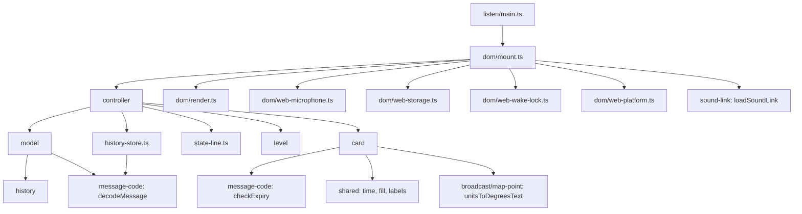
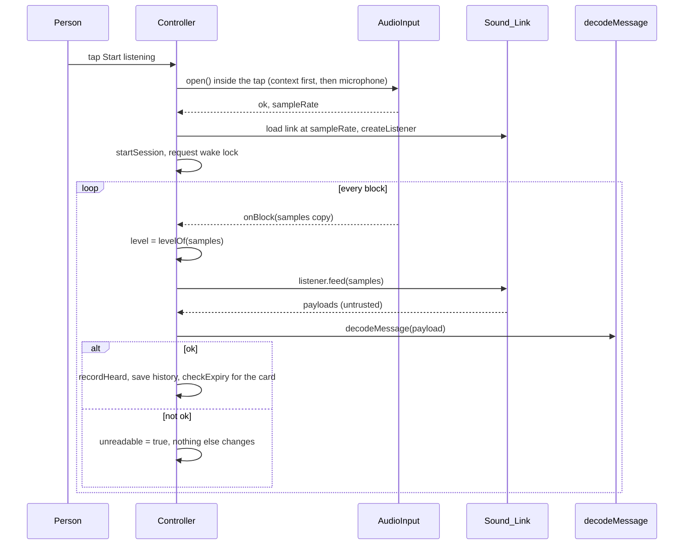

# Design Document

## Overview

The Listen page is the listener's page at `<base>listen/`. After one tap on "Start listening" it opens the microphone, gives every block of samples to the Sound_Link `Listener`, and sends every payload it returns through `decodeMessage`. A payload that passes is shown as an alert card. A payload that fails shows only the Unreadable_Notice. The page keeps a history in `localStorage`, shows one of three states, shows a level meter, keeps the screen awake, and tries to listen again when the page becomes visible.

This document follows the approved `requirements.md` and the workspace steering (promises 1 to 6, sound rules, structure rules). It reuses `src/message-code/index.ts`, `src/sound-link/index.ts` and `src/shared/`. It copies the structure of the Broadcast page: pure logic in a folder with no browser APIs, small provider interfaces, a DOM layer, and fakes in tests.

### Design decisions

| Decision | Choice | Reason |
|---|---|---|
| Where the logic lives | Pure functions in `src/listen/` (no DOM types); browser code only in `src/listen/dom/` | Requirement 15.1, and the steering rule that logic runs in plain Node. |
| Microphone path | `getUserMedia` with the three processing flags false, `MediaStreamSource`, then `createScriptProcessor(1024, 1, 1)`, copy each block into a new `Float32Array` | `sound-test/index.html` already follows the official ggwave-js example this way. The steering says to follow that example. `ScriptProcessorNode` is deprecated but works in every target browser. An `AudioWorklet` needs a second bundled file and a second offline asset. |
| Sample rate | `new AudioContext({ sampleRate: 48000 })`, falling back to `new AudioContext()`. The Sound_Link is loaded with `context.sampleRate` | Requirement 2.5. The same fallback is in the Broadcast `web-audio.ts`. |
| Sound_Link reuse | One `SoundLink` is kept per page for one sample rate. A Session with a different rate disposes it and loads a new one | Loading ggwave takes time. Each Session still gets its own `Listener` and `AudioContext` (Requirement 13.6). |
| What is stored | Message bytes, count, first heard, last heard. Never decoded fields | Requirement 8.2. On load every entry goes through `decodeMessage` again, so storage cannot show a damaged alert (promise 1). |
| Storage encoding | Lowercase hex text inside one JSON string | Pure Node, no `btoa`, easy to test. |
| Level | Peak of the block (largest absolute sample, ignoring NaN, capped at 1) | Silence gives 0 and full scale gives 1 (Requirement 11.2). It is cheap and always in 0 to 1. |
| Time ticks | One 1-second timer, always running while the page is open | Covers the 30 s expiry check, the 10 s dead-air minute update and the 90 s window with one timer. |
| Card text | Written with `textContent` only. No `innerHTML` | The place name is free text from the sender. |
| Wake lock | New `src/listen/dom/web-wake-lock.ts` with the same shape as the Broadcast one | Requirement 16.7 forbids editing the Broadcast file. The `WakeLockProvider` type is in `src/broadcast/providers.ts`; it is imported as a type only. |
| DOM tests | None in Vitest (environment is `node`). The controller is tested with fake providers | Same as the Broadcast spec. Real-phone checks are recorded in the Report_File. |

### Research notes

- **Official example.** The ggwave-js browser example creates its `AudioContext` at 48000 Hz, calls `getUserMedia` with echo cancellation, noise suppression and auto gain off, and feeds a script processor's input into the decoder. `sound-test/index.html` in this repo is a working copy of that flow (lines 73 to 152). The design copies it, including the per-block `new Float32Array(getChannelData(0))`.
- **AudioContext sample rate.** Not every browser honours the `sampleRate` option. The page therefore reads `context.sampleRate` after creation and loads the Sound_Link with that value (Requirement 2.5). Source: [AudioContext constructor on MDN](https://developer.mozilla.org/en-US/docs/Web/API/AudioContext/AudioContext).
- **Script processor needs a destination.** A `ScriptProcessorNode` only fires `onaudioprocess` in some browsers when it is connected to `context.destination`. The page connects it and never writes to its output buffer, so it plays silence.
- **Wake lock.** `navigator.wakeLock.request('screen')` is released by the browser when the page is hidden. This is why Requirement 17 ends the Session on hide and rebuilds it on show. Source: [Screen Wake Lock API on MDN](https://developer.mozilla.org/en-US/docs/Web/API/Screen_Wake_Lock_API).
- **Bundle.** The Broadcast page build is one JS file of about 138 kB with ggwave embedded (see its design). The Listen page imports `loadSoundLink` the same way, so the same Vite warnings about `path` and `fs` are expected. `vite.config.ts` already lists `listen/index.html` as an input.

## Architecture

### Files

```
listen/
  index.html                 markup, no visible text, data-text attributes
  main.ts                    calls mount()
src/listen/
  providers.ts               types only: ListenClock, IntervalTimers, AudioInput, StorageProvider, PageVisibility
  history.ts                 pure: Alert_Key, recordHeard, trim, clear
  history-store.ts           pure: serializeHistory, parseHistory, StoredHistory
  model.ts                   pure: ListenModel, applyPayload, endSession, startSession, clearHistory
  card.ts                    pure: buildCardView (rows, banner, sent time, expiry, clock line, count)
  state-line.ts              pure: decideState, minutesSince, buildStateLine
  level.ts                   pure: levelOf(samples)
  texts.ts                   pure: text(strings, key, params) with the fallback line
  controller.ts              start, stop, resume, visibility, tick, wake lock, notices
  ui-state.ts                ListenUi type and control states (what is shown or disabled)
  dom/
    ids.ts                   element ids
    mount.ts                 builds the real providers, controller, listeners, 1 s timer
    render.ts                fills the page from ListenUi
    web-microphone.ts        AudioInput: AudioContext, getUserMedia, script processor
    web-storage.ts           StorageProvider around localStorage
    web-wake-lock.ts         WakeLockProvider around navigator.wakeLock
    web-platform.ts          clock offset, page visibility
tests/listen/                one test file per pure module, controller.test.ts, generators.ts
tsconfig.listen-logic.json   src/listen without dom, plus shared, message-code, sound-link, broadcast strings
tsconfig.listen-page.json    listen/main.ts and everything above with the DOM library
```

Boundaries:

- Nothing under `src/listen/` outside `dom/` uses `document`, `window`, `navigator`, `localStorage`, `AudioContext` or `Date.now`. The clock, storage, microphone and wake lock come in through providers (Requirement 15.2).
- `src/listen/` imports `src/message-code/index.ts`, `src/sound-link/index.ts` (types, and `loadSoundLink` only from `dom/mount.ts`), `src/shared/`, `unitsToDegreesText` from `src/broadcast/map-point.ts`, and the strings types from `src/broadcast/strings.types.ts`. It imports nothing else from `src/broadcast/`.
- The Listen page does not load front-page photos and makes no network request (Requirements 1.3, 1.4).

### Module dependencies



### Start (tap) and receive



## Components and Interfaces

### Strings (added to `src/broadcast/strings.types.ts` and `strings.en.ts`)

Only new `listen.*` keys are added to `TEXT_KEYS`, `PLACEHOLDERS` and the English `text` table. No existing key or label changes (Requirement 14.2, Decision 1). Existing entries that the page reuses as they are:

- `labels.event`, `labels.urgency`, `labels.severity`, `labels.action`, `labels.status.expired`
- `test.banner`, `nav.home`, `nav.listen`, `engine.failed`
- row labels `preview.event`, `preview.urgency`, `preview.severity`, `preview.action`, `preview.place`, `preview.map`, `preview.sent`, `preview.until`

New keys. The wording column is fixed where the requirements fix it. All other wording is left to the project owner (see "Open items for the owner").

| Key | Placeholders | Used for | Wording |
|---|---|---|---|
| `listen.page.title` | none | `<title>` | owner |
| `listen.page.heading` | none | page heading | owner |
| `listen.nav.broadcast` | none | link to `<base>broadcast/` | owner |
| `listen.btn.start` | none | Start_Button | "Start listening" |
| `listen.btn.stop` | none | Stop_Button | owner |
| `listen.btn.clear` | none | Clear button | "Clear history" |
| `listen.state.idle` | none | not-listening state, something heard before or not | owner |
| `listen.state.idle.none` | none | state line after Clear (Requirement 9.3) | owner |
| `listen.state.listening` | none | listening state | owner |
| `listen.state.dead.last` | `minutes` | dead air with a Last_Heard_Time | "Dead air. Last heard {minutes} min ago." |
| `listen.state.dead.none` | none | dead air, nothing heard | "Dead air. Nothing heard yet." |
| `listen.unreadable` | none | Unreadable_Notice | "Heard something but could not read it. Waiting for the repeat." |
| `listen.heard.one` | none | count text for 1 | "Heard 1 time" |
| `listen.heard.many` | `n` | count text for 2 or more | "Heard {n} times" |
| `listen.row.sender` | none | label of the sender ID row | "Sender ID" |
| `listen.clock.line` | none | Clock_Line | owner |
| `listen.keep-open` | none | Keep_Open_Line | owner |
| `listen.hidden-stop` | none | Hidden_Stop_Notice | owner |
| `listen.history.unkept` | none | history will not be kept (Requirement 8.7) | owner |
| `listen.level.label` | `percent` | text alternative of the Level_Meter | owner |
| `listen.mic.refused` | none | Allow_Help (content fixed by Requirement 12.4) | owner |
| `listen.mic.none` | none | no microphone found | owner |
| `listen.mic.insecure` | none | needs a secure page or newer browser | owner |
| `listen.mic.audio` | none | the audio context could not start | owner |
| `listen.mic.stopped` | none | microphone stopped during a Session | owner |
| `listen.mic.failed` | none | any other microphone failure | owner |
| `listen.fallback` | none | the plain line shown when a template cannot be filled (Requirement 14.6) | owner |

`texts.ts`:

```ts
export function text(strings: Strings, key: TextKey, params?: TemplateParams): string;
```

It calls `fillTemplate`. When that returns null it returns `strings.text['listen.fallback']`, and never an empty or half-filled line. No sentence is written in code.

The exported `listen.*` list is a type-checked addition: `PLACEHOLDER_KEYS_MATCH` already fails the build when `text` and `PLACEHOLDERS` differ.

### Providers (`providers.ts`, types only)

```ts
export interface ListenClock {
  now(): number;               // epoch ms
  offsetMinutes(): number;     // -new Date().getTimezoneOffset() in the DOM layer
}

export interface IntervalTimers {
  setInterval(fn: () => void, ms: number): unknown;
  clearInterval(handle: unknown): void;
}

export type MicFailure =
  | 'refused'      // NotAllowedError, SecurityError
  | 'no-device'    // NotFoundError, OverconstrainedError
  | 'unsupported'  // no mediaDevices, or not a secure context
  | 'audio'        // AudioContext missing, could not be created or resumed
  | 'other';

export interface AudioHandle {
  readonly sampleRate: number;                       // context.sampleRate
  /** Starts delivering blocks. Each block is a fresh Float32Array the caller may keep. */
  start(onBlock: (samples: Float32Array) => void, onLost: () => void): void;
  /** Stops every track, disconnects the nodes, closes the context. Safe to call twice. */
  close(): void;
}

export interface AudioInput {
  /** Creates or resumes the AudioContext first, then asks for the microphone. */
  open(): Promise<{ ok: true; handle: AudioHandle } | { ok: false; reason: MicFailure }>;
}

export interface StorageProvider {
  /** Null when nothing is stored or storage is unavailable. Never throws. */
  read(): string | null;
  /** False when the write failed. Never throws. */
  write(text: string): boolean;
  /** False when the removal failed. Never throws. */
  remove(): boolean;
  readonly available: boolean;
}

export interface PageVisibility {
  isVisible(): boolean;
}

export type SoundLinkLoader = (sampleRate: number) => Promise<LoadResult>; // wraps loadSoundLink
```

`open()` must create or resume the `AudioContext` synchronously at the start of the call, before its first `await`, so the browser sees it inside the tap (Requirement 2.2). It passes `echoCancellation: false`, `noiseSuppression: false`, `autoGainControl: false` to `getUserMedia` (Requirement 2.3). If `open()` fails after creating the context or stream, it closes both before returning (Requirements 2.6 and 17.5). The track `ended` event calls `onLost`.

The `WakeLockProvider` type comes from `src/broadcast/providers.ts` and is imported as a type.

### Pure model (`history.ts`, `model.ts`)

```ts
export interface HistoryEntry {
  readonly bytes: Uint8Array;      // the payload that passed the check
  readonly alert: Alert;           // decodeMessage(bytes).alert, never edited
  readonly heardCount: number;     // >= 1
  readonly firstHeardMs: number;
  readonly lastHeardMs: number;
}
export type History = readonly HistoryEntry[]; // first heard newest first

export const HISTORY_LIMIT = 100;
export function alertKey(a: Pick<Alert, 'stationId' | 'counter' | 'sentMinute'>): string;
export function recordHeard(h: History, bytes: Uint8Array, alert: Alert, nowMs: number): History;
```

`alertKey` returns `` `${stationId}:${counter}:${sentMinute}` ``.

`recordHeard`:

1. If an entry has the same key, return a new list where only that entry changes: `heardCount + 1`, `lastHeardMs = nowMs`. Its position, bytes and alert stay as they were (Requirements 7.1 and 7.4).
2. Otherwise put a new entry (`heardCount` 1, both times `nowMs`) at the front and drop entries from the end until there are at most `HISTORY_LIMIT` (Requirements 7.2, 8.6).

```ts
export interface ListenModel {
  readonly history: History;
  readonly unreadable: boolean;
  readonly sessionStartMs: number | null;   // null when no Session runs
  readonly lastPayloadMs: number | null;    // any payload this Session, passed or failed
  readonly lastHeardMs: number | null;      // Last_Heard_Time, passed payloads only
}

export function initialModel(history: History): ListenModel;       // lastHeardMs = max lastHeardMs in history (Requirement 10.10)
export function startSession(m: ListenModel, nowMs: number): ListenModel;  // clears sessionStart, lastPayload; clears unreadable only on end
export function endSession(m: ListenModel): ListenModel;           // sessionStartMs = null, lastPayloadMs = null, unreadable = false (Requirement 6.5)
export function applyPayload(m: ListenModel, bytes: unknown, nowMs: number): ListenModel;
export function clearHistory(m: ListenModel): ListenModel;         // history [], lastHeardMs null (Requirement 9.3)
```

`applyPayload` is the only place a payload becomes a card:

```text
r = decodeMessage(bytes)
if r.ok:  history = recordHeard(history, copy of bytes, r.alert, now)
          unreadable = false; lastPayloadMs = now; lastHeardMs = now
else:     history unchanged (same object); unreadable = true; lastPayloadMs = now
```

On a failed check, nothing from the payload or from `r.reason` is kept (Requirement 6.2). The stored bytes are copied so later changes to the caller's array cannot alter the history.

### Storage format (`history-store.ts`)

```ts
export const HISTORY_STORAGE_KEY = 'dead-air.listen.history.v1';
export function serializeHistory(h: History): string;
export function parseHistory(text: string | null): History;   // never throws
```

Stored text is `JSON.stringify({ v: 1, entries: [{ b, n, f, l }] })` where `b` is the bytes as lowercase hex, `n` the count, `f` first heard and `l` last heard in epoch ms. Nothing else is stored (Requirement 8.2). The key name is a name, not a path.

`parseHistory` returns `[]` when the text is null, is not JSON, or has a different `v` or no `entries` array. For each entry it keeps the entry only when all of these hold:

- `b` is hex text of 21 to 40 bytes, `n` is an integer of at least 1, `f` and `l` are finite non-negative integers.
- `decodeMessage` on the bytes returns `ok: true`. The alert on the entry comes from that decode and from nothing in the stored text.
- No earlier kept entry has the same Alert_Key. A later duplicate is dropped, so the one-card-per-key rule holds for stored data too.

The kept entries are sorted by `f` descending (stable) and cut to `HISTORY_LIMIT`. One bad entry never removes the others (Requirement 8.4).

### Card view (`card.ts`)

```ts
export interface CardRow { label: string; value: string }
export interface CardView {
  key: string;                         // alertKey
  testBanner: string | null;           // text of test.banner when alert.test, else null
  rows: CardRow[];                     // see below
  sentText: string;                    // always present
  expiryStatus: ExpiryStatus;
  presentedAsCurrent: boolean;         // expiryStatus === 'current'
  greyedOut: boolean;                  // expiryStatus === 'expired'
  expiredWord: string | null;          // labels.status.expired when expired
  clockLine: string | null;            // listen.clock.line when sent-in-future or clock-unknown
  heardText: string;                   // "Heard 1 time" / "Heard N times"
}
export function buildCardView(
  entry: HistoryEntry, nowMs: number, offsetMinutes: number, strings: Strings,
): CardView;
```

`buildCardView` calls `checkExpiry(entry.alert, nowMs)` on every call. It never reads a status that was stored earlier (Requirements 5.6, 3.6).

Rows in order: event, urgency, severity, action (labels from `strings.labels`, row names from `preview.*`), place name (only when not empty), map point (only when both `latitude` and `longitude` are numbers, as `unitsToDegreesText(latitude), unitsToDegreesText(longitude)`; 0 and 0 shows "0.0000"), sent time, valid-until time (both with `formatLocal(ms, offsetMinutes)`), and the sender ID row (`listen.row.sender`, value is the decimal `stationId`).

The sent time is in `sentText` and in the rows in every state. The test banner depends only on `alert.test`, so it shows for current, expired, repeated and loaded cards alike (Requirements 4.5 to 4.7). `passedOn` is not shown (the requirements do not list it).

`presentedAsCurrent` is the only value the DOM layer uses to style a card as live. It is true only for `current` (Requirement 5.4).

### State line (`state-line.ts`)

```ts
export const DEAD_AIR_WINDOW_MS = 90_000;
export type ListenState = 'not-listening' | 'listening' | 'dead-air';

export function decideState(m: ListenModel, nowMs: number): ListenState;
export function minutesSince(thenMs: number, nowMs: number): number;   // floor of the gap in minutes, never below 0
export function buildStateLine(m: ListenModel, nowMs: number, strings: Strings): { state: ListenState; text: string };
```

`decideState`: `not-listening` when `sessionStartMs` is null. Otherwise let `base = lastPayloadMs ?? sessionStartMs`. It is `dead-air` when `nowMs - base > DEAD_AIR_WINDOW_MS`, and `listening` in every other case (including a clock that moved back). Exactly one state is returned (Requirement 10.1).

Text: `listen.state.idle` for not-listening (or `listen.state.idle.none` after a Clear, see open items), `listen.state.listening`, and for dead air `listen.state.dead.last` with `minutes = minutesSince(lastHeardMs, nowMs)` when `lastHeardMs` is not null, else `listen.state.dead.none`.

### Level (`level.ts`)

```ts
export function levelOf(samples: ArrayLike<number>): number;
```

Returns the largest absolute sample, ignoring NaN, capped at 1. An empty block gives 0. The result is always in 0 to 1. The meter text alternative is `listen.level.label` with `percent = Math.round(level * 100)`.

### Wake lock (`dom/web-wake-lock.ts`)

Same shape as the Broadcast provider: `supported` and `request()` returning a handle with `release()` and `onRelease(cb)`, or null. `request()` never throws.

### Controller (`controller.ts`)

```ts
export interface ListenDeps {
  clock: ListenClock;
  timers: IntervalTimers;
  audio: AudioInput;
  loadLink: SoundLinkLoader;
  storage: StorageProvider;
  wake: WakeLockProvider;
  visibility: PageVisibility;
  strings: Strings;
}

export interface ListenController {
  tapStart(): Promise<void>;
  tapStop(): void;
  tapClear(): void;
  visibilityChanged(visible: boolean): Promise<void>;
  tick(): void;                              // called by the 1 s timer and on becoming visible
  snapshot(): ListenUi;
  subscribe(fn: (ui: ListenUi) => void): () => void;
}
export function createListenController(deps: ListenDeps): ListenController;
```

Internal state: `model`, `intent` (Listening_Intent), `phase` (`idle`, `starting` or `running`), `notice` (one of none, a mic message key, `engine.failed`, `listen.hidden-stop`), `historyKept` (false after a failed write or no storage), `link`, `listener`, `handle`, `wakeHandle`, `level`.

**Start flow** `begin(fromTap)`:

1. If `phase !== 'idle'`, return (Requirement 2.8).
2. `phase = 'starting'`. Clear the earlier mic error and, when `fromTap`, the Hidden_Stop_Notice (Requirements 12.7 and 17.9).
3. `r = await audio.open()`. On failure: `phase = 'idle'`; show the message for the reason; if `fromTap`, `intent = false` stays false, if not `fromTap`, show `listen.hidden-stop` instead of the mic message and keep `intent` true (Requirement 17.4).
4. `await loadLink(handle.sampleRate)` unless a link for that rate is cached, then `link.createListener()`. On any failure: `handle.close()`, show `engine.failed`, `phase = 'idle'` (Requirement 2.6). A Hidden_Resume failure here shows `listen.hidden-stop`.
5. If `visibility.isVisible()` is false at this point, close the handle and listener, `phase = 'idle'`, keep `intent` as it was, and return. The next visible event retries.
6. `handle.start(onBlock, onLost)`; `model = startSession(model, now)`; `phase = 'running'`; `intent = true`; request the wake lock (a null result changes nothing, Requirement 16.4).

**Block** `onBlock(samples)`: `level = levelOf(samples)`; `r = listener.feed(samples)`; if `r.ok` is false, discard (Requirement 3.3); else for each payload `model = applyPayload(model, payload, now)`. When the history changed, `storage.write(serializeHistory(history))`; a false result sets `historyKept = false`. The samples are not kept anywhere after `feed` returns (Requirement 13.2).

**End** `endSession()` closes in this order: `handle.close()` (tracks, nodes, context), `listener.dispose()`, release the wake lock, `model = endSession(model)`, `level = 0`, `phase = 'idle'`. It is used by Stop, hide, mic loss and a failed start.

**Taps and events:**

| Event | What happens |
|---|---|
| `tapStart` | `begin(true)` |
| `tapStop` | `intent = false`, `endSession()` (Requirement 17.7) |
| `onLost` | `intent = false`, `endSession()`, notice `listen.mic.stopped` (Requirements 12.5, 17.8) |
| `visibilityChanged(false)` while `running` | `endSession()`, `intent` unchanged (Requirement 17.1, 13.5) |
| `visibilityChanged(true)`, `intent` true, `phase` idle | `begin(false)` (Requirement 17.2) |
| `visibilityChanged(true)`, `intent` false | nothing (Requirement 17.3) |
| any visibility change while `phase` is `starting` | ignored (Requirement 17.10) |
| wake lock released by the browser while `running` | request again at the next visible time; failure changes nothing (Requirement 16.6) |
| `tapClear` | `model = clearHistory(model)`, `storage.remove()`; a false result sets `historyKept = false` |
| `tick` | emit a new `ListenUi` (cards rebuilt with the current time, state line recomputed) |

After a hide, no block can arrive because `handle.close()` has run. A Hidden_Resume that fails leaves `intent` true. The next visible event tries again. Only Stop and a lost microphone set it to false (a literal reading of Requirements 17.7 and 17.8).

### UI state (`ui-state.ts`)

```ts
export interface ListenUi {
  state: ListenState;
  stateText: string;
  running: boolean;                 // Stop shown, Start hidden
  starting: boolean;                // Start shown but taps are ignored
  level: number;                    // 0 to 1
  levelLabel: string;
  cards: CardView[];                // newest first heard first
  errorText: string | null;         // mic, engine or hidden-stop message, one at a time
  unreadableText: string | null;
  keepOpenText: string | null;      // only while running
  historyUnkeptText: string | null;
  clearEnabled: boolean;            // cards.length > 0
}
```

| State | Start | Stop | Clear | Meter | Keep-open line |
|---|---|---|---|---|---|
| idle, not listening | shown | hidden | enabled when cards exist | empty | hidden |
| starting | shown, taps ignored | hidden | as before | empty | hidden |
| running | hidden | shown | as before | live | shown |

The Start button stays available after every error (Requirement 12.6).

### Markup and DOM layer

`listen/index.html` holds plain semantic structure with no visible text. Each text element carries `data-text="<TextKey>"`; `render.ts` fills it from the strings, and also fills the page title. The two links use `import.meta.env.BASE_URL` for `<base>` and `<base>broadcast/`, so no `/dead-air/` is written anywhere (Requirement 1.2). The meter is an element with `role="meter"`, `aria-valuemin="0"`, `aria-valuemax="100"`, `aria-valuenow` and an `aria-label` from `listen.level.label`. The state line and the unreadable line use `aria-live="polite"`. The error line uses `role="alert"`.

`render.ts` writes with `textContent`. It coalesces meter updates with `requestAnimationFrame`. It rebuilds a card only when its `CardView` text changed since the last render.

`mount.ts`:

- Builds the real providers and the controller, reads the history through `parseHistory(storage.read())`, and renders the not-listening state. It does not create an `AudioContext` and does not request the microphone (Requirement 2.1).
- Registers the Start, Stop and Clear click handlers and one `visibilitychange` handler that calls `visibilityChanged(document.visibilityState === 'visible')` and then `tick()`.
- Starts the 1-second timer. It registers no service worker (that is spec 6) and writes no emoji.

`web-microphone.ts` is the only file with `AudioContext`, `getUserMedia`, `createMediaStreamSource` and `createScriptProcessor`. It maps `DOMException` names to `MicFailure`, copies each block with `new Float32Array(event.inputBuffer.getChannelData(0))`, and never writes samples to storage, logs or any request (Requirement 13.3). `web-platform.ts` gives the clock (`Date.now()` and `-new Date().getTimezoneOffset()`) and `document.visibilityState`.

## Data Models

| Type | Where | Notes |
|---|---|---|
| `Alert` | `src/message-code` | Unchanged. Every shown field comes from here. |
| `HistoryEntry`, `History` | `src/listen/history.ts` | In memory. At most 100 entries, first heard newest first. |
| `ListenModel` | `src/listen/model.ts` | History, unreadable flag and three times. No audio. |
| `StoredHistory` | `localStorage`, key `dead-air.listen.history.v1` | `{ v: 1, entries: [{ b, n, f, l }] }`. Hex bytes, count, first and last heard in ms. |
| `CardView` | `src/listen/card.ts` | Built fresh from an entry and the current time each tick. Never stored. |
| `ListenUi` | `src/listen/ui-state.ts` | What `render.ts` draws. |

Storage holds one key. Nothing else is written to `localStorage`, `sessionStorage`, IndexedDB or the Cache API, and no audio in any form is written anywhere (Requirement 13.4).

### Files outside this spec that the tasks touch

These need approval with this design (Requirement 15.3 allows only the strings files by name):

- `src/broadcast/strings.types.ts` and `src/broadcast/strings.en.ts`: new `listen.*` keys only.
- `package.json`: add the two new `tsc -p` commands to the `typecheck` script.
- New config files `tsconfig.listen-logic.json` and `tsconfig.listen-page.json`.
- `listen/index.html` already exists as a placeholder and is owned by this spec.

## Correctness Properties

*A property is a characteristic or behavior that should hold true across all valid executions of a system-essentially, a formal statement about what the system should do. Properties serve as the bridge between human-readable specifications and machine-verifiable correctness guarantees.*

All properties use test alerts only (`test` true). Each is implemented as one fast-check test with at least 100 runs.

### Property 1: One card per Alert_Key, with a matching count

For any sequence of passing payloads, the history after `recordHeard` has exactly one entry per distinct Alert_Key (`stationId`, `counter`, `sentMinute`), and each entry's `heardCount` equals the number of payloads with that key.

**Validates: Requirements 7.1, 7.2, 7.4, 7.5, 7.6, 15.4**

### Property 2: A payload that fails the check changes nothing

For any valid message with one byte changed, and for any byte array that `decodeMessage` rejects, `applyPayload` returns the same history object, keeps nothing from the payload or the reason, and sets the unreadable flag.

**Validates: Requirements 3.4, 6.1, 6.2, 6.3, 15.4**

### Property 3: An alert that is not current is never shown as current

For any history entry and any time (before sending, after expiry, negative, NaN or Infinity), `buildCardView` sets `presentedAsCurrent` to true only when `checkExpiry` returns `current`. An expired card is greyed out and carries the expired word. A sent-in-future or clock-unknown card carries the Clock_Line.

**Validates: Requirements 3.6, 5.1, 5.2, 5.3, 5.4, 5.6, 15.4**

### Property 4: The TEST banner and the sent time are always shown

For any history entry, including entries that came back from `parseHistory`, and any time, the card view has a test banner exactly when `alert.test` is true, and always has a non-empty sent time.

**Validates: Requirements 4.5, 4.6, 4.7, 4.8**

### Property 5: Optional rows appear only when the alert has the data

For any alert, the card has a place row only when the place name is not empty, and a map row only when both `latitude` and `longitude` are numbers (including 0 and 0). It always has the event, urgency, severity, action, sent, valid-until and sender ID rows.

**Validates: Requirements 4.3, 4.4, 4.11, 4.12, 4.13**

### Property 6: Saving then loading the history gives the same history

For any valid history, `parseHistory(serializeHistory(h))` returns a history with the same bytes, alerts, counts and times in the same order, and the stored text holds only bytes, count, first heard and last heard.

**Validates: Requirements 8.1, 8.2, 8.3, 8.5, 8.8, 15.4**

### Property 7: A damaged stored entry is dropped and the rest are kept

For any stored history in which one or more entries are damaged (bad hex, a changed byte, a bad count or time, a duplicate key), `parseHistory` drops those entries, keeps every other entry, and does not throw.

**Validates: Requirements 8.3, 8.4**

### Property 8: The history is ordered and never longer than the limit

For any sequence of `recordHeard` calls and any stored text given to `parseHistory`, the history is ordered by first heard, newest first, and has at most `HISTORY_LIMIT` (100) entries.

**Validates: Requirements 8.5, 8.6**

### Property 9: The state line shows exactly one state, chosen by the 90 second rule

For any model and any current time, `decideState` returns exactly one of `not-listening`, `listening` or `dead-air`. It returns `not-listening` when no Session runs. Otherwise it returns `dead-air` exactly when the time since the last payload (or the Session start, if none) is more than 90 seconds. The dead-air text uses the whole minutes since the last heard time, never below 0, or the nothing-heard text when there is none.

**Validates: Requirements 10.1, 10.2, 10.3, 10.4, 10.5, 10.6, 10.7, 10.9**

### Property 10: The level is always from 0 to 1

For any block of samples (including empty blocks, NaN, and values above 1 or below -1), `levelOf` returns a number from 0 to 1. Silence gives 0 and a full-scale sample gives 1.

**Validates: Requirements 11.2, 11.5, 15.4**

## Error Handling

Each failure below has one visible result and never shows data from a payload that failed the check.

| Failure | What happens |
|---|---|
| `decodeMessage` returns `ok: false` | `applyPayload` sets the unreadable flag and the page shows the Unreadable_Notice. History is the same object. Nothing from the payload or the reason is kept or shown. A later good payload, Stop, or the end of the Session removes the notice. |
| Listener `feed` returns `ok: false` | The block result is discarded. No card and no notice. The Session continues. |
| Sound_Link load or `createListener` fails | The controller closes the microphone handle, shows `engine.failed`, and returns to idle with Start available. After a Hidden_Resume it shows the Hidden_Stop_Notice instead. |
| `MicFailure` `refused` | Shows the Allow_Help (`listen.mic.refused`). Start stays available. |
| `MicFailure` `no-device` | Shows `listen.mic.none`. |
| `MicFailure` `unsupported` | Shows `listen.mic.insecure`. |
| `MicFailure` `audio` | Shows `listen.mic.audio`. |
| Microphone lost during a Session (`onLost`) | Ends the Session, sets Listening_Intent to false, shows `listen.mic.stopped`. |
| `MicFailure` `other` | Shows `listen.mic.failed`. |
| Storage unavailable, `write` false, or `remove` false | The page keeps working in memory and shows `listen.history.unkept`. |
| Unreadable stored data | `parseHistory` returns an empty history for text that is null, not JSON or of another version. It drops each entry that is damaged or fails `decodeMessage`. It never throws. |
| Wake lock unsupported, refused or released | The Session, state line and meter do not change. Only the Keep_Open_Line shows. The controller asks again at the next visible time. |
| Failed Hidden_Resume | Closes what it opened, shows `listen.hidden-stop`, keeps Listening_Intent and keeps Start available. Tapping Start removes the notice. |
| A template that cannot be filled | `text()` returns `listen.fallback`, never an empty or half-filled line. |
| Error thrown in the block handler | Caught. The block is dropped and the Session continues. |

Only one error message shows at a time. The next tap on Start clears the earlier one.

## Testing Strategy

Tests use Vitest and fast-check (no new dependency). Vitest runs in the `node` environment, so no DOM test exists.

**Property tests.** Each of the ten properties is one fast-check test with at least 100 runs. Each carries a tag comment of the form `Feature: listen-page, Property N: <title>`. Fixtures are test alerts only (`test` true).

**Unit tests.** Examples, edge cases and the controller with fakes: exact fixed wordings, the dead-air texts, heard-count text, map point 0 and 0, start and stop, visibility and Hidden_Resume, each `MicFailure`, storage failures, wake lock cases, and clear.

**Files under `tests/listen/`:**

| File | Covers |
|---|---|
| `generators.ts` | `testAlertArb`, `heardSequenceArb`, `changedByteArb` |
| `fakes.ts` | Fake clock, timers, audio input, storage, visibility, loader and wake lock |
| `level.test.ts` | Property 10 |
| `strings.test.ts` | Every `listen.*` key, fixed wording, fallback, no emoji |
| `history.test.ts` | Properties 1 and 8 |
| `history-store.test.ts` | Properties 6 and 7 |
| `model.test.ts` | Property 2, notice and clear examples |
| `card.test.ts` | Properties 3, 4 and 5, heard text examples |
| `state-line.test.ts` | Property 9, state text examples |
| `controller.test.ts` | Start, payloads, stop, errors, visibility, wake lock |
| `boundary.test.ts` | No browser APIs outside `dom/`, no network or other storage APIs, import limits, no emoji or external URL in the page, built links with a sub-path and at the root, all fixtures are test alerts |

**Not covered by Vitest.** There is no browser check script. DOM rendering, the real microphone, the script processor, the wake lock and checks on real phones and speakers are recorded in the Report_File (`.kiro/specs/listen-page/report.md`).

## Open items for the owner

These change what the listener reads or sees. The owner accepted items 2, 3 and 4 as proposed. Item 1 is left to the implementer, who writes plain English that the owner can edit later.

1. **Wording of every "owner" row in the strings table. Left to the implementer, who writes plain English that the owner can edit later. Requirement 12.4 fixes what the Allow_Help must say.** Includes the Clock_Line, Keep_Open_Line, Hidden_Stop_Notice, the microphone messages, the Allow_Help sentence (Requirement 12.4 fixes its content), the history-not-kept line, the Stop button, the page title and heading, the Broadcast link text and the meter label.
2. **Accepted by the owner. State line text for "not listening".** Requirement 10 fixes the dead-air and last-heard text only for dead air. The design needs wording for not listening (`listen.state.idle`), and Requirement 9.3 says the state line shows that nothing has been heard yet after a Clear. The design assumes this means a separate not-listening text `listen.state.idle.none`, because the dead-air text only appears in a running Session. Confirm, or say which of the three states should carry it.
3. **Accepted by the owner. Same Alert_Key, different bytes.** Requirement 7 makes one card per key and counts every passing payload. If two payloads share the key but carry different content (a sender bug, or a hostile sender), the design keeps the first card's content and counts the second. The listener would not see the second content. Confirm this is acceptable.
4. **Accepted by the owner. Sent-in-future and clock-unknown cards.** Requirement 5.3 requires the Clock_Line and the sent time. The design shows no extra status word on these cards, and shows no "Current" word on current cards. Confirm.
