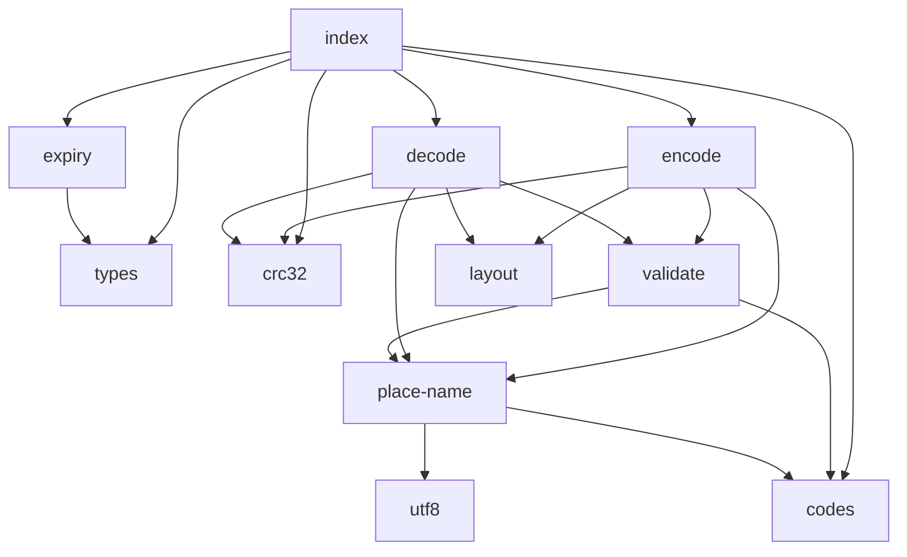
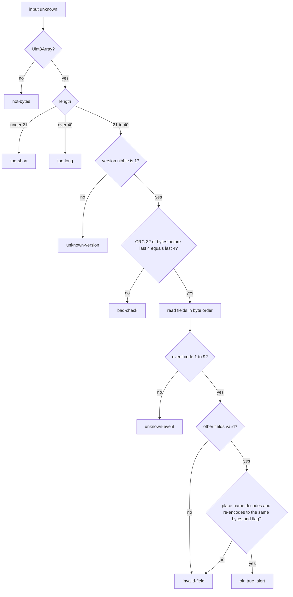

# Design Document

## Overview

The Message Code is a folder of pure TypeScript functions, `src/message-code/`. It has three jobs:

1. `encodeAlert` turns an `Alert` into 21 to 40 bytes.
2. `decodeMessage` turns untrusted bytes back into an `Alert`, or into a `Rejection` that carries a reason and nothing else.
3. `checkExpiry` compares an `Alert` with a caller-supplied time and says whether it is `current`, `expired`, `sent-in-future` or `clock-unknown`.

It uses no browser API, no clock, no random source and no import from outside its folder. It runs and is tested in plain Node.

This document follows the approved `requirements.md` exactly. A place name is stored in one of two forms: plain UTF-8, or a compact form for the nine Indic scripts that holds about three times as many characters. The section "Place names in Indian scripts" is the adopted design for that. Place-name coding sits in one file, `place-name.ts`. The other files only pass the bytes and the Compact_Place_Name_Flag through.

### Design decisions

| Decision | Choice | Reason |
|---|---|---|
| One validation function | `validateAlert` is used by the encoder and by the decoder | Both sides then accept exactly the same set of alerts. This is what makes encoding canonical (Requirement 4.3). |
| Decoder order | Type, length, version, check value, then fields (Requirement 7.13) | Nothing from a message is read before its check passes (promise 1). |
| UTF-8 code | Hand-written, strict, about 60 lines | The module is compiled without the DOM library, so `TextEncoder` and `TextDecoder` have no type. A hand-written strict decoder also rejects overlong forms and surrogates in a way we control and can test. |
| Safe default in expiry | `current` is returned only when two comparisons are both true. Any other outcome, including NaN input, is not `current` | Promise 2. |
| No catch-all `try/catch` in the decoder | Totality comes from bounds checks, and is tested by property test 4 and the seeded test | A catch-all hides bugs. The Listen page should still treat a thrown error as a rejection. |
| Decoder input type | `Uint8Array` only | ggwave returns `Uint8Array`. Any other input gives `not-bytes`. |
| One place-name rule, used by both sides | The decoder decodes the place name, then runs the encoder's `encodePlaceName` on the text and requires the same bytes and the same flag (Requirement 7.18) | One comparison rejects every non-canonical form, with no list of special cases. It also gives Requirements 4.3 and 4.6. |
| No table of assigned code points | A Script_Character is any byte 0x00 to 0x7F added to the window start (Requirement 7.19) | A table would freeze to one Unicode version and make old phones reject real names after a Unicode release. |

### Research notes

- **CRC-32 variant.** The check string "123456789" gives 0xCBF43926 for the CRC-32 used by zlib, PNG and Ethernet (reflected polynomial 0xEDB88320, initial 0xFFFFFFFF, final XOR 0xFFFFFFFF). This matches Requirement 5.2. It detects every burst error up to 32 bits long, so any single changed byte is always caught. Source: the CRC-32 entry in the [CRC RevEng catalogue](https://reveng.sourceforge.io/crc-catalogue/17plus.htm) (CRC-32/ISO-HDLC).
- **CAP 1.2 values.** Urgency: Immediate, Expected, Future, Past, Unknown. Severity: Extreme, Severe, Moderate, Minor, Unknown. `responseType` includes Shelter, Evacuate, Prepare, Avoid, Monitor and AllClear. Coordinates are WGS 84 decimal degrees. These match the requirements. Source: [OASIS CAP 1.2 specification](https://docs.oasis-open.org/emergency/cap/v1.2/CAP-v1.2-os.html). Content was rephrased for compliance with licensing restrictions.
- **UTF-8 strictness.** A valid decoder must reject overlong forms, surrogate code points U+D800 to U+DFFF, values above U+10FFFF and truncated sequences. This is the rule set in [RFC 3629](https://www.rfc-editor.org/rfc/rfc3629).
- **Indic blocks.** Each of the nine Indic blocks used by the compact place name is exactly 128 code points wide, and the nine are contiguous from U+0900 to U+0D7F. All of them sit in U+0800 to U+FFFF, so each character costs 3 bytes in UTF-8. Source: [Unicode block list](https://www.unicode.org/Public/UCD/latest/ucd/Blocks.txt).

## Architecture

### Folder layout

No app code exists yet, so this spec creates the skeleton too. Only files this spec needs are listed. There are no Listen, Broadcast, offline, language, sound or look files (Requirement 11.8).

```
package.json                    dev dependencies: vite, typescript, vitest, fast-check only
tsconfig.json                   checks src and tests
tsconfig.message-code.json      checks src/message-code only, no DOM library
vite.config.ts                  base path from a build setting, test settings
build/base-path.ts              resolveBase(): pure function, unit tested
index.html                      empty placeholder so `vite build` runs
src/message-code/
  index.ts                      the only public entry point
  types.ts                      Alert, results, rejection reasons
  codes.ts                      code lists (events, U/S/A, scripts), packing and unpacking of the U/S/A byte
  layout.ts                     byte offsets, sizes, masks, flag bits
  crc32.ts                      table-based CRC-32
  utf8.ts                       strict UTF-8 encode and decode
  place-name.ts                 place-name coding: form choice, UTF-8 and compact forms, canonical re-encode
  validate.ts                   validateAlert
  encode.ts                     encodeAlert
  decode.ts                     decodeMessage
  expiry.ts                     checkExpiry
tests/message-code/
  generators.ts                 fast-check arbitraries
  fixtures.ts                   sample alerts, all with TEST flag set
  properties.test.ts            the four property tests
  crc32.test.ts  utf8.test.ts  codes.test.ts  layout.test.ts
  encode.test.ts  decode.test.ts  expiry.test.ts  place-name.test.ts
  raw-message.ts                test-only helper that builds raw bytes with a correct check value
  seeded-fuzz.test.ts           fixed pseudo-random inputs, lengths 0 to 64
  boundary.test.ts              source scans for forbidden APIs and imports
tests/build/base-path.test.ts   resolveBase examples
```

Tests live outside `src/message-code/` so the module never imports from outside its own folder (Requirement 11.3).

### Module dependencies



All arrows point inside the folder. `expiry`, `crc32`, `utf8` and `codes` import nothing from the rest of the module except `types`.

### Decoder flow



### Build and hosting settings

- `tsconfig.message-code.json` sets `lib: ["ES2022"]`, `types: []`, `strict: true`, and includes only `src/message-code`. Any use of `document`, `window`, `fetch`, `localStorage`, `TextEncoder` or `setTimeout` fails the type check (Requirement 11.4). Later specs that need the DOM add their own tsconfig. They do not edit this one.
- `tsconfig.json` is the general config: strict, `lib: ["ES2022"]`, `types: ["vite/client"]`, includes `src`, `tests`, `build` and `vite.config.ts`. The `vite/client` types give `import.meta.glob`, which the boundary test uses to read source text without Node types.
- `vite.config.ts` imports `defineConfig` from `vitest/config` so one file holds both build and test settings:

```ts
import { loadEnv } from 'vite';
import { defineConfig } from 'vitest/config';
import { resolveBase } from './build/base-path.ts';

export default defineConfig(({ mode }) => {
  const env = loadEnv(mode, '.', '');          // also reads process environment variables
  return {
    base: resolveBase(env.BASE_PATH),          // the only place `base` is set
    test: { environment: 'node', include: ['tests/**/*.test.ts'] },
  };
});
```

- `resolveBase(value: string | undefined): string` returns `/` for undefined or empty, adds a missing leading and trailing slash (`x` and `/x` both become `/x/`), and throws for a value that contains `://` or `..`. It is pure and tested with examples.
- The text `/dead-air/` appears in no source or config file (Requirement 11.6). The deploy step in a later spec sets `BASE_PATH` from the repository name, for example `BASE_PATH=/${{ github.event.repository.name }}/` in the workflow, so the literal never has to be written. Building at the domain root needs no setting, because the default is `/`.
- Scripts in `package.json`: `test` is `vitest run` (one run, then exit, Requirement 11.5), `typecheck` runs `tsc -p tsconfig.message-code.json --noEmit` and then `tsc -p tsconfig.json --noEmit`, `build` is `vite build`.
- Requirement 11.7 (change the base setting, build, no other change) holds because `base` is the only input. It is covered by `resolveBase` example tests plus one manual smoke command, `BASE_PATH=/x/ npm run build`, listed in the task phase. A build test inside Vitest would need Node types, which are not in the allowed dependency list.
- Dependencies are exactly `vite`, `typescript`, `vitest`, `fast-check`. `@types/node` is not added. If the task phase finds it is unavoidable, ask first.

## Components and Interfaces

### `types.ts`

```ts
export type EventType =
  | 'flood' | 'cyclone' | 'fire' | 'earthquake' | 'heatwave'
  | 'landslide' | 'medical' | 'missing-person' | 'all-clear';
export type Urgency  = 'immediate' | 'expected' | 'future' | 'past' | 'unknown';
export type Severity = 'extreme' | 'severe' | 'moderate' | 'minor' | 'unknown';
export type Action   = 'shelter' | 'evacuate' | 'prepare' | 'avoid' | 'monitor' | 'all-clear';

export interface Alert {
  readonly test: boolean;          // TEST_Flag
  readonly passedOn: boolean;      // Passed_On_Flag
  readonly event: EventType;
  readonly urgency: Urgency;
  readonly severity: Severity;
  readonly action: Action;
  readonly sentMinute: number;     // integer, 0 to 4294967295, minutes since 1970-01-01 UTC
  readonly validSteps: number;     // integer, 1 to 255, steps of 15 minutes
  readonly latitude: number;       // integer, -900000 to 900000, units of 0.0001 degree
  readonly longitude: number;      // integer, -1800000 to 1800000, units of 0.0001 degree
  readonly stationId: number;      // integer, 0 to 65535
  readonly counter: number;        // integer, 0 to 255
  readonly placeName: string;      // text whose chosen form (UTF-8 or compact) is 0 to 19 bytes, no control characters
}
// The form (UTF-8 or compact) is not a field of Alert. It follows from the text by the rule in Requirement 10.

export type DecodeRejectionReason =
  | 'not-bytes' | 'too-short' | 'too-long' | 'unknown-version'
  | 'bad-check' | 'unknown-event' | 'invalid-field';

export interface DecodeRejection { readonly ok: false; readonly reason: DecodeRejectionReason }
export type DecodeResult = { readonly ok: true; readonly alert: Alert } | DecodeRejection;

export interface EncodeRejection {
  readonly ok: false;
  readonly reason: 'invalid-field' | 'place-name-too-long';
  readonly field: keyof Alert;     // names the invalid field (Requirement 3.4)
}
export type EncodeResult = { readonly ok: true; readonly bytes: Uint8Array } | EncodeRejection;

export type ExpiryStatus = 'current' | 'expired' | 'sent-in-future' | 'clock-unknown';
export interface ExpiryResult {
  readonly status: ExpiryStatus;
  readonly sentAtMs: number;       // sentMinute * 60000
  readonly expiresAtMs: number;    // Expiry_Time in milliseconds
}
```

The code lists use lowercase, hyphenated names. The CAP spelling is kept in comments. Every `ok: false` result has no Alert fields, so a `Rejection` cannot leak the event or place name (Requirement 5.6).

### `codes.ts`

```ts
export const EVENT_TYPES: readonly EventType[];            // order is not used for packing
export const EVENT_CODES: Readonly<Record<EventType, number>>; // flood 1 ... all-clear 9
export const URGENCIES:  readonly Urgency[];   // index 0..4 in the order Immediate, Expected, Future, Past, Unknown
export const SEVERITIES: readonly Severity[];  // index 0..4 in the order Extreme, Severe, Moderate, Minor, Unknown
export const ACTIONS:    readonly Action[];    // index 0..5 in the order shelter, evacuate, prepare, avoid, monitor, all-clear

/** Exactly nine entries. Codes and window starts only, no names meant for display (Requirements 2.8, 2.9). */
export const SCRIPT_WINDOWS: readonly { readonly selector: number; readonly start: number }[];
// { selector: 1, start: 0x0900 }  Devanagari
// { selector: 2, start: 0x0980 }  Bengali
// { selector: 3, start: 0x0A00 }  Gurmukhi
// { selector: 4, start: 0x0A80 }  Gujarati
// { selector: 5, start: 0x0B00 }  Odia
// { selector: 6, start: 0x0B80 }  Tamil
// { selector: 7, start: 0x0C00 }  Telugu
// { selector: 8, start: 0x0C80 }  Kannada
// { selector: 9, start: 0x0D00 }  Malayalam
// (the script names appear in comments only, not in the exported values)
export const SCRIPT_WINDOW_SIZE = 128;

export function packUsa(u: Urgency, s: Severity, a: Action): number;       // 0..149
export function unpackUsa(byte: number): { urgency: Urgency; severity: Severity; action: Action } | null;
export function eventFromCode(code: number): EventType | null;
export function windowStartForSelector(selector: number): number | null;    // null outside 1..9
export function selectorForCodePoint(cp: number): number | null;           // null outside U+0900..U+0D7F
```

Packing is a mixed-radix number, which gives every combination exactly one byte value (Requirement 1.8):

```
packed = (urgencyIndex * 5 + severityIndex) * 6 + actionIndex     // 5 x 5 x 6 = 150 values, 0..149
urgencyIndex  = floor(packed / 30)
severityIndex = floor(packed / 6) mod 5
actionIndex   = packed mod 6
```

Byte values 150 to 255 are unassigned and `unpackUsa` returns `null` for them. The list order is part of Version 1, because it fixes the packing. A test pins each list, including `SCRIPT_WINDOWS`, to a literal array so an accidental change fails (Requirements 2.7, 2.8, 6.4). The lists hold codes only, never display text (Requirements 2.6, 2.9).

`selectorForCodePoint(cp)` is `floor((cp - 0x900) / 128) + 1` for `0x900 <= cp <= 0xD7F`, and `null` otherwise. It is correct because the nine windows are contiguous and each is 128 wide. A test checks it against `SCRIPT_WINDOWS` for every start and end of a window.

### `layout.ts`

```ts
export const VERSION = 1;
export const MIN_MESSAGE_BYTES = 21;
export const MAX_MESSAGE_BYTES = 40;
export const PLACE_NAME_MAX_BYTES = 19;
export const CHECK_BYTES = 4;
export const FIXED_PREFIX_BYTES = 17;       // bytes before the place name

export const OFFSET = {
  versionFlags: 0, event: 1, usa: 2, sentMinute: 3, validSteps: 7,
  latitude: 8, longitude: 11, stationId: 14, counter: 16, placeName: 17,
} as const;

export const FLAG_TEST = 0b0000_1000;           // bit 3
export const FLAG_PASSED_ON = 0b0000_0100;      // bit 2
export const FLAG_COMPACT_PLACE = 0b0000_0010;  // bit 1, Compact_Place_Name_Flag
export const RESERVED_MASK = 0b0000_0001;       // bit 0, must be zero
```

### Exact byte layout, Version 1

| Offset | Size | Field | Encoding |
|---|---|---|---|
| 0 | 1 | Version and flags | high 4 bits = 1, bit 3 = TEST, bit 2 = passed on, bit 1 = Compact_Place_Name_Flag, bit 0 = 0 |
| 1 | 1 | Event_Type | code 1 to 9 |
| 2 | 1 | Urgency, severity, action | packed value 0 to 149 |
| 3 to 6 | 4 | Sent_Minute | unsigned 32-bit, big-endian |
| 7 | 1 | Valid_Steps | 1 to 255 |
| 8 to 10 | 3 | Latitude | signed 24-bit two's complement, big-endian, units of 0.0001 degree |
| 11 to 13 | 3 | Longitude | signed 24-bit two's complement, big-endian, units of 0.0001 degree |
| 14 to 15 | 2 | Station ID | unsigned 16-bit, big-endian |
| 16 | 1 | Counter | 0 to 255 |
| 17 to 17+n-1 | n | Place_Name | n = length - 21, 0 to 19 bytes. Flag clear: UTF-8. Flag set: one Script_Selector byte, then one byte per character |
| length-4 to length-1 | 4 | Check_Value | CRC-32 of bytes 0 to length-5, big-endian |

The fixed part is 17 bytes plus 4 check bytes, so the shortest message is 21 bytes and the longest is 40 (Requirements 1.3, 1.4, 10.2, 10.3). The place name length is derived from the message length in both forms, so the layout needs no length byte. Byte 0 is `0x10` for a plain alert, `0x18` with TEST, `0x12` with a compact place name, and so on by adding the flag bits. Two helpers do the number work without bit operators that overflow into negative values: `writeU32/readU32` use `>>> 0`, and `writeI24/readI24` add or subtract 0x1000000 for negative values. `readI24` returns `x >= 0x800000 ? x - 0x1000000 : x`.

### `crc32.ts`

```ts
const TABLE = (() => {
  const t = new Uint32Array(256);
  for (let n = 0; n < 256; n++) {
    let c = n;
    for (let k = 0; k < 8; k++) c = (c & 1) ? (0xEDB88320 ^ (c >>> 1)) : (c >>> 1);
    t[n] = c >>> 0;
  }
  return t;
})();

/** CRC-32 (ISO-HDLC, zlib). Reads bytes[start, end). Returns an unsigned 32-bit number. */
export function crc32(bytes: Uint8Array, start = 0, end = bytes.length): number {
  let c = 0xFFFFFFFF;
  for (let i = start; i < end; i++) c = TABLE[(c ^ bytes[i]) & 0xFF] ^ (c >>> 8);
  return (c ^ 0xFFFFFFFF) >>> 0;
}
```

`crc32` of the ASCII bytes of "123456789" must equal 0xCBF43926 (Requirement 5.2). The table is built once at load time from constants only.

### `utf8.ts`

```ts
/** Returns null if the string contains a lone surrogate. */
export function utf8Encode(s: string): Uint8Array | null;
/** Returns null on overlong forms, surrogates, values above U+10FFFF, bad lead or continuation bytes, or truncation. */
export function utf8Decode(bytes: Uint8Array): string | null;
```

Because the decoder is strict, `utf8Encode(utf8Decode(b)) == b` for every `b` it accepts. The place-name re-encode check relies on this.

### `place-name.ts`

```ts
export type PlaceNameEncoding =
  | { readonly ok: true; readonly bytes: Uint8Array; readonly compact: boolean }
  | { readonly ok: false; readonly reason: 'too-long' | 'invalid' };

/** Chooses the form by the canonical rule and returns the bytes and the flag value. Never shortens the name. */
export function encodePlaceName(name: string): PlaceNameEncoding;

/** Reads the bytes in the form the flag says. Returns null for anything not valid, or not canonical (see below). */
export function decodePlaceName(bytes: Uint8Array, compact: boolean): string | null;

/** No control characters (U+0000 to U+001F, U+007F), no lone surrogates. */
export function isValidPlaceNameText(name: string): boolean;
```

Internal helpers, not exported from the folder: `encodeCompact(name): Uint8Array | null` (null when not eligible) and `readCompact(bytes): string | null` (null when a byte or selector is invalid).

### Choosing the form (canonical rule)

`encodePlaceName(name)` is the only place the form is chosen. It applies these steps in order (Requirements 3.5, 10.2, 10.5 to 10.10, 10.13):

1. If the text has a lone surrogate or a control character, return `invalid`.
2. Build the UTF-8 bytes `u`.
3. Try to build a Compact_Form `c` with `encodeCompact`. It is eligible only if the name is not empty, every code point is a Shared_Character or lies in one single Script_Window, and at least one code point lies in that window. Shared_Characters are printable ASCII U+0020 to U+007E, U+200C and U+200D. Any other code point, or code points from two windows, make `c` not eligible (Requirements 10.5, 10.9, 10.10, 10.13, 10.14).
4. If `c` is eligible, has at most 19 bytes, and (`u` has more than 19 bytes or `c` is strictly shorter than `u`), return `c` with `compact: true` (Requirement 10.6).
5. Otherwise, if `u` has at most 19 bytes, return `u` with `compact: false` (Requirement 10.7). An empty name takes this branch and gives a 21-byte message (Requirement 10.2).
6. Otherwise return `too-long`. The name is never shortened (Requirement 3.5).

`encodeCompact` walks the code points once. A printable ASCII code point `cp` becomes `0x80 | cp`. U+200C becomes `0x80` and U+200D becomes `0x81`. A code point in U+0900 to U+0D7F gets its selector from `selectorForCodePoint`, and becomes `(cp - 0x900) mod 128`. The first Script_Character fixes the selector. A later Script_Character with a different selector, or any other code point, returns `null`. The result starts with the selector byte. With no Script_Character it returns `null`.

For an eligible name that has a Script_Character, the Compact_Form is always shorter than the UTF-8_Form. The selector adds 1 byte, each ASCII character costs 1 byte in both forms, and each Script_Character, ZWNJ and ZWJ saves 2 bytes. So the "strictly shorter" test in step 4 never changes the outcome. It stays in the code because Requirement 10.6 states it, and it costs one comparison. The re-encode check below, not the length test, is what rejects a compact form the rule would not have chosen.

### `validate.ts`

```ts
/** Returns the name of the first invalid field in the order of the Alert interface, or null if the alert is valid. */
export function validateAlert(a: unknown): keyof Alert | null;
```

It checks, at run time and without trusting the TypeScript types: both flags are booleans, `event`, `urgency`, `severity` and `action` are members of their lists, every number field is a safe integer inside its range, and `placeName` is a string that passes `isValidPlaceNameText`. It does not check the 19-byte limit, because the encoder reports that with its own reason.

### `encode.ts`

```ts
export function encodeAlert(alert: Alert): EncodeResult;
```

Steps: run `validateAlert` (reject `invalid-field` with the field name), call `encodePlaceName` (reject `place-name-too-long` for `too-long`, or `invalid-field` for `invalid`), allocate `21 + n` bytes where `n` is the length of the returned bytes, write the fields at the offsets above with the Compact_Place_Name_Flag bit set when `compact` is true, copy the place-name bytes to offset 17, compute `crc32` over bytes `0` to `len-5`, and write it big-endian into the last 4 bytes. It does not mutate its argument and calls no clock or random source (Requirements 3.2, 3.6).

### `decode.ts`

```ts
export function decodeMessage(input: unknown): DecodeResult;
```

Steps, in the required order (Requirement 7.13):

1. `input instanceof Uint8Array`, otherwise `not-bytes`.
2. Length below 21 gives `too-short`, above 40 gives `too-long`.
3. `input[0] >>> 4 !== 1` gives `unknown-version`. No other field is read.
4. Compute `crc32(input, 0, len - 4)` and compare with the big-endian last 4 bytes. A difference gives `bad-check`.
5. Only now read fields. Event code not in 1 to 9 gives `unknown-event`. Bit 0 of byte 0 set, packed value above 149, `validSteps` of 0, or latitude or longitude out of range each give `invalid-field`. Bit 1 is the compact flag and is not an error by itself.
6. Read the place name bytes `input[17 .. len-5]` and the flag. Call `decodePlaceName(bytes, flag)`. A `null` result gives `invalid-field`.
7. Build the `Alert`, run `validateAlert` on it as a final guard, and return `{ ok: true, alert }`.

`decodePlaceName` does the work described next. It reads the input through indexing and `subarray` views and never writes to it (Requirement 7.14). It does not call the clock (Requirement 4.5).

### Decoding the place name and the re-encode check

`decodePlaceName(bytes, compact)` does the following (Requirements 7.10, 7.15 to 7.19):

1. Flag clear: `utf8Decode(bytes)`. A `null` result, or any control character in the text, gives `null` (Requirement 7.10).
2. Flag set: an empty field, or a first byte outside 1 to 9, gives `null` (Requirement 7.15). Every later byte is mapped by the table below. Any other value gives `null` (Requirement 7.16). A control character in the resulting text gives `null` (Requirement 7.17). This check cannot fire for bytes that passed the table, because script code points start at U+0900 and Shared_Character bytes 0xA0 to 0xFE map to 0x20 to 0x7E. It stays as a guard so the rule does not rest on that argument.
3. Run `encodePlaceName(text)`. If the result is not `ok`, or its bytes differ from `bytes`, or its `compact` differs from the flag, return `null` (Requirement 7.18).

| Byte value | Meaning |
|---|---|
| first byte 1 to 9 | Script_Selector. Selects the Script_Window. |
| later byte 0x00 to 0x7F | Script_Character. Code point = window start + the byte. |
| later byte 0xA0 to 0xFE | Shared_Character. ASCII code = byte AND 0x7F, which is 0x20 to 0x7E. |
| later byte 0x80 | U+200C (ZWNJ) |
| later byte 0x81 | U+200D (ZWJ) |
| any other value | invalid: selector 0 or 10 to 255, later bytes 0x82 to 0x9F and 0xFF |

The decoder keeps no table of assigned code points, so a Script_Character that is unassigned in Unicode is accepted (Requirement 7.19).

Step 3 rejects every non-canonical form with one comparison. The cases that tests name are:

- The flag set on an empty name or an ASCII-only name. The rule chooses UTF-8.
- A selector followed only by Shared_Characters. There is no Script_Character, so the name is not eligible and the rule chooses UTF-8.
- The flag set on bytes that are valid UTF-8. The first byte is not a selector, or a later byte fails the table.

A selector byte changed to another valid value is not an error. The same low 7 bits then name characters in another window, re-encoding gives that other selector, and the message is accepted and canonical. Property 4 exercises this through the selector mutation. Because of this, Requirement 12.11's case "a Script_Selector that does not match the characters" has no separate rejecting input apart from the selector-with-only-Shared_Characters case above, and the tests use that case for it.

Because step 3 re-encodes with the same function the Encoder uses, `encodeAlert(decodeMessage(b).alert)` returns the same bytes and the same flag (Requirements 4.3, 4.6).

### `expiry.ts`

```ts
export const VALID_STEP_MINUTES = 15;
export const CLOCK_TOLERANCE_MINUTES = 5;

export function checkExpiry(
  alert: Pick<Alert, 'sentMinute' | 'validSteps'>,
  currentTimeMs: number,
): ExpiryResult;
```

All arithmetic is in milliseconds. The largest value is about 4.3e9 minutes times 60000, which is about 2.6e14 and well inside the exact integer range of a double.

```ts
const sentAtMs    = alert.sentMinute * 60_000;
const expiresAtMs = (alert.sentMinute + alert.validSteps * 15) * 60_000;

if (!Number.isFinite(currentTimeMs) || currentTimeMs < 0) return { status: 'clock-unknown', sentAtMs, expiresAtMs };
if (!(currentTimeMs < expiresAtMs))                       return { status: 'expired', ... };
if (!(sentAtMs - currentTimeMs <= 5 * 60_000))            return { status: 'sent-in-future', ... };
return { status: 'current', ... };
```

`current` is reached only when `currentTimeMs < expiresAtMs` and `sentAtMs - currentTimeMs <= 5 minutes` are both true (Requirement 8.9). A NaN in the alert fields makes a comparison false, so the result is `expired`, never `current`. The function is pure, so the same inputs always give the same status (Requirement 8.11). It does not touch the `test` flag (Requirement 9.6), and the caller shows `sentAtMs` next to every alert (Requirements 8.1, 8.10).

Boundary behaviour: at exactly `expiresAtMs` the status is `expired`. A sent time exactly 5 minutes ahead is `current`. One millisecond more is `sent-in-future`.

### `index.ts`

Exports `encodeAlert`, `decodeMessage`, `checkExpiry`, `crc32`, the code lists `EVENT_TYPES`, `URGENCIES`, `SEVERITIES`, `ACTIONS`, `EVENT_CODES` and `SCRIPT_WINDOWS`, the constants `VERSION`, `MIN_MESSAGE_BYTES`, `MAX_MESSAGE_BYTES`, `PLACE_NAME_MAX_BYTES`, `VALID_STEP_MINUTES`, `CLOCK_TOLERANCE_MINUTES`, and all types. Other specs import only from this file. `encodePlaceName` is not exported, because no other spec needs the form choice. Tests import it from `place-name.ts` directly, which is inside the module's own spec.

## Data Models

The data models are the `Alert` interface and the byte layout above. Two derived facts matter for tests.

- **Canonical form.** Every field has exactly one byte form: fixed-width numbers, bit 0 of byte 0 fixed at zero, one packed value per combination, and a place name in exactly the one form that the rule in Requirement 10 picks for its text. So the set of accepted messages and the set of valid alerts are in one-to-one correspondence, and `encode(decode(b)) == b` for every accepted `b`, including the flag bit.
- **Check coverage.** The check covers bytes 0 to `len-5`, so flags (including TEST and the compact flag), version, and place name are all protected (Requirement 9.1).

Fixtures (`tests/message-code/fixtures.ts`) export `TEST_FIXTURES`, a list of alerts that all have `test: true`. They include one with a compact place name ("नई दिल्ली") and one with a UTF-8 place name. A test checks that every entry has `test: true` (Requirement 9.7). Tests that need `test: false` build it at run time with `{ ...fixture, test: false }`, so no stored fixture is a non-test alert.

## Place names in Indian scripts

A place name is stored in one of two forms: plain UTF-8, or a compact form for the nine Indic scripts. This section describes the adopted design for Requirements 1.2, 2.8, 2.9, 3.5, 4.6, 7.10, 7.15 to 7.19, 10 and 12.5 to 12.11. The code is in `place-name.ts`, described above.

### The problem

A Devanagari, Bengali, Gurmukhi, Gujarati, Odia, Tamil, Telugu, Kannada or Malayalam code point is 3 bytes in UTF-8. A 19-byte field holds 6 code points, often 3 to 4 visible syllables. "नई दिल्ली" is 9 code points and takes 25 bytes in UTF-8, so it cannot be sent in UTF-8 form at all.

### The two forms

Bit 1 of byte 0 is the Compact_Place_Name_Flag (Requirement 1.2).

- **Flag clear (UTF-8_Form):** the place name bytes are strict UTF-8.
- **Flag set (Compact_Form):** the first place name byte is the Script_Selector (1 to 9). Each later byte is one character: a Script_Character (top bit 0) or a Shared_Character (top bit 1).

The place name length is still the message length minus 21 (Requirement 1.3). The Script_Selector byte counts toward the 19-byte limit, so a Compact_Form holds 1 selector byte and at most 18 character bytes (Requirement 10.8).

The nine Script_Windows are 128 code points each, in selector order: Devanagari U+0900, Bengali U+0980, Gurmukhi U+0A00, Gujarati U+0A80, Odia U+0B00, Tamil U+0B80, Telugu U+0C00, Kannada U+0C80, Malayalam U+0D00 (Requirement 2.8). They are contiguous from U+0900 to U+0D7F, so for a code point `cp` in that span the selector is `floor((cp - 0x900) / 128) + 1` and the byte is `(cp - 0x900) mod 128`. The byte mapping for decoding is in the table in "Decoding the place name and the re-encode check".

### Examples

| Name | Code points | UTF-8 bytes | Compact bytes | Form chosen | Message bytes |
|---|---|---|---|---|---|
| (empty) | 0 | 0 | not eligible | UTF-8 | 21 |
| मुंबई | 5 | 15 | 6 | compact | 27 |
| কলকাতা | 6 | 18 | 7 | compact | 28 |
| नई दिल्ली | 9 | 25 (does not fit) | 10 | compact | 31 |
| Dharavi, धारावी | 15 | 27 (does not fit) | 16 | compact | 37 |
| Mumbai Central | 14 | 14 | not eligible | UTF-8 | 35 |
| Pune | 4 | 4 | not eligible | UTF-8 | 25 |
| A name with Devanagari and Bengali characters | mixed windows | any | not eligible | UTF-8 | 21 plus length, or rejected if over 19 |
| A name in Urdu (Arabic script) | any | 2 bytes per character | not eligible | UTF-8 | 21 plus length, or rejected if over 19 |
| 18 Devanagari characters | 18 | 54 (does not fit) | 19 | compact | 40 |

### Limits

- One Script_Window per name, apart from Shared_Characters.
- Scripts outside the nine windows are carried in UTF-8_Form only. Urdu in Arabic script is the main case, because U+0600 to U+06FF is 256 code points, which does not fit a 7-bit window (Requirement 10.14).
- Punctuation outside printable ASCII, for example an en dash, is not a Shared_Character. A name that uses it is carried in UTF-8_Form.
- The selector list is part of Version 1 and cannot change without Version 2 (Requirements 2.7, 6.4).

### Display side (not this spec)

The listener's phone must have a font that draws the script. Android and iOS ship system fonts for these scripts, but this must be checked on real phones. If a font has to be bundled, it is a file in the offline copy (promise 4 allows bundled files, not loaded URLs), and its size is a cost for the languages spec to measure. Message Code returns text only.

## Correctness Properties

A correctness property is a characteristic or behavior that should hold true across all valid executions of a system. It is a formal statement about what the system should do. Properties serve as the bridge between human-readable specifications and machine-verifiable correctness guarantees.

Reflection on overlap: the round trip subsumes the field-by-field checks (layout length, signed coordinates, flags, sent time, place name text in both forms, TEST flag). The never-throws, canonical (including the choice of place-name form), complete-or-rejected and input-not-changed checks are one fuzz property. The single changed byte check and the expiry check stand alone. That leaves exactly four properties, matching Requirement 12.1. Everything else is covered by example and edge-case tests (see Testing Strategy).

### Property 1: Encode then decode returns the original alert

For any valid Alert (any event, urgency, severity and action; either value of both flags; any sent minute, valid steps, latitude, longitude, station ID and counter in range; any place name whose chosen form is 0 to 19 bytes, including multi-byte characters, names in each of the nine Script_Windows, names that mix one Script_Window with ASCII, ZWNJ and ZWJ, ASCII-only names, names that mix two Script_Windows, and names with leading or trailing spaces), `encodeAlert` returns `ok: true` with 21 + (length of the chosen place name form) bytes, `decodeMessage` of those bytes returns `ok: true`, and the decoded alert deeply equals the original, including the sent minute, the TEST flag, the passed-on flag and the exact place name text.

**Validates: Requirements 1.2, 1.3, 1.4, 1.5, 1.7, 3.1, 4.1, 4.2, 4.4, 8.1, 9.3, 9.4, 9.5, 10.1, 10.4, 10.12**

### Property 2: Any single changed byte is rejected

For any valid Alert, any byte position in its encoded Message, and any replacement value different from the original byte at that position, `decodeMessage` of the changed bytes returns `ok: false`, and the rejection object has no field other than `ok` and `reason`. For any position other than byte 0 the reason is `bad-check`. For byte 0 the reason is `unknown-version` when the high 4 bits changed, and `bad-check` when only the low 4 bits changed (this includes a change of the Compact_Place_Name_Flag).

**Validates: Requirements 5.3, 5.4, 5.6, 6.1**

### Property 3: An expired alert is never reported as current

For any valid Alert and any current time at or after its Expiry_Time (finite values, and also `Infinity`), `checkExpiry` does not return `current`. For finite times it returns `expired`, and it always returns the same sent time and expiry time.

**Validates: Requirements 8.5, 8.9, 8.10**

### Property 4: The decoder never throws, and whatever it accepts is canonical

For any byte array (arbitrary bytes of length 0 to 80, and valid Messages that were changed, extended or shortened, including changes of the Compact_Place_Name_Flag bit and of the Script_Selector byte, with the check value recomputed for a share of the cases), `decodeMessage` returns without throwing, returns either a complete Alert or a rejection, does not change the input array, and when it returns `ok: true`, `encodeAlert` of the decoded Alert returns exactly the same bytes, with the same place name form and the same flag bit.

**Validates: Requirements 4.3, 4.6, 7.1, 7.10, 7.11, 7.12, 7.14, 7.15, 7.16, 7.17, 7.18, 7.19, 12.8, 12.9**

The compact place name adds no new property. Properties 1 and 4 pick up Indic and mixed names through the generators. Property 4 also checks that every non-canonical compact form that the mutations produce is rejected, because an accepted one would fail the re-encode comparison.

## Error Handling

### Decoder rejections

| Reason | When | Checked |
|---|---|---|
| `not-bytes` | input is not a `Uint8Array` | first |
| `too-short` | fewer than 21 bytes | second |
| `too-long` | more than 40 bytes | second |
| `unknown-version` | high 4 bits of byte 0 are not 1 | third |
| `bad-check` | CRC-32 of bytes before the last 4 differs from the last 4 | fourth |
| `unknown-event` | event code is not 1 to 9 | after the check |
| `invalid-field` | bit 0 of byte 0 set, packed value above 149, valid steps 0, latitude or longitude out of range, UTF-8 place name not valid UTF-8 or containing a control character, compact place name that is empty, has a selector outside 1 to 9, has a byte that is not a Script_Character or Shared_Character, contains a control character, or does not re-encode to exactly the same bytes and flag | after the check |

A rejection carries only `ok: false` and `reason`. It never carries a partial alert (promise 1). The caller must show nothing from a rejected message.

### Encoder rejections

| Reason | `field` | When |
|---|---|---|
| `invalid-field` | the first invalid field name | wrong type, value not in a code list, number not an integer or out of range, valid steps 0, place name with a control character or a lone surrogate |
| `place-name-too-long` | `placeName` | the shortest form allowed by Requirement 10 is longer than 19 bytes. The name is never shortened. |

### Expiry outcomes

| Status | Meaning for the UI |
|---|---|
| `current` | Show as current, with the sent time. |
| `expired` | Show as expired, with the sent time. Never as current. |
| `sent-in-future` | The sender's clock is ahead of this device by more than 5 minutes, or this device's clock is wrong. Do not show as current. The UI spec decides the wording. |
| `clock-unknown` | The device time is not usable. Do not show as current. |

### Other cases

- A thrown exception is not an expected outcome. The decoder has no catch-all. The Listen spec wraps the call and treats a throw as a rejection.
- The Message Code does not log, store or send anything.
- Messages with the same bytes received twice produce two equal results. De-duplication is for the Listen spec.
- A CRC does not stop deliberate forgery (stated in the requirements, out of scope).
- Place name text accepts C1 control characters (U+0080 to U+009F) and the byte order mark in UTF-8_Form, since Requirement 7.10 lists only U+0000 to U+001F and U+007F. This can be tightened by a requirement change if wanted.
- A compact place name can contain a code point that Unicode has not assigned. It is accepted (Requirement 7.19). A phone may show it as an empty box. This is a sender mistake and not a safety problem.

## Testing Strategy

PBT applies: the module is pure functions over a large input space, with a serializer round trip. Property tests use fast-check. Example tests cover specific values, boundaries and every rejection reason. Property tests do not replace them.

### Property tests (`tests/message-code/properties.test.ts`)

- Exactly four tests, one per property above, each with `numRuns: 100` or more (Requirement 12.1).
- Each test has a comment in this form: `// Feature: message-code, Property 2: Any single changed byte is rejected`.
- Property 2 loops over every position and every other value for each generated alert, which is at most 40 x 255 = 10,200 decodes per case and about a million in total. Each decode is a CRC over at most 40 bytes, so this should take a few seconds. If it proves too slow, reduce `numRuns` to 100 and keep the full inner loop. Do not sample positions.
- Property 3 draws the time as `expiresAtMs + offset`, where the offset comes from `fc.oneof(fc.constant(0), fc.nat(), fc.double({ min: 0, max: 1e15, noNaN: true }))`, plus a case for `Infinity`.

### Generators (`tests/message-code/generators.ts`)

```ts
const eventArb    = fc.constantFrom(...EVENT_TYPES);
const urgencyArb  = fc.constantFrom(...URGENCIES);
const severityArb = fc.constantFrom(...SEVERITIES);
const actionArb   = fc.constantFrom(...ACTIONS);

// code points: printable ASCII, Latin extended, Indic blocks, ZWNJ, ZWJ, Arabic, CJK, emoji. No C0, DEL or surrogates.
const unitArb = fc.oneof(
  fc.integer({ min: 0x20, max: 0x7E }),        // 1 byte
  fc.integer({ min: 0xA0, max: 0x24F }),       // 2 bytes
  fc.integer({ min: 0x0600, max: 0x06FF }),    // 2 bytes, Arabic script (Urdu), never compact
  fc.integer({ min: 0x0900, max: 0x0D7F }),    // 3 bytes, all nine Indic windows
  fc.constantFrom(0x200C, 0x200D),             // 3 bytes, ZWNJ and ZWJ
  fc.integer({ min: 0x4E00, max: 0x9FFF }),    // 3 bytes
  fc.integer({ min: 0x1F300, max: 0x1F64F }),  // 4 bytes
).map((cp) => String.fromCodePoint(cp));

// cut a list of characters back to whole characters that fit in 19 UTF-8 bytes
const utf8FitArb = fc.array(unitArb, { maxLength: 19 }).map(fitTo19Bytes);

// shared characters: printable ASCII, ZWNJ, ZWJ
const sharedArb = fc.oneof(
  fc.integer({ min: 0x20, max: 0x7E }),
  fc.constantFrom(0x200C, 0x200D),
).map((cp) => String.fromCodePoint(cp));

// one name per window: 1 to 18 characters, all from window w or shared, at least one from window w.
// The UTF-8 form is often longer than 19 bytes, and the compact form always fits (1 selector + up to 18).
const windowCharArb = (w: number) =>
  fc.integer({ min: 0, max: 127 }).map((i) => String.fromCodePoint(SCRIPT_WINDOWS[w].start + i));
const windowNameArb = (w: number) =>
  fc.tuple(
    fc.array(fc.oneof({ weight: 4, arbitrary: windowCharArb(w) }, { weight: 1, arbitrary: sharedArb }), { maxLength: 17 }),
    windowCharArb(w),                          // the required window character
    fc.nat(17),                                // where to insert it
  ).map(([chars, anchor, at]) => [...chars.slice(0, at), anchor, ...chars.slice(at)].join(''));

const indicNameArb      = fc.integer({ min: 0, max: 8 }).chain(windowNameArb);   // each of the nine windows
const twoWindowNameArb  = /* two different windows, 1 to 3 characters from each, cut to 19 UTF-8 bytes */;
const asciiNameArb      = fc.array(fc.integer({ min: 0x20, max: 0x7E }).map((c) => String.fromCharCode(c)), { maxLength: 19 }).map((a) => a.join(''));
const longIndicArb      = fc.integer({ min: 0, max: 8 }).chain((w) =>
  fc.array(fc.integer({ min: 0, max: 127 }).map((i) => String.fromCodePoint(SCRIPT_WINDOWS[w].start + i)), { minLength: 7, maxLength: 18 }).map((a) => a.join('')));
  // UTF-8 form is 21 to 54 bytes, compact form is 8 to 19 bytes: only the compact form fits

const placeNameArb = fc.oneof(
  { weight: 4, arbitrary: utf8FitArb },
  { weight: 3, arbitrary: indicNameArb },
  { weight: 2, arbitrary: longIndicArb },
  { weight: 1, arbitrary: twoWindowNameArb },
  { weight: 1, arbitrary: asciiNameArb },
  { weight: 1, arbitrary: fc.constant('') },
  { weight: 1, arbitrary: fc.constantFrom('a'.repeat(19), 'म'.repeat(6) + 'a', 'म'.repeat(18), 'क\u200Cष') },  // fixed edge names
);

const alertArb: fc.Arbitrary<Alert> = fc.record({
  test: fc.boolean(), passedOn: fc.boolean(),
  event: eventArb, urgency: urgencyArb, severity: severityArb, action: actionArb,
  sentMinute: fc.integer({ min: 0, max: 4294967295 }),
  validSteps: fc.integer({ min: 1, max: 255 }),
  latitude:   fc.integer({ min: -900000, max: 900000 }),
  longitude:  fc.integer({ min: -1800000, max: 1800000 }),
  stationId:  fc.integer({ min: 0, max: 65535 }),
  counter:    fc.integer({ min: 0, max: 255 }),
  placeName:  placeNameArb,
});
```

`windowNameArb` and `twoWindowNameArb` are sketches of intent, and the task phase may write them differently. The requirement on them is only that every generated name lies in one window plus Shared_Characters, and has at least one window character. The generators never build the expected bytes. They produce text, and the tests compare the encoder with the decoder and with the examples. `fc.integer` already favors the edges of its range, so the extremes (0, 4294967295, -900000 and so on) appear often.

Every `placeNameArb` value has a chosen form of at most 19 bytes, so the generated alerts are all valid (Requirement 12.5). The mix covers: multi-byte characters, each of the nine windows, one window mixed with ASCII, ZWNJ and ZWJ, two windows mixed, ASCII only, and names whose UTF-8 form is over 19 bytes but whose compact form fits.

Byte arrays for Property 4 come from `fc.oneof` over three sources (Requirement 12.9):

1. `fc.uint8Array({ minLength: 0, maxLength: 80 })`: arbitrary bytes.
2. `alertArb` encoded, left unchanged: always accepted, so the "accepted" branch is exercised.
3. `alertArb` encoded, then a list of 1 to 3 mutations, then, for about half the cases, the last 4 bytes replaced by the CRC-32 of the rest when the length is at least 5. This gets mutated fields past the check and into the field validation. The mutations are `change(i, v)`, `insert(i, v)`, `remove(i)`, `truncate(n)`, `append(bytes)`, plus two for the compact form: `toggleCompactFlag` (flip bit 1 of byte 0) and `setSelector(v)` (set byte 17 to any value 0 to 255, when the message has a place name).

A separate example test samples 500 values from this arbitrary with a fixed seed. It asserts that at least 10 percent are accepted, that some accepted values have the compact flag set and some have it clear, and that each of `bad-check`, `invalid-field`, `too-short` and `unknown-version` occurs, so the generator cannot go vacuous (Requirement 12.9).

### Example and edge-case tests

| File | Covers |
|---|---|
| `crc32.test.ts` | "123456789" gives 0xCBF43926 (5.2), empty input gives 0, a range `start/end` call |
| `utf8.test.ts` | fixed vectors: overlong `C0 80`, surrogate `ED A0 80`, above U+10FFFF `F4 90 80 80`, truncated sequences, 1 to 4 byte characters, lone surrogate string on encode |
| `codes.test.ts` | pinned literal lists and codes (2.1 to 2.4, 2.7), `SCRIPT_WINDOWS` pinned to its nine literal entries (2.8, 2.9), `selectorForCodePoint` agrees with `SCRIPT_WINDOWS` at the first and last code point of every window and returns `null` just outside U+0900 to U+0D7F, all 150 combinations pack to distinct bytes 0..149 and unpack back (1.8), bytes 150 to 255 give `null` |
| `layout.test.ts` | golden messages written out by hand, with TEST set: one with a UTF-8 place name and one with the compact place name "नई दिल्ली" (31 bytes, byte 0 is `0x1A`, place name bytes `01 28 08 A0 ...` written out in the test: selector 1, then न as 0x28, ई as 0x08, and the space as 0xA0), CRC cross-checked against an independent tool (for example Python `zlib.crc32`) when the test is written (1.1, 1.2, 5.1, 9.1, 9.2, 10.11). Byte 0 is checked for each combination of TEST, passed-on and compact flags. |
| `encode.test.ts` | determinism (3.2), version nibble (3.3), each out-of-range field rejected with its name (3.4), a name whose shortest allowed form is over 19 bytes rejected and not shortened (3.5), lengths 21 and 40 for both forms (10.2, 10.3), lat, lon, station and counter boundary values (1.6, 1.7), input not mutated, compact flag set in byte 0 exactly when the compact form is chosen (1.2, 10.6, 10.7) |
| `decode.test.ts` | each reason code (5.3, 6.1, 7.2 to 7.10), lengths 0, 20, 21, 40 and 41, input types (string, null, number array, `ArrayBuffer`, `Uint16Array`), bad check beats bad event (5.5, 7.13), version 2 with a valid CRC gives `unknown-version` (6.3), all 15 other version nibbles, rejection has only `ok` and `reason` (5.6), TEST and passed-on flags, and the `invalid-field` cases of Requirement 12.11 (see `place-name.test.ts` below for the list) |
| `expiry.test.ts` | expired at exactly `expiresAtMs` and valid one millisecond before (8.3, 8.5, 8.6), `current` at exactly 5 minutes ahead and `sent-in-future` one millisecond later (8.7), NaN, Infinity, -Infinity and negative gives `clock-unknown` (8.8), repeat calls equal (8.11), flag unchanged (9.6), sent minute 0 and 4294967295 (8.2) |
| `raw-message.ts` | A test-only helper `buildRaw({ flagsByte, placeBytes, ... })` that writes the fixed fields of a Version 1 message around chosen place-name bytes and computes a correct CRC-32 on its own. It does not call `encodeAlert`, so a bug in the encoder cannot hide a bug in the decoder. All `invalid-field` tests below use it, so the check never rejects first (Requirement 12.11). |
| `place-name.test.ts` | Compact_Form examples (Requirement 12.10): one name in each of the nine Script_Windows, each with its selector byte checked (10.5, 10.6); "नई दिल्ली" gives a 10-byte place name and a 31-byte message (10.11); a name of exactly 19 compact bytes ("म" repeated 18 times, 40 bytes, 10.3, 10.8); a name that fits only in Compact_Form ("Dharavi, धारावी", 10.6); an ASCII-only name uses UTF-8 and a name with Latin letters only does too (10.7, 10.9); a name that mixes two windows uses UTF-8 (10.10); ZWNJ and ZWJ carried as `0x80` and `0x81` (10.12); a ZWNJ with no Script_Character uses UTF-8 (10.5); an Urdu name uses UTF-8 (10.14) and is rejected when over 19 bytes (3.5); a name with an en dash uses UTF-8 (10.13); a Script_Character whose code point is unassigned is accepted (7.19); the empty name gives a 21-byte message with the flag clear (10.2); no trimming and no change of case in either form (10.4); control characters and lone surrogates are rejected on encode. Decoder rejections (Requirement 12.11), each built with `buildRaw` and a correct check value, each expected to give `invalid-field`: bit 0 of byte 0 set (7.7); the flag set with an empty place name (7.15); a Script_Selector of 0 and of 10 (7.15); a Shared_Character byte of 0x82, 0x9F and 0xFF (7.16); a Shared_Character byte whose low 7 bits are a control character, such as `0x85` (7.16, 7.17); the flag set on an ASCII-only name (7.18); the flag set with a Compact_Form that is not strictly shorter than the UTF-8_Form, built as a selector followed only by Shared_Characters (7.18); a selector that does not match the characters, covered by the same selector-with-only-Shared_Characters input because a changed selector on Script_Character bytes names another window and is accepted (7.18); a name that is canonical in UTF-8_Form but carries the flag set, for example the UTF-8 bytes of "Pune" and of a Devanagari name (7.15, 7.16, 7.18); and the flag clear on valid Compact_Form bytes, which gives a UTF-8 or control character failure (7.10, 7.18). |
| `seeded-fuzz.test.ts` | a small seeded generator (mulberry32 written in the test), 200 inputs for each length 0 to 64, none throws (12.7) |
| `boundary.test.ts` | reads every file under `src/message-code` as text with `import.meta.glob('../../src/message-code/*.ts', { query: '?raw', eager: true })` and fails on: any import specifier that leaves the folder or names a package, the words `Date.now`, `Math.random`, `fetch`, `localStorage`, `window`, `document`, `XMLHttpRequest` (3.6, 4.5, 8.4, 11.3, 11.9). A second scan of source and config files, including `vite.config.ts` and `build/`, fails on the text `/dead-air/` (11.6). |
| `fixtures.test.ts` (inside `boundary.test.ts` if small) | every entry of `TEST_FIXTURES` has `test: true` (9.7) |
| `tests/build/base-path.test.ts` | `resolveBase(undefined)` is `/`, `x`, `/x` and `/x/` give `/x/`, values with `://` or `..` throw (11.7) |

### Not covered by automated tests

- Requirements 2.5, 2.6, 2.9, 6.4, 11.1, 11.2, 11.4, 11.5 and 11.8 are checked by `npm run typecheck`, `npm test`, and a review of `package.json` and the file tree at the end of the task phase.
- Sound quality and room noise are outside this spec. They are tested on real phones in the Listen and Broadcast specs.

### Open items for the task phase

- Pin dependency versions in the lockfile at install time. The four dependencies are the only ones allowed.
- If `@types/node` turns out to be needed, ask before adding it.
- Write the `windowNameArb` and `twoWindowNameArb` generators to the intent stated above, and check with the vacuity test that all nine windows appear in the samples.
- Cross-check the compact golden message bytes with an independent calculation, because the same author wrote the encoder and the expected bytes.
