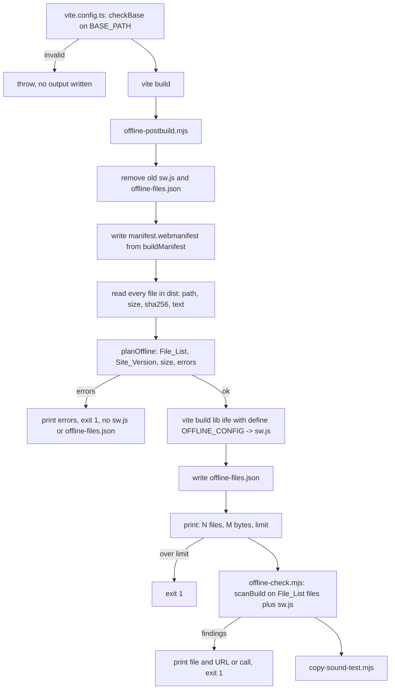
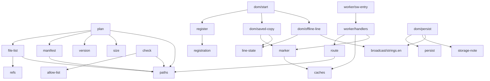
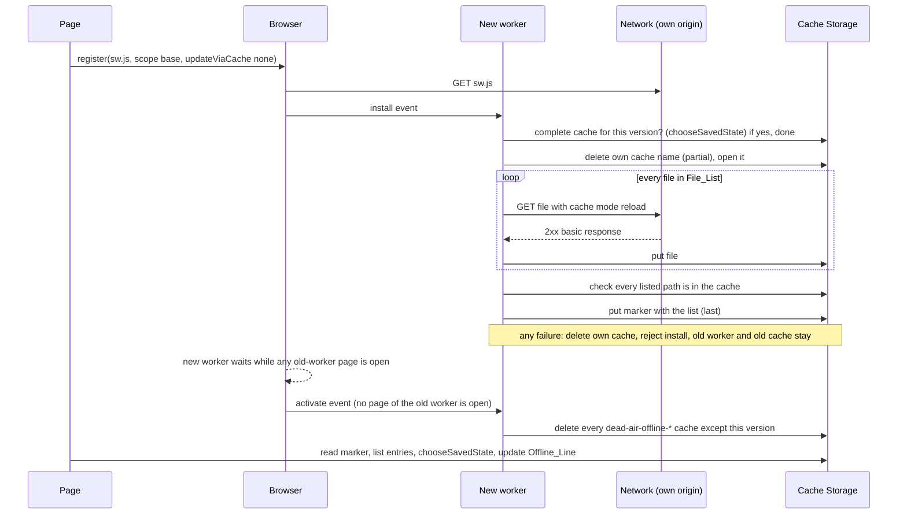
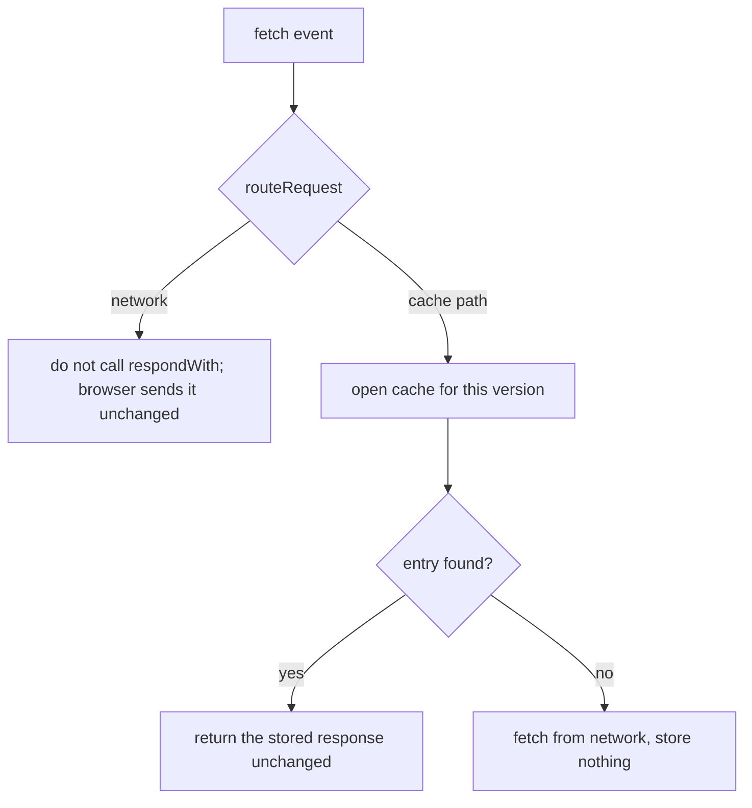
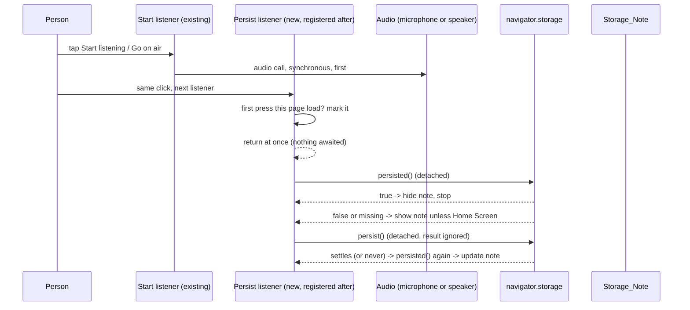

# Design Document

## Overview

Spec 6 makes Dead Air work with no network after the first visit. Four things are added to the site:

1. A **Service_Worker** (`<base>sw.js`) that saves every file in the File_List into a versioned cache on install, writes a Completion_Marker last, and then answers page requests from that cache.
2. A **registration and status layer** on all three pages. It registers the worker, asks for update checks, and drives the **Offline_Line** on the two app pages. It reads the Saved_Copy to decide whether the app is Fully_Saved.
3. A **persistence request and Storage_Note** on the two app pages. The first press of Start listening or Go on air asks the browser to keep the storage, after the audio call. A note appears when the browser did not agree and the page is not opened from the Home Screen.
4. **Build steps** that make the manifest, the File_List, the Site_Version and the worker file from the finished Vite output, print the Saved_Copy size, and run the **Offline_Check**.

This document follows the approved `requirements.md` (including Requirement 14 and the second-round decisions) and the workspace steering (promises 1 to 6, hosting, offline, structure and sound rules). It keeps every earlier design choice that still matches. All logic that decides something (what to cache, what to delete, how to route, whether the copy is complete, what the line says, whether the note shows, what the check flags) is a pure function in `src/offline/` and is tested in plain Node. The worker, the registration code and the build scripts only call browser or Node APIs and call those functions.

### Design decisions

| Decision | Choice | Reason |
|---|---|---|
| How the worker is built | A second, small `vite build` (library mode, one `iife` file, `fileName` fixed to `sw.js`, `minify: false`) run from `build/offline-postbuild.mjs` after the main build. The File_List and Site_Version are injected with Vite `define` as `__OFFLINE_CONFIG__` | A fixed name at the root of the output puts the worker at `<base>sw.js`, so its default scope is `<base>` (Requirement 3.5). Vite is already a dependency. The worker file changes whenever the injected version changes (Requirements 6.2, 6.11). Without minifying, the call text in `sw.js` is stable, so the Loader_Call_List can name it exactly. |
| How the File_List reaches the Service_Worker and the page with no network | **Baked into `sw.js`** by `define`. The worker copies it into the **Completion_Marker entry inside the cache** as JSON (`version`, `base`, `files`). The page reads the list from that entry. No file carrying the list is saved, and `offline-files.json` stays an Excluded_File | See "File_List with no network" below. |
| Where the File_List is made | After `vite build`, from the files on disk, by `build/offline-postbuild.mjs`. The decisions are in `planOffline` in `src/offline/plan.ts` | Reading the finished output is the only way to know the hashed file names (Requirement 9.2). |
| How the script runs TypeScript | The `.mjs` scripts import `src/offline/*.ts` directly. Node 24 strips types when it loads a `.ts` file. Files under `src/offline/` import each other with the `.ts` extension and use only erasable syntax | `vite.config.ts` already imports `./build/base-path.ts` this way. No loader or new dependency is needed. |
| What goes in the File_List | Everything reachable by **load references** from the three HTML pages and the Manifest (script, link, img, source, `srcset`, CSS `url()` and `@import`, JS imports and string paths that name an existing file, manifest icons). Anchor and area links are not load references | Anchors would make the Front_Page reachable from the app pages through the "Home" link, and the Front_Page images with it. External anchors on the Front_Page are not followed (Requirement 9.8). |
| How Front_Page images are excluded | By rule. An image file (by extension) that is in the set reachable from the Front_Page HTML but not in the set reachable from the Listen HTML, the Broadcast HTML and the Manifest | Requirement 9.3. No file or folder name is tested. |
| Site_Version | First 16 hex characters of a SHA-256 over the sorted lines `path NUL sha256(content)` of every file in the File_List | Order-independent, changes with any added, removed or changed file (Requirements 6.10, 6.11, 9.9). Hashing is injected into the pure function. |
| Cache name | `dead-air-offline-<Site_Version>` | One cache per version. Old ones are found by prefix (Requirement 10.3). |
| When a cache is "complete" | The Completion_Marker entry at `<base>offline-saved` is the last thing written, and a copy counts as Fully_Saved only when the marker parses, names this cache's version, and **every path in the marker's list is present in the cache**. One pure function, `chooseSavedState`, makes this decision in the page and in the worker | Cache Storage has no transactions. A killed browser can leave half a cache. A marker alone is not enough if an entry was later evicted or lost (Requirements 5.11, 5.12, 5.13). |
| Update flow | Install into the new versioned cache. No `skipWaiting`. No `clients.claim`. Activate deletes old Dead Air caches | A page that is open (a Session on the Listen page) is never changed (Requirements 6.3, 6.5, 6.6). |
| Install fetches | The worker asks its dependency for each file with the fixed init `{ cache: 'reload' }`. The handler itself sets the mode | Requirement 1.12 and the checkable property 1.13. GitHub Pages lets browsers reuse files for about 10 minutes, so a stale HTTP-cached file must not enter a new Saved_Copy. |
| Page to worker channel | None. The worker has no `message` handler (Requirement 11.3) and the page never posts to it | Alert data and audio cannot reach the worker. |
| Worker to page channel | The page reads Cache Storage (marker and entries), and listens to the standard `serviceWorker` events | Cache Storage works offline. The worker needs to send nothing. |
| Registration gate | `import.meta.env.PROD`. In the dev server nothing is registered and no request is made | Requirement 1.10. |
| Update check | Register with `updateViaCache: 'none'`, then call `registration.update()` 3 seconds after load when `navigator.onLine` is not `false`. Errors are swallowed | Requirements 6.1 and 6.12. |
| Offline_Check scope | One pure scanner over every File_List file plus `sw.js`. Pages are classified by path: the Front_Page HTML is `index.html` at the root of Base, every other HTML file is an app page. On the Front_Page, `<a href>` and `<area href>` to another site pass and everything that loads fails. On app pages every URL attribute is strict, including anchors | Requirements 7.2 to 7.5 and 7.15. |
| Loader_Call_List | Each entry names one file pattern, one call and the exact call text, plus a reason. The check fails when an entry is stale (matches no call) or wide (matches more than one file or more than one call) | Requirements 7.7 to 7.9. See "Offline_Check". |
| Persist request | A pure-logic controller (`persist.ts`) called by a second click listener that is registered after the existing Start listener, so the audio call has already run when it fires. It never awaits `persist()` in the click path | Requirement 14.3. |
| Offline_Check run | `npm run build` runs it on the output it just made. `npm test` builds twice (empty `BASE_PATH` and `dead-air`) and runs it on both, reporting which `BASE_PATH` failed | Requirements 7.11 and 7.12. The deploy workflow runs `npm test` before `npm run build`. |
| Vite modulepreload polyfill | Turned off with `build.modulePreload: { polyfill: false }` | The polyfill is a `fetch(e.href, ...)` call that the Offline_Check cannot prove same-origin. |
| Base check | `checkBase` runs inside `vite.config.ts` before the build starts | Requirement 3.7: an invalid `BASE_PATH` must not write any build output. |
| Icons | Two plain placeholder PNGs in `public/icons/`, committed. Vite copies `public/` to the output root | Requirement 4.8. |

### File_List with no network

The Saved_Copy has to say, with the network off, which files make up a complete copy. Three places could hold the list.

| Option | Verdict |
|---|---|
| A small saved JSON file, for example `offline-files.json` | Rejected. Requirement 1 and the Glossary make `offline-files.json` an Excluded_File. A different saved file that holds the list would have to be in the File_List itself, and it would carry the Site_Version, which is computed from the File_List. That is circular. |
| Bake the list and version into a page chunk | Rejected. The chunk is an App_File, so its content would change the Site_Version it contains. Circular again. |
| Bake into `sw.js`, and let the worker copy it into the Completion_Marker entry in the cache | **Chosen.** `sw.js` is an Excluded_File and is not part of the Site_Version, so there is no cycle. The marker is not in the File_List. The worker writes the marker last, so a marker in a cache always comes with the list that was saved. The page gets the list by reading one cache entry, which works offline. |

The marker body is `{"version":"<Site_Version>","base":"<base>","files":["assets/...","broadcast/index.html", ...]}`. The page and the worker both call `chooseSavedState` with that text and the URLs actually present in the cache. A marker that is missing, not valid JSON, for another version than the cache name, or listing a path that is not in the cache gives "unsaved". `offline-files.json` is still written to the output for the build tests and the Offline_Check, and it is never saved.

"Running Site_Version" in Requirements 5.4 and 5.12 is read as "any Dead Air cache that passes the check". The page cannot ask the worker which cache it is serving (there is no message channel), and while an update waits there are two complete caches. Either one passing is enough to show "Saved for offline use" (Open item 3).

### Research notes

- **Worker scope.** A worker's default scope is the folder it is served from. `<base>sw.js` gives scope `<base>`, which covers `/`, `/listen/` and `/broadcast/`. No `Service-Worker-Allowed` header is needed. Source: [ServiceWorkerContainer.register on MDN](https://developer.mozilla.org/en-US/docs/Web/API/ServiceWorkerContainer/register).
- **Waiting and no `skipWaiting`.** A new worker that finishes install waits until no client is controlled by the old worker, then activates. Neither `skipWaiting` nor `clients.claim` is called. Source: [Service Worker lifecycle on web.dev](https://web.dev/articles/service-worker-lifecycle).
- **`updateViaCache: 'none'`.** The browser then ignores the HTTP cache when it fetches `sw.js`. GitHub Pages sends `Cache-Control: max-age=600`. Same MDN source as above.
- **Install fetches.** `fetch(url, { cache: 'reload' })` bypasses the HTTP cache and updates it. Source: [Request.cache on MDN](https://developer.mozilla.org/en-US/docs/Web/API/Request/cache).
- **Cache Storage is origin-wide and not transactional.** `cache.addAll` can leave a partial cache if the browser stops, so the design writes a marker last and verifies entries against the list. Source: [Cache on MDN](https://developer.mozilla.org/en-US/docs/Web/API/Cache).
- **Storage persistence.** `navigator.storage.persist()` returns a promise for a boolean and `navigator.storage.persisted()` tells whether the origin is already persistent. Browsers decide on their own (Firefox asks the person, Chromium decides by engagement, Safari decides by its own rules). A `false` result is normal. Source: [StorageManager.persist on MDN](https://developer.mozilla.org/en-US/docs/Web/API/StorageManager/persist).
- **Home Screen detection.** `matchMedia('(display-mode: standalone)').matches` covers installed web apps, and `navigator.standalone` covers iOS Safari. Source: [display-mode on MDN](https://developer.mozilla.org/en-US/docs/Web/CSS/@media/display-mode).
- **Vite asset paths.** With `base` set to `/` or `/repo/`, Vite rewrites script and link paths in built HTML to absolute paths that begin with the base (for example `/assets/x.js` or `/repo/assets/x.js`). A page served at `<base>listen` (no trailing slash) therefore still finds its files. GitHub Pages answers `/listen` with a redirect to `/listen/`, but when the worker answers from the cache there is no redirect, so the absolute paths matter. The design turns this into a build error: a relative load reference in a built HTML page fails the plan (Requirement 2.10).
- **Vite and `%BASE_URL%` in a link.** A test build with `--base /repo/` turned `<link rel="manifest" href="%BASE_URL%manifest.webmanifest">` into `href="/repo/manifest.webmanifest"`, although the file did not exist yet when Vite ran. The manifest can therefore be written after the build.
- **What the built output contains today** (`dist/assets/fill-*.js`, from a build of the current code). It has the Vite modulepreload polyfill (`fetch(e.href, n)`), the Emscripten loader from ggwave (`fetch(V, { credentials: 'same-origin' })` and three uses of `XMLHttpRequest`), and no other `fetch`, `WebSocket`, `EventSource`, `sendBeacon` or absolute URL. The ggwave package embeds the wasm as a `data:` URI, so the Emscripten paths do not run. The first real Offline_Check run reports the exact call texts and they go into the Loader_Call_List one by one.
- **Node 24.4** runs `.ts` files with type stripping by default.

## Architecture

### Files

```
public/icons/
  icon-192.png                 placeholder, 192 by 192 (new)
  icon-512.png                 placeholder, 512 by 512 (new)
src/offline/
  index.ts                     exports the pure API
  paths.ts                     pure: checkBase, joinBase, stripBase, parseUrl, dirOf, resolveRelative, globMatch
  caches.ts                    pure: CACHE_PREFIX, cacheNameFor, markerPathFor, selectCachesToDelete
  marker.ts                    pure: makeMarkerText, parseMarker, chooseSavedState
  route.ts                     pure: routeRequest
  version.ts                   pure: computeSiteVersion
  refs.ts                      pure: extractRefs (html, css, js, webmanifest), IMAGE_EXTENSIONS
  file-list.ts                 pure: buildFileList, Front_Page_Image rule, errors
  manifest.ts                  pure: buildManifest, manifestText
  size.ts                      pure: summarizeSize, SIZE_LIMIT_BYTES
  plan.ts                      pure: planOffline (manifest + file list + version + size + worker config)
  check.ts                     pure: scanBuild, scanHtml, scanCss, scanJs, validateCallList
  allow-list.ts                data: ALLOWED_URLS, LOADER_CALL_LIST, each with a reason
  line-state.ts                pure: reduceOfflineLine, OfflineLineState
  storage-note.ts              pure: storageNoteVisible, isHomeScreenMode
  persist.ts                   pure logic with injected storage: createPersistController
  registration.ts              pure: registrationPlan(baseUrl)
  worker/
    handlers.ts                install, activate, fetch decisions over small interfaces (no browser globals)
    sw-entry.ts                real glue: addEventListener for install, activate, fetch
  dom/
    ids.ts                     OFFLINE_IDS: 'offline-line', 'storage-note'
    start.ts                   registerServiceWorker(), connectOfflineLine() (called from the two app main.ts)
    front-entry.ts             Front_Page entry: calls registerServiceWorker() only
    register.ts                navigator.serviceWorker.register, update check
    saved-copy.ts              reads caches, calls chooseSavedState, serviceWorker events
    offline-line.ts            writes the line text into #offline-line
    persist.ts                 createPersistence(document, strings): wires navigator.storage and #storage-note
build/
  offline-postbuild.mjs        main-build output in, manifest + sw.js + offline-files.json out, prints size
  offline-check.mjs            runs scanBuild on an output folder, exits non-zero on findings
tests/offline/                 see Testing Strategy
tsconfig.offline-logic.json    src/offline without dom and worker/sw-entry
tsconfig.offline-worker.json   worker/sw-entry.ts with the WebWorker library
tsconfig.offline-page.json     dom/ files with the DOM library
```

Output after `npm run build` (the three new files are written by `offline-postbuild.mjs`):

```
dist/index.html  listen/index.html  broadcast/index.html
dist/assets/*.js  (hashed)
dist/icons/icon-192.png  icon-512.png
dist/manifest.webmanifest      written by the script; in the File_List
dist/sw.js                     written by the script; Excluded_File; scanned by the check
dist/offline-files.json        written by the script; Excluded_File; read by the check and the tests only
dist/sound-test/               copied last by copy-sound-test.mjs; Excluded_File, never listed
```

Boundaries:

- Nothing in `src/offline/` outside `dom/` and `worker/sw-entry.ts` uses `document`, `window`, `navigator`, `caches`, `fetch`, `Response`, `URL`, `localStorage`, `matchMedia`, `Date.now` or a Node module (Requirement 10.1). `worker/handlers.ts` and `persist.ts` get everything they touch through parameters.
- `src/offline/` imports only from itself, plus `stringsEn` and the strings types from `src/broadcast/` in `dom/`. It does not import the message code, Listen or Broadcast logic.
- The worker file contains only `worker/sw-entry.ts`, `worker/handlers.ts`, `caches.ts`, `marker.ts`, `route.ts` and `paths.ts`. It has no `message` listener, never touches `localStorage` and never mentions `persist` (Requirements 6.7, 14.11).
- The app pages load only `src/offline/dom/*`, `line-state.ts`, `storage-note.ts`, `persist.ts`, `marker.ts`, `registration.ts`, `caches.ts` and `paths.ts`. They load no Front_Page image.
- `build/offline-*.mjs` do all file and process access. The decisions are in `plan.ts` and `check.ts`.

### Build flow



`package.json` `build` becomes `vite build && node build/offline-postbuild.mjs && node build/offline-check.mjs && node build/copy-sound-test.mjs`. The size line is printed before the limit is judged, so it appears on pass and on fail (Requirement 8.5). A failed plan removes the old `sw.js` and `offline-files.json` first and writes neither, so a failed run leaves no File_List or Site_Version in the output (Requirement 9.7).

### Module dependencies



### Install, update and activate



### Request handling



### First press, persistence and Storage_Note



## Components and Interfaces

### Paths (`paths.ts`)

```ts
/** Returns an error text when base is not "/" or "/seg/.../" with no empty segment, else null. */
export function checkBase(base: string): string | null;
export function joinBase(base: string, rel: string): string;       // "/repo/", "listen/index.html" -> "/repo/listen/index.html"
export function stripBase(base: string, abs: string): string | null; // null when abs is outside base
export function parseUrl(url: string): { origin: string; path: string } | null; // no query, no fragment
export function dirOf(path: string): string;
export function resolveRelative(fromDir: string, ref: string): string | null; // null if it climbs above the root
export function globMatch(pattern: string, path: string): boolean; // "*" matches any run of characters except "/"
```

`checkBase` rejects an empty inner segment such as `/a//b/`, so the build fails with the offending value (Requirement 3.7). It is called from `vite.config.ts` on the resolved base before Vite starts, and again by `planOffline`. `parseUrl` is hand-written because `src/offline/` may not use the `URL` global.

### Cache names (`caches.ts`)

```ts
export const CACHE_PREFIX = 'dead-air-offline-';
export const cacheNameFor = (version: string): string => CACHE_PREFIX + version;
export const markerPathFor = (base: string): string => base + 'offline-saved';
/** Names of Dead Air caches that are not the current one. Never a foreign cache, never the current one. */
export function selectCachesToDelete(names: readonly string[], currentVersion: string): string[];
```

### Completion_Marker and the Fully_Saved choice (`marker.ts`)

```ts
export interface MarkerData { version: string; base: string; files: string[] }
export function makeMarkerText(data: MarkerData): string;           // JSON, no spaces
export function parseMarker(text: string | null): MarkerData | null; // null for missing, bad JSON, wrong shape

export interface SavedInput {
  cacheName: string;                 // for example "dead-air-offline-ab12..."
  markerText: string | null;         // body of the marker entry, or null when absent
  presentUrls: readonly string[];    // URLs of every entry in that cache
  origin: string;
  base: string;
}
/** 'saved' only if the marker parses, its version equals the cache name's version, its base equals base,
 *  its list is non-empty, and every listed path is present as origin + base + path. */
export function chooseSavedState(input: SavedInput): 'saved' | 'unsaved';
```

The marker URL itself is never in the `files` list. A cache with all files and no marker gives `unsaved`. A cache with a marker and one file missing gives `unsaved` (Requirement 5.13). The page calls this for each Dead Air cache and shows "saved" if any returns `saved`. The worker calls it at install to decide whether a cache of the same version is already complete.

### Request routing (`route.ts`)

```ts
export interface RouteContext {
  origin: string;                 // worker origin, e.g. "https://deadair.vedasdixit.com"
  base: string;                   // "/" or "/repo/"
  files: readonly string[];       // File_List, relative to base
}
export type Route = { action: 'cache'; path: string } | { action: 'network' };
export function routeRequest(req: { url: string; method: string }, ctx: RouteContext): Route;
```

Rules, in order:

1. A method other than `GET` gives `network`.
2. `parseUrl` fails, or the origin differs from `ctx.origin`, gives `network` (Requirement 2.4). `parseUrl` drops the query and the fragment, so they never change the result (Requirement 2.2).
3. The path must start with `ctx.base`, otherwise `network`. Strip the base to get `rel`.
4. Candidates, tried in this order, first one in `ctx.files` wins:
   - `rel` itself (a file such as `assets/x.js`, `manifest.webmanifest`, `icons/icon-192.png`, or `index.html`).
   - if `rel` is empty: `index.html` (the address `<base>`).
   - if `rel` ends with `/`: `rel + 'index.html'` (`listen/` gives `listen/index.html`).
   - otherwise: `rel + '/index.html'` (`listen` with no slash gives `listen/index.html`).
5. If a candidate matches the result is `cache`, otherwise `network`. A request for `<base>other` or `<base>offline-saved` or `<base>offline-files.json` is not in the list and goes to the network, which offline is a normal failed request with no substitute page (Requirement 2.9).

The address variants for each page are therefore `<base>listen`, `<base>listen/`, `<base>listen/index.html`, the same for `broadcast`, and `<base>` and `<base>index.html` for the Front_Page, each with or without a query string or fragment (Requirements 2.2, 2.5, 2.10).

**Why the pages still load at every variant.** Vite builds HTML with asset paths that are absolute from Base, so a page opened at `/listen` (no slash) asks for `/assets/x.js`, not `listen/assets/x.js`. The build proves it: `planOffline` reports an error for any load reference in a built HTML file that does not begin with Base (Requirement 2.10). The `%BASE_URL%` manifest link is also absolute. GitHub Pages redirects `/listen` to `/listen/` when online. When the worker answers, there is no redirect, and the same absolute paths work.

### Site_Version (`version.ts`)

```ts
export interface VersionEntry { path: string; hash: string }  // hash: hex digest of the file bytes
export function computeSiteVersion(entries: readonly VersionEntry[], hashText: (text: string) => string): string;
```

It sorts the entries by `path` (code unit order), joins `path + '\0' + hash` lines with `\n`, passes the text to `hashText` and returns the first 16 characters. `offline-postbuild.mjs` passes `node:crypto` SHA-256 hex for both the file hashes and `hashText`.

### References (`refs.ts`)

```ts
export type FileKind = 'html' | 'css' | 'js' | 'manifest' | 'other';
export interface Ref {
  target: string;                // raw text in the file
  kind: 'load' | 'import';       // import = must exist, a JS import specifier
  from: 'html-attr' | 'css' | 'js' | 'manifest'; // lets the plan treat relative HTML loads as errors
}
export function kindOf(path: string): FileKind;
export function extractRefs(kind: FileKind, text: string): Ref[];
export const IMAGE_EXTENSIONS: readonly string[]; // png jpg jpeg gif webp avif svg ico bmp
```

`extractRefs` by kind:

- **html:** `src` on `script`, `img`, `source`, `audio`, `video`, `iframe`, `embed`; `srcset` (the URL part of each candidate); `poster`; `href` on `link` only (not on `a` or `area`). Inline `<style>` text is read as CSS. Inline `<script>` text is read as JS.
- **css:** `url(...)` and `@import "..."` / `@import url(...)`.
- **js:** static `import ... from "x"`, `export ... from "x"`, `import "x"` and `import("x")` give kind `import`. Every other string literal that starts with `./`, `../`, `/` or contains a known file extension gives kind `load`. The builder keeps a `load` ref only when it names an existing file.
- **manifest:** `icons[].src` (JSON parse; invalid JSON gives no refs and the plan reports it).

### File_List (`file-list.ts`)

```ts
export interface OutputFile { path: string; size: number; hash: string; text?: string } // path relative to base
export interface FileListInput {
  base: string;
  files: readonly OutputFile[];           // everything in the output folder
  appRoots: readonly string[];            // ['listen/index.html', 'broadcast/index.html', 'manifest.webmanifest']
  frontRoots: readonly string[];          // ['index.html']
  excludedPaths: readonly string[];       // 'sw.js', 'offline-files.json'
  excludedPrefixes: readonly string[];    // 'sound-test/'
  excludedSuffixes: readonly string[];    // '.map'
}
export interface FileListResult {
  files: string[];                        // sorted, unique, relative to base
  frontImages: string[];                  // the Front_Page_Images that were left out
  missing: { target: string; from: string }[];
  external: { target: string; from: string }[];
  outsideScope: { target: string; from: string }[];
  relativeLoads: { target: string; from: string }[]; // HTML load refs that do not begin with base
  excludedReached: string[];              // Excluded_Files that something loads (Requirement 8.7)
}
export function buildFileList(input: FileListInput): FileListResult;
```

Algorithm:

1. Build a map `path -> OutputFile` from `files`.
2. `reach(roots)` walks the graph. For each file it reads `kindOf(path)` and, for html, css, js and manifest files with `text`, calls `extractRefs`. Each ref is resolved:
   - `data:`, `blob:`, `mailto:`, `tel:`, `javascript:`, `#...`: ignored.
   - `http(s)://...` or `//host`: added to `external` (Requirement 9.8). Anchors never reach this step, so an External_Link on the Front_Page is neither followed nor an error.
   - Starts with `/`: must start with `base`, else `outsideScope`. Strip `base` to get a path.
   - Otherwise relative. A ref with `from: 'html-attr'` that is relative is added to `relativeLoads` (Requirement 2.10) and then resolved with `resolveRelative(dirOf(from), ref)` so the walk continues. Other relative refs resolve the same way.
   - A trailing `/` means `<dir>/index.html`. Query and fragment are removed.
   - If the target exists, it is added and walked. If it does not exist: kind `import`, or any ref from html, css or manifest, goes to `missing` (Requirement 9.7). A JS `load` ref that does not name a file is dropped.
3. `A = reach(appRoots)`, `F = reach(frontRoots)`. A root missing from the output goes to `missing`.
4. `frontImages = { p in F \ A : extension of p is in IMAGE_EXTENSIONS }`.
5. `files = (A ∪ F) \ frontImages`. Any file in `A ∪ F` that is an excluded path, prefix or suffix goes to `excludedReached` and the plan fails (Requirement 8.7). A Front_Page_Image is not an error: it is simply not listed.
6. `files` is sorted by code unit and has no duplicates.

An image is kept when any app root reaches it, including the manifest icons. The rule is about references, not names (Requirement 9.3).

### Manifest (`manifest.ts`)

```ts
export interface WebManifest {
  name: string; short_name: string; start_url: string; scope: string; display: 'standalone';
  background_color: string; theme_color: string;
  icons: { src: string; sizes: string; type: 'image/png'; purpose: 'any' }[];
}
export function buildManifest(base: string): WebManifest;
export function manifestText(m: WebManifest): string; // JSON, 2 spaces, trailing newline
```

Values: `name` "Dead Air", `short_name` "Dead Air" (8 characters), `start_url` `joinBase(base, 'listen/')`, `scope` `base`, `display` `standalone`, `background_color` `#000000`, `theme_color` `#000000`, icons `joinBase(base, 'icons/icon-192.png')` (192x192) and `icon-512.png` (512x512). No URL is cross-origin. The colours and names are placeholders for spec 8.

### Plan (`plan.ts`)

```ts
export interface PlanInput {
  base: string;
  files: readonly OutputFile[];           // the output folder, including manifest.webmanifest
  hashText: (text: string) => string;
}
export interface OfflineConfig { version: string; base: string; files: readonly string[] }  // injected into sw.js
export interface PlanResult {
  ok: boolean;
  errors: string[];                       // one line per problem, naming the path or the pair
  config: OfflineConfig | null;           // null when errors is not empty
  count: number;
  totalBytes: number;
  sizeLine: string;                       // "offline: 12 files, 187404 bytes in the Saved_Copy (limit 2097152)"
}
export function planOffline(input: PlanInput): PlanResult;
```

`planOffline` calls `checkBase`, `buildFileList`, `computeSiteVersion` and `summarizeSize`, checks that every listed path exists in `files`, is relative, has no `..` and no scheme, and joins all failures into `errors` (Requirements 2.10, 3.7, 3.8, 8.6, 8.7, 8.8, 9.7, 9.8). The manifest is checked against Requirement 4: `start_url`, `scope` and icons start with `base`, and the two icon paths exist. `config` is the single File_List and Site_Version. When `errors` is not empty, `config` is null and the script writes neither `sw.js` nor `offline-files.json`.

### Size (`size.ts`)

```ts
export const SIZE_LIMIT_BYTES = 2_097_152;
export interface SizedFile { path: string; size: number }
export function summarizeSize(files: readonly SizedFile[]): { count: number; total: number; over: boolean; line: string };
```

`over` is `total > SIZE_LIMIT_BYTES`. `line` is always produced. The `line` reads `Saved copy: N files, T bytes (limit 2097152 bytes)`, with `, over the limit` added when over. The sizes are those of the File_List files only (the Front_Page HTML and its own files are included, the marker and `sw.js` are not).

### Offline_Check (`check.ts`, `allow-list.ts`)

```ts
export interface CheckFile { path: string; text: string }          // path relative to base
export interface CheckInput {
  files: readonly CheckFile[];             // every File_List file that is html, css, js, webmanifest or json, plus sw.js
  outputPaths: readonly string[];          // every file in the output (for pattern matching in the call list)
  frontPages: readonly string[];           // ['index.html']
  callList: readonly LoaderCall[];
  allowedUrls: readonly AllowedUrl[];
}
export interface Finding {
  path: string;
  kind: 'html-load' | 'html-link' | 'css-url' | 'js-url' | 'js-call' | 'call-list-entry' | 'url-list-entry';
  detail: string;      // the URL, the call text, or the entry
}
export interface CheckResult { ok: boolean; findings: Finding[] }
export function scanBuild(input: CheckInput): CheckResult;
```

An external URL is a string that starts with `http://`, `https://`, `ws://`, `wss://` or `//` followed by a host that contains a dot. A same-origin absolute URL is also reported, because the check does not know the origin. One finding is made per occurrence, so the count of findings equals the count of external URLs and calls in a fixture (Requirements 7.13, 7.14).

**HTML.** The page role comes from the path: a path in `frontPages` is the Front_Page, every other `.html` file is an app page.

| Where | App page (strict) | Front_Page |
|---|---|---|
| `src`, `srcset` (each candidate), `poster`, `data`, `ping` on any element | external gives `html-load` | external gives `html-load` |
| `href` on `<link>` of any `rel` | external gives `html-load` | external gives `html-load` |
| `action`, `formaction` | external gives `html-load` | external gives `html-load` |
| `content` | external gives `html-load` on any `<meta>` | external gives `html-load` only on `<meta http-equiv="refresh">` |
| `href` on `<a>` and `<area>` | external gives `html-link` | accepted, no finding |
| inline `<style>` and `style=""` | scanned as CSS | scanned as CSS |
| inline `<script>` | scanned as JS | scanned as JS |

The table is the whole difference between the two roles (Requirements 7.2 to 7.4, 7.15). The same check runs on Front_Page_Files such as its CSS and JS, which have no relaxation.

**CSS.** Any `url(...)` or `@import` that is external gives `css-url` (Requirement 7.5).

**JS** (`.js`, `.webmanifest`, `.json` use the string rule only):

- A quoted string (`"`, `'` or backtick) that starts with an external URL and is not an entry of `allowedUrls` gives `js-url` (Requirement 7.6). This covers request targets, imports, script sources and worker sources.
- A call to `fetch`, `XMLHttpRequest` (including `new XMLHttpRequest`), `WebSocket`, `EventSource` or `navigator.sendBeacon` is found by name. Its **call text** is the source from the callee name to the matching closing parenthesis (strings skipped). The call gives `js-call` unless (a) its first argument is a string literal that is a same-origin relative path, or (b) its first argument is a string literal that is an external URL (already counted as `js-url`, so it is not counted twice), or (c) exactly one `callList` entry matches it.

**Loader_Call_List.**

```ts
export interface LoaderCall {
  file: string;      // path pattern in the build output; "*" matches within one folder level
  call: 'fetch' | 'XMLHttpRequest' | 'WebSocket' | 'EventSource' | 'sendBeacon';
  snippet: string;   // the exact call text, as found in the file
  reason: string;
}
export interface AllowedUrl { url: string; reason: string }
export const LOADER_CALL_LIST: readonly LoaderCall[];
export const ALLOWED_URLS: readonly AllowedUrl[];
```

An entry accepts a call only when `globMatch(entry.file, call.path)`, `entry.call` equals the callee and `entry.snippet` equals the call text. It names one file pattern, one call and one call text (Requirement 7.8). `validateCallList` gives at most one finding of kind `call-list-entry` per entry, in this order (Requirements 7.9, 7.16):

1. `reason` empty or only spaces.
2. `file` pattern matches more than one file in `outputPaths` (too wide).
3. The entry matches no call, or more than one call, in the scanned files (stale, or snippet too wide).

`ALLOWED_URLS` gets the same reason rule (`url-list-entry`, Requirement 7.10).

**Where the list lives and how the owner sees it.** The two lists are in one file, `src/offline/allow-list.ts`, as plain data with the reason next to each entry. The first real run reports the current call texts and one entry is added for each reported call, nothing more. The expected content is: the Emscripten `fetch(...)` in the ggwave chunk and each of its `XMLHttpRequest` uses (one entry each, because each has a different call text), and the two `fetch(...)` calls in `sw.js`. If two calls in one file have identical text, one entry would match two calls and fail rule 3, so the design asks to change the source for that case instead of widening the entry (Open item 2). The whole list is copied into `.kiro/specs/offline/report.md` and into the final summary (Requirement 13.6). A test checks that the report contains every entry.

**Runner.** `build/offline-check.mjs <outDir>` reads `offline-files.json`, loads every listed html, css, js, webmanifest and json file plus `sw.js`, passes the full list of output paths, and calls `scanBuild`. Each finding prints as `<path>: <kind>: <detail>`. Any finding exits 1. `tests/offline/site-build.test.ts` builds with an empty `BASE_PATH` and with `dead-air`, runs the same function on both, and names the `BASE_PATH` in each failure message (Requirement 7.12).

### Offline_Line state (`line-state.ts`)

```ts
export type OfflineLineState = 'unsaved' | 'saved';
export type OfflineEvent =
  | { type: 'copy-found' }          // chooseSavedState returned 'saved' for some Dead Air cache
  | { type: 'copy-missing' }        // no cache passed the check
  | { type: 'unsupported' }         // no service worker or no Cache Storage, or dev server
  | { type: 'update-downloading' }  // a new worker is installing
  | { type: 'update-failed' }       // a new worker failed
  | { type: 'update-done' };        // a new worker finished install
export const INITIAL_LINE_STATE: OfflineLineState = 'unsaved';
export function reduceOfflineLine(state: OfflineLineState, event: OfflineEvent): OfflineLineState;
```

`copy-found` gives `saved`. `copy-missing` and `unsupported` give `unsaved`. The three `update-*` events return the state unchanged, so a download of a new version never turns "saved" into "unsaved" and a failed update with a complete old copy keeps "saved" (Requirements 5.5, 5.14). After `update-done` the page probes again. "Saved" is only ever entered through `copy-found`, which the page emits only after `chooseSavedState` returns `saved` (Requirement 5.12).

### Storage_Note and persistence (`storage-note.ts`, `persist.ts`)

```ts
// storage-note.ts (pure)
export interface NoteInput { firstPress: boolean; persisted: boolean; homeScreen: boolean }
export function storageNoteVisible(i: NoteInput): boolean;       // firstPress && !persisted && !homeScreen
export function isHomeScreenMode(m: { displayStandalone: boolean; navigatorStandalone: boolean | undefined }): boolean;

// persist.ts (no browser globals; storage is injected)
export interface StorageLike {
  persist?: () => Promise<boolean>;
  persisted?: () => Promise<boolean>;
}
export interface PersistDeps {
  storage: StorageLike | undefined;      // real: navigator.storage
  homeScreen: () => boolean;             // real: isHomeScreenMode over matchMedia and navigator.standalone
  showNote: (visible: boolean) => void;  // real: writes #storage-note
}
export interface PersistController { firstPress(): void }
export function createPersistController(deps: PersistDeps): PersistController;
```

`firstPress()` behaviour, all inside one call that returns before any promise settles:

1. If a first press was already seen on this page load, return. Otherwise remember it in memory only (nothing goes to `localStorage`, Requirement 14.5).
2. Start one detached async task and return. The task never throws. Every call to storage is inside `try` and every promise has a `catch`.
3. The task reads `persisted()` (a missing function or a throw counts as `false`). If `true`, it calls `showNote(false)` and ends, without calling `persist()` (Requirement 14.1).
4. Otherwise it calls `showNote(storageNoteVisible({ firstPress: true, persisted: false, homeScreen: homeScreen() }))`, then calls `persist()` if it exists and does not wait for it in any place a click handler waits.
5. When `persist()` settles (resolves, rejects or throws), the task reads `persisted()` again and calls `showNote` with the new result. If `persist()` never settles the first `showNote` result stays, and nothing else waits (Requirement 14.4).

Nothing in `persist.ts` is called at load. `createPersistController` itself makes no storage call (Requirement 14.2). The Service_Worker never imports this file (Requirement 14.11).

**Order against the audio call.** The two click listeners are registered in this order: the existing Start listener first, then the persist listener. The browser runs listeners in registration order, in the same event, so the audio call (`tapStart` calls `audio.open()` first, `goOnAir` calls `audio.unlock` first) has already run when `firstPress` is called, and `firstPress` does not delay or wrap it (Requirement 14.3). A boundary test checks the order in the source.

### Registration plan (`registration.ts`)

```ts
export interface RegistrationPlan { scriptUrl: string; scope: string; updateViaCache: 'none' }
export function registrationPlan(baseUrl: string): RegistrationPlan | null; // null when baseUrl fails checkBase
```

`scriptUrl` is `baseUrl + 'sw.js'` and `scope` is `baseUrl`. `baseUrl` comes from `import.meta.env.BASE_URL`, which is the Vite `base`. No sub-path is written in code.

### Worker handlers (`worker/handlers.ts`)

```ts
export interface ResponseLike { ok: boolean; type?: string; redirected?: boolean }
export interface CacheLike<R extends ResponseLike> {
  put(url: string, response: R): Promise<void>;
  match(url: string): Promise<R | undefined>;
  keys(): Promise<string[]>;                           // URLs of every entry
}
export interface CacheStorageLike<R extends ResponseLike> {
  open(name: string): Promise<CacheLike<R>>;
  has(name: string): Promise<boolean>;
  delete(name: string): Promise<boolean>;
  keys(): Promise<string[]>;
}
export interface WorkerDeps<R extends ResponseLike> {
  caches: CacheStorageLike<R>;
  fetchFresh(url: string, init: { cache: 'reload' }): Promise<R>;   // real: fetch(url, init)
  fetchNetwork(request: unknown): Promise<R>;                       // real: fetch(request)
  makeMarker(json: string): R;                                      // real: new Response(json, JSON content type)
  readText(response: R): Promise<string>;                           // real: response.clone().text()
  origin: string;                                                   // self.location.origin
  config: OfflineConfig;                                            // injected
}
export interface WorkerHandlers<R extends ResponseLike> {
  install(): Promise<void>;
  activate(): Promise<void>;
  handleFetch(request: { url: string; method: string }, raw: unknown): Promise<R> | null; // null = do not respond
}
export function createWorkerHandlers<R extends ResponseLike>(deps: WorkerDeps<R>): WorkerHandlers<R>;
```

Behaviour:

- **`install`:** `name = cacheNameFor(version)`. If that cache exists and `chooseSavedState` says `saved` for it, return (a second worker with the same Site_Version must not delete the cache the active worker is serving). Otherwise delete `name` (a partial from an earlier stop), open it, and for every path in the list call `fetchFresh(origin + joinBase(base, path), { cache: 'reload' })` exactly once. The handler writes the `{ cache: 'reload' }` object itself, so no caller can forget it (Requirements 1.12, 1.13). Each response must have `ok`, `type === 'basic'` and `redirected !== true`; each is `put` unchanged. After the last file, `keys()` is checked to contain every listed URL, then the marker (`makeMarkerText({ version, base, files })`) is `put` last. On any error delete `name` and rethrow, which makes the install fail. The old cache is never opened for writing (Requirements 1.3, 1.4, 5.11, 6.2, 6.8, 6.9).
- **`activate`:** delete each name from `selectCachesToDelete(await caches.keys(), version)` (Requirement 6.4).
- **`handleFetch`:** `routeRequest`. For `network` return `null`. For `cache`, open the current cache, `match(origin + joinBase(base, path))`, return it unchanged when found. When not found (evicted or never saved) return `fetchNetwork(raw)` and store nothing. Offline that call fails with a network error and no substitute page is returned (Requirements 2.1 to 2.5, 2.9, 11.2, 11.7). If opening the cache throws, the same network fallback is used.

### Worker glue (`worker/sw-entry.ts`)

```ts
declare const __OFFLINE_CONFIG__: OfflineConfig;
declare const self: ServiceWorkerGlobalScope;
const h = createWorkerHandlers({
  caches: self.caches,
  fetchFresh: (u, init) => fetch(u, init),
  fetchNetwork: (r) => fetch(r as Request),
  makeMarker: (j) => new Response(j, { headers: { 'content-type': 'application/json' } }),
  readText: (r) => r.clone().text(),
  origin: self.location.origin, config: __OFFLINE_CONFIG__,
});
self.addEventListener('install', (e) => e.waitUntil(h.install()));
self.addEventListener('activate', (e) => e.waitUntil(h.activate()));
self.addEventListener('fetch', (e) => { const p = h.handleFetch(e.request, e.request); if (p) e.respondWith(p); });
```

There is no `message` listener, no `skipWaiting`, no `clients.claim`, no `localStorage`, no `storage.persist` and no logging. The two `fetch(...)` calls here are the two `sw.js` entries of the Loader_Call_List.

### Page glue (`dom/`)

- **`start.ts`:** `registerServiceWorker()` calls `registerWorker()`; `connectOfflineLine()` creates the line controller. Both do nothing harmful when the APIs are missing.
- **`register.ts`:** if `!import.meta.env.PROD`, return. If `!('serviceWorker' in navigator)`, return. Otherwise, at `window` `load` (or at once if `document.readyState === 'complete'`) call `navigator.serviceWorker.register(plan.scriptUrl, { scope: plan.scope, updateViaCache: 'none' })`. A rejection is caught and ignored. After success, wait 3 seconds, and when `navigator.onLine !== false` call `registration.update()` with errors ignored (Requirements 1.1, 1.2, 6.1, 6.12). It never reloads, navigates or closes a page (Requirement 6.5) and never reads or writes `localStorage` (Requirement 6.7).
- **`saved-copy.ts`:** `probeSavedCopy()` lists `caches.keys()`. For each name that starts with `CACHE_PREFIX` it opens the cache, reads the marker entry at `location.origin + markerPathFor(BASE_URL)` as text (or `null`), lists the entry URLs with `cache.keys()`, and calls `chooseSavedState`. Any `saved` means "complete copy exists". It reads no entry other than the marker. `watchSavedCopy(emit)` emits `copy-found` or `copy-missing` from a probe at start, after `navigator.serviceWorker.ready` resolves, on `controllerchange`, and when a new worker reaches `installed` or `activated` (also `update-done`). It emits `update-downloading` on the registration's `updatefound` and `update-failed` when the new worker becomes `redundant`. It emits `unsupported` when there is no `serviceWorker` or no `caches`, and in dev.
- **`offline-line.ts`:** finds `#offline-line` once, folds events with `reduceOfflineLine`, and writes `stringsEn.text['offline.saved']` or `['offline.unsaved']` with `textContent`. The element is in the markup with `aria-live="polite"` (Requirement 5.9). The text appears at once as "unsaved" and changes after the first probe, normally within a few milliseconds and always within 1 second (Requirements 5.3, 5.4).
- **`persist.ts` (dom):** `createPersistence(doc, strings)` finds `#storage-note` once, builds a `PersistController` with `navigator.storage`, a `homeScreen` function from `isHomeScreenMode({ displayStandalone: matchMedia('(display-mode: standalone)').matches, navigatorStandalone: navigator.standalone })`, and a `showNote` that sets `hidden` and writes `strings.text['offline.storageNote']` when visible and an empty text when not (so the live region announces the appearance). It returns `{ firstPress }`.
- **`front-entry.ts`:** `import { registerServiceWorker } from './start'; registerServiceWorker();`. It does not connect an Offline_Line or a Storage_Note (Requirements 5.10, 14.10).

### Strings

Three keys are added to `TEXT_KEYS`, `PLACEHOLDERS` (all with no placeholders) and the English `text` table:

| Key | English text |
|---|---|
| `offline.unsaved` | `Open this page once with internet to save it` |
| `offline.saved` | `Saved for offline use` |
| `offline.storageNote` | `Your browser may clear this saved copy if you do not use the app. Add it to your Home Screen to keep it.` |

The two line texts are 60 characters or fewer, plain text, no emoji. The note text is exactly the sentence in Requirement 14.9, no emoji. Because `Strings['text']` is `Record<TextKey, string>` and `PLACEHOLDER_KEYS_MATCH` is checked at compile time, a language file that lacks any of the keys fails the type check (Requirement 5.8).

### Edits to files owned by other specs

All are pre-approved by the owner (Requirement 12.1). Each is the smallest edit that works. Every other line stays as it is.

| File | Exact edit |
|---|---|
| `listen/index.html` | In `<head>` add `<link rel="manifest" href="%BASE_URL%manifest.webmanifest" />`. As the last children of `<main>` add `<div id="offline-line" aria-live="polite"></div>` and `<p id="storage-note" aria-live="polite" hidden></p>`. |
| `broadcast/index.html` | The same three lines. |
| `index.html` | In `<head>` add the same manifest link. Before `</body>` add `<script type="module" src="./src/offline/dom/front-entry.ts"></script>`. No Offline_Line, no Storage_Note. |
| `listen/main.ts` | Add `import { connectOfflineLine, registerServiceWorker } from '../src/offline/dom/start';` and, after `mount();`, add `registerServiceWorker();` and `connectOfflineLine();`. |
| `broadcast/main.ts` | The same import and the same two calls after `mount();`. |
| `src/listen/dom/mount.ts` | Add one import line `import { createPersistence } from '../../offline/dom/persist';`. Directly after the existing `on(byId(ELEMENT_IDS.start), 'click', ...)` line, these two lines: `const persistence = createPersistence(document, strings);` and `on(byId(ELEMENT_IDS.start), 'click', () => persistence.firstPress()); // after the Start listener, so audio opens first`. The existing Start line and everything else stay unchanged. |
| `src/broadcast/dom/mount.ts` | Add one import line `import { createPersistence } from '../../offline/dom/persist';`. Directly after the existing `on(byId<HTMLButtonElement>(ELEMENT_IDS.go), 'click', () => guard(() => controller.goOnAir()));` line add `const persistence = createPersistence(document, strings);` and `on(byId<HTMLButtonElement>(ELEMENT_IDS.go), 'click', () => persistence.firstPress()); // after the Go on air listener, so audio unlocks first`. Change line 3 of the header comment from `// No network request, no microphone, no service worker, no logging of samples or positions.` to `// No network request, no microphone, no logging of samples or positions. The service worker is in src/offline.` (Requirement 12.9). |
| `src/broadcast/strings.types.ts` | Add `'offline.unsaved'`, `'offline.saved'` and `'offline.storageNote'` to `TEXT_KEYS`, and `[]` placeholder entries for each to `PLACEHOLDERS`. |
| `src/broadcast/strings.en.ts` | Add the three English texts under a comment `// Offline`. |
| `vite.config.ts` | Import `checkBase` and throw an `Error` naming the value when `checkBase(base)` returns text. In `build` add `modulePreload: { polyfill: false }`. Nothing else changes. |
| `package.json` | `build` becomes `vite build && node build/offline-postbuild.mjs && node build/offline-check.mjs && node build/copy-sound-test.mjs`. `typecheck` gets three more `tsc -p` commands: `tsconfig.offline-logic.json`, `tsconfig.offline-worker.json`, `tsconfig.offline-page.json`. |
| `tsconfig.json` | Add `src/offline/dom` and `src/offline/worker/sw-entry.ts` to `exclude`. `allowImportingTsExtensions` is already set there. |
| `tsconfig.listen-page.json`, `tsconfig.broadcast-page.json` | Add `"allowImportingTsExtensions": true` to `compilerOptions`, because the pages now import `src/offline/*.ts` files that use `.ts` import specifiers. |

The mount edits are two lines plus one import each. `persistence` is a new constant, so no existing name is touched. The persist listener is a separate `on(...)` call, so the existing Start handler (which calls the audio function with no `await` before it) is not edited and stays first in registration order. No teardown is added, since `createPersistence` registers no listener of its own.

The Listen mount header comment (`src/listen/dom/mount.ts` line 6) said "No network request, no service worker, no logging of samples." and was stale after this spec. The owner directly instructed a change of that comment line, which overrides the limit in Requirement 12.10 for comment lines only. It now reads "No network request, no logging of samples. The service worker is in src/offline." (Open item 4, resolved).

New files this spec owns: everything in `src/offline/`, `build/offline-postbuild.mjs`, `build/offline-check.mjs`, `public/icons/*.png`, `tests/offline/`, the three `tsconfig.offline-*.json` files, and `.kiro/specs/offline/report.md`. No file outside the lists above is edited. The deploy workflow needs no change.

## Data Models

| Type | Where | Notes |
|---|---|---|
| `OfflineConfig` | `src/offline/plan.ts` | `{ version, base, files }`. Injected into `sw.js`. |
| `offline-files.json` | `<base>offline-files.json` (build output) | Same data as `OfflineConfig`: `{ "version": "ab12...", "base": "/", "files": [...] }`. Sorted, 2-space JSON, trailing newline, no time stamp, so two runs on one output are byte-identical (Requirement 9.6). One File_List and one Site_Version per build (Requirement 9.1). Excluded_File: read by the Offline_Check and the tests, never saved. |
| `sw.js` | `<base>sw.js` (build output) | Bundled, unminified worker with `__OFFLINE_CONFIG__` replaced. Excluded_File. Scanned by the Offline_Check. |
| Cache `dead-air-offline-<version>` | Cache Storage | One entry per File_List path under its full URL (origin + base + path), plus the marker. Each response is the one downloaded, unchanged. |
| Completion_Marker | Key `<origin><base>offline-saved` | Body `{"version":"...","base":"...","files":[...]}`. Written last. Never routed, never served by the worker. The page reads it to learn the list. |
| `WebManifest` | `<base>manifest.webmanifest` | Written by the build script. In the File_List. |
| Strings | `src/broadcast/strings.*` | `offline.unsaved`, `offline.saved`, `offline.storageNote`. |
| `LOADER_CALL_LIST`, `ALLOWED_URLS` | `src/offline/allow-list.ts` | Plain data, each entry with a reason. Copied into `report.md`. |

The first-press flag lives in memory in `createPersistController` and is lost on reload. Nothing the worker or the registration code does touches `localStorage`. The Listen History key `dead-air.listen.history.v1` and the Broadcast station data are never read, written or deleted by this spec (Requirements 6.7, 14.5). No audio and no alert is written anywhere (Requirement 11.1).

### Excluded_File list

The Glossary lists Front_Page_Images, `sound-test/`, the worker file, `offline-files.json` and source maps. The Front_Page HTML and its small own CSS and JS are App_Files, so they are saved and count toward the 2 MiB limit.

## Correctness Properties

*A property is a characteristic or behavior that should hold true across all valid executions of a system-essentially, a formal statement about what the system should do. Properties serve as the bridge between human-readable specifications and machine-verifiable correctness guarantees.*

Reflection on overlap: install success and install failure (1.3, 1.4, 5.11, 6.8, 6.9, 11.2) are one property about install being all or nothing, and the fresh-fetch criteria 1.12 and 1.13 are a second property because they vary over a different thing (the request mode). Excluded_File and Front_Page_Image criteria (1.6, 8.1 to 8.4) are covered by File_List completeness and soundness together with the Front_Page_Image rule. Manifest, registration and scope criteria are one property about Base. Routing criteria 2.1, 2.2, 2.4, 2.5, 2.9, 2.10 and 10.4 are one property. The Offline_Check criteria split into three properties because they vary over different inputs: app pages (7.2, 7.5, 7.6, 7.13), the Front_Page rule (7.3, 7.4, 7.14, 7.15), and the Loader_Call_List (7.7 to 7.9, 7.16). The Fully_Saved choice (5.11 to 5.13) is separate from the line reducer (5.5, 5.6, 5.14). The Storage_Note choice (14.6 to 14.8) is separate from the persist controller behaviour (14.1 to 14.5). Properties that touch Cache Storage, the network or storage use fakes. This spec handles no alert data, so no alert fixtures are needed.

Each property is one fast-check test with at least 100 runs.

### Property 1: Routing answers from the Saved_Copy only for same-origin pages and files in the list

For any worker origin, any valid base, any File_List, any request method and any URL (same origin or not, with or without a query string or fragment, with a path inside or outside the base), `routeRequest` returns `cache` exactly when the method is `GET`, the origin equals the worker origin, and the path, after removing the base, the query and the fragment, equals a listed path, or is empty and `index.html` is listed, or ends in `/` and the path plus `index.html` is listed, or has no trailing `/` and the path plus `/index.html` is listed. In every other case it returns `network`, including requests for the marker path and `offline-files.json`. A URL that differs only by its query string or fragment gets the same answer.

**Validates: Requirements 2.1, 2.2, 2.4, 2.5, 2.9, 2.10, 10.4**

### Property 2: Old-copy selection returns exactly the other Dead Air caches

For any list of cache names (Dead Air names with random versions, foreign names, and names that merely contain the prefix) and any current Site_Version, `selectCachesToDelete` returns exactly the names that start with `dead-air-offline-` and are not equal to `dead-air-offline-<current>`. It returns no foreign name and never the current name.

**Validates: Requirements 6.4, 10.3**

### Property 3: Site_Version does not depend on file order

For any set of file entries (path and content hash) and any ordering of that set, `computeSiteVersion` returns the same value.

**Validates: Requirements 6.10, 9.6**

### Property 4: Site_Version changes when any file changes

For any set of file entries, adding an entry, removing an entry, renaming an entry, or changing the content hash of one entry gives a different Site_Version from the original.

**Validates: Requirements 6.11, 9.9**

### Property 5: File_List completeness

For any generated build output (HTML, CSS, JS, manifest and other files in a reference graph with hashed-style names, with or without a base prefix on the references), every file reachable by load references from the app roots or the Front_Page root is in the File_List, except Front_Page_Images and Excluded_Files.

**Validates: Requirements 1.5, 1.7, 8.1, 9.2, 9.4**

### Property 6: File_List soundness and determinism

For any generated build output, every path in the File_List exists in the output, is relative, has no `..` segment, has no scheme or leading `/`, is not an Excluded_File, and appears once, and the list is sorted. Running `planOffline` twice on the same output, with the files given in two different orders, gives byte-identical `offline-files.json` text and the same Site_Version.

**Validates: Requirements 8.3, 9.5, 9.6**

### Property 7: Front_Page_Image is decided by reference, not by name

For any generated build output and any renaming of its files and folders (the references are renamed with them), the set of Front_Page_Images is the set of image files that the Front_Page root reaches and no app root reaches, and no other file is left out because it is an image. An image reached from the Listen page, the Broadcast page or the manifest is in the File_List even when the Front_Page also uses it. Non-image files that only the Front_Page reaches (its HTML, CSS and JS) are in the File_List.

**Validates: Requirements 1.6, 1.7, 8.2, 9.3**

### Property 8: Every path is derived from Base

For any valid base (`/` or `/seg/.../`), `buildManifest(base)`, `registrationPlan(base)` and the worker config give: `scope` equal to the base, `start_url` equal to the base plus `listen/`, every icon path, the script URL and every cache URL beginning with the base, and every path inside the scope. The manifest has a non-empty `name`, a `short_name` of 12 characters or fewer, `display` `standalone`, valid colours, a 192 and a 512 icon, and no path that begins with a scheme or `//`. For any string that is not a valid base (including any with `//` or another empty segment), `checkBase` returns an error and `planOffline` fails.

**Validates: Requirements 1.9, 3.1, 3.3, 3.4, 3.5, 3.6, 3.7, 4.1, 4.2, 4.3, 4.5, 4.7, 4.10**

### Property 9: A missing, external or relative load reference fails the plan, and an External_Link does not

For any generated build output, adding one load reference to a non-existing file (that is not a Front_Page_Image) or one load reference to a file outside the base makes `planOffline` fail, name the missing file and the file that references it, and return no config. Adding a load reference to another origin does the same and names the reference and its file. Adding a reference to an Excluded_File from a reachable file also fails the plan. Rewriting any load reference in a built HTML file so that it does not begin with the base makes the plan fail and name that reference. Adding any number of external `<a href>` or `<area href>` to the Front_Page HTML leaves the plan result and the File_List unchanged, and the linked URLs are never followed.

**Validates: Requirements 2.10, 8.7, 8.8, 9.7, 9.8**

### Property 10: App pages and their files accept no external URL of any kind

For any set of clean files (HTML app pages, CSS, JS and manifest text with only same-origin references) and any choice of k external URLs and calls inserted as: HTML `src`, `href` (on `<link>`, `<a>` or `<area>`), `action`, `formaction`, `poster`, `srcset` candidates, `data`, `ping` or `content` attributes of an app page, CSS `url()` or `@import`, JS string literals, and unproven `fetch`, `XMLHttpRequest`, `WebSocket`, `EventSource` or `sendBeacon` calls, `scanBuild` returns exactly k findings, and each finding names the file and the URL or call. With k equal to 0 it returns none.

**Validates: Requirements 7.1, 7.2, 7.5, 7.6, 7.7, 7.13**

### Property 11: The Front_Page allows links and refuses loads

For any Front_Page HTML and any choice of k external loaded URLs (in `src`, `srcset`, `poster`, `data`, `ping`, `<link href>` of any `rel`, `action`, `formaction` and `<meta http-equiv="refresh">` content) plus its CSS and JS (font through CSS, `@import`, JS import, scripts, frames, audio, video), `scanBuild` returns exactly k findings. For any number of external `<a href>` and `<area href>` in the same Front_Page, the added findings are zero. When the same anchors are placed in an app page, `scanBuild` returns one `html-link` finding for each.

**Validates: Requirements 7.3, 7.4, 7.5, 7.6, 7.14, 7.15**

### Property 12: The Loader_Call_List is narrow, and a stale or wide entry fails

For any set of JS files with generated calls and any call list: a call is accepted if and only if it has exactly one matching entry (file pattern, call name and exact call text) or a same-origin relative literal target. Each unaccepted call gives one finding. Each entry gives exactly one `call-list-entry` finding when its reason is empty or only spaces, when its file pattern matches more than one output file, or when it matches no call or more than one call, and none otherwise. An allowed-URL entry with an empty reason gives one `url-list-entry` finding. A list in which every entry matches exactly one call in exactly one file and has a reason gives no finding.

**Validates: Requirements 7.7, 7.8, 7.9, 7.10, 7.16**

### Property 13: Fully_Saved is shown if and only if the marker and every listed file are present

For any cache name, any marker text (valid, for another version, for another base, empty list, not JSON, or absent), and any set of present entry URLs, `chooseSavedState` returns `saved` if and only if the marker parses, its version equals the cache name's version, its base equals the page base, its list is non-empty, and every listed path is in the present set as origin plus base plus path. A cache with all files and no marker returns `unsaved`, and a cache with a valid marker and any one listed file removed returns `unsaved`.

**Validates: Requirements 5.2, 5.11, 5.12, 5.13**

### Property 14: The Offline_Line follows the last copy probe and ignores update events

For any sequence of Offline_Line events, the state after the sequence is `saved` exactly when the last `copy-found`, `copy-missing` or `unsupported` event in the sequence is `copy-found`. With no such event the state is `unsaved`. `update-downloading`, `update-failed` and `update-done` never change the state, so a state of `saved` is never `unsaved` at any point of a run that contains only update events.

**Validates: Requirements 5.3, 5.4, 5.5, 5.6, 5.14**

### Property 15: The size summary adds up and the limit is exact

For any list of file sizes, `summarizeSize` returns a count equal to the list length and a total equal to the sum. `over` is true exactly when the total is greater than 2,097,152. The `line` always contains the count and the total in bytes, for passing and failing totals.

**Validates: Requirements 8.5, 8.6**

### Property 16: Install is all or nothing

For any File_List, any previous state of Cache Storage (an old complete cache, foreign caches, or a partial cache of the same version), and any failure point (a network error, a non-2xx, non-basic or redirected response for file number k, or a failure while writing the marker), the install either stores every listed file, each as the same response object that was downloaded, and then the marker listing exactly the File_List, or it rejects and leaves no cache with the new name. In both cases every cache that existed before and does not carry the new name is unchanged, and the old cache is never opened for writing. If a complete cache of the same version already exists, install makes no request and leaves it unchanged. If a cache of the same version has a marker but is missing a listed file, install rebuilds it.

**Validates: Requirements 1.3, 1.4, 5.11, 6.2, 6.8, 6.9, 11.2**

### Property 17: Install fetches each listed file once, with cache mode reload

For any File_List, an install that succeeds issues exactly one request per list entry, and every one of those requests carries cache mode `reload`. The marker is stored without a network request.

**Validates: Requirements 1.12, 1.13**

### Property 18: Fetch handling never changes the Saved_Copy and returns saved bytes

For any sequence of requests (listed and unlisted paths, address variants, other origins, other methods) against a complete Saved_Copy, `handleFetch` returns `null` for every request that routes to the network, and returns the stored response object for every request that routes to the cache and is stored. After the whole sequence the cache contents are the same as before. When a routed entry is missing from the cache, the result is the network function's result, so a failing network gives a rejection and never another file or a substitute page. After `activate` with any cache names, the only Dead Air cache left is the current one.

**Validates: Requirements 2.1, 2.2, 2.3, 2.9, 6.4, 11.2, 11.7**

### Property 19: The Storage_Note shows if and only if a press happened, persistence was refused and the page is not on the Home Screen

For any combination of first-press state, persisted result and Home_Screen_Mode, `storageNoteVisible` returns true if and only if the first press has happened, persisted is false and Home_Screen_Mode is false. For any `displayStandalone` and `navigatorStandalone` values (including `undefined`), `isHomeScreenMode` is true if and only if either one is true.

**Validates: Requirements 14.6, 14.7, 14.8**

### Property 20: The persistence request is made once, after the first press, and never blocks or breaks the press

For any storage behaviour (missing, `persisted()` true or false or throwing or rejecting, `persist()` missing, returning true, returning false, throwing, rejecting, or never settling), any Home_Screen_Mode and any number of presses, with the call log of a fake storage: nothing is called before the first press; `persist()` is called at most once per page load and only when `persisted()` did not report true; `firstPress()` returns before any storage promise settles and never throws; later presses make no storage call; nothing is written to `localStorage`; and the last `showNote` value equals `storageNoteVisible` for the final `persisted()` result, except when `persist()` never settles, where it equals the value for the first `persisted()` result.

**Validates: Requirements 14.1, 14.2, 14.3, 14.4, 14.5, 14.6, 14.7**

## Error Handling

Each failure below has one visible or logged result. None shows an alert that failed the check, and none touches `localStorage`.

| Failure | What happens |
|---|---|
| Browser has no service worker or no Cache Storage | Registration does nothing. The page works as before. The Offline_Line shows `offline.unsaved`. |
| `register` rejects (for example `sw.js` missing) | The rejection is caught and dropped. The page keeps running. A probe still decides the line, so an older complete copy still shows "saved". |
| Dev server (`import.meta.env.PROD` false) | No registration and no request for `sw.js`. The line shows `offline.unsaved`. |
| A file fails to download during install (network error, status outside 200 to 299, not `basic`, redirected) | The handler deletes the new cache name and rethrows. The browser drops the new worker. The old worker and the old cache stay. The next page open with a connection tries again. |
| Browser stops or the connection drops during install | The new cache has no marker, so it is not counted or served as complete. The old copy is unchanged. The next install of that version deletes the partial cache first. |
| New worker with the same Site_Version as the active one (worker code changed only) | Install sees a complete cache (`chooseSavedState` is `saved`) and returns, so the active cache is not deleted. |
| Same Site_Version, marker present, a listed entry lost | `chooseSavedState` is `unsaved`, so install rebuilds the cache. The page shows "unsaved" until then. |
| Cache entry for a listed file is missing or `caches.open` throws at fetch time | `handleFetch` falls back to the network. Offline this is a network error. No other file is returned. |
| Cache evicted by the browser | The probe finds no complete copy and the line returns to `offline.unsaved`. The Storage_Note and the persistence request exist to make this rarer. A cache of the same version is rebuilt at the next worker install, which needs a new worker script, so a person who sees "unsaved" is told to open the page once with internet. Open item 5. |
| Update check fails or the device is offline | `registration.update()` errors are ignored. No message is shown (Requirement 6.12). |
| `persisted()` or `persist()` missing, throwing, rejecting or never settling | The press runs as usual. The note uses the last known result, with a missing result counted as "not persisted". No error is shown (Requirement 14.4). |
| Home Screen mode cannot be read | `homeScreen()` is treated as false, so the note can show. It is only a note. |
| Build: base not valid (empty segment, no slashes) | `checkBase` throws in `vite.config.ts` before the build with an error that names the value. No output is written (Requirement 3.7). |
| Build: dangling reference, reference outside the base, external load reference, relative load reference in HTML, Excluded_File reached | `planOffline` returns errors. The script prints each error with both file names, exits 1, and writes neither `sw.js` nor `offline-files.json`. |
| Build: total size above 2 MiB | The size line is printed, then the script prints the limit and exits 1. |
| Build: the worker bundle step fails | The script prints the error, exits 1, and deletes any partial `sw.js`. |
| Offline_Check finding (external load, app-page link, unproven call, stale or wide Loader_Call_List entry, empty reason) | One line per finding (`path: kind: detail`), exit 1. In the tests the line also names the `BASE_PATH` build. |

## Testing Strategy

Tests use Vitest and fast-check (both already dependencies; no new package). Vitest runs in `node`, so no DOM test exists. The fakes for Cache Storage, network, storage manager and registration are written in `tests/offline/fakes.ts`. A fake method that is called but not implemented throws `Error('fake missing API: <name>')`, so a test never skips silently (Requirement 10.6).

**Property tests.** Each of the 20 properties is one fast-check test with at least 100 runs. Each carries a tag comment of the form `Feature: offline, Property N: <title>`. The generators build in-memory build outputs: a random reference graph of HTML, CSS, JS and manifest files with hashed-style names, a random base, images with random names and folders, and optional injected faults (missing file, external reference, relative load, excluded file). They also build HTML fixtures with external URLs of each attribute kind, JS files with calls and call lists with each fault kind, and storage behaviours for the persist controller.

**Unit tests.** One test at least for each of Requirements 1 to 8 and 14, as Requirement 10.5 asks. Examples: registration is skipped in dev and when unsupported (1.2, 1.10, 1.11); the update check runs 3 seconds after load and swallows errors (6.1, 6.12); the real worker handlers on a fake storage serve `/listen`, `/listen/` and `/broadcast/index.html?x=1#y` (2.2); a first press with `persisted()` true makes no `persist()` call (14.1); a `persist()` that never settles leaves the press and the note working (14.4); the Offline_Line and Storage_Note texts have the required wording, contain no emoji (`\p{Extended_Pictographic}` and `\p{Emoji_Presentation}`) and exist in every shipped language file (5.7, 5.8, 11.4, 14.9); the manifest has no emoji (11.4); the current `LOADER_CALL_LIST` and `ALLOWED_URLS` have a reason on every entry (7.8, 7.10).

**Boundary tests (`boundary.test.ts`).** Text scans of the source: no browser global and no Node import in `src/offline/` outside `dom/` and `worker/sw-entry.ts` (10.1); `sw-entry.ts` and everything it imports have no `message` listener, `skipWaiting`, `clients.claim`, `localStorage`, `persist` or `location.reload` (6.5, 6.7, 11.3, 14.11); `dom/register.ts` has no `location.reload`, `navigate` or `localStorage`; no `/dead-air/` in any file this spec adds (3.2); `src/offline/` imports nothing from Listen, Broadcast logic or the message code (11.6); the three pages' entries all use `start.ts` or `front-entry.ts` (1.8); in each of the two `mount.ts` files the Start listener appears before the `persistence.firstPress` listener and `createPersistence` is not called before it is needed, and the added lines match the exact edits in the table (12.6, 12.9, 12.10, 14.2, 14.3); the Broadcast header comment no longer says "no service worker" (12.9).

**Build tests (`site-build.test.ts`).** Same method as `tests/broadcast/build-site.test.ts`. For `BASE_PATH` empty and `dead-air` the test runs `vite build --outDir node_modules/.cache/dead-air-offline-build/<name>`, then `node build/offline-postbuild.mjs <outDir>`, then the Offline_Check on that output. It asserts: exit 0; exactly one `offline-files.json`; the File_List contains the three pages (with the Front_Page HTML), the manifest, both icons and the JS chunks, no `sound-test/` and no `sw.js`; `sw.js` is not in the File_List and `offline-files.json` is not in it; the manifest and `sw.js` paths start with the base; every `src` and `href` that loads something in the three built HTML pages starts with the base (2.10); the manifest link exists in all three pages; `#offline-line` and `#storage-note` exist once in each app page and in neither the Front_Page (5.1, 5.10, 14.10); the Offline_Check passes with zero findings for each base, and a failure names the `BASE_PATH` (7.12, 7.17); a second run gives identical `offline-files.json`; the size line is printed (8.5). A second test builds a copy with an injected image in `index.html` and checks that the image is left out of the list and an image used by the manifest stays. A third test builds with `BASE_PATH=a//b` and checks that the build fails with the value in the message and writes no output (3.7). The builds run once and are shared, with a timeout of 170 seconds.

**Report test (`report.test.ts`).** When `.kiro/specs/offline/report.md` exists it has one entry for each of the eight checks, each with a result of exactly "pass", "fail" or "not run on a real device", a date, a device and a browser; it contains every `LOADER_CALL_LIST` and `ALLOWED_URLS` entry with file, call and reason (13.2, 13.3, 13.5, 13.6).

**Icons (`icons.test.ts`).** The two PNG files exist and the PNG header gives 192 by 192 and 512 by 512 (4.4, 4.8).

**Files under `tests/offline/`:**

| File | Covers |
|---|---|
| `generators.ts` | `baseArb`, `buildOutputArb` (with faults), `urlArb`, `cacheNamesArb`, `markerArb`, `eventsArb`, `htmlFixtureArb`, `callListArb`, `storageBehaviourArb` |
| `fakes.ts` | Fake Cache Storage, network (with failure at position k and a request log), registration, storage manager with a call log, clock and timers |
| `node-extra.d.ts` | Types for the Node modules the build tests use (same approach as `tests/broadcast/node-extra.d.ts`) |
| `route.property.test.ts` | Property 1 |
| `caches.property.test.ts` | Property 2 |
| `version.property.test.ts` | Properties 3 and 4 |
| `file-list.property.test.ts` | Properties 5, 6, 7 and 9 |
| `base.property.test.ts` | Property 8 |
| `check-app.property.test.ts` | Property 10 |
| `check-front.property.test.ts` | Property 11 |
| `check-calls.property.test.ts` | Property 12 |
| `marker.property.test.ts` | Property 13 |
| `line-state.property.test.ts` | Property 14 |
| `size.property.test.ts` | Property 15 |
| `handlers.property.test.ts` | Properties 16, 17 and 18 |
| `storage-note.property.test.ts` | Property 19 |
| `persist.property.test.ts` | Property 20 |
| `register.test.ts` | Registration examples with fakes |
| `strings.test.ts` | Offline keys and wording |
| `icons.test.ts` | Icon files |
| `boundary.test.ts` | Source scans, including the two `mount.ts` edits |
| `site-build.test.ts` | Real builds, the check, the sub-path build, the bad base |
| `report.test.ts` | Report content |

**Not covered by Vitest.** A real service worker, real Cache Storage, airplane mode, Home Screen start, a real `persist()` answer and an update with the History kept need a real phone. The eight checks of Requirement 13 are written in `.kiro/specs/offline/report.md` with a result, device, browser and date: first visit saves both pages, airplane-mode start of Listen, airplane-mode start of Broadcast, Home Screen start opens Listen, update with History kept, a sub-path build, the Front_Page opens with no connection without its large images, and the persistence request after the first press with the Storage_Note.

## Open items for the owner

These need a confirmation. None blocks the tasks, and the design assumes the first choice in each.

Resolved by the owner: items 1 and 3 are confirmed as designed (the list lives in the marker and in `sw.js`; the line shows "saved" when any complete Dead Air copy passes the check). Item 4 is fixed. Item 2 was resolved with an optional `occurrence` field on `LoaderCall` (1-based position among calls with the same text in one file; without it the text must appear exactly once in the file). Items 5 and 6 remain open. The owner also approved two extra edits: `tests/offline/register.test.ts` in the `exclude` list of `tsconfig.json` (it is type-checked under `tsconfig.offline-page.json`), and `"types": ["vite/client"]` in `tsconfig.offline-page.json`.

1. **Marker as the home of the File_List.** The design stores the list inside the Completion_Marker cache entry and bakes it into `sw.js`, because `offline-files.json` is an Excluded_File and any other saved file would make the Site_Version circular. Confirm that no saved file should carry the list.
2. **Loader_Call_List texts.** The exact call texts come from the first real run. If the ggwave chunk has two calls with identical text, one entry would match two calls and fail. The design then asks to change the call text at the source (for example a different local variable name) and not to widen the entry. Confirm.
3. **"Running Site_Version" in Requirements 5.4 and 5.12.** The page has no channel to ask the worker which cache it serves, so the line shows "saved" when any Dead Air cache passes `chooseSavedState`. While an update waits, two caches can pass. Confirm.
4. **Stale comment in `src/listen/dom/mount.ts` (line 6, "no service worker").** Requirement 12.10 limits the Listen edit to the hook and the note wiring, so the design leaves the comment as it is. Approve fixing it in the same edit, as Requirement 12.9 does for Broadcast.
5. **After eviction.** A browser can still delete Cache Storage. A same-version cache is rebuilt only when a new worker installs. The design does not add an extra re-save path. Say if the page should ask the worker to re-register itself when the probe finds no complete copy and the network is up.
6. **Same-origin absolute URLs.** The Offline_Check reports `https://deadair.vedasdixit.com/...` written out in full, because the check does not know the origin. The app writes only paths from Base, so none should appear. Confirm.

> Update 22 Nov 2026 (front-page spec, task 6.3): offline decision 5 ("Front_Page images are not saved") is reversed by the front-page spec (Requirements 7.1, 7.2, 7.11). The four front pictures now join the File_List and the Saved_Copy. The 2 MiB Size_Limit still applies to the whole File_List.
