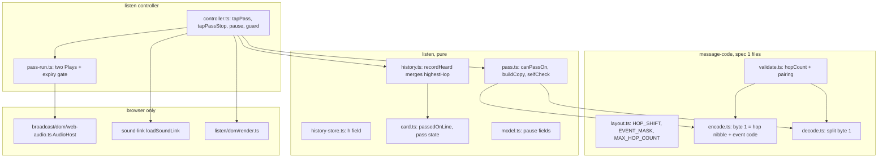
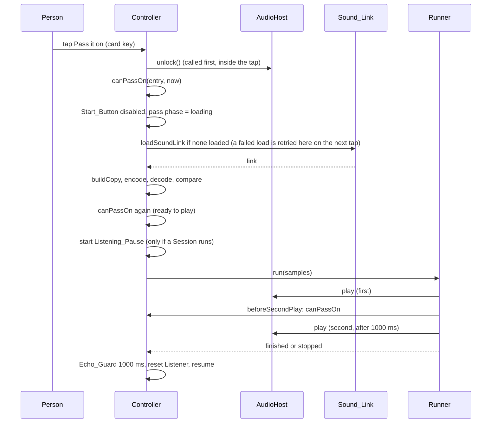

# Design Document

## Overview

Pass it on adds one button to each current Alert_Card on the Listen page. The tap builds a Copy of the alert (same fields, Passed_On_Flag set, Hop_Count raised by one), plays it twice through the existing Sound_Link and Player, and pauses microphone feeding while the phone plays. The History merges every heard copy into the original card and keeps the highest hop count.

The work has four parts.

1. **Message layout (spec 1 files).** The high 4 bits of byte 1 carry the Hop_Count. `Alert` gains `hopCount`. The Passed_On_Flag must equal `hopCount >= 1`. Version stays 1.
2. **Pure pass logic (new, `src/listen/`).** `pass.ts` decides whether a Copy may be built and builds it. No browser API, no clock, no random source.
3. **History and card (spec 4 files).** `HistoryEntry` gains `highestHop`. `CardView` gains the Passed_On_Line and the Pass_Button state. The store keeps key `dead-air.listen.history.v1`.
4. **Controller wiring (spec 4 files).** The Listen controller gets a pass state machine, a Sound_Link load on tap, a Listening_Pause with a 1 second Echo_Guard, and the Volume_Reminder.

### Research summary

No outside research was needed. The design follows code that already exists:

- `src/message-code/encode.ts` and `decode.ts` write and read byte 1 as `EVENT_CODES[event]` and `eventFromCode(byte)`. `eventFromCode` rejects anything outside 1 to 9, so an older Version 1 app rejects a non-zero hop nibble as `unknown-event` (Requirement 1, Introduction).
- `decodeMessage` already checks length, version and CRC-32 before it reads any field, then calls `validateAlert` on the result. The pairing rule is added to `validateAlert`, so the encoder and the decoder share it.
- `src/listen/history.ts` already keys by `alertKey` (`stationId:counter:sentMinute`) and leaves the first heard alert unedited. Only the merge step changes.
- `src/broadcast/broadcast-run.ts` plays samples, waits `PLAY_GAP_MS` (1000), plays the same samples again. It has no hook to re-check expiry before the second play (Requirement 5.4), so the Listen page gets its own small runner over the same `Player` interface. No new audio path is added.
- `src/listen/controller.ts` `ensureLink` disposes and reloads the Sound_Link when the sample rate differs. A Sound_Link is bound to one sample rate (`parameters.sampleRateInp` and `sampleRateOut` are set at load). That behavior is kept for a Session start (Requirements 7.16 to 7.18). A Copy never triggers a reload, because playing uses the loaded link as it is.

### Design decisions

| Decision | Choice | Reason |
|---|---|---|
| Where the pairing rule lives | `validateAlert`, with field name `passedOn` | One rule for both directions, and the decoder already calls it last. |
| Encoder behavior on mismatch | Reject, do not fix | Requirement 2.7. A silent fix would hide a caller bug. |
| Highest hop storage | `HistoryEntry.highestHop`, separate from `alert.hopCount` | `alert` stays the first heard alert, unedited (Requirement 9.5). |
| Expiry gate | One pure function used at three moments | Tap, ready to play, second Play (Requirement 5). |
| Runner for the two Plays | New `pass-run.ts` in `src/listen/` | Needs a `beforeSecondPlay` check. Reuses `Player` and `PLAY_GAP_MS`. |
| Pause state | Controller field plus a model field for the Dead_Air_Window | The pause must not count toward dead air and must not touch `lastHeardMs` (Requirement 8.8). |
| Property tests for the codec | Existing four stay four | Requirement 3.3 is unchanged. The pairing property (Requirement 2.11, 2.12) lives in `tests/listen/` over the real codec. |
| Failed Sound_Link load | Does not disable any Pass_Button. The next tap retries the load, with the unlock inside that tap | Requirements 4.5, 4.10, 4.12, 7.14. No Try again button. |
| Start_Button during a pass | Rendered disabled with a reason line, from the Pass_Button tap to the end of the Echo_Guard. A tap on it is not accepted | Requirement 8.14 to 8.18. |
| Failure lines | One text key each, English and Hindi, each saying what happened and what to do next | Requirement 12.10, 12.11. |
| Playing a Copy | `playCopy` uses the loaded link and never loads one | Requirement 7.15 (Play_Link_Function). |
| Sample rate at Session start | `ensureLink` reloads only when the loaded link's rate differs from the microphone's rate, and otherwise reuses it | Requirements 7.16, 7.17. A reload can never cut a Copy, because Start is disabled during a load, a Copy and the Echo_Guard (Requirement 7.18, decisions 10 and 11). |
| Failed self-check | Shows `listen.pass.err.failed`, no separate key | Requirement 12.15 lists five Failure_Lines and no `err.check`. |

## Architecture



### Tap sequence



## Components and Interfaces

### Message code (spec 1 files, edits approved in Requirement 15)

`types.ts`: add `readonly hopCount: number; // integer, 0 to 15` to `Alert`, directly after `passedOn`. `EncodeRejection.field` is `keyof Alert`, so `hopCount` is accepted with no further change.

`layout.ts`: add

```ts
export const HOP_SHIFT = 4;
export const EVENT_MASK = 0b0000_1111;
export const MAX_HOP_COUNT = 15;
```

`validate.ts`: after the `passedOn` boolean check, add the checks in this order.

```ts
if (!isIntInRange(r.hopCount, 0, MAX_HOP_COUNT)) return 'hopCount';
if (r.passedOn !== (r.hopCount as number >= 1)) return 'passedOn';
```

`encode.ts`: `out[OFFSET.event] = (alert.hopCount << HOP_SHIFT) | EVENT_CODES[alert.event];` The Passed_On_Flag is still written from `alert.passedOn`; `validateAlert` has already ensured it equals `hopCount >= 1`. For `hopCount` 0 the byte equals today's byte (Requirement 1.5).

`decode.ts`: after the CRC check, read byte 1 once.

```ts
const b1 = input[OFFSET.event]!;
const event = eventFromCode(b1 & EVENT_MASK);   // null -> 'unknown-event'
const hopCount = b1 >>> HOP_SHIFT;
```

The Alert gets `hopCount`. The final `validateAlert(alert)` call rejects a mismatched flag and nibble with `invalid-field` (Requirements 2.2, 2.3). The CRC check stays before any read of byte 1 (Requirement 2.5).

`index.ts`: also export `MAX_HOP_COUNT`. Message-code Requirement 6.4 text is updated to name the hop count as the second precedent for "Version stays 1".

Every `Alert` literal in other specs gets `hopCount: 0`: `src/broadcast/build.ts`, `place-name.ts`, `src/languages/translation-check.ts` and tests that build literals (Requirement 15.4).

### `src/listen/pass.ts` (new, pure)

```ts
import type { Alert, ExpiryStatus } from '../message-code';
import type { HistoryEntry } from './history';

export type PassRefusal = 'not-current' | 'max-hops';
export type PassCheck =
  | { ok: true; hopCount: number; expiry: 'current' }   // hopCount = highestHop + 1
  | { ok: false; reason: PassRefusal; expiry: ExpiryStatus };

/** Pure. Takes the time as input. Same function for the tap, ready-to-play and second-Play checks. */
export function canPassOn(entry: HistoryEntry, nowMs: number): PassCheck;

/** Builds the Copy fields. Does not encode. Throws nothing; call only after canPassOn is ok. */
export function buildCopy(entry: HistoryEntry): Alert;
// { ...entry.alert, passedOn: true, hopCount: entry.highestHop + 1 }

export type CopyResult =
  | { ok: true; alert: Alert; bytes: Uint8Array }
  | { ok: false; reason: 'refused' | 'encode-failed' | 'self-check-failed'; refusal?: PassRefusal };

/** canPassOn, buildCopy, encodeAlert, decodeMessage, field-by-field compare. */
export function prepareCopy(entry: HistoryEntry, nowMs: number): CopyResult;
```

`canPassOn` order: `checkExpiry(entry.alert, nowMs).status !== 'current'` returns `not-current`; then `entry.highestHop >= MAX_HOP_COUNT` returns `max-hops`. The expiry test comes first so that an expired card never reports "cannot be passed on again" in place of "no longer current". It uses only `sentMinute` and `validSteps`, and the Copy never changes them (Requirement 5.6).

`prepareCopy` is the only place that encodes. It never edits stored bytes (Requirement 6.4). The self-check decodes the new bytes and compares every field of the Copy (Requirement 6.5), including `test`, so the TEST flag cannot be dropped (Requirement 6.9).

### `src/listen/pass-run.ts` (new)

```ts
import type { Player, Timers } from '../broadcast/providers';
import { PLAY_GAP_MS } from '../broadcast/compose';

export type PassRunResult =
  | { status: 'finished' }
  | { status: 'stopped' }          // stop(), or beforeSecondPlay returned false
  | { status: 'failed'; error: unknown };

export interface PassRun {
  done: Promise<PassRunResult>;    // never rejects
  stop(): void;                    // silences via player.stop(), clears the gap timer
}

export function runPass(
  player: Player,
  timers: Timers,
  build: { samples: Float32Array; sampleRate: number },
  beforeSecondPlay: () => boolean,
): PassRun;
```

It mirrors `runBroadcast`: play, wait `PLAY_GAP_MS`, call `beforeSecondPlay()`, play the same array again. There is no repeat after the second Play (Requirement 7.10). The existing `Player.stop()` already silences within 0.25 s.

The Play_Link_Function (Requirement 7.15) is a second export of the same file:

```ts
/** Uses a link that is already loaded. Takes the link as an argument, so it cannot start a load. */
export function playCopy(
  link: SoundLink,
  bytes: Uint8Array,
  player: Player,
  timers: Timers,
  beforeSecondPlay: () => boolean,
): { ok: true; run: PassRun } | { ok: false };   // ok:false when bytesToAudio rejects
```

It calls `link.bytesToAudio(bytes)` once and then `runPass` with those samples. It imports no loader, so a test can show it never loads a link.

### Providers (`src/listen/providers.ts`)

`ListenDeps` gains two members. Both are replaced by fakes in tests.

```ts
host: AudioHost;      // from '../broadcast/providers'; unlock() + player
timeouts: Timers;     // setTimeout / clearTimeout, for the gap and the Echo_Guard
```

`mount.ts` passes `createWebAudioHost()` from `src/broadcast/dom/web-audio.ts` (read only, no edit) and a `Timers` built over `setTimeout`.

### History (`src/listen/history.ts`)

```ts
export interface HistoryEntry {
  readonly bytes: Uint8Array;
  readonly alert: Alert;           // first heard, unedited
  readonly highestHop: number;     // 0 to 15, new
  readonly heardCount: number;
  readonly firstHeardMs: number;
  readonly lastHeardMs: number;
}
```

`recordHeard` keeps its signature. On a repeat it sets `highestHop: Math.max(e.highestHop, alert.hopCount)` beside the existing count and time update. On a new key it sets `highestHop: alert.hopCount`. `alertKey` is unchanged, so neither `passedOn` nor `hopCount` is in the key (Requirement 9.9). `applyPayload` in `model.ts` still discards failed payloads without touching the History (Requirement 9.10). `onNewAlert` is already skipped for known keys by `keysBefore` in `makeOnBlock` (Requirement 9.6), so that code does not change.

### History store (`src/listen/history-store.ts`)

`serializeHistory` writes `h: e.highestHop` per entry. `parseHistory` decodes each entry first, then:

```ts
const saved = isHop(e.h) ? e.h : 0;           // isHop: integer 0..15
const highestHop = Math.max(saved, r.alert.hopCount);
```

A missing or invalid `h` therefore falls back to the decoded hop count and the entry is kept (Requirements 11.2 to 11.4). The key stays `dead-air.listen.history.v1`. Storage holds hex of bytes that passed the check, never audio and never Copy bytes (Requirement 11.8). The Copy bytes the phone plays are never stored because `prepareCopy` returns them only to the controller, which passes them to `bytesToAudio` and drops them.

### Card view (`src/listen/card.ts`)

`buildCardView(entry, nowMs, offsetMinutes, strings, pass)` gets a fifth argument.

```ts
export interface PassUiInput {
  phase: 'idle' | 'loading' | 'playing';   // a failed load is not an input here: it never disables a button
}
export interface PassButtonView {
  label: string;                  // text key listen.pass.btn
  enabled: boolean;
  note: string | null;            // listen.pass.max when highestHop is 15
}
// added to CardView:
passedOnLine: string | null;      // highestHop 0 -> null; 1 -> listen.pass.line.one; n -> listen.pass.line.many {n}
passButton: PassButtonView | null; // null unless expiry status is 'current'
```

`passButton` is built from `checkExpiry` on every call, so no stored status is used (Requirement 4.6). A card that is not `current` has `passButton: null`. A `current` card has `enabled = highestHop < 15 && phase === 'idle'`. The button does not depend on whether a Session runs, whether the Sound_Link is loaded, or whether the last load failed (Requirements 4.5, 4.9). The Passed_On_Line is independent of expiry, so an expired card keeps it (Requirement 10.6). The one-second `tick()` already re-renders every card, which meets Requirement 4.7.

### UI state (`src/listen/ui-state.ts`)

`ListenUi` gains:

```ts
pass: {
  phase: 'idle' | 'loading' | 'playing';
  statusText: string | null;      // listen.pass.playing while playing
  volumeText: string | null;      // listen.pass.volume while playing, else null
  stopVisible: boolean;           // playing only
  errorText: string | null;       // one Failure_Line at a time
  start: {
    enabled: boolean;             // false while a load runs, a Copy plays or the Echo_Guard lasts
    reasonText: string | null;    // listen.pass.start-reason while disabled by a pass, else null
  };
};
```

`ListenUiInput` gains `pass: { phase; guard: boolean; notice: PassNotice }`. `PassNotice` is `'none' | 'listen.pass.err.not-current' | 'listen.pass.err.expired-mid' | 'listen.pass.err.failed' | 'listen.pass.err.audio' | 'listen.pass.err.load'`. `errorText` is the text for the notice. The Load_Failure_Line is `err.load`; it is set when a load fails and cleared when the next load starts (Requirement 4.11) or when the pass ends in another outcome. It does not disable anything.

The Volume_Reminder is shown only when `phase === 'playing'` and is removed on stop, cancel and the end of the second Play (Requirements 7.8, 7.11 to 7.13). It is a reminder only; the page cannot read the device volume.

The Start_Button state is a pure function of the pass fields. `start.enabled` is `phase === 'idle' && !guard && <the existing Start_Button rules>`, and `start.reasonText` is `listen.pass.start-reason` exactly when `phase !== 'idle' || guard` (Requirements 8.14, 8.15, 8.18). A failed tap that ends before any sound plays returns `phase` to `idle` with `guard` false, so the Start_Button is enabled again at once (Requirement 8.16).

### State line (`src/listen/state-line.ts`, `model.ts`)

`ListenState` gains `'paused'`. `ListenModel` gains `pauseStartMs: number | null` and `pausedMs: number`. New pure helpers:

```ts
export function startPause(m: ListenModel, nowMs: number): ListenModel;  // pauseStartMs = nowMs
export function endPause(m: ListenModel, nowMs: number): ListenModel;    // pausedMs += nowMs - pauseStartMs; pauseStartMs = null
```

`decideState` returns `'paused'` while `pauseStartMs !== null`. Otherwise it measures `nowMs - base - pausedMs` against `DEAD_AIR_WINDOW_MS`. `applyPayload` and `startSession` reset `pausedMs` to 0 because they move the base. `lastHeardMs` is never written by the pause helpers (Requirement 8.8). The `paused` text is `listen.pass.paused`, so "Dead air" is not shown (Requirement 8.7).

### Controller (`src/listen/controller.ts`)

`ListenController` gains:

```ts
tapPass(key: string): Promise<void>;   // key is an alertKey
tapPassStop(): void;
```

New private state: `passPhase: 'idle' | 'loading' | 'playing'`, `passNotice: PassNotice`, `pauseKind: 'none' | 'playing' | 'guard'`, `guardActive: boolean`, `passRun: PassRun | null`, `guardTimer: unknown`. There is no `linkFailed` gate: a failed load only sets `passNotice = 'listen.pass.err.load'`.

`tapPass(key)` steps. Steps 1 to 3 run with no `await`, so the unlock happens inside the tap.

1. Return if `passPhase !== 'idle'`. Set `passNotice = 'none'`.
2. Call `deps.host.unlock()` and keep the promise. Set `passPhase = 'loading'` and emit, so the Start_Button is disabled from the tap (Requirement 8.14). Find the entry by key; if there is none, go to `abort()`.
3. `canPassOn(entry, now)`. If not ok: `abort('not-current')` for `not-current`; for `max-hops` call `abort()` with no notice (the button was disabled). (Requirement 5.1.)
4. Await the unlock result. If false: `abort('err.audio')`. The Pass_Button stays enabled (Requirement 7.2).
5. If no link is loaded, run the Sound_Link_Load: clear the Load_Failure_Line (Requirement 4.11), then `ensurePlayLink()` (below). This runs on every tap that finds no link, so a tap after a failed load is the retry (Requirement 4.10). On failure: `abort('err.load')` (Requirement 7.14). There is no Try again button (Requirement 4.12).
6. `prepareCopy(entry, now)`. A failed self-check and every other failure map to `err.failed`. No sound, History unchanged (Requirements 6.5, 6.7).
7. Call `canPassOn` once more (ready to play, Requirement 5.3). Not ok: `abort('not-current')`.
8. Call `playCopy(link, bytes, ...)` to get the samples. A rejection maps to `abort('err.failed')`. This call is the Play_Link_Function and never loads a link.
9. If a Session is running, call `startListeningPause()`. Set `passPhase = 'playing'`, emit, and start the run. The `beforeSecondPlay` check is `canPassOn(entry, deps.clock.now()).ok`; when it returns false the run ends as `stopped` and `passNotice = 'err.expired-mid'`.
10. Await `done`, then `finishPass()`.

`abort(notice?)` sets `passNotice`, sets `passPhase = 'idle'`, leaves `guardActive` false and emits. The Start_Button is therefore enabled again and its reason line removed (Requirement 8.16). `abort` is also called from a `catch` around steps 2 to 9, so a thrown provider error ends as `err.failed` and never leaves the page in `loading`.

`finishPass()` sets `passPhase = 'idle'` and clears `passRun`. It always starts the Echo_Guard: `guardActive = true`, a 1000 ms timeout on `deps.timeouts`. While `guardActive` is true the Start_Button stays disabled with its reason line (Requirement 8.14). When the timeout fires, and a Session is still running, it calls `listener.reset()`, `endPause`, sets `pauseKind = 'none'`; in both cases it then sets `guardActive = false` and emits, which enables the Start_Button again (Requirement 8.15). A `failed` run maps to `err.failed`.

`startListeningPause()` calls `listener.reset()` and `startPause(model, now)` before the first sample plays (Requirements 8.1, 8.3), then sets `pauseKind = 'playing'`.

`makeOnBlock` gets one line after its existing owner check: `if (pauseKind !== 'none') return;`. Blocks are dropped before the level meter and the Listener, so nothing from them is kept (Requirements 8.2, 8.12). The block handler does not call `emit()` during the pause beyond the existing timer ticks.

Interaction with existing actions:

- `tapPassStop()` calls `passRun.stop()`; `finishPass()` then runs the guard as above.
- `tapStop()` (the Stop_Button) also calls `passRun?.stop()`, clears the guard timer, and `endSession()`. It does not resume (Requirement 8.9). `endSession()` resets `pauseKind` to `'none'` and ends any pause in the model. The Echo_Guard flag is cleared with the timer, because the run was stopped and the Session is over.
- `visibilityChanged(false)` while passing: stop the run, then follow the existing `endSession()` path (Requirement 8.10).
- `makeOnLost` (microphone lost): `endSession()` as now. The run is not stopped; it ends on its own, and `finishPass()` finds no Session, so it runs only the guard flag with no `reset` (Requirement 8.11).
- `tapStart()` returns at once when `passPhase !== 'idle' || guardActive` (a Sound_Link_Load for a tap is `passPhase === 'loading'`). It starts no Session, leaves the run unchanged and does not touch the microphone (Requirement 8.17). The rendered Start_Button also carries `disabled` and the reason line from `ui.pass.start`, so the tap is normally not possible; the guard covers a click that arrives by another route.
- `tapPass` while the Session is not running does not start a Session and has no pause (Requirement 8.6).
- `setStrings` and `subscribe` are unchanged. `snapshot()` passes the pass fields to `buildListenUi`, so a language change redraws every new line without reload (Requirement 12.6).

### Sound_Link load on tap and at Session start

Two functions share one `link` and one `linkRate` in the controller. Neither is called while a Copy plays.

```ts
/** Pass_Button tap only. Loads when no link is loaded, with the unlock already called in the tap. */
async function ensurePlayLink(): Promise<SoundLink | null> {
  if (link) return link;                         // a loaded link is used at whatever rate it has
  const r = await deps.loadLink(DEFAULT_SAMPLE_RATE);
  if (!r.ok) return null;                        // caller shows err.load; the next tap calls this again
  link = r.link; linkRate = DEFAULT_SAMPLE_RATE;
  return link;
}

/** Session start only. micRate is the rate of the microphone Audio_Context. */
async function ensureLink(micRate: number): Promise<SoundLink | null> {
  if (link && linkRate === micRate) return link; // Requirement 7.17: same rate, keep it
  if (link) { link.dispose(); link = null; }     // Requirement 7.16: different rate, reload
  ...load at micRate as today, set link and linkRate...
}
```

`begin()` calls `ensureLink(micRate)`. Playing uses `playCopy`, which takes the loaded link as an argument and never loads. `Player.play(samples, sampleRate)` takes the rate of the samples, and `createWebAudioHost` builds the buffer with that rate, so playback works at any link rate.

**Why the reload is safe.** `ensureLink` can dispose the link only inside `begin()`, and `tapStart` returns before `begin()` while `passPhase !== 'idle'` or `guardActive` (Requirement 7.18, decisions 10 and 11). A load for a tap, a Copy and the Echo_Guard are all covered by those two fields, so a reload never cuts a Copy and a tap never finds the link disposed under it. A Copy played through a link at a different rate than the microphone is followed, at the next Session start, by a reload to the microphone rate, so the Listener always decodes at the microphone rate.

The unlock is called before the load starts, inside the tap, so phone browsers allow audio (Sound rules, Requirement 4.10, Requirement 7.1). Offline, the WebAssembly engine comes from the service worker copy.

### Strings (`strings.types.ts`, `strings.en.ts`, `strings.hi.ts`)

New `TEXT_KEYS` with empty or listed placeholders in `PLACEHOLDERS`:

All new strings. The owner has approved every English text in this table. "Failure line" means the text says what happened and what the person can do next (Requirement 12.10), and has its own key (Requirement 12.11). Every key has an English and a Hindi text, and each Hindi text is recorded as Needs_Human_Check. The last column maps each text to its place in Requirements 12.

| Key | Placeholders | Failure line | English text (approved) | Requirement |
|---|---|---|---|---|
| `listen.pass.btn` | none | no | Pass it on | 12.1 |
| `listen.pass.line.one` | none | no | Passed on 1 time | 10.3, 12.1 |
| `listen.pass.line.many` | `n` | no | Passed on {n} times | 10.4, 12.1 |
| `listen.pass.max` | none | no | This alert cannot be passed on again. | 12.14 (maximum-hops line) |
| `listen.pass.playing` | none | no | Playing this alert so people nearby can hear it. | 12.14 (passing-on line) |
| `listen.pass.stop` | none | no | Stop | 12.1 |
| `listen.pass.volume` | none | no | Turn your volume all the way up. | 7.11, 12.1 |
| `listen.pass.paused` | none | no | Not listening while this phone plays the alert. | 12.14 (pause line) |
| `listen.pass.start-reason` | none | no | The alert is still playing. Tap Start listening when the sound has finished. | 8.18, 12.14 (Start_Reason_Line) |
| `listen.pass.err.load` | none | yes | The sound could not be loaded. Tap Pass it on to try again. | 12.12 |
| `listen.pass.err.not-current` | none | yes | This alert is no longer current, so nothing was played. Only a current alert can be passed on. | 12.14 (not-current line) |
| `listen.pass.err.expired-mid` | none | yes | This alert ended while it was playing, so it was not played a second time. It cannot be passed on any more. | 12.13 |
| `listen.pass.err.failed` | none | yes | The alert could not be passed on. Tap Pass it on to try again. | 12.14 |
| `listen.pass.err.audio` | none | yes | This phone could not play sound. Turn the volume up, switch off silent mode, then tap Pass it on again. | 12.14 (audio line) |

There is no `listen.pass.err.check` key (Requirement 12.1). The five Failure_Line keys are exactly those in Requirement 12.15. `listen.pass.max` is not a failure line: it explains a disabled button, not something that went wrong. Hindi texts are added in `src/languages/strings.hi.ts` and recorded in `docs/translation-check.md`. Because `Strings['text']` and `PLACEHOLDERS` are checked against `TEXT_KEYS` by `SameKeys`, a missing key fails the type check (Requirement 12.2). No emoji, no icon file, no new alert type, and the spoken text is unchanged.

### DOM (`src/listen/dom/render.ts`, `ids.ts`, `mount.ts`)

Each card gets a `<button type="button">` built from `passButton`. `mount.ts` binds one delegated `click` handler that reads the card key (the existing `read-tap.ts` pattern for the read button) and calls `controller.tapPass(key)` directly, with no `await` before it, so the unlock runs inside the tap. A Stop button, a status line, the Volume_Reminder line and the pass error line are added to `ids.ts`. Styles go in `src/shared/ui/look.css` only if the existing button class is not enough.

## Data Models

### Byte 1 of the Message

```
bit  7 6 5 4 | 3 2 1 0
     hopCount | event code (1 to 9)
```

| Alert state | `passedOn` (byte 0, bit 2) | `hopCount` (byte 1, high nibble) |
|---|---|---|
| Original | false | 0 |
| Copy, first pass | true | 1 |
| Copy, nth pass | true | n, up to 15 |
| Any other pairing | rejected as `invalid-field` | |

Message size stays 21 to 40 bytes. Every other offset in `OFFSET` is unchanged. The CRC-32 covers byte 1 like any other byte.

### Rejections

| Case | Reason | Where |
|---|---|---|
| Event nibble not 1 to 9 | `unknown-event` | decoder, after CRC |
| Nibble 0 with flag set, or nibble 1+ with flag clear | `invalid-field` | decoder (`validateAlert`) |
| `hopCount` not an integer 0 to 15 | `invalid-field`, field `hopCount` | encoder |
| `passedOn` not equal to `hopCount >= 1` | `invalid-field`, field `passedOn` | encoder |

### Listen types

`HistoryEntry.highestHop`, `PassCheck`, `CopyResult`, `PassRunResult`, `PassUiInput`, `PassButtonView`, `PassNotice` and the model fields `pauseStartMs` and `pausedMs` are defined above. The stored form adds `h` to each entry object under `v: 1`.

### Files of other specs this design edits

All are approved in Requirement 15. New files are `src/listen/pass.ts` and `src/listen/pass-run.ts`.

| Owner | File | Edit |
|---|---|---|
| message-code | `types.ts`, `layout.ts`, `validate.ts`, `encode.ts`, `decode.ts`, `index.ts` | `hopCount`, nibble split, pairing rule, export |
| broadcast-page | `build.ts`, `place-name.ts`, `strings.en.ts`, `strings.types.ts` | `hopCount: 0`, new keys |
| languages | `translation-check.ts`, `strings.hi.ts` | `hopCount: 0`, Hindi texts |
| listen-page | `history.ts`, `history-store.ts`, `card.ts`, `model.ts`, `state-line.ts`, `ui-state.ts`, `providers.ts`, `controller.ts`, `dom/*` | as described above |
| radio-look | `src/shared/ui/look.css` | button and line styles, only if needed |

## Correctness Properties

*A property is a characteristic or behavior that should hold true across all valid executions of a system-essentially, a formal statement about what the system should do. Properties serve as the bridge between human-readable specifications and machine-verifiable correctness guarantees.*

### Property 1: Hop count round trip

*For any* valid Alert with any Hop_Count from 0 to 15 and the matching Passed_On_Flag, decoding the encoded Message returns an Alert equal to the original, and encoding the decoded Alert returns the same bytes.

**Validates: Requirements 1.1, 1.2, 2.1, 2.8, 2.9**

### Property 2: Any single changed byte is caught

*For any* valid Message with any Hop_Count and any position and any different byte value at that position, including byte 1 high nibble bits, the Decoder returns a Rejection.

**Validates: Requirements 1.4, 2.5, 2.10**

### Property 3: The flag and the hop count are paired in encode, decode and validate

*For any* otherwise valid Alert with `passedOn` set and `hopCount` 0, or `passedOn` clear and `hopCount` from 1 to 15, the Encoder returns a Rejection and `validateAlert` rejects it. *For any* byte sequence built with a correct Check_Value in which the Passed_On_Flag is set and the Hop_Nibble is 0, or the flag is clear and the Hop_Nibble is 1 or more, the Decoder returns a Rejection with the reason `invalid-field`. *For any* Alert the Encoder accepts, `passedOn` equals `hopCount >= 1`, and so does the decoded Alert. The decode test builds the Message by hand and appends the real CRC-32, so the check does not reject first. This test lives in `tests/listen/` over the real codec and is not one of the four Message_Code property tests.

**Validates: Requirements 1.6, 1.7, 2.2, 2.3, 2.7, 2.11, 2.12**

### Property 4: Expired alerts are never offered or played

*For any* History entry and any device time, `canPassOn` returns ok only when `checkExpiry` returns `current` and `highestHop` is below 15. In particular, *for any* time at or after the Expiry_Time, `canPassOn` and `prepareCopy` refuse, the card view has no Pass_Button, and a run whose `beforeSecondPlay` uses the same check cancels the second Play.

**Validates: Requirements 4.1, 4.2, 4.3, 5.1, 5.2, 5.3, 5.4, 5.5, 6.6, 13.2**

### Property 5: The Copy is the same alert with one more hop

*For any* current History entry with `highestHop` 0 to 14, `prepareCopy` returns bytes that decode to the entry's Alert with only `passedOn` set to true and `hopCount` equal to `highestHop + 1`; the Copy has the same `test` flag, the same Sent_Minute and Valid_Steps, and the same Alert_Key as the entry.

**Validates: Requirements 5.6, 6.1, 6.2, 6.3, 6.8, 6.9, 6.10**

### Property 6: Highest hop count merge is monotonic, idempotent and order independent

*For any* sequence of payloads that pass the check, the History has one card per distinct Alert_Key and each card's `highestHop` equals the largest Hop_Count among payloads with that key. Feeding the same payload again does not change `highestHop`, and never lowers it. *For any* two orderings of the same set of payloads, each card's `highestHop` is the same. The first heard Alert of each card is unedited.

**Validates: Requirements 9.1, 9.2, 9.3, 9.4, 9.5, 9.7, 9.8, 9.9**

### Property 7: Failed payloads change nothing

*For any* History and any byte sequence that the Decoder rejects, `applyPayload` leaves the History, including every `highestHop`, unchanged.

**Validates: Requirements 9.10, 13.1**

### Property 8: The card line matches the highest hop count

*For any* History entry and any time, the card view's Passed_On_Line is null when `highestHop` is 0, and otherwise contains N equal to `highestHop` with the singular text for 1; the sent time, expiry fields and TEST banner are still present, including when the entry is expired.

**Validates: Requirements 10.1, 10.2, 10.3, 10.4, 10.5, 10.6, 10.8**

### Property 9: History storage round trip

*For any* History, `parseHistory(serializeHistory(h))` returns equal Alerts, Heard_Counts, `highestHop` values and times. *For any* saved `h` that is missing or not an integer 0 to 15, the loaded `highestHop` equals the decoded Hop_Count, and *for any* valid saved `h` it equals the larger of `h` and the decoded Hop_Count.

**Validates: Requirements 11.1, 11.2, 11.3, 11.4, 11.7**

### Property 10: Nothing is heard during the Listening_Pause

*For any* sequence of microphone blocks that arrive during the Listening_Pause, including blocks a fake Listener would report as payloads, the History, `lastHeardMs` and the Listener's fed-block count are unchanged after the pause ends.

**Validates: Requirements 8.2, 8.8, 8.12, 8.13**

### Property 11: Start listening is disabled exactly while a pass is in progress

*For any* pass phase (`idle`, `loading`, `playing`), any Echo_Guard flag and any Session state, `buildListenUi` gives a disabled Start_Button with the `listen.pass.start-reason` line when the phase is not `idle` or the guard is on, and gives no reason line and a Start_Button that follows only the existing rules otherwise. *For any* of those states with the Start_Button disabled by a pass, `tapStart` starts no Session and leaves the microphone and the run unchanged.

**Validates: Requirements 8.14, 8.15, 8.17, 8.18**

### Property 12: The Pass_Button state does not depend on the load

*For any* History entry, time, pass phase and any record of earlier failed loads, the Pass_Button is enabled exactly when the expiry status is `current`, `highestHop` is below 15, and the phase is `idle`. *For any* sequence of tap, failed load, tap, the second tap starts a new load.

**Validates: Requirements 4.1, 4.5, 4.9, 4.10, 4.12, 7.14**

### Property 13: A Session start reloads the link only when the rates differ

*For any* loaded link rate and any microphone rate, `ensureLink` calls `loadLink` exactly when the two rates differ and otherwise returns the loaded link unchanged. *For any* pass phase other than `idle` or any Echo_Guard flag, `tapStart` does not reach `ensureLink`, so no link is disposed while a load, a Copy or the guard is in progress.

**Validates: Requirements 7.16, 7.17, 7.18**

## Error Handling

| Situation | Behavior | Text key | Requirement |
|---|---|---|---|
| Expiry not `current` at the tap or when the Copy is ready | No Copy, no sound | `listen.pass.err.not-current` | 5.2, 5.3 |
| Expiry not `current` when the second Play is due | Second Play cancelled | `listen.pass.err.expired-mid` | 5.4 |
| Highest hop count 15 | Button disabled, reason shown, no Copy | `listen.pass.max` | 4.3, 6.6 |
| `unlock()` returns false | No sound, button stays enabled | `listen.pass.err.audio` | 7.2 |
| Sound_Link load fails | No sound, Load_Failure_Line shown, every allowed button stays enabled, next tap retries the load | `listen.pass.err.load` | 4.5, 4.10, 7.14 |
| Encoder rejects, self-check differs from the Copy fields, or `bytesToAudio` fails | No sound, History unchanged | `listen.pass.err.failed` | 6.5, 6.7 |
| `Player.play` rejects | Run ends, Echo_Guard still applies | `listen.pass.err.failed` | 6.7 |
| Start_Button activated while disabled by a pass | Nothing happens | none (the reason line is already shown) | 8.17 |
| Stop tapped | `player.stop()`, second Play cancelled, Volume_Reminder removed | none | 7.7, 7.12 |
| Page hidden or microphone lost during a pass | Existing rules for the Session; hidden stops the run | existing keys | 8.10, 8.11 |
| `tapPass` for a key not in the History | Ignored, state returns to `idle` | none | 6.1 |
| Stored `h` invalid | Use decoded Hop_Count, keep entry | none | 11.4 |

Every failure leaves the History unchanged. A thrown error from a provider is caught in `tapPass` and treated as `err.failed`. Every failure path ends in `abort()`, which returns `passPhase` to `idle` and the Start_Button to enabled, so a failure cannot leave the page disabled (Requirement 8.16). Each of the five Failure_Lines has its own key and says what happened and what to do next, in English and Hindi (Requirements 12.10, 12.11).

## Testing Strategy

Property-based testing applies: the codec, `canPassOn`, `prepareCopy`, the merge and the store are pure functions over large input spaces. The DOM, the audio device and real phones are covered by example tests and the Report_File.

**Tools.** Vitest and fast-check. Each property test runs at least 100 cases and carries a tag comment `Feature: pass-it-on, Property N: <text>`. Each property is one test. No new dependency.

**Order of work (Requirement 3).** First change `tests/message-code/generators.ts`, `fixtures.ts`, `raw-message.ts` and the example tests for `hopCount`. Run them against the unchanged source and record the failing test names in `.kiro/specs/pass-it-on/report.md`. Only then edit message-code source. Every Fixture has the TEST_Flag set.

**Message_Code property tests.** `tests/message-code/properties.test.ts` keeps exactly four property tests (Requirement 3.3). Their generator `alertArb` covers `hopCount` 0 to 15 with the matching `passedOn`. Property 1 and Property 2 extend the existing round-trip and single-changed-byte tests, and the expired-never-current test keeps its meaning.

**Property 3 placement.** Property 3 is not a fifth Message_Code property test. It lives in `tests/listen/pass.property.test.ts` over the real codec, with byte sequences built using the real `crc32` so the CRC does not reject first (Requirement 2.12). Requirement 3.3 is unchanged: the Message_Code tests keep exactly four property tests.

**Listen property tests (`tests/listen/`).** `pass.property.test.ts` holds Properties 3, 4, 5 and 12. `history.property.test.ts` holds Properties 6, 7. `card.property.test.ts` holds Property 8. `history-store.property.test.ts` holds Property 9. `controller-pass.property.test.ts` holds Properties 10, 11 and 13, with a fake Listener that would report a payload if fed, a fake clock and fake timers. Generators extend `tests/listen/generators.ts`.

**Example tests.**

- Layout: byte 1 equals the event code for hop 0; high nibble 1 and 15 for those hops; each rejection in Requirement 2; both mismatch directions with a correct CRC; a fixed byte sequence from before this change that still decodes with `hopCount` 0.
- Pass_Button states (Requirement 4): current enabled with no Session and with the link not loaded; expired, `sent-in-future` and `clock-unknown` have no button; hop 15 disabled with the `listen.pass.max` note; disabled during `loading` and `playing`; enabled with the load line after a failed load; disabled on the next `tick()` after the alert expires.
- Tap flow: `host.unlock()` is called before `loadLink`; a tap with no loaded link loads once and plays; a second tap reuses the link; unlock failure leaves the button enabled.
- Retry: a failed load shows `listen.pass.err.load` and keeps the button enabled; the next tap calls `unlock()` and `loadLink` again, clears the line when the load starts, and plays on success; no Try again button exists.
- Play_Link_Function: `playCopy` is given a loaded link and calls `loadLink` zero times; a Session start with a loaded link at the same rate as the microphone calls `loadLink` zero times and keeps the link; a Session start with a loaded link at a different rate disposes it and calls `loadLink` once at the microphone rate; a Session start with no link loads once; a tap on Start during a load, a Copy or the guard never reaches `ensureLink`.
- Start_Button: disabled with the reason line from the tap, during the load, during both Plays and for 1000 ms after; enabled again when the guard ends, and at once when the tap fails before any sound; a tap on it during those times starts no Session and does not change the microphone.
- Play pattern: the same sample array is played twice with a gap of 1000 ms on fake timers; no third Play; Stop silences and cancels the gap; the second Play is cancelled when time passes expiry between the Plays.
- Listening_Pause: `reset` is called before the first Play and after the guard; blocks are dropped for the pause plus 1000 ms and fed again after; no Session is started when none was running; `tapStop` during the pause ends the Session and does not resume; hidden page stops the run; mic loss lets the run end; the Dead_Air_Window excludes the pause and `lastHeardMs` is unchanged; the state line shows `listen.pass.paused` and not "Dead air".
- Volume_Reminder: shown only while `playing`, removed at the end of the second Play, on Stop and on cancel.
- Strings: every new key has English and Hindi, placeholders match, the translation check reports zero failures, no emoji. Each Failure_Line key is different from every other key and its English and Hindi texts differ from each other; the five Failure_Line keys (`err.load`, `err.not-current`, `err.expired-mid`, `err.failed`, `err.audio`) are listed in a test, and no key `listen.pass.err.check` exists so a new one cannot be added without a text.
- Failure lines: one test for each row in the Error Handling table that has a text key (a forced self-check mismatch shows `listen.pass.err.failed`), checking the key shown and that the page returns to `idle` with the Start_Button enabled.
- Promises: the Copy of a test alert is a test alert (promise 3); no `fetch` or `XMLHttpRequest` is called and no sample array is passed to storage or logs (promises 4, 5); the offline File_List includes the new files with no manual list.

**Integration test (Requirement 14.7).** Build a TEST Alert, run `prepareCopy`, convert with the real `loadSoundLink().bytesToAudio`, feed the samples to a real `createListener()` in blocks of `frameSize`, and assert the Listener reports the Copy bytes. Passes through `decodeMessage` to the expected Alert.

**Not tested in code.** A real phone playing a Copy to a second phone, the adequacy of the 1 second Echo_Guard on real hardware, and an older app ignoring a Copy are recorded in the Report_File as tested or not tested (Requirement 16).

**Commands.** `npm run typecheck`, `npm run build`, `npx vitest --run`.
