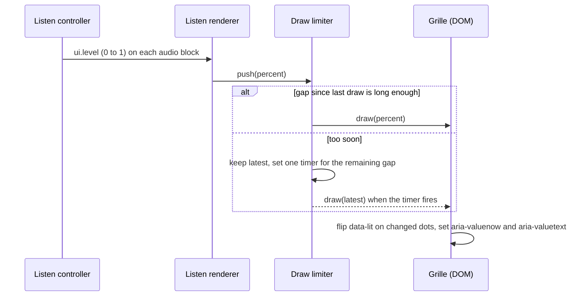

# Design Document

## Overview

Spec 8, "The radio look". It restyles `/listen` and `/broadcast` and gives `/` the same base style. It changes the interface only. The message code, the sound link and the offline worker logic stay as they are, and promises 1 to 6 stay intact.

The design has six parts for the look (Requirements 1 to 19) and four small fixes that came with it (Requirements 20 to 23):

1. **One stylesheet.** `src/shared/ui/look.css` holds the Theme_Tokens (one block per theme), the `@font-face` rules and every component rule. Both app pages import it from their `main.ts`. The front page links it from `index.html`.
2. **Shared header.** One pure function builds the header markup for the Listen and Broadcast pages only. A small Vite plugin writes it into those two HTML files at build time, so the Page_Switch is two plain links that work without scripts. The front page header is static HTML written by hand in `index.html`: the app name, two plain pill links and an empty language slot.
3. **Event faces.** Nine SVG files in `src/shared/ui/icons/`, one file each in source, bundled into the page JavaScript as strings. One pure function, `eventFace`, pairs an icon with the translated name. The picker, the Alert_Card and the preview all use it. The icon strings are the only markup the pages insert. All alert text, place names included, goes in as text only.
4. **Broadcast controls.** A radio-group picker replaces the `<select id="f-event">`. The TEST checkbox becomes a styled switch with a text state. Go on air gets an on-air lamp.
5. **Listen controls.** A Speaker_Grille replaces the level bar. A pure draw limiter caps redraws at 15 per second (2 per second under reduced motion). The card gets the new layout. The arrival flash becomes a two-band frame.
6. **Checks.** A Contrast_Test reads the tables in `style-rules.md` and the shipped CSS. Property tests cover the pure parts. A font checker replaces the old "no fonts at all" assertions.
7. **Read aloud tap (Requirement 20).** The click handler on the card list matches the Read_Aloud_Button itself, through one small pure function.
8. **The name in Latin letters (Requirement 21).** One Hindi string changes, the Listen page title becomes static text, and the markup test exception covers the Listen title key.
9. **The flaky noise test (Requirement 22).** The cause is reproduced and written down below. The fix is in `tools/ears/noise.ts`, which belongs to neither `src/message-code/` nor `src/sound-link/`.
10. **Diary (Requirements 16.6 and 23).** Two entries appended to `docs/kiro-diary.md`.

### Design decisions

| Decision | Choice | Reason |
|---|---|---|
| How pages get the CSS | `listen/main.ts` and `broadcast/main.ts` do `import '../src/shared/ui/look.css'`. `index.html` uses a `<link rel="stylesheet">`. | `tests/languages/boundary.test.ts` check (c) forbids a stylesheet link in `listen/index.html` and `broadcast/index.html`. A JS import passes that check, and Vite still writes the `<link>` into the built page, which is where the offline file list finds it. |
| Where the header comes from | `src/shared/ui/header.ts` (pure) plus `build/look-header-plugin.ts` (Vite `transformIndexHtml`). `listen/index.html` and `broadcast/index.html` each hold one marker comment, `<!--look:header-->`. The front page header is static HTML in `index.html`, with no marker and no plugin step. | Two hand-copied app headers would drift, so a plugin keeps one source and reads the real `base` from the resolved Vite config (no sub-path is hard-coded). The output is static HTML (Requirement 3.6). The front header has different content (two plain pills, no switch, no language switch) and must work with scripts off (Requirements 3.13, 3.14), so it is written once by hand. It uses `%BASE_URL%` as the other pages do for their manifest link, which Vite replaces with the real base. |
| Icons | Nine files in `src/shared/ui/icons/`, one SVG each in source (Requirement 4.12), imported with `?raw` into one `Record<EventType, string>` and bundled into the page JavaScript. | The type forces one icon per event type at typecheck time. Inline markup makes `currentColor` follow the theme (Requirement 4.11). A separate request per icon would add network calls and a flash of missing icons. |
| Markup versus text | `src/shared/ui/dom/icon-node.ts` is the only place in `src/` that assigns markup. Everything else uses `textContent`, `createElement` and `setAttribute`. A scan test enforces it. | Requirements 4.16 to 4.18. Place names and every other received string must never become elements. |
| Offline list and inlined icons | The icons end up inside the page JS bundle, not as separate files. The offline test checks that the listed JS holds each icon's drawing. | Requirement 15.1 says "wherever the build places them". The bundle is already in the list, so no change to the worker or the list rules (Requirement 15.7). |
| Event picker | Native radio inputs in a `fieldset` with a `legend`, wrapped in `label.tile`. | The browser already gives arrow-key movement, group position and checked state to screen readers (Requirements 6.2 to 6.4). No script for keys. |
| Limiting redraws | A pure `createDrawLimiter` with an injected clock and timer. Minimum gap 67 ms normally, 500 ms under reduced motion. | With gaps of at least 67 ms, a 1000 ms window (end not included) holds at most 15 draws. With 500 ms it holds at most 2. A timer-based limiter is testable in plain Node, unlike `requestAnimationFrame` (which runs at 60 per second). |
| Grille drawing | 37 dots in rings of 1, 6, 12 and 18. Positions are set once. A redraw only flips `data-lit` on dots whose state changed. | Few DOM writes per redraw. No animation or transition on the grille (Requirement 8.6). |
| Fonts | Own `@font-face` rules in `look.css`. The `src` points at the package's `files/ibm-plex-mono-latin-{400,600}-normal.woff2` by relative path. `assetsInlineLimit` returns `false` for `.woff2`. | Vite hashes and copies the files unchanged to `assets/`. The `unicode-range` is copied from the package's Latin CSS, so Devanagari never selects this font. |
| Font checker | One pure function, `findFontProblems`, in `src/shared/ui/font-rules.ts`. The edited Languages build test and the new tests both call it. | One definition of "exactly one family, two weights, this site only" (Requirements 12.4 to 12.10 and 16.9). The Languages test keeps its other assertions. |
| Card order | A pure `cardLayout(view)` returns the ordered list of parts. `buildCardElement` maps each part to a node. | The order (banner first, icon tile before name, sent time always present) becomes testable without a DOM. |
| Card state | A pure `cardLook(view)` returns the state class and whether the expired label shows. | "Expired is never styled as current" becomes a property over the existing `checkExpiry` result. No second expiry rule (Requirement 10.12). |
| Contrast oracle | The Contrast_Test parses the two tables in `.kiro/steering/style-rules.md` and the token blocks of `look.css`. | The tables stay the only place the pairs are written. A change to either file that breaks the match fails the test. |
| Hindi strings | Six keys added to the three string files with the existing "every key in every language" tests as the guard. One existing Hindi value changes (`listen.page.title`). | D2 and Requirement 21. |
| Read aloud tap | `readButtonKey(target)` in `src/listen/dom/read-tap.ts` returns the card key only when the tap landed on the Read_Aloud_Button or inside it. `mount.ts` calls it. | The old handler matched the whole `[data-read]` block, so a tap on a help or error line started the voice. A pure function over `closest` is testable with small fake nodes (Requirement 20.5). |
| Listen layout rule | The top of the newest card must be on screen at 360 by 640: the TEST banner (if any), the icon tile, the event name and the sentence line. Rows below may scroll. The grille shrinks to a compact strip once an alert has arrived. There is no Details fold. | Requirement 9. This replaces the earlier, stricter "whole card visible" reading. |
| Noise test fix | A floor on the signal level in `tools/ears/noise.ts`, and the same floor in the shared signal generator of the noise tests. | See "Flaky noise test" below. One part of it needs the user's yes before it is done. |
| Font size gate | The first task copies the two Latin woff2 files into a scratch folder and sums their sizes. Over 61 440 bytes, work stops and the two sizes go to the user (Requirement 12.11). | Requirement 12.3 is a hard limit and the package is large. |

### Approved edits to files of other specs

The user has approved D1 to D5 (see the Introduction of the requirements). Requirement 16.13 also allows the edits of Requirements 20 to 23. The report lists every file below (Requirements 16.12 and 19.4).

| # | Edit | File (owner) | Why |
|---|---|---|---|
| D1 | Replace the white inset `box-shadow` flash with a two-band frame drawn by CSS classes. `FLASH_PLAN`, `planFlash` and `decideArrival` stay unchanged. | `src/languages/dom/web-arrival.ts` and `tests/languages/arrival.test.ts` (languages) | The Style_Rules forbid shadows. Requirement 11.1 asks for an orange band and an ink band. The current code sets `cssText` and a white `boxShadow` inline. |
| D2 | New text keys (listed in Data Models) in English and Hindi. | `src/broadcast/strings.types.ts`, `src/broadcast/strings.en.ts`, `src/languages/strings.hi.ts` | Requirement 18.10 needs every added text in every language. The key list is typed, so a new key touches all three. The Hindi text goes on the translation check list (Requirement 16.14). |
| D3 | Markup and wiring for the header, CSS import, test-switch text, on-air lamp, action bars. | `listen/index.html`, `listen/main.ts`, `broadcast/index.html`, `broadcast/main.ts`, `src/*/dom/ids.ts`, `mount.ts`, `render.ts` | Requirements 3, 7, 8, 9 restyle these pages. |
| D4 | Add the header plugin, the font `assetsInlineLimit` and the licence copy step. Add `src/shared/ui/dom` to the root `tsconfig.json` exclude list. | `vite.config.ts`, `tsconfig.json` (earlier specs) | Required by the shared header and bundled font. Existing `dom` folders are excluded from the root config because it has no DOM lib. |
| D5 | Add the licence note and the new dependency. | `README.md`, `package.json`, `package-lock.json` | Requirements 12.1 and 12.8. |
| R20 | Match the Read_Aloud_Button only. | `src/listen/dom/mount.ts`, new `src/listen/dom/read-tap.ts` (listen) | Requirement 20. |
| R21 | Latin "Dead Air" in the Hindi Listen title, static title in the Listen page, wider test exception. | `src/languages/strings.hi.ts`, `listen/index.html`, `tests/languages/markup.test.ts`, `docs/translation-check.md` | Requirement 21. |
| R22 | Fix the flaky noise test. | `tools/ears/noise.ts`, `tests/ears/noise.property.test.ts` (kiro-ears) | Requirement 22. |
| R23 | Diary entries. | `docs/kiro-diary.md` | Requirements 16.6 and 23. |

One open question remains, and it is about Requirement 22.4: the fix needs a narrower signal generator in the noise tests. See "Flaky noise test".

### Research notes

- **Fontsource package.** `@fontsource/ibm-plex-mono` is at version 5.3.0 on the [npm registry](https://www.npmjs.com/package/@fontsource/ibm-plex-mono). Its files are named `ibm-plex-mono-latin-<weight>-normal.woff2`. The actual size of the two Latin files against the 60 KB limit is checked in the first task, because the whole package is large (1.49 MB unpacked) and only two files ship.
- **WCAG ratio.** Relative luminance is `0.2126 R + 0.7152 G + 0.0722 B` with each channel linearised, and the ratio is `(L1 + 0.05) / (L2 + 0.05)` with the lighter colour first. This is the formula in [WCAG 2.x, contrast ratio definition](https://www.w3.org/TR/WCAG21/#dfn-contrast-ratio). The Contrast_Test implements it in a pure function.
- **Radio groups.** Native radio inputs with one `name` move the choice on arrow keys and announce position in the group. See [MDN, input type radio](https://developer.mozilla.org/en-US/docs/Web/HTML/Element/input/radio).
- **Existing code that shapes the design.**
  - `src/listen/dom/mount.ts` binds one `click` listener on the card list. It matches `closest('[data-read], [data-part="button"]')`, so a tap anywhere in the `[data-read]` block (including the help, missing-voice and error lines) calls `speech.tap`. The Read_Aloud_Button is always inside that block, so the `data-key` fallback in the handler is never the path that runs.
  - `src/languages/strings.hi.ts` has `'listen.page.title': 'डेड एयर: सुनें'` (Devanagari) and `'page.title': 'Dead Air: प्रसारण'` (Latin). Those are the only two strings that hold the name. `broadcast/index.html` has `<title data-text="page.title">Dead Air</title>`. `listen/index.html` has an empty `<title data-text="listen.page.title"></title>`. `src/listen/dom/render.ts` also sets `document.title` from the string. `tests/languages/markup.test.ts` allows a non-empty static title only as exactly "Dead Air" with `data-text="page.title"`.
  - `tests/ears/noise.property.test.ts` Property 5 fails rarely. A 20 000-run reproduction (a temporary test file, deleted afterwards) failed after 4 089 runs. The counterexample is in "Flaky noise test" below.
  - `docs/kiro-diary.md` has entries up to "Spec 5: Kiro's ears". It has no entry for the Languages spec.
  - `src/listen/dom/render.ts` coalesces meter updates with `requestAnimationFrame` (about 60 per second). That breaks the 15 per second cap, so the meter goes through the draw limiter instead.
  - `src/languages/dom/web-arrival.ts` sets the flash with inline `cssText` and an inset white `box-shadow`. `src/languages/flash-gate.ts` already caps pulses at 3 per second, and `decideArrival` already turns the flash off under reduced motion.
  - `src/offline/refs.ts` follows `url(...)` in CSS and `href` on any `<link>`. Fonts reached from the CSS are listed automatically. A licence file is reached only if some page links to it, so the header plugin adds `<link rel="license">`.
  - `src/offline/file-list.ts` drops images that only the front page reaches (`frontImages`). Icons are inlined, so none of them is an image file in the list.
  - `vite.config.ts` sets `base` in one place and `build/offline-check.mjs` fails on any reference to another site, including inline `style` attributes and CSS `url()`.
  - `tests/languages/offline-build.test.ts` forbids any font file and any `@font-face`. `tests/languages/boundary.test.ts` check (c) forbids `@font-face`, font files and stylesheet links in the languages sources and in the two app HTML files. With this design check (c) still passes unchanged, because `@font-face` lives in `src/shared/ui/look.css` and the app HTML has no font reference.
  - The root `tsconfig.json` has `lib: ["ES2022"]` and excludes the `dom` folders. A new DOM folder follows that pattern.
  - `tests/*/node-extra.d.ts` declares the few `node:` functions the tests use, so no `@types/node` is installed. `tests/look/` gets the same file.

## Architecture

```mermaid
flowchart TD
  subgraph Build
    CSS[look.css<br/>tokens, font-face, components]
    ICONS[icons/*.svg x9]
    HDR[header.ts pure<br/>Listen and Broadcast only]
    PLG[look-header-plugin.ts]
    FONT[@fontsource woff2 x2 + LICENSE]
    VITE[vite build]
    POST[offline-postbuild + offline-check]
  end
  subgraph Pure[Pure modules, no DOM]
    FACE[event-face.ts]
    LIM[draw-limiter.ts]
    GRL[grille-layout.ts]
    CLK[card-look.ts / card-layout.ts]
    FRULES[font-rules.ts]
    CON[contrast.ts]
    TAP[read-tap.ts]
  end
  subgraph Pages
    LIS[listen/main.ts]
    BRO[broadcast/main.ts]
    FRO[index.html<br/>static header]
  end
  HDR --> PLG --> VITE
  CSS --> VITE
  ICONS --> FACE
  FONT --> VITE
  FACE --> BRO
  FACE --> LIS
  LIM --> LIS
  GRL --> LIS
  CLK --> LIS
  TAP --> LIS
  VITE --> POST
  LIS --> VITE
  BRO --> VITE
  FRO --> VITE
```

### Level to grille flow



### Pages and files

New files (owned by this spec):

```
src/shared/ui/
  look.css                 tokens, @font-face, header, tiles, cards, grille, flash, switches
  contrast.ts              hex parse, relative luminance, ratio (pure)
  font-rules.ts            findFontProblems (pure)
  header.ts                headerHtml({ page, base }) for listen and broadcast only (pure)
  event-face.ts            eventFace(event, strings) (pure)
  icons.ts                 ICONS: Record<EventType, string>, from ?raw imports
  icons/                   flood.svg cyclone.svg fire.svg earthquake.svg heatwave.svg
                           landslide.svg medical.svg missing-person.svg all-clear.svg
  draw-limiter.ts          createDrawLimiter (pure, injected clock and timer)
  grille-layout.ts         GRILLE_DOTS, grilleDots(), litCount(percent) (pure)
  card-look.ts             cardLook(view) (pure)
  dom/
    icon-node.ts           builds an <svg> node for an EventType (the only markup assignment)
    grille.ts              builds the dots, draws a level, owns the limiter
    event-picker.ts        fills the fieldset, reads and writes the choice
build/look-header-plugin.ts   fills <!--look:header--> and emits the licence file
src/listen/card-layout.ts     cardLayout(view) (pure, listen-owned file approved by Requirement 10)
src/listen/dom/read-tap.ts    readButtonKey(target) (pure over closest, approved by Requirement 20)
tests/look/                   all new tests (see Testing Strategy)
```

Files of other specs that change, and where each change is allowed:

| File | Change | Authority |
|---|---|---|
| `listen/index.html`, `broadcast/index.html` | header marker, picker fieldset, switch state text, lamps, grille root, action bars. Listen title becomes static "Dead Air". | Requirements 3, 6 to 9, 21. See D3. |
| `listen/main.ts`, `broadcast/main.ts` | `import` the stylesheet | D3 |
| `index.html` | static header (app name, two plain pill links, empty language slot), stylesheet link | Requirements 3 and 17 |
| `src/listen/dom/{ids,render,mount}.ts` | grille root id, limiter wiring, new card parts, listening lamp, read-aloud click handler | Requirements 8 to 10, 20 |
| `src/languages/strings.hi.ts` | `listen.page.title` in Latin "Dead Air" | Requirement 21 |
| `tools/ears/noise.ts`, `tests/ears/noise.property.test.ts` | signal floor and matching generator filter | Requirement 22 |
| `docs/kiro-diary.md` | two entries appended | Requirements 16.6, 23 |
| `src/listen/card.ts` | `CardView` gains `event` and `expiredLabel` (additive) | Requirement 10 |
| `src/broadcast/dom/{ids,render,mount}.ts` | picker, test state text, on-air lamp, preview event face | Requirements 5 to 7 |
| `src/broadcast/strings.types.ts`, `strings.en.ts`, `src/languages/strings.hi.ts` | new text keys | D2 |
| `src/languages/dom/web-arrival.ts`, `tests/languages/arrival.test.ts` | flash frame | D1 |
| `tests/languages/offline-build.test.ts` | font assertions call `findFontProblems` | Requirement 16.9 |
| `tests/languages/markup.test.ts` (also the Listen title exception, Requirement 21.3), `tests/listen/card.test.ts`, `tests/languages/card-voice-dom.test.ts`, `tests/*/strings.test.ts` | follow replaced markup and new keys, additive only | Requirement 18.3 |
| `vite.config.ts`, `tsconfig.json`, `README.md`, `package.json`, `docs/brief.md`, `.kiro/steering/product.md`, `docs/kiro-diary.md` | see D4, D5 and Requirement 16 | D4, D5, 16 |

Files that stay unchanged: `src/message-code/**`, `src/sound-link/**`, everything under `src/offline/` except what Requirement 16 does not touch (the worker, `plan.ts`, `file-list.ts`, `allow-list.ts`), and the Languages tests other than the two named above.

## Components and Interfaces

### `contrast.ts`

```ts
export function parseHex(hex: string): [number, number, number];   // '#EAE4D9' or '#eae4d9'
export function luminance(hex: string): number;                    // WCAG 2.x
export function contrastRatio(a: string, b: string): number;       // symmetric, 1 to 21
```

### `font-rules.ts`

```ts
export interface FontInput {
  files: readonly string[];          // offline file list paths
  css: ReadonlyArray<{ path: string; text: string }>;
  base: string;                      // Vite base, '/' or '/repo/'
}
export interface FontProblem { path: string; rule:
  'other-family' | 'bad-weight' | 'other-site' | 'font-file-not-allowed' | 'src-missing' | 'no-unicode-range' | 'bad-display'; detail: string }
export function findFontProblems(input: FontInput): FontProblem[];  // empty means allowed
```

Allowed: `@font-face` for family `IBM Plex Mono`, weight 400 or 600 (one rule each), `font-display: swap`, a `unicode-range`, and every `src` a path on this site that names a file present in `files`. Allowed font files: exactly `assets/ibm-plex-mono-latin-(400|600)-normal-<hash>.woff2`. Anything else in each rule is a problem. `src` URLs that start with a scheme or `//` are `other-site`.

### `header.ts` and `look-header-plugin.ts`

```ts
export type HeaderPage = 'listen' | 'broadcast';
export function headerHtml(input: { page: HeaderPage; base: string }): string;
```

The function builds the header of the Listen and Broadcast pages only (Requirement 3.13). It returns:

```html
<header class="site-header">
  <a id="link-home" class="app-name" href="{base}">Dead Air</a>
  <nav class="page-switch" data-position="listen|broadcast">
    <a id="link-listen" href="{base}listen/" data-text="nav.switch.listen" [aria-current="page"]>Listen</a>
    <a id="link-broadcast" href="{base}broadcast/" data-text="nav.switch.broadcast" [aria-current="page"]>Broadcast</a>
  </nav>
  <div id="language-switch" role="group"></div>
</header>
```

The front page header is not built by this function. It is static HTML written in `index.html` (Requirements 3.9 to 3.12, 3.14):

```html
<header class="site-header">
  <a class="app-name" href="%BASE_URL%">Dead Air</a>
  <nav class="front-links">
    <a class="pill" href="%BASE_URL%listen/">Listen</a>
    <a class="pill" href="%BASE_URL%broadcast/">Broadcast</a>
  </nav>
  <span class="language-slot"></span>
</header>
```

The two links are plain pills with text, no knob, no `aria-current`, no `data-text`. The language slot is last, holds no text and no focusable element, and keeps its place so the front-page spec can add a switch without a layout change. The front page has no script that fills text, so the link text is plain English as today. A test reads `index.html` and checks these facts (see Testing Strategy).

The plugin runs `transformIndexHtml` with `order: 'pre'`, picks the page from the file path, reads `base` from `configResolved`, and replaces the marker in the two app pages. It throws if the marker is missing there. It does nothing to the header of `index.html`. It also emits `fonts/ibm-plex-mono-LICENSE.txt` (the package `LICENSE`, unchanged) with `emitFile` and adds `<link rel="license" href="{base}fonts/ibm-plex-mono-LICENSE.txt">` to the head of all three pages. `refs.ts` treats every `<link href>` as a reference, so the offline list picks the licence up without a change to the list rules. The plugin throws if the package `LICENSE` is not found.

The knob is a pseudo-element on `.page-switch` moved by `[data-position]`. The current link also carries `aria-current="page"` and is drawn inverted, so the position is shown by knob, text and attribute (Requirement 3.5).

### `icons.ts`, `event-face.ts`

```ts
export const ICONS: Readonly<Record<EventType, string>>;   // exhaustive by type

export interface EventFace { event: EventType; svg: string; name: string }
export function eventFace(event: EventType, strings: Strings): EventFace;
```

`name` is `labelFor(strings.labels.event, event)`. If the label is missing, `eventFace` throws. A missing name is a bug (promise 6), and the renderer's existing guard shows `err.unexpected`. The icon cannot be missing: `Record<EventType, string>` fails typecheck first, and the icon test fails for an empty string.

`dom/icon-node.ts` creates an inert `<template>`, assigns the bundled string to `innerHTML`, and returns the `<svg>` with `aria-hidden="true"` and `focusable="false"`. Its parameter type is `EventType`, not `string`. It looks the drawing up in `ICONS`, so a caller cannot pass arbitrary text to the markup path. The string is a build-time constant, never user data.

**Markup versus text (Requirements 4.16 to 4.18).** The `innerHTML` assignment in `icon-node.ts` is the only code path in `src/` that turns a string into elements. Every received or typed string (event text, place names, the free-text fields, the preview, Voice_Notes) is written with `textContent` or as an attribute value through `setAttribute`. A scan test searches `src/` and `listen/` and `broadcast/` for `innerHTML`, `outerHTML`, `insertAdjacentHTML`, `createContextualFragment`, `DOMParser` and `document.write`, and allows hits only in `src/shared/ui/dom/icon-node.ts`. The first task runs the scan on the current tree. Any existing hit elsewhere is reported to the user before work continues. A second test builds the Alert_Card and the preview on a recording fake document with markup-like text, such as ``, `<svg onload=1>` and strings built from `<`, `>`, `&` and quotes, and checks that the text arrives verbatim as text and that no element is created from it (Property 15).

Icon file rules (Requirements 4.2 to 4.7): `viewBox="0 0 48 48"`, main shapes `fill="currentColor"`, holes drawn with `fill-rule="evenodd"`, at most one element with `fill="#FF5D1F"`, no gradient element, no `stroke-width` below 3 (2 px at 32 px size is 3 units at 48).

### `dom/event-picker.ts` (Broadcast)

```ts
export interface EventChoice { value: EventType; checked: boolean }
export function eventChoices(selected: string): EventChoice[];      // pure, 9 items, at most one checked
export function readChoice(choices: readonly EventChoice[]): string; // '' when none checked

export function fillEventPicker(doc: Document, fieldset: HTMLFieldSetElement, strings: Strings): void;
export function readPicker(fieldset: HTMLFieldSetElement): string;
export function writePicker(fieldset: HTMLFieldSetElement, value: string): void;
```

`fillEventPicker` builds nine `label.tile` nodes once, each with `input[type=radio][name=event]`, `span.tile-icon` and `span.tile-name`. On a language change it only rewrites the names, so the checked tile stays. `bindStaticText` calls it where it called `fillSelect` for the event select.

`mount.ts` handles the picker apart from the other fields: one `change` listener on the fieldset reads `readPicker` and calls `controller.setField('event', value)` when it differs from the state. `render.ts` calls `writePicker(fieldset, state.form.event)`, which also covers a restored station and a form reset (Requirement 6.8). The form value is the same string as before, so `form.ts`, `build.ts`, `preview.ts`, `say-first.ts` and `station-store.ts` do not change (Requirement 6.7). The "choose an event" error is shown after the fieldset, using the existing `field-error` span with the new element id in `errorAfter` and `inputOf` (`aria-describedby` goes on the fieldset).

### Test switch and on-air lamp (Broadcast)

- The `<input id="f-test" type="checkbox" role="switch">` stays. CSS draws the pill track and knob with `appearance: none`. A sibling `<span id="test-state">` shows "TEST ON" or "TEST OFF" (new keys). `render.ts` writes it from `state.form.test`. The orange lamp is a CSS pseudo-element shown with `:checked`, with the 3 px ring and the text beside it.
- `<button id="btn-go">` gets two spans: `span.lamp[hidden]` and `span` with the label. A third span shows "On air" (new key) while the lamp shows. `render.ts` sets all three from `state.phase === 'on-air'`, the same condition that produces the existing `on-air` notice in `controller.ts`.
- Go on air, Stop and Save sit in `div.action-bar`, which is `position: sticky; bottom: 0`. That keeps Go on air in the lower half of the Reference_Phone at any scroll position (Requirement 7.5). Go on air spans the full width and is the tallest control.

### `draw-limiter.ts`

```ts
export const NORMAL_GAP_MS = 67;     // ceil(1000 / 15)
export const REDUCED_GAP_MS = 500;   // 2 per second

export interface LimiterDeps<H> {
  now(): number;
  setTimer(fn: () => void, ms: number): H;
  clearTimer(handle: H): void;
  reducedMotion(): boolean;          // read on every push
}
export interface DrawLimiter<T> { push(value: T): void; dispose(): void }
export function createDrawLimiter<T, H>(deps: LimiterDeps<H>, draw: (v: T) => void, equal?: (a: T, b: T) => boolean): DrawLimiter<T>;
```

Rules:
1. A value equal to the last drawn value is dropped and never draws.
2. If `now - lastDrawAt >= gap`, the value draws at once.
3. Otherwise the latest value is kept and one timer is set for `lastDrawAt + gap`. When it fires, it draws the kept value if `now` is at least `lastDrawAt + gap`, and sets a new timer for the rest if it fired early.
4. `gap` is `REDUCED_GAP_MS` when `reducedMotion()` is true, else `NORMAL_GAP_MS`, read on each push and each timer.
5. `dispose` clears the timer.

The last pushed value always reaches the screen after at most one gap. Each draw is at least one gap after the previous one, so a window of 1000 ms (end not included) holds at most 15 draws, or 2 under reduced motion.

### `grille-layout.ts` and `dom/grille.ts`

```ts
export const GRILLE_DOTS = 37;                                  // 1 + 6 + 12 + 18
export function grilleDots(): Array<{ index: number; x: number; y: number }>; // percent positions, centre first
export function litCount(percent: number): number;              // Math.round(percent / 100 * 37), clamped to 0..37

export interface Grille { draw(percent: number): void; dispose(): void }
export function createGrille(doc: Document, root: HTMLElement, deps: LimiterDeps<unknown>): Grille & { push(percent: number): void };
```

`root` is the existing `#level-meter` element, so `role="meter"`, `aria-valuemin`, `aria-valuemax` and the translated `aria-label` stay (Requirement 8.2). The old `#level-bar` child is replaced by an inner `div.grille` holding 37 `span.dot`. `draw` sets `aria-valuenow` to the percent and `aria-valuetext` to `"{percent}%"`, which needs no translation, and flips `data-lit` on the dots whose state changed. Dots light from the centre outward.

`mount.ts` builds the grille and passes a sink to `createListenRenderer(doc, strings, { level })`. When no sink is given, the renderer sets only the ARIA attributes. That keeps `card-voice-dom.test.ts`, which builds the renderer on fake nodes, working with no grille code in its path.

While not listening, `buildListenUi` already sets `level` to 0. The first zero draws once (all dots off), and later zeros equal the last drawn value and are dropped, so nothing redraws (Requirement 8.7).

A `matchMedia('(prefers-reduced-motion: reduce)')` read supplies `reducedMotion()`. If `matchMedia` throws, it returns true, the same fallback that `web-arrival.ts` uses.

### Listen layout

- `main` is a column. The header sits on top. `div.action-bar` holds Start and Stop and is fixed to the bottom with `padding-bottom` on `main` equal to its height, so it never covers a card (Requirement 9.3).
- `#state-line` gets `span.lamp[hidden]` before it. `render.ts` shows the lamp while `ui.running` (Requirement 8.8). The lamp and the text sit side by side.
- `render.ts` sets `data-has-cards` on `#cards`' parent. CSS then shrinks the Speaker_Grille to a compact 4rem strip and keeps the newest card first (Requirements 9.1, 9.2). The history list stays below it as before.
- **The rule (Requirement 9.1).** At 360 by 640, default text, with no scrolling, the top of the newest card is on screen: the TEST banner when the alert is a test, the icon tile, the Event_Name and the sentence line. The rows below the sentence may need a scroll (Requirement 9.3). There is no Details fold, no collapsed rows and no hidden card content.
- Height budget, English: header 56, state line 28, grille strip 64 and the action bar 64 leave about 430 for the card. The parts that must be on screen need about 36 (banner) + 64 (icon tile and name side by side) + 50 (sentence) = 150, plus card padding. That leaves about 270 of spare room for the rows, so part of the rows is usually visible too. The action bar is fixed to the bottom, and `main` has bottom padding equal to the bar height, so the bar never covers a card and the last row can be scrolled clear of it (Requirement 9.4).
- Hindi has a line height of at least 1.5 and the sentence may wrap to three lines. The 270 of spare room covers that, and the check in Requirement 9.7 records both languages.
- Fallback, already agreed: the grille is a compact strip as soon as a card exists, and the rows scroll. If the real-phone check still shows the sentence line below the fold, the grille drops to a lamp-only strip while a card is showing. Nothing is hidden behind a control, because that would change the card content.
- A CSS lint test checks that `[data-has-cards]` sets the grille strip height, that no `details` or `summary` element and no `display: none` on a card row exists in the card rules, and that `main` has bottom padding for the bar. The layout itself is checked on a phone (see Testing Strategy).
- `.kiro/steering/style-rules.md` still says the newest card is "fully visible without scrolling". Requirement 9.1 is narrower. Steering files are not in the list of approved edits (Requirement 16), so this design does not touch that line. The requirement governs this spec, and the line needs a user decision.

### `card-layout.ts`, `card-look.ts`

```ts
export type CardPart =
  | 'test-banner' | 'icon-tile' | 'event-name' | 'expired-label' | 'sentence'
  | 'rows' | 'sent' | 'clock' | 'heard' | 'voice';
export function cardLayout(view: CardView): CardPart[];

export type CardState = 'current' | 'expired' | 'unverified';
export interface CardLook { state: CardState; classes: string[]; showExpiredLabel: boolean }
export function cardLook(view: CardView): CardLook;
```

`cardLayout` always yields, in order: `test-banner` (only when `view.testBanner !== null`), `icon-tile`, `event-name`, `expired-label` (only when expired), `sentence` (only when not null), `rows`, `sent`, `clock` (only when `view.clockLine !== null`), `heard`, `voice`. `sent` is always present (promise 2). The `rows` part keeps the existing rows, including the Event row, so the existing card tests still hold.

`cardLook` maps `view.expiryStatus`: `current` gives `card card-live`, `expired` gives `card card-expired` and the label, and `sent-in-future` or `clock-unknown` gives `card card-unverified` (plain panel plus the existing clock line). `card-live` appears only for `current`, and `card-expired` only for `expired`. `buildCardElement` in `render.ts` uses these two functions, writes `data-status` as before, and adds the icon tile and event name from `eventFace`. The existing `card-grey` class is replaced by `card-expired`. The existing `expiredWord` field stays in the view model and spoken text, but the card shows the new `card.expired` text ("No longer current").

### `web-arrival.ts` flash (needs D1)

The layer becomes `div.arrival-flash[aria-hidden=true]` with one child `div.arrival-flash-inner`. Each pulse sets `data-on="true"` and clears it after `onMs`. The timers, `FLASH_PLAN`, `planFlash` and the `starts` bookkeeping stay as they are. CSS draws the frame:

- `.arrival-flash[data-on="true"]`: `position: fixed; inset: 0; border: 12px solid var(--orange); pointer-events: none; z-index: 2147483647`.
- `.arrival-flash-inner`: `position: absolute; inset: 0; border: 12px solid var(--text)`. `--text` is ink in the light theme and paper in the night theme, so the second band follows Requirement 11.2.
- Both are `display: none` when `data-on` is not `"true"`. Borders cover no text and take no taps.

The 24 px total comes from `FLASH_FRAME_PX`, which the test already pins.

### Header, picker and card CSS conventions

Every text-bearing surface sets `color` and `background` in the same rule from a fixed set of surface classes: `.surface-page`, `.surface-panel`, `.surface-expired`, `.surface-selected`, `.surface-banner` (ink on orange). A rule that sets `color: var(--muted)` is allowed only on selectors listed in the CSS test's allow list (page-background text). `--orange` and `--olive` are never used in a `color` declaration. These conventions are what let the CSS test decide pairs from the file alone.

Sizes: body `1.125rem`, labels `0.875rem`, event name `2rem`. Touch target token `--target: max(48px, 3rem)`, gap token `--gap: 8px`. Radius token `--radius: 12px`, pills `999px`, focus ring `3px solid var(--text)` with `outline-offset: 3px`. Motion is declared only inside `@media (prefers-reduced-motion: no-preference)`. Hindi: `:lang(hi)` sets `text-transform: none; letter-spacing: 0; line-height: 1.6` and a `system-ui` stack.

### Font size gate (Requirement 12.11)

The first implementation task installs `@fontsource/ibm-plex-mono` and sums the byte sizes of `files/ibm-plex-mono-latin-400-normal.woff2` and `files/ibm-plex-mono-latin-600-normal.woff2`. If the sum is more than 61 440 bytes, work stops and the two sizes go to the user. Nothing else in this spec is built on top of the font until the user answers. `font-build.test.ts` repeats the check on the built files.

### Read aloud tap (Requirement 20)

```ts
// src/listen/dom/read-tap.ts
export interface TapTarget { closest(selector: string): TapTarget | null; getAttribute(name: string): string | null }
export function readButtonKey(target: TapTarget | null): string | null;
```

`readButtonKey` finds `target.closest('[data-part="button"]')`. If there is none it returns `null`. Otherwise it returns the `data-read` value of that button's `closest('[data-read]')`, or `null` when the button has no such parent. A tap on a child of the button (the button holds only text today, but a child is allowed) still finds the button through `closest`. A tap on a help, missing-voice or error line, on the `[data-read]` block itself or anywhere else returns `null`.

In `mount.ts` the listener becomes:

```ts
on(byId(ELEMENT_IDS.cards), 'click', (ev) => {
  const key = readButtonKey(ev.target as Element | null);
  if (key) safe(() => speech.tap(key));
});
```

The `data-key` fallback is dropped. The button is always built inside `[data-read]` (`render.ts`, `buildCardElement`), so the fallback never ran. The call to `speech.tap(key)` is unchanged, so start and stop behave as before when the button is tapped (Requirement 20.1). The button stays `hidden` until `applySpeech` shows it, so a hidden button cannot be tapped.

### The name in Latin letters (Requirement 21)

- `src/languages/strings.hi.ts`: `'listen.page.title'` changes from `'डेड एयर: सुनें'` to `'Dead Air: सुनें'`. This matches `'page.title': 'Dead Air: प्रसारण'`. The only other string with the name is `page.title`, which is already Latin. The Hindi text is added to `docs/translation-check.md` as needs human check, replacing the old row for that key.
- `listen/index.html`: `<title data-text="listen.page.title">Dead Air</title>`, the same shape as the Broadcast page. The text is the static name, so the title is right before any script runs. The script then replaces it with the translated string, as `render.ts` already does.
- `tests/languages/markup.test.ts`: the static title check accepts `data-text` equal to `page.title` or `listen.page.title`. The text must still be exactly "Dead Air". The "no visible text outside data-text" rule is unchanged.
- A new test (in `tests/look/`) reads every Hindi string and fails if one holds the name spelled in Devanagari (`डेड एयर`, `डेड एअर`, `डैड एयर`, or a name written as Devanagari letters that sound as "dead air"). It also checks that `listen.page.title` and `page.title` both start with "Dead Air". The set of strings is fixed, so this is an example test over a loop, not a property.

### Flaky noise test (Requirement 22)

**Investigation, done before this design.** I ran Property 5 of `tests/ears/noise.property.test.ts` with its own generators and assertions at 20 000 runs (200 times its normal 100). It failed after 4 089 runs, and shrank to this counterexample:

- signal: one sample, `-1.401298464324817e-45` (the smallest Float32 subnormal)
- `db`: 13.69 (below the test's `Math.min(db, 20)` clamp, so unchanged)
- seeds: 0 and 805663217
- result: the two seeds give identical output, so the `differs` assertion fails.

**Cause.** `addWhiteNoise` computes in Float64 and stores into a `Float32Array`. For this signal the requested noise level is the signal RMS times about 0.2, which is about 3e-46, below half of the smallest Float32 subnormal (about 7e-46). Every noise sample rounds to zero when stored, so the tail stays silence and the signal sample is unchanged, for any seed. The requested noise cannot be stored. Property 5 is right that two seeds should give different output, and the claim is false only for signals so quiet that the noise vanishes in Float32. The earlier report note ("failed once in a full run") fits a rare generator corner like this one. The mechanism comes from the numbers above. I did not trace each sample.

The same defect hides in the tool. `appliedNoiseRms` is computed in Float64 before the store, so the tool reports a noise level that is not in the clip. Property 4 checks that Float64 figure, so it passes on the same inputs.

**Where it lies.** The cause is in `tools/ears/noise.ts` and in the test's input domain. It is not in `src/message-code/` or `src/sound-link/`, so Requirement 22.5 does not apply and no stop is needed. If a later step finds that it does lie there, work stops and asks the user first.

**Fix.**
1. `tools/ears/noise.ts` exports `MIN_SIGNAL_RMS = 1e-30` and returns `{ ok: false, reason: 'silent-signal' }` when `signalRms < MIN_SIGNAL_RMS`, the same result it already gives for a silent signal. At 1e-30 the noise at the test's loudest SNR (+60 dB) is 1e-33, far above Float32's smallest normal number (about 1.2e-38), so the noise survives the store. No real recording is affected: the quietest nonzero 16-bit sample is about 3e-5. The code that calls `addWhiteNoise` already handles `silent-signal`. The first task reads those callers to confirm that the message they show is still true.
2. `tests/ears/noise.property.test.ts`: the local `nonSilentArb` filter changes from "some sample is not zero" to "RMS is at least `MIN_SIGNAL_RMS`", using the exported constant. It is applied to Properties 4, 5 and 6, which share it. The number of runs (100), the other generators, and every assertion stay as they are. The examples test adds one case: a one-sample signal of `1.4e-45` returns `silent-signal`.

**Open question for the user.** Requirement 22.4 says "the same generators". The fix narrows the shared signal filter from "not all zero" to "RMS at least 1e-30" for Properties 4, 5 and 6. Without it, Property 4 and Property 6 would fail on the same quiet inputs once the tool rejects them. The alternative, adding a precondition to Property 5 only, weakens the test and keeps the misleading `appliedNoiseRms`. The design recommends the fix above and asks for a yes before the test file is edited.

**Check.** The reproduction at 20 000 runs (a temporary file, deleted after use, with its seed printed) must pass. Then `npx vitest --run` passes in 20 full runs in a row. Both results go in the report (Requirements 19.7, 22.6).

### Diary entries (Requirements 16.6 and 23)

Two entries are appended to `docs/kiro-diary.md`, after the existing entries and in this order.

1. **Languages spec.** Written only if the file still has no Languages entry when the task runs (the current file has none). The facts come from `.kiro/specs/languages/` (requirements, design, tasks, `report.md`) and from `git log`. It follows the style of the existing "Spec N" entries: files, code, tests, commit, problems found, final test count. A statement that the sources do not show is left out. If an entry already exists, the file is left alone for this requirement and the report says so (Requirement 23.4).
2. **The radio look.** Written last, once the work is done. It states that the Teletext look became the radio look, and why: the look is a style and not a revived technology, and it wears the face of a mid-century radio.

No existing line of the diary is edited.

## Data Models

### Theme tokens (custom properties)

Each name is defined in `:root` for light and again inside `@media (prefers-color-scheme: dark) { :root { ... } }`.

| Token | Light | Night | Role |
|---|---|---|---|
| `--page` | #EAE4D9 | #111111 | Page background |
| `--text` | #111111 | #EAE4D9 | Text, rings, ink band |
| `--panel` | #C6BEAC | #26231F | Tiles, fields, cards |
| `--panel-expired` | #DDD6C8 | #1B1916 | Expired card |
| `--selected-bg` | #111111 | #EAE4D9 | Selected tile |
| `--selected-fg` | #EAE4D9 | #111111 | Text and icon on selected tile |
| `--orange` | #FF5D1F | #FF5D1F | Lamps, banner, marker, flash |
| `--olive` | #5B6E53 | #8FA586 | All-clear mark (shape) |
| `--muted` | #6B6558 | #B9B2A2 | Secondary text |

No other file or rule names a hex colour. The single exception is `#FF5D1F` inside the icon files.

### Contrast pair

Parsed by the test from the two tables in `style-rules.md`:

```ts
interface ContrastRow {
  theme: 'light' | 'night';
  fg: string; bg: string;          // hex values from the table
  written: number;                 // ratio in the table
  outcome: 'text' | 'shape' | 'fails-by-design' | 'forbidden';
}
```

`outcome` comes from the `Passes` column: `AA` or `AAA` means `text` (minimum 4.5, or 3 for text at 24 px and above), `Shape OK` means `shape` (minimum 3), `Fails by design` and `Forbidden pair` are listed as not allowed for text.

### New text keys (D2)

| Key | English | Used for |
|---|---|---|
| `nav.switch.listen` | Listen | Page_Switch label |
| `nav.switch.broadcast` | Broadcast | Page_Switch label |
| `switch.test.on` | TEST ON | Test toggle state |
| `switch.test.off` | TEST OFF | Test toggle state |
| `btn.onair` | On air | Go on air state text |
| `card.expired` | No longer current | Expired_Card label |

Each has a Hindi value in `strings.hi.ts`. No other text is added. The grille value text is `"{percent}%"` and needs no key. The app name "Dead Air" is a name, not a translated string. The Event_Names already exist in both languages.

### Build outputs added

| Output | Source |
|---|---|
| `assets/ibm-plex-mono-latin-400-normal-<hash>.woff2` and `...-600-...` | package files, copied unchanged |
| `fonts/ibm-plex-mono-LICENSE.txt` | package `LICENSE`, unchanged, emitted by the plugin |
| `assets/*.css` | `look.css` after Vite processing |

### View model additions

`CardView` gains `event: EventType` and `expiredLabel: string | null`. Both are additive. `ListenRenderer` creation gains an optional third argument `{ level?: (percent: number, label: string) => void }`.

## Correctness Properties

*A property is a characteristic or behavior that should hold true across all valid executions of a system-essentially, a formal statement about what the system should do. Properties serve as the bridge between human-readable specifications and machine-verifiable correctness guarantees.*

Reflection: properties for the 15 per second cap (8.4, 14.2) and the 2 per second stepping (8.5) share one generator and one limiter, so they are one property with a mode parameter. The theme-token checks for text colour pairs (2.3), muted (2.5), olive (2.6) and orange (1.9) share one scan of the shipped CSS, so they are one property. The ratio match (2.1, 2.4) stays separate because it reads the tables, not the rules. Requirements that are layout, drawing or real-device checks (3.4, 4.8, 4.13, 9.1 to 9.7, 13.7, 13.10) have no property and are in the Testing Strategy. The markup-like text checks (4.16 to 4.18) share one property, and the read aloud tap (20.1 to 20.5) is one property. Requirements 21 and 22 check a fixed set of strings and one fixed bug, so they are example tests, not properties.

### Property 1: Table ratios match the shipped colours

For any row of the light and night tables in `style-rules.md`, both colours are token values of that theme in `look.css`, the ratio computed from them is within 0.05 of the written ratio, and a row marked as passing meets its limit (4.5 for text, 3 for a shape). A failure names the pair and the theme.

**Validates: Requirements 2.1, 2.2, 2.4**

### Property 2: No forbidden colour use in the shipped CSS

For any rule in the shipped CSS that sets both a foreground and a background from tokens, the pair is not a "Fails by design" or "Forbidden pair" row of its theme. For any rule, `color` is never `--orange` or `--olive`, and `--muted` appears as `color` only on the listed page-background selectors.

**Validates: Requirements 1.9, 2.3, 2.5, 2.6**

### Property 3: Every icon file meets the icon rules

For any event type in `EVENT_TYPES`, an icon file of that name exists in `src/shared/ui/icons/`, has `viewBox="0 0 48 48"`, uses `currentColor` for its main shapes, has `fill-rule="evenodd"` when it has a hole, has at most one `#FF5D1F` element, has no gradient and has no stroke width below 3 units. The set of icon file names equals `EVENT_TYPES`.

**Validates: Requirements 4.1, 4.2, 4.3, 4.4, 4.5, 4.6, 4.7, 4.12, 4.14, 4.15**

### Property 4: Every event type has an icon and a name in every language

For any event type and any language in the catalog, `eventFace` returns a non-empty icon string and a non-empty name equal to that language's label, and the node built from the icon has `aria-hidden="true"`.

**Validates: Requirements 4.9, 4.10, 5.1, 5.2, 5.3, 5.4, 5.5**

### Property 5: Header links follow the base and mark the current page

For any valid base path and any page of `listen` and `broadcast`, `headerHtml` gives links whose `href` is the base followed by `listen/` and `broadcast/`, exactly one link has `aria-current="page"`, `data-position` names that same page, the app name comes before the switch, and the language switch comes after it. No `href` holds a scheme or a hard-coded sub-path. The static front page header is checked by an example test on `index.html`, because it is not built by this function.

**Validates: Requirements 3.2, 3.3, 3.5, 3.13**

### Property 6: The event picker round-trips the form value

For any event type or the empty string, `readChoice(eventChoices(v))` returns `v`, and at most one choice is checked. The 9 choices equal `EVENT_TYPES` in order.

**Validates: Requirements 6.1, 6.7, 6.8, 6.9**

### Property 7: The grille lit count follows the level

For any percent from 0 to 100, `litCount` is an integer from 0 to 37, is zero only when the percent rounds to zero, is 37 at 100, and never decreases as the percent rises. For any percent, `draw` sets `aria-valuenow` to that percent and `aria-valuetext` to `"{percent}%"`.

**Validates: Requirements 8.1, 8.2, 8.3**

### Property 8: Redraws never exceed the rate cap

For any sequence of level pushes at arbitrary non-decreasing times and for either motion mode, the number of draws in any 1000 ms window (end not included) is at most 15 normally and at most 2 under reduced motion. After the timers run, the last value drawn equals the last value pushed.

**Validates: Requirements 8.4, 8.5, 8.10, 14.2**

### Property 9: An idle grille draws nothing

For any sequence of zero-level pushes after the grille has shown zero, the number of draws is zero.

**Validates: Requirements 8.7**

### Property 10: Card order and always-visible fields

For any alert, any clock value and any shipped language, `cardLayout` starts with `test-banner` when the alert is a test and has no `test-banner` otherwise, has `icon-tile` before `event-name`, and always contains `sent`. For any test alert the preview also starts with the TEST banner.

**Validates: Requirements 10.1, 10.2, 10.5, 10.6**

### Property 11: An expired alert is never styled as current

For any alert and any clock value, `cardLook(buildCardView(...)).state` is `current` exactly when `checkExpiry` says `current`, and `expired` exactly when it says `expired`. The `card-live` class appears only in the first case. In the second case the expired label shows, `card-live` is absent, and the sent time is present. No card has both classes.

**Validates: Requirements 10.7, 10.8, 10.9, 10.10, 10.11, 10.12**

### Property 12: The arrival flash respects the rate cap

For any sequence of new-alert times and any settings, the number of pulses that turn on in any 1000 ms window (end not included) is at most 3, each flash builds the two-band layer, and the layer is removed after its last pulse.

**Validates: Requirements 11.1, 11.3, 11.5**

### Property 13: No flash under reduced motion

For any sequence of new-alert times with `prefers-reduced-motion: reduce`, no layer is created and no pulse turns on.

**Validates: Requirements 11.4**

### Property 14: The font checker allows one family and rejects the rest

For any valid fixture (two `@font-face` rules for IBM Plex Mono at 400 and 600, matching listed woff2 files) with any one mutation applied (a third weight, another family name, a `src` on another site or starting with `//`, a font file not in the allowed names, a missing file, a missing `unicode-range`), `findFontProblems` returns no problem for the unmutated fixture and at least one problem for each mutated one.

**Validates: Requirements 12.4, 12.6, 12.10, 16.9, 16.10**

### Property 15: Markup-like text stays text

For any alert text, place name or other Placed_Text, drawn from a generator that mixes ``, `<svg onload=1>`, strings of `<`, `>`, `&`, quotes and backticks, and ordinary strings, building the Alert_Card and the Broadcast preview on a recording fake document creates exactly the elements that the card layout lists for that alert and no others, holds the text verbatim in a `textContent` value or an attribute value, and assigns markup only through the icon insertion, with a string taken from `ICONS`. A scan of `src/`, `listen/` and `broadcast/` finds no markup assignment outside `src/shared/ui/dom/icon-node.ts`.

**Validates: Requirements 4.16, 4.17, 4.18**

### Property 16: Read aloud starts only from the button

For any tap target in a card (the card, the `[data-read]` block, the Read_Aloud_Button, a child of the button, the help line, the missing-voice line, the error line, any other node of the card) and any card key, `readButtonKey` returns the key when the target is the Read_Aloud_Button or inside it, and returns `null` for every other target. The test builds the card tree from the `buildCardElement` structure on fake nodes whose `closest` follows the real selector rules used.

**Validates: Requirements 20.1, 20.2, 20.3, 20.4, 20.5**

## Error Handling

| Situation | Behaviour |
|---|---|
| Event name missing for a language | `eventFace` throws. The page guard shows `err.unexpected`. The completeness test fails the build first. |
| Icon missing for an event type | Typecheck fails (`Record<EventType, string>`), and Property 3 fails. There is no fallback icon. |
| Font fails to load | `font-display: swap` shows text in the fallback stack (`ui-monospace, "SF Mono", Menlo, Consolas, monospace`). Layout uses `rem` and no fixed heights, so nothing clips. |
| Stylesheet missing from the offline copy | The offline plan already errors on a missing referenced file. The pages still work unstyled because the markup is plain and semantic. |
| `matchMedia` throws or is missing | Treated as reduced motion: grille steps twice a second, flash does not run. Matches `web-arrival.ts`. |
| Timers missing in a test | The limiter takes timers by injection. A failing timer throws into the caller's existing `safe` wrapper. |
| `<!--look:header-->` marker missing, or package `LICENSE` not found | The Vite plugin throws, so `npm run build` fails. |
| Failed check on a received message | Unchanged. Nothing is shown (promise 1). The card code is not reached. |
| `localStorage` or station restore gives an unknown event string | `writePicker` unchecks all tiles. The form reports "choose an event" as before. |
| Page unload | `pagehide` teardown also disposes the grille limiter and the arrival layer. |
| Font files over 61 440 bytes | Work stops at the first task and the two sizes go to the user. No further step runs (Requirement 12.11). |
| Placed text with markup characters | Shown as text. No element is created from it (Property 15). |
| Tap on a Voice_Note or on the `[data-read]` block | `readButtonKey` returns `null`. The reading state does not change. |
| Signal quieter than `MIN_SIGNAL_RMS` in the noise tool | Returns `silent-signal`, as for a silent signal. |
| Newest card too tall for 360 by 640 | The grille is already a strip. The rows scroll. If the real-phone check fails, the grille becomes a lamp-only strip. No Details fold (Requirement 9.3). |

## Testing Strategy

Property-based testing applies to the pure parts: contrast, CSS rule scan, icon files, event face, header, picker, limiter, grille layout, card layout and look, the flash with a fake environment, the font checker, markup-like text on the card and preview, and the read aloud tap. It does not apply to drawing, spacing, real-device layout, or the build wiring. Those use example tests, CSS lint tests, build checks and a recorded real-phone check.

**Library and settings.** Vitest 5 with `fast-check` 4 (both already installed). Every property test runs at least 100 iterations (`numRuns: 100` or more). Each property is one test, tagged with a comment `Feature: radio-look, Property N: <title>`. No property-testing code is written by hand. Tests live in `tests/look/`, in the default `node` environment, with a `node-extra.d.ts` like the other test folders. The DOM-touching helpers (`grille.ts`, `event-picker.ts`, the flash layer) are tested with small fake nodes, the same pattern as `tests/languages/arrival.test.ts`.

**Property tests**

| File | Properties |
|---|---|
| `contrast.property.test.ts` | 1 |
| `css-colour-rules.property.test.ts` | 2 |
| `icons.property.test.ts` | 3 |
| `event-face.property.test.ts` | 4 |
| `header.property.test.ts` | 5 |
| `picker.property.test.ts` | 6 |
| `grille.property.test.ts` | 7, 9 |
| `draw-limiter.property.test.ts` | 8 |
| `card.property.test.ts` | 10, 11 (reuses `tests/listen/generators.ts`) |
| `arrival-flash.property.test.ts` | 12, 13 (fake environment and fake timers) |
| `font-rules.property.test.ts` | 14 |
| `markup-text.property.test.ts` | 15 (recording fake document, card and preview) |
| `read-tap.property.test.ts` | 16 (fake nodes built from the card structure) |

**Example and lint tests (no properties)**

- `css-lint.test.ts` reads `look.css` and checks:
  - Hex colours appear only in token blocks.
  - There is exactly one dark media block with the same token names.
  - No `box-shadow`, `text-shadow`, gradient, `filter` or `blur`.
  - Every font size is in `rem`, and no weight is below 400.
  - Radius values are 12 px or 999 px, and the banner has none.
  - `:lang(hi)` sets `text-transform: none`, `letter-spacing: 0` and `line-height` of at least 1.5.
  - Each interactive selector has `min-height` and `min-width` from `--target`.
  - `transition` and `animation` appear only inside `@media (prefers-reduced-motion: no-preference)`, and there is no `infinite`.
  - No `line-through` anywhere.
  - Every `@font-face` `src` is a relative path inside the package folder (before build).
- `header-markup.test.ts` checks the three built HTML pages hold the header, with no script needed for the links.
- `front-header.test.ts` reads `index.html` and checks the static header: app name, two `a.pill` links to `listen/` and `broadcast/` through `%BASE_URL%`, each with text and no knob, no `aria-current`, no `data-position`, no language switch element, and an empty `.language-slot` as the last child of the header. It also checks that the page loads no script from `src/listen` or `src/broadcast` (Requirement 17.2).
- `markup-scan.test.ts` implements the scan for markup assignment named in "Markup versus text" and fails on any hit outside `icon-node.ts`.
- `hindi-name.test.ts` covers Requirement 21: no Hindi string spells the name in Devanagari, and the Listen and Broadcast titles start with "Dead Air". It also checks that `listen/index.html` holds the static title "Dead Air".
- `card-fit-css.test.ts` covers the CSS part of the Listen layout rule (see "Listen layout").
- `test-switch.test.ts` and `on-air.test.ts` cover the text state for true and false in both languages, and the lamp for every `Phase`.
- `font-build.test.ts` (skipped when `dist/` is missing, like `offline-build.test.ts`) checks two woff2 files in `assets/` with the same SHA-256 as the package files, a total at most 61 440 bytes, the licence file in the list, no `data:font` in CSS, and no `@font-face` for another family.
- `offline-look.test.ts` (skipped without `dist/`) checks the offline list holds the CSS, the fonts and the licence, that the listed JS holds each icon's path data, that the total stays within 2 MiB, and that the app pages reach no front-page image.
- `wording.test.ts` searches the repository for "Teletext" outside the excluded paths of Requirement 16.8 and fails on a match in a file this spec may change.

**Existing tests that change** (Requirement 18.3, recorded with old and new assertion in the report):

- `tests/languages/offline-build.test.ts`: the two font assertions call `findFontProblems`. The other assertions are unchanged. This adds checks and removes none that still apply. The "no font at all" rule becomes "no font except this one", which is the change Requirement 16.9 asks for.
- `tests/languages/arrival.test.ts` (D1): the layer assertions follow the class and `data-on` markup. The constants, `FLASH_PLAN` and gate assertions stay.
- `tests/languages/markup.test.ts`, `tests/listen/card.test.ts`, `tests/*/strings.test.ts`: follow the replaced select, level bar and new keys. Additive only. In `markup.test.ts` the static title exception also accepts `data-text="listen.page.title"` (Requirement 21.3). The text must still be exactly "Dead Air".
- `tests/ears/noise.property.test.ts` (Requirement 22): the local `nonSilentArb` filter uses `MIN_SIGNAL_RMS`, and the examples test gains one quiet-signal case. Runs, other generators and every assertion stay. This waits for the user's answer on Requirement 22.4.
- Any test that clicks the card list (`tests/languages/card-voice-dom.test.ts` and the speech tests) keeps its assertions. If one taps a help line and expects the voice to start, that assertion contradicts Requirement 20.2. It is reported to the user, not silently changed.
- No Promise test is weakened. Promise 3 (TEST banner) and promise 2 (sent time) gain Property 10 and Property 11 at the render-layout level.

**Not covered by automated tests** (recorded as "not run" if skipped, per Requirement 19.3): the 360 by 640 layout in English and Hindi, 200 percent text size, night theme on a real screen, reduced motion on a real phone, the arrival flash on a real phone, arrow keys in the picker with a screen reader, and the offline look after airplane mode. `npm run check:browser` drives headless Chrome for `/broadcast/` only. Extending it is not part of this spec, and the phone checks use the manual list above.
