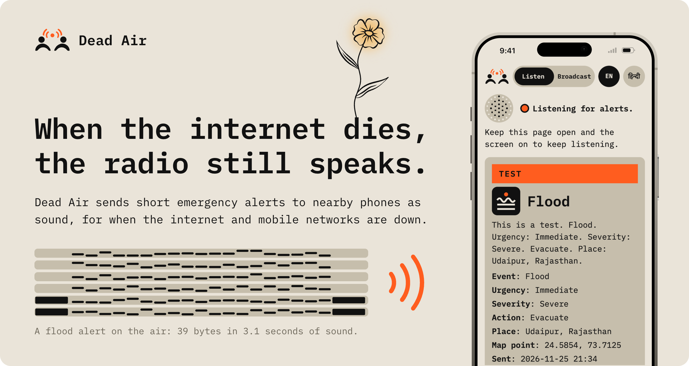
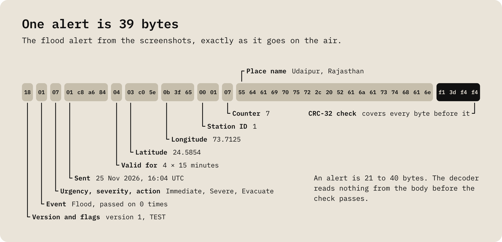
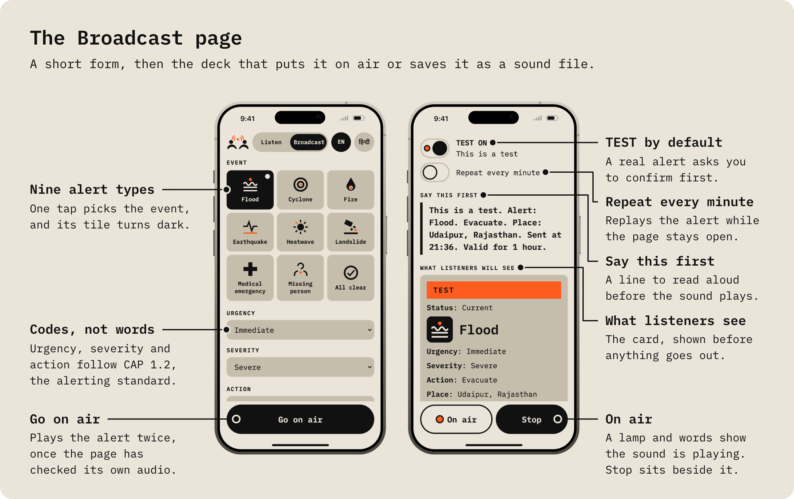
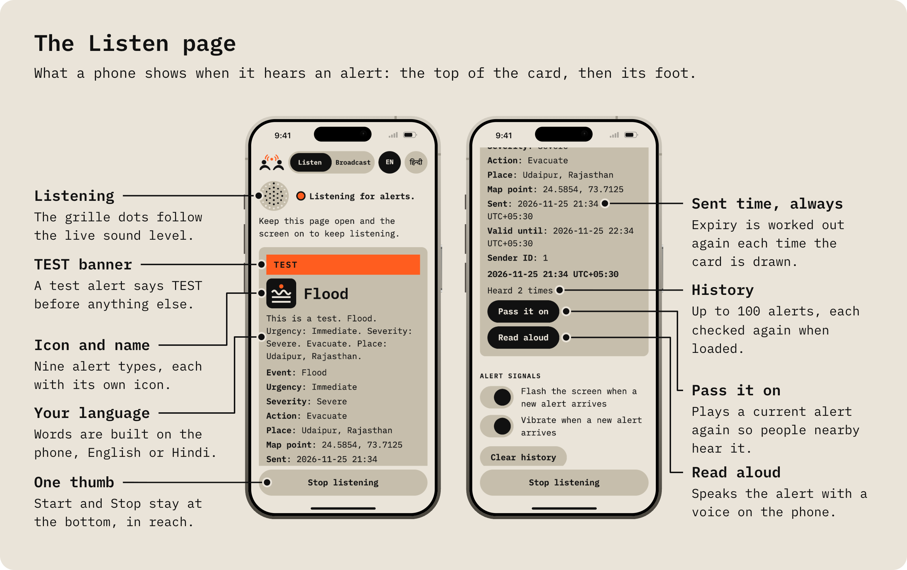
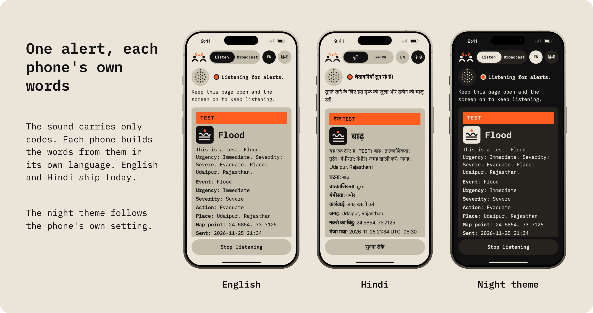

<picture>
  <source media="(prefers-color-scheme: dark)" srcset="docs/readme/cover-night.png">
  
</picture>

# Dead Air

Dead Air sends short emergency alerts from one device to nearby phones through sound. It is for moments when the internet and mobile networks are down but a speaker, a radio or a loudspeaker still works.

A sender fills in a short form and presses "Go on air". The device plays a few seconds of data-over-sound, the kind of screech an old modem made. A phone with the Listen page open hears it, checks it, and shows the alert in the listener's language.

It is an entry for Kiroween 2026, in the Resurrection category. The old technology it revives is the modem screech and data broadcast over radio.

It is a prototype and a backup channel. It does not replace official alerts.

<p align="center"></p>

## Try the live site

Site: https://deadair.vedasdixit.com

- `/` is the front page. It has the story, a "Play test alert" button and a QR code that opens the Listen page.
- `/listen/` is the Listen app.
- `/broadcast/` is the Broadcast app.

To try it with two devices:

1. On the phone, open `/listen/` while you still have a connection, so the page can be saved for offline use.
2. Press Start and allow the microphone.
3. On a laptop or second phone, open the front page and press "Play test alert", or open `/broadcast/`, choose an alert and press "Go on air".
4. Hold the devices a few metres apart. The alert appears on the phone with a TEST banner.

<p align="center"></p>

<sub>Screens are captures of the running app, placed in a phone frame for display. The status bar is drawn. The app has not been tried on iOS yet, see Known limits.</sub>

Every demo and sample alert is a TEST alert. The Broadcast page asks you to confirm before it sends one that is not.

## Run it locally

You need Node 24 (the deploy workflow uses 24).

```sh
npm install
npx vite
```

`npx vite` serves the site on `http://localhost:5173`. The microphone works on localhost and on https only. The service worker registers only in a production build, so to try offline use:

```sh
npm run build
npx vite preview
```

To build for a sub-path, such as `https://<user>.github.io/<repo>/`, set `BASE_PATH=<repo>` when you build. With no `BASE_PATH` the site is built for the root of a domain. No path is written into the code.

## Run the tests

```sh
npm test
npm run typecheck
```

`npm test` runs Vitest, with fast-check for the property tests. On 25 Nov 2026 it ran 190 test files and 1805 tests, all passing, in about 18 seconds. Some of those tests build the whole site.

Other checks:

- `npm run translations:check` checks that `docs/translation-check.md` matches the two language files.
- `npm run check:browser` loads the Broadcast page in headless Chrome. It needs Chrome installed, and it is not part of `npm test` or the deploy.
- `npm run build` also runs the offline check, which scans the built files for any request to another site and fails if it finds one.

The message code has three property tests: any alert survives encode then decode, any single changed byte is caught, and an expired alert is never reported as current.

## How it works

**Message code** (`src/message-code/`). An alert becomes 21 to 40 bytes and back. Fields follow CAP 1.2 (the Common Alerting Protocol) where a matching field exists: version and flags, event, urgency, severity and action, sent time to the minute in UTC, valid-for in steps of 15 minutes, map point, station ID and counter, an optional short place name, and a 4-byte CRC-32 over everything before it. The decoder rejects an unknown version or a failed check, and reads nothing from the body before the check passes. These are pure functions with no browser APIs.

<p align="center"></p>

**Sound link** (`src/sound-link/`). A wrapper around the [ggwave](https://github.com/ggerganov/ggwave) npm package. It turns bytes into audio and audio back into bytes, and does not read the bytes. Only the message code check may accept what the listener hears.

**Broadcast page.** A form, a "say this first" line for the sender to read aloud, Go on air, repeat every minute, and save as a sound file. Each alert is played twice, one second apart. Before anything plays, the page decodes its own audio in memory and compares it with what it meant to send.

<p align="center"></p>

**Listen page.** Microphone in, decode, check, show. The microphone is requested with echo cancellation, noise suppression and auto gain control turned off. Audio stays in memory and is dropped. A message that fails the check shows only "Heard something but could not read it". Every card shows the sent time, and expiry is worked out again on every render from the sent time, the valid-for period and the device clock. History (up to 100 cards) is kept in `localStorage` as message bytes, and each entry is checked again when it is loaded. A phone can also pass a current alert on by playing it again with one more hop.

<p align="center"></p>

**Offline.** A service worker saves every file the app needs on the first visit to any of the three pages, then serves from that copy. The only request the app makes is to its own address, to check for a new version. The Home Screen icon opens `/listen/`.

**Languages.** English and Hindi. The alert on the air is only codes, so each language builds its own words from them. Read aloud uses an on-device voice only.

<p align="center"></p>

**The look.** A mid-century radio: plain shapes, a speaker grille that shows the sound level, nine event icons, and one bundled font.

The six promises that never bend are in `.kiro/steering/promises.md`: no damaged alert shown, no expired alert shown as current, test alerts always marked TEST, no contact with other sites after the first load, microphone audio never kept, and an icon and text for every alert type in every shipped language.

## Built with Kiro

The work was done one spec at a time, in the order set in the brief: requirements, then design, then tasks, with approval between phases.

**Specs** (`.kiro/specs/`):

1. `message-code`
2. `sound-link`
3. `broadcast-page`
4. `listen-page`
5. `kiro-ears`
6. `offline`
7. `languages`
8. `radio-look`
9. `pass-it-on`
10. `front-page`
11. `front-sprout`

There is also `listen-grille-band-level`, a bugfix spec. Several specs end with a `report.md` that lists what was and was not checked.

**Steering** (`.kiro/steering/`). Six files: `product.md`, `promises.md`, `sound-rules.md`, `structure.md`, `tech.md` and `style-rules.md`. The first five came from `docs/brief.md`. `style-rules.md` loads only when interface files are open.

**Hooks** (`.kiro/hooks/`). "Run message code tests on save" runs `tests/message-code` when a file in `src/message-code/` is saved. "Run sprout tests on save" runs the sprout and front page tests when a sprout file, `index.html` or the front page script is saved.

**The ears server** (`tools/ears/`). A small local MCP server, `dead-air-ears`, that lets Kiro test Dead Air sound without a speaker or a phone. It has three tools:

- `make_broadcast` writes a TEST alert as a WAV file.
- `hear_wav` runs a WAV file through the Listen page decoder, with optional noise.
- `round_trip` makes a broadcast, adds noise, decodes it, and counts results over N tries.

It refuses any alert that is not a TEST alert, and a message that fails its check returns only its length and the reason. It is registered in `.kiro/settings/mcp.json`. To use it, run `npm run build:ears` and see `tools/ears/README.md`. It is a developer aid and is not part of the site build.

Results from the ears server use white noise added to clean audio. They are not a room.

| Noise (signal-to-noise) | Tries | Decoded | Wrong alerts |
|---|---|---|---|
| 0 dB | 20 | 20 | 0 |
| -10 dB | 20 | 19 | 0 |
| -15 dB | 20 | 0 | 0 |

At -6 dB it decoded 20 of 20, and at -12 dB 6 of 20. It also gave the measurements behind the speaker grille's pitch band (1800 to 6400 Hz).

**Diary.** `docs/kiro-diary.md` records the decisions, the problems found and what was not verified for each spec.

## How it was built

Kiro built the app, the tests and the page content from specs. I did the layout passes on the Listen, Broadcast and front pages by hand, with Claude Code. The English wording of the front page was also rewritten by me, and the flower on the front page is my own drawing.

At commit `ec31299`, `git rev-list --count HEAD` gives 31 commits, and `git log --grep="Co-Authored-By: Claude" --oneline | wc -l` gives 2. The count of 2 only counts commits that carry the trailer. An earlier hand layout commit (`9cdbfd9`) is described in the diary as done outside Kiro, but it has no trailer, so the trailer count is a floor and not the full amount of hand work.

## Field test results

All results are informal and were taken on 21 Nov 2026. The sender was a MacBook Pro M4 playing through its built-in speakers at full volume (about 85 dB). The listener was a Samsung Galaxy S25 Ultra, indoors, with some distant household noise. Each alert is played twice.

| Distance | Tries | Result |
|---|---|---|
| 8 ft (2.4 m) | Not counted | Both plays heard every time, no errors |
| 15 ft (4.6 m) | Not counted | Alerts received, but sometimes only one of the two plays was heard |
| 21 ft (6.4 m), next room through an open doorway | 4 | 3 of 4 alerts received, each on one play only |

Playing each alert twice is what kept alerts arriving when a single play was missed. Exact counts over 10 presses per distance were not done.

## Known limits

- **A phone listens only while the Listen page is open with its screen on.** A phone pauses a web page when the screen is off, so a phone in a pocket hears nothing. The page asks for a screen wake lock while it listens, which helps only while the page stays in view.
- Tested on one pair of devices (a MacBook and an Android phone), up to 21 ft, with household noise. Nothing was tried on Safari or iOS, on a real radio or loudspeaker, or in a loud room.
- The offline, language, read-aloud and Pass it on checks on real devices were written as steps and not run. Tests cover only part of each.
- The check catches damage. It does not prove who sent an alert. Anyone who can play sound near a listener can send an alert that passes.
- Expiry uses the phone's own clock. A wrong clock can make an alert look current for longer than it should. A clock that is more than 5 minutes behind the sent time shows a clock warning instead of "current".
- The Hindi text was written by a machine and no native speaker has checked it. `docs/translation-check.md` lists 316 entries, all marked as needing a human check. Only English and Hindi are shipped. Place names are shown exactly as sent and are not translated.
- Sound carries about 8 to 16 bytes per second, so an alert is 21 to 40 bytes and takes about 2 to 4 seconds to play. A far-off broadcast can decode without lighting the speaker grille.
- Read aloud needs an on-device voice for the language. Chrome on Android can list a voice whose language is not installed and then speak in English.
- A browser may clear the saved copy if the app is not used. Adding it to the Home Screen helps keep it.
- The "use my location" button on Broadcast asks the browser for a position. Whether the browser's own location service uses the network is up to the browser.
- The microphone works only on https or localhost.
- The front page links to other sites for its sources. Those are links the reader taps, not requests the page makes.

## Credits

- [ggwave](https://github.com/ggerganov/ggwave) by Georgi Gerganov, MIT licence. It carries the data in the sound.
- [IBM Plex Mono](https://github.com/IBM/plex), IBM, SIL Open Font License 1.1, through `@fontsource/ibm-plex-mono`.
- [qrcode-generator](https://github.com/kazuhikoarase/qrcode-generator) by Kazuhiko Arase, MIT licence.
- Common Alerting Protocol 1.2 (OASIS), which the message fields follow.
- Front page pictures. The two Cyclone Fani night views (30 April 2019 and 5 May 2019): NASA Earth Observatory (Lauren Dauphin), with Black Marble data from NASA Goddard and Landsat data from USGS. The acoustic coupler modem photo: secretlondon123, CC BY-SA 2.0, resized, from Wikimedia Commons. The phone illustration is AI-generated. Full lines and links are in `docs/design/front/credits.md`.
- README images. The pictures in `docs/readme/` were made with Claude Code from captures of the running app. The phone frame around the screens is a device mockup supplied by the owner, and the status bar in it is drawn.
- The flower on the front page is the owner's own drawing.
- Sources for every number and claim on the front page are linked next to it.
- Dev tools: Vite, Vitest, fast-check, TypeScript, and the Model Context Protocol SDK with zod for the ears server.

## Licence

MIT.

```
MIT License

Copyright (c) 2026 Vedas Dixit

Permission is hereby granted, free of charge, to any person obtaining a copy
of this software and associated documentation files (the "Software"), to deal
in the Software without restriction, including without limitation the rights
to use, copy, modify, merge, publish, distribute, sublicense, and/or sell
copies of the Software, and to permit persons to whom the Software is
furnished to do so, subject to the following conditions:

The above copyright notice and this permission notice shall be included in all
copies or substantial portions of the Software.

THE SOFTWARE IS PROVIDED "AS IS", WITHOUT WARRANTY OF ANY KIND, EXPRESS OR
IMPLIED, INCLUDING BUT NOT LIMITED TO THE WARRANTIES OF MERCHANTABILITY,
FITNESS FOR A PARTICULAR PURPOSE AND NONINFRINGEMENT. IN NO EVENT SHALL THE
AUTHORS OR COPYRIGHT HOLDERS BE LIABLE FOR ANY CLAIM, DAMAGES OR OTHER
LIABILITY, WHETHER IN AN ACTION OF CONTRACT, TORT OR OTHERWISE, ARISING FROM,
OUT OF OR IN CONNECTION WITH THE SOFTWARE OR THE USE OR OTHER DEALINGS IN THE
SOFTWARE.
```

Third-party licences are listed below.

## Font licence

The Listen and Broadcast pages use the IBM Plex Mono font, in two weights (400 and 600). It comes from the npm package `@fontsource/ibm-plex-mono`, version 5.3.0, and is bundled with the site. Nothing is loaded from another site.

IBM Plex Mono is licensed under the SIL Open Font License 1.1. The licence text ships with the built site at `fonts/ibm-plex-mono-LICENSE.txt`.

## QR code library

The front page draws its QR code with the npm package `qrcode-generator`, version 2.0.4, by Kazuhiko Arase. It is bundled with the site and makes no network request. The package is licensed under the MIT licence. It is also named in `docs/design/front/credits.md`.
