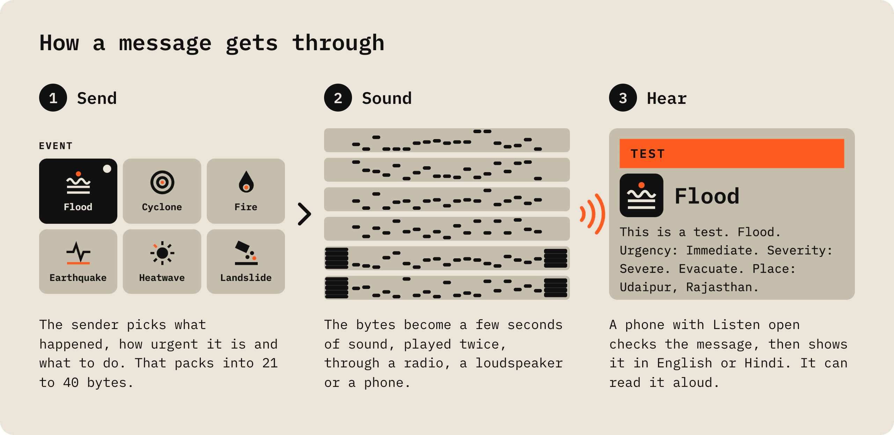
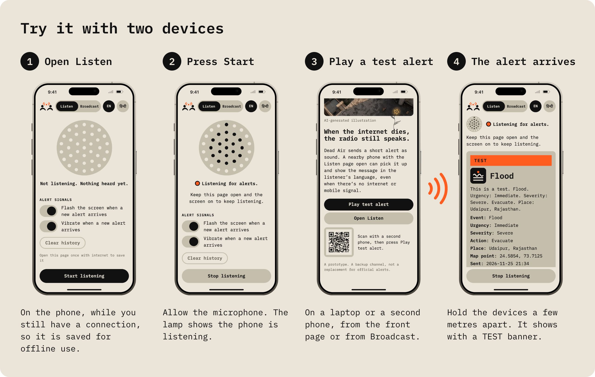

<picture>
  <source media="(prefers-color-scheme: dark)" srcset="docs/readme/cover-night.png">
  
</picture>

# Dead Air

**When the internet dies, the radio still speaks.**

[Live site](https://deadair.vedasdixit.com) · [Documentation](DOCUMENTATION.md) · Demo video (coming soon) · Devpost (coming soon)

## What it is

Dead Air sends short emergency alerts from one device to nearby phones through sound. It is for moments when the internet and mobile networks are down but a speaker, a radio or a loudspeaker still works. It revives the modem screech and data broadcast over radio, as an entry for Kiroween 2026 in the Resurrection category. It is a prototype and a backup channel. It does not replace official alerts.

## Try it in a minute

1. On the phone, open [`/listen/`](https://deadair.vedasdixit.com/listen/) while you still have a connection, so the page can be saved for offline use.
2. Press Start and allow the microphone.
3. On a laptop or second phone, open the [front page](https://deadair.vedasdixit.com) and press "Play test alert", or open [`/broadcast/`](https://deadair.vedasdixit.com/broadcast/), choose an alert and press "Go on air".
4. Hold the devices a few metres apart. The alert appears on the phone with a TEST banner.

Screens are captures of the running app, placed in a phone frame for display. The status bar is drawn. The app has not been tried on iOS yet, see <a href="#known-limits">Known limits</a>.

Every demo and sample alert is a TEST alert. The Broadcast page asks you to confirm before it sends one that is not.

## Built with Kiro

I built it one spec at a time: requirements, then design, then tasks, with approval between phases.

- **12 specs** in `.kiro/specs/`: `message-code`, `sound-link`, `broadcast-page`, `listen-page`, `kiro-ears`, `offline`, `languages`, `radio-look`, `pass-it-on`, `front-page`, `front-sprout`, and the bugfix spec `listen-grille-band-level`.
- **6 steering files** in `.kiro/steering/`: `product.md`, `promises.md`, `sound-rules.md`, `structure.md` and `tech.md` came from the brief, and `style-rules.md` loads only for interface files.
- **2 hooks** in `.kiro/hooks/`: one runs the message code tests when a message code file is saved, the other runs the sprout and front page tests when a sprout file, `index.html` or the front page script is saved.
- **The ears server** (`tools/ears/`), a local MCP server that lets Kiro test the sound without a speaker or a phone. In white noise it decoded 20 of 20 at 0 dB, 19 of 20 at -10 dB and none at -15 dB, with no wrong alerts.
- **The diary**, [`docs/kiro-diary.md`](docs/kiro-diary.md), records the decisions, the problems found and what was not verified for each spec.

Full details: [Built with Kiro in DOCUMENTATION.md](DOCUMENTATION.md#built-with-kiro).

## How it was built

Kiro built the app, the tests and the page content from specs. I did the layout passes on the Listen, Broadcast and front pages by hand, with Claude Code. I made the README images in `docs/readme/` the same way, with Claude Code from captures of the running app. The English wording of the front page was also rewritten by me, and the flower on the front page is my own drawing.

At commit `effdeda`, `git rev-list --count HEAD` gives 32 commits, and `git log --grep="Co-Authored-By: Claude" --oneline | wc -l` gives 2. The count of 2 only counts commits that carry the trailer. Two hand commits have no trailer: an earlier layout commit (`9cdbfd9`), described in the diary as done outside Kiro, and the README images commit (`effdeda`). So the trailer count is a floor and not the full amount of hand work.

## Tested so far

Informal tests on 21 Nov 2026. A MacBook Pro M4 sent through its built-in speakers at full volume (about 85 dB). A Samsung Galaxy S25 Ultra listened, indoors, with some distant household noise. Each alert is played twice.

| Distance | Tries | Result |
|---|---|---|
| 8 ft (2.4 m) | Not counted | Both plays heard every time, no errors |
| 15 ft (4.6 m) | Not counted | Alerts received, but sometimes only one of the two plays was heard |
| 21 ft (6.4 m), next room through an open doorway | 4 | 3 of 4 alerts received, each on one play only |

Not tested yet: Safari or iOS, a real radio or loudspeaker, a loud room, and the real-device checks for offline, languages, read aloud and Pass it on.

## Known limits

- **The screen must stay on.** A phone listens only while the Listen page is open with its screen on, because a phone pauses a web page when the screen is off.
- **It cannot prove who sent an alert.** The check catches damage. Anyone who can play sound near a listener can send an alert that passes.
- **Only one pair of devices was tested:** a MacBook and an Android phone, up to 21 ft.
- **No person has checked the Hindi.** It was written by a machine, and all 316 entries still need a native speaker's check.

The full list is in [Known limits in DOCUMENTATION.md](DOCUMENTATION.md#known-limits).

## Run it

You need Node 24.

- `npm install` installs the dependencies.
- `npx vite` serves the site on `http://localhost:5173`. The microphone works on localhost and on https only.
- `npm test` runs the tests with Vitest and fast-check.

Building, offline preview and the other checks: [Running and testing](DOCUMENTATION.md#running-and-testing).

## Credits and licence

Sound by [ggwave](https://github.com/ggerganov/ggwave) (MIT). Font [IBM Plex Mono](https://github.com/IBM/plex) (SIL Open Font License 1.1, from `@fontsource/ibm-plex-mono` 5.3.0). QR code by [qrcode-generator](https://github.com/kazuhikoarase/qrcode-generator) (MIT). Front page pictures from NASA Earth Observatory and Wikimedia Commons. [Full credits](DOCUMENTATION.md#credits).

MIT, see [LICENSE](LICENSE).

Made with love by <a href="https://vedasdixit.com">Vedas Dixit</a> for Kiroween 2026.

