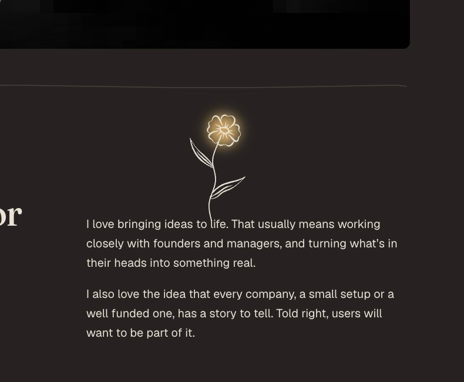
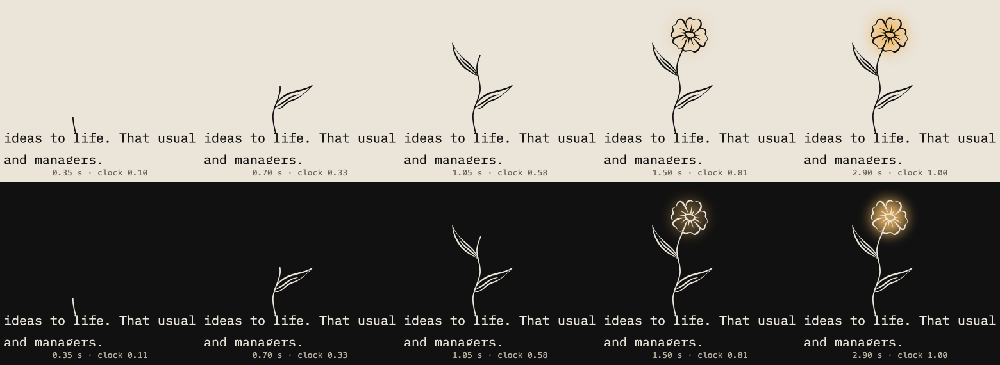

# Sprout: a flower that grows out of a word

A hand-drawn flower grows up out of one word on the page. A stem draws itself up from the top of the word's first letter, two leaves open, the head opens, and a warm glow comes up behind the head. It takes 2.8 seconds and starts once the whole plant is on screen. When the plant has left the screen it resets, so it grows again on the way back. With reduced motion the finished flower is simply there.

It is the same flower that grows out of the "l" of "life" on the author page of blog.vedasdixit.com.

| What it looks like on the blog | How it grows, in both themes |
|---|---|
|  |  |

`sprout.svg` is the finished drawing on its own. The orange dot marks the root, the point that sits on the top of the letter.

Spec: `.kiro/specs/front-sprout/`. Rule exception: `.kiro/steering/style-rules.md`, "Exception: the front page sprout".

---

## The files

Everything the page needs is in `kit/`. It is finished, tested code. Copy it, do not rewrite it.

| Kit file | Copy to | What it is |
|---|---|---|
| `kit/sprout-drawing.ts` | `src/front/sprout-drawing.ts` | The flower as data. Never edit by hand. |
| `kit/sprout-ink.ts` | `src/front/sprout-ink.ts` | Finds the top of a letter's ink. Pure, no browser API. |
| `kit/dom/sprout.ts` | `src/front/dom/sprout.ts` | Draws the flower, places it on the letter, starts and resets the growth. |
| `kit/sprout.css` | `src/front/sprout.css` | Places and animates the drawing. The only stylesheet the rule exception covers. |
| `kit/tests/sprout-ink.property.test.ts` | `tests/front/` | Property tests for the ink finder. |
| `kit/tests/sprout-drawing.test.ts` | `tests/front/` | Checks on the drawing data. |
| `kit/tests/sprout-css.test.ts` | `tests/front/` | Lint for `sprout.css`. |
| `kit/tests/sprout-markup.test.ts` | `tests/front/` | Checks the anchor in `index.html` and the wiring in `main.ts`. |

Keep the folders as they are (`dom/sprout.ts` goes in `src/front/dom/`). The imports then work without any change.

Other files here, which are not copied:

| File | What it is for |
|---|---|
| `preview.html` | Try the flower on any word. Run `npx vite` in the project root and open `http://localhost:5173/docs/design/sprout/preview.html`. |
| `sprout.svg` | The finished drawing, to look at. |
| `reference-blog.png`, `storyboard.png` | What it should look like. |
| `export-from-blog.mjs` | Rebuilds `kit/sprout-drawing.ts` from the blog. Only if the flower changes there. |

---

## Put it on a word

This is the whole job. Do the steps in order.

### Step 1. Check the word

The owner names the word. Before you change anything, check these four things. If one fails, stop and tell the owner which one.

1. **The word starts on the first line of its block** (its heading or paragraph) at the screen widths that matter: 360, 390, 768 and 1280 px wide. The plant grows upward, so on a later line it would grow over the line above. The code hides the flower wherever the word is not on the first line, so nothing breaks, but the flower will not be seen there.
2. **There is room above the word.** The plant is as tall as `--sprout-height` (Step 5). It may grow over space, a margin or a picture. It is drawn on top of whatever is there, and it never takes clicks.
3. **The word is not inside an element with `data-text`, unless it is that element's only text.** A language switch replaces the whole content of a `data-text` element, which would delete the anchor. If the word is alone in its `data-text` element (like `<span id="dies" data-text="front.s1.h.dies">dies</span>`), that is fine: the anchor goes outside it. If the word shares a `data-text` element with other words, the text must be split into its own key first. That is a language-file change: ask the owner.
4. **The word is not too close to the left edge of the screen.** The left leaf reaches about 0.2 times the plant's height to the left of the letter, and the right leaf about 0.3 times to the right. At the start of a line on a phone, with a 16 px gutter, keep the plant 80 px tall or less, or accept a clipped leaf.

### Step 2. Copy the kit

From the project root:

```sh
cp docs/design/sprout/kit/sprout-drawing.ts docs/design/sprout/kit/sprout-ink.ts docs/design/sprout/kit/sprout.css src/front/
cp docs/design/sprout/kit/dom/sprout.ts src/front/dom/
cp docs/design/sprout/kit/tests/*.ts tests/front/
```

### Step 3. Put the anchor in `index.html`

The anchor is an empty span, straight before the word, inside a host span that wraps both. Write it exactly like this, on one line, with no space or line break between the anchor and the word:

```html
<span class="sprout-host"><span class="sprout" data-sprout aria-hidden="true"></span>WORD</span>
```

**If the word is its own element** (the usual case on this page), wrap that element and leave it untouched:

```html
<!-- before -->
<span id="dies" data-text="front.s1.h.dies">dies</span>
<!-- after -->
<span class="sprout-host"><span class="sprout" data-sprout aria-hidden="true"></span><span id="dies" data-text="front.s1.h.dies">dies</span></span>
```

**If the word is plain text** inside an element without `data-text`, wrap just the word, plus any punctuation stuck to it:

```html
<p>I love bringing ideas to <span class="sprout-host"><span class="sprout" data-sprout aria-hidden="true"></span>life.</span> That usually means ...</p>
```

To grow from a letter other than the first, add `data-sprout-letter` straight after `data-sprout`, counting from 0. For example, `data-sprout data-sprout-letter="1"` grows from the dot of the "i" in "dies".

### Step 4. Wire it in `src/front/main.ts`

Add three lines, each in its place:

```ts
import './front.css';
import './sprout.css';                          // add, after the front.css import

import { mountQr } from './dom/qr-svg';
import { mountSprouts } from './dom/sprout';    // add, with the other ./dom imports

mountHowScene(document);
mountSprouts(document);                         // add, after mountHowScene
```

Do not link `sprout.css` from `index.html`. The script loads it, and without the script there is no flower.

### Step 5. Size it

The plant's height is `--sprout-height`. The default is 9.5em of the word's own text size, the blog's proportion for body text (190 px at 20 px text). For body text, leave it.

For a headline, add one rule to the "Placement on this site" part at the end of `src/front/sprout.css`, on the headline's own class. Never in `front.css`: a test keeps the flower out of it.

```css
.hero-title {
  --sprout-height: 3.5em;
}
```

3.5em gives a plant about 170 px tall on the front page headline at full width. Between 3em and 4em looks right for a headline.

### Step 6. Run the checks

```sh
npm run typecheck
npm test
npm run build
grep -l sprout dist/assets/*.js
```

All three commands must pass. The `grep` must list only the front page bundle (`main-*.js`), never `listen` or `broadcast`.

### Step 7. Look at it in a real browser

The owner does this, with `npx vite`:

- [ ] The stem starts on the top of the letter, not beside it or above it, in English and in Hindi. Switch language without reloading.
- [ ] It grows once the plant is on screen, and again after scrolling away and back.
- [ ] Light and dark theme. Over a photo, the light theme's dark lines can sink into dark parts of the picture.
- [ ] 360, 390, 768 and 1280 px wide. Where the word wraps to a later line, there is no flower, and no stray mark.
- [ ] Reduced motion on (macOS: System Settings, Accessibility, Display, Reduce motion): the finished flower shows, and nothing moves.
- [ ] Text at 200 percent: the flower stays on the letter.
- [ ] Buttons and links near the plant still take clicks.

---

## Knobs

Set them in `src/front/sprout.css`, "Placement on this site", on the block's class, or on `.sprout`.

| Knob | Default | What it does |
|---|---|---|
| `--sprout-height` | `9.5em` | How tall the plant is. In em of the word's text, so it follows the text size. |
| `--sprout-time` | `2.8s` | How long the growth takes. The blog's author asked for slow growth. Do not go under 2.5s. |
| `--sprout-glow` | `0.85` | Strength of the warm glow behind the head, 0 to 1. |
| `data-sprout-letter="N"` | first letter | On the anchor in `index.html`: which letter of the word to grow from, counting from 0, spaces not counted. |

---

## How it works

Read this only to debug.

**The drawing.** `sprout-drawing.ts` holds five marks in a 180 by 190 box: the stem (a path), two leaves and the head (groups of paths), and the glow (a blurred circle). The root, where the stem starts, is at (84, 186). Every mark has a start `s` and a length `dur` on one growth clock that runs from 0 to 1. The stem draws from 0 to 0.68, the leaves open at 0.19 and 0.44, the head at 0.65, and the glow last, at 0.76.

**The clock.** `--grow` is a registered CSS number. Its default is 1, so the finished flower is what shows before the script runs and under reduced motion. The script sets `data-grown="false"` (the clock snaps to 0, which empties the drawing), then `data-grown="true"` once the plant is on screen. A CSS transition then runs `--grow` from 0 to 1 over `--sprout-time`. Each mark turns the clock into its own 0 to 1 with `clamp((p - s) / dur)`: the stem's dash offset, the leaves' and head's scale, the glow's opacity.

**The root on the letter.** The anchor is a zero-size box on the baseline, just before the word. The script draws the chosen letter big (200 px) on a canvas in the word's own font, finds the topmost row of ink and the middle of the ink across the next few rows, then moves 2 percent of the size down into the stroke. That gives `--lx` (em across from the anchor) and `--ly` (em up from the baseline), set on the anchor. CSS places the drawing so its root lands there. Because it is in em, it follows any text size. It is measured again when any text in the block changes (a language switch), when the block changes size, and once the fonts have loaded.

**On screen.** The drawing's box is wider than the plant, and near the left edge of a phone part of the box hangs off screen. So "on screen" is judged on an invisible 1 px strip from the root to the top of the drawing (`.sprout-probe`): the plant grows when 98 percent of that strip is on screen above the bottom 12 percent of the window (or, for a plant taller than that, when it fills that space), and resets when none of it is on screen.

**First line only.** If the chosen letter is lower than the block's first character by more than half a line, the anchor gets `data-sprout-line="later"` and its drawing is hidden.

---

## When it goes wrong

| What you see | Why | Fix |
|---|---|---|
| No flower anywhere | `mountSprouts(document)` not called, or `sprout.css` not imported | Step 4 |
| Flower vanishes after switching language | The anchor is inside a `data-text` element | Move it outside, Step 3 |
| Flower floats beside or above the word | Space or line break between the anchor and the word, or the anchor is not straight before the word | Write the markup on one line, Step 3 |
| Flower is there on desktop, missing on a phone | The word wraps to a later line on a phone. This is on purpose. | Choose a word that stays on the first line, or accept it |
| Flower is huge | Headline with the default size | `--sprout-height`, Step 5 |
| Flower never grows, stays empty | The page scrolls inside an element instead of the window (not the case on this site today) | Give both observers in `dom/sprout.ts` that element as `root` |
| `front-css.test.ts` fails on "filter" or "blur" | Sprout rules were put in `front.css` | Move them to `sprout.css` |
| `sprout-markup.test.ts` fails | Anchor markup not exactly as in Step 3 (attribute order, extra space, extra attribute) | Copy the Step 3 markup again |

---

## Do not

- Do not redraw, simplify or edit the flower. It is the owner's own drawing. If it changes, it is regenerated from the blog.
- Do not add a library or load anything from another site (promise 4).
- Do not put sprout rules in `front.css` or `look.css`, or load the sprout on Listen or Broadcast.
- Do not add a second animation, a loop, or anything that moves outside `prefers-reduced-motion: no-preference`.
- Do not change the word's text, its `data-text` key or its `id`.

---

## Where the drawing comes from

The flower is one of Vedas Dixit's own drawings. On the blog (`blogdotcom` repository) its parts are cut from the drawing by `scripts/flower-parts.mjs` into `components/author/flower-parts.json`, and `components/author/flowers.ts` grows it on one stem (`SPROUT_MARKS`, built by `grow.ts` with no random wobble, so it comes out the same every time). `export-from-blog.mjs` reads those exact numbers and writes `kit/sprout-drawing.ts`:

```sh
node docs/design/sprout/export-from-blog.mjs ../../blogdotcom
cp docs/design/sprout/kit/sprout-drawing.ts src/front/sprout-drawing.ts
npm test
```
